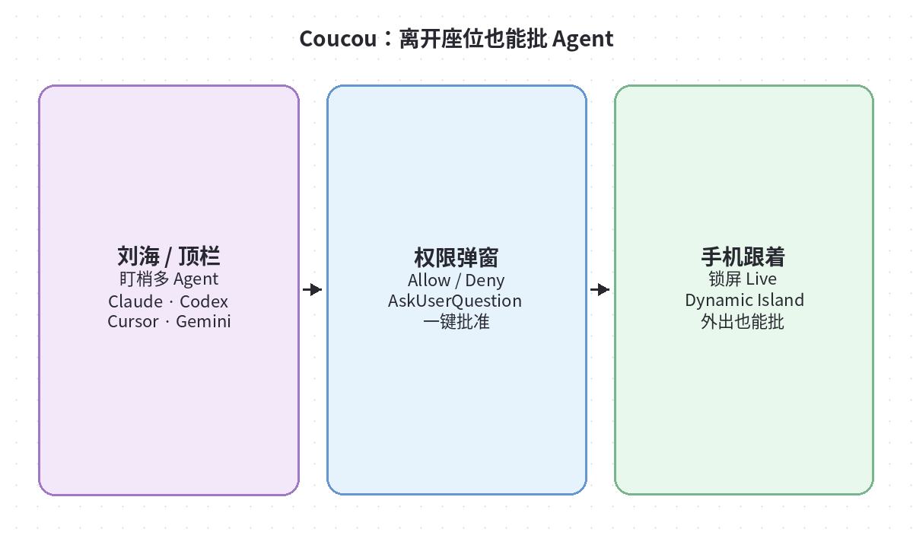
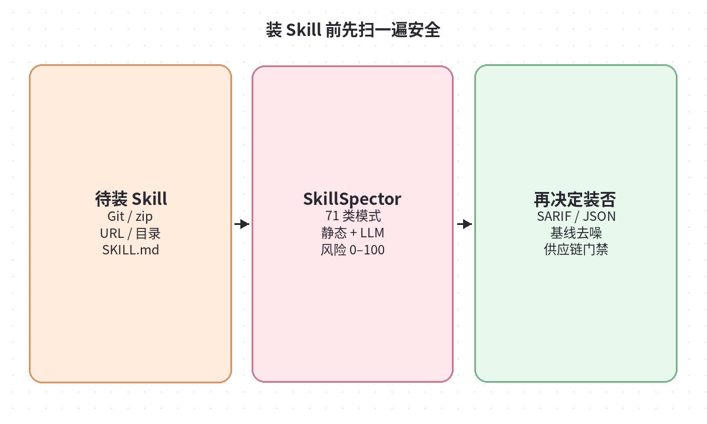
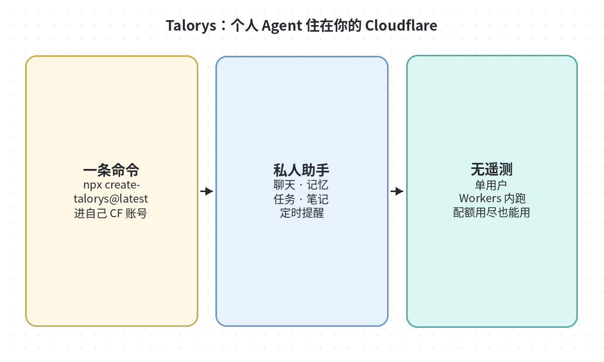
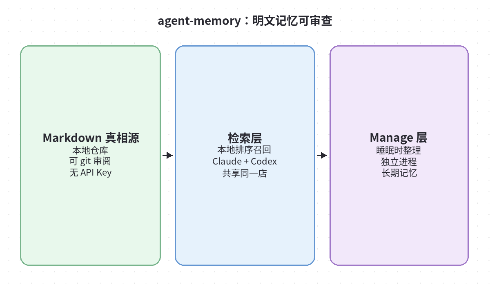
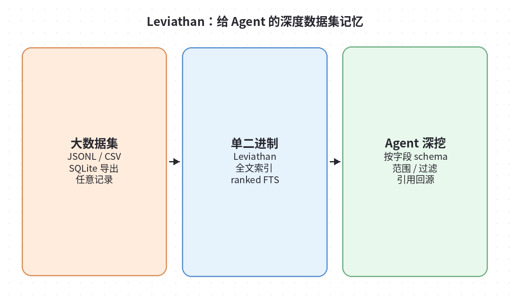

# 2026-10-12 GitHub 日报

今日精选 5 个值得动手跟进的开源项目（偏 Agent 运维 / 安全 / 记忆与个人助手）。与当日周报条目不重复。

## 1. Louis-CFM/coucou — 刘海 / 锁屏里盯梢并批准 Coding Agent

**介绍**  
开源的「缺口伙伴」Mochi：住在 Mac 刘海（无缺口则顶栏），也覆盖 Windows/Linux 顶栏与 iPhone/Android。实时看 Claude Code、Codex、Cursor、Gemini CLI 等会话在读改什么，权限请求可在刘海或锁屏上一键 Allow/Deny，离开座位也能批。

**用法**  
仓库：[github.com/Louis-CFM/coucou](https://github.com/Louis-CFM/coucou)。从 Releases 装对应平台构建；macOS 在 Settings → Agents 打开需要的 agent 与 Plan usage。任意 agent 可用 hook payload 打上 `coucou_agent` 自建 pill（见 `docs/AGENTS.md`）。

**应用场景**  
多终端并行跑 coding agent、经常被权限弹窗打断、或人在别处仍要批工具调用的开发者。

**推荐学习程度**：入门

---

## 2. NVIDIA/SkillSpector — 装 Agent Skill 前的安全扫描器

**介绍**  
NVIDIA 开源的 AI agent skill 安全扫描仪：在 Claude Code / Codex / MCP skill 安装前做静态分析（可选 LLM 语义评估），覆盖提示注入、外泄、供应链等 71 类模式，输出 0–100 风险分与 SARIF/JSON/Markdown。研究子集里约 26% skill 有漏洞、约 5% 疑似恶意。

**用法**  
仓库：[github.com/NVIDIA/SkillSpector](https://github.com/NVIDIA/SkillSpector) · 文档：[docs.nvidia.com/skills/scanning-agent-skills](https://docs.nvidia.com/skills/scanning-agent-skills)。`uv tool install git+https://github.com/NVIDIA/skillspector.git` 后对 git/URL/zip/目录扫描；也可 Docker/`make install`。支持基线抑制误报。

**应用场景**  
团队要统一 skill 准入、从公共市场批量试装 skill、或把扫描挂进 CI / Pi / OpenCode 扩展。

**推荐学习程度**：进阶

---

## 3. rociiu/talorys — 一条命令把个人 Agent 部署进自己的 Cloudflare

**介绍**  
10/10 前后开源的个人 AI 助手：聊天、可编辑记忆、任务/笔记/项目、Durable Object 定时提醒与例程，全部跑在**你自己的** Cloudflare 账号里；单用户、无遥测、无开发者侧服务器。Workers AI 配额用尽时任务/笔记等仍可用。

**用法**  
仓库：[github.com/rociiu/talorys](https://github.com/rociiu/talorys)。`npx create-talorys@latest` 按向导绑定 Cloudflare；可选 `--semantic` 开语义召回。安装器设置 owner 密码，无注册流。

**应用场景**  
想要「真·自托管个人助理」、又不想维护 VPS/数据库的人；适合先当笔记+提醒底座再接更强模型。

**推荐学习程度**：入门

---

## 4. tigerless-labs/agent-memory — Markdown 为真相源的长期记忆运行时

**介绍**  
面向 coding agent 的长期记忆：明文 Markdown 存事实，本地排序召回，另有独立「睡眠时」Manage 层整理；Claude Code 与 Codex 可共享同一 store，默认不需要 API Key。强调可 git 审查、索引可重建。

**用法**  
仓库：[github.com/tigerless-labs/agent-memory](https://github.com/tigerless-labs/agent-memory)。需 Python 3.12+ 与 uv：`git clone` 后 `uv sync --all-packages`，把 `.venv/bin` 加 PATH。`mem init` → `mem setup --host claude-code`（或 `codex`）；`mem doctor` 验 READY。

**应用场景**  
多会话/多工具要共享决策记忆、讨厌黑盒向量库、希望记忆文件可 PR review 的团队。

**推荐学习程度**：进阶

---

## 5. elstongun/leviathan — 大数据集上的 Agent 深度记忆（单二进制）

**介绍**  
Rust 单二进制：把 JSONL/JSON/CSV/SQLite（或任意 DB CLI 导出）建成排序全文索引；agent 用自然语言问，拿回短卡片+引用（基准约每问 ~450 token，而不是 grep 整库）。可选 MCP。Apache-2.0。

**用法**  
仓库：[github.com/elstongun/leviathan](https://github.com/elstongun/leviathan)。`cargo install leviathan-index` 或 Releases 预编译；在数据目录 `leviathan index`，再 `leviathan search -g <组> "问题"`。用 schema 映射 `id/title/text/group/date` 等字段。

**应用场景**  
客服工单、运维日志、百万级业务记录要给 agent「少 token 却有出处」的检索，而不是塞进上下文。

**推荐学习程度**：进阶
