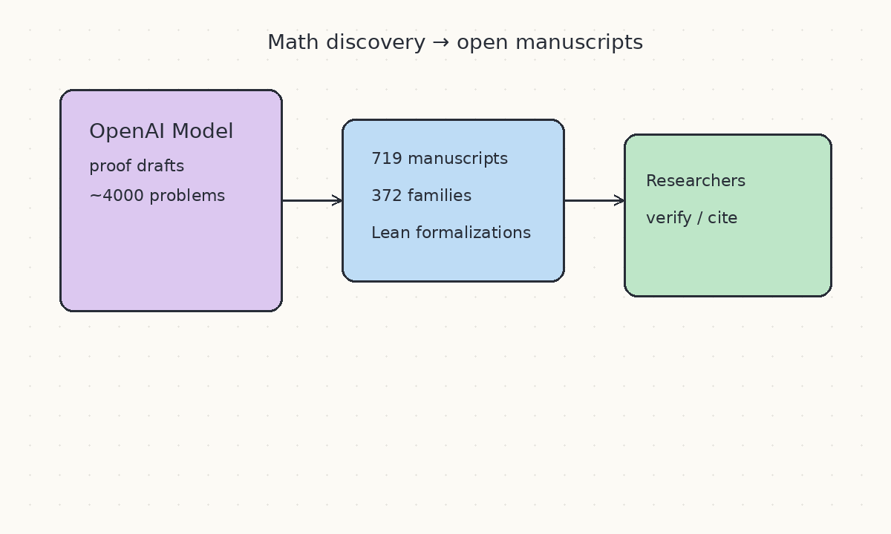
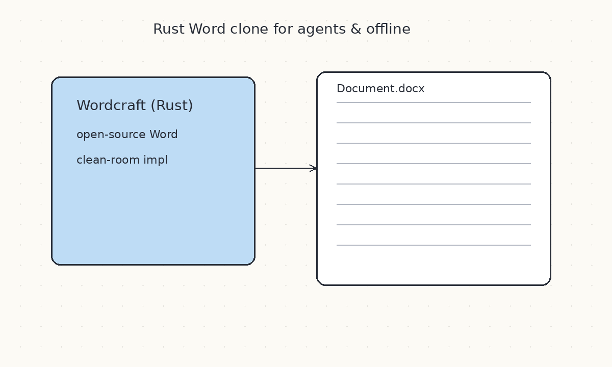
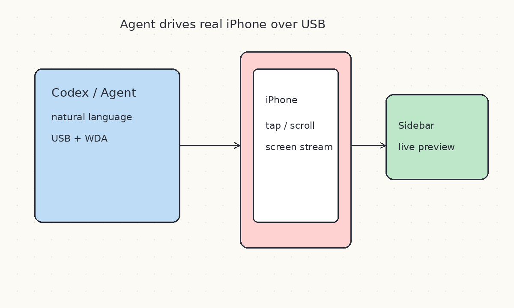
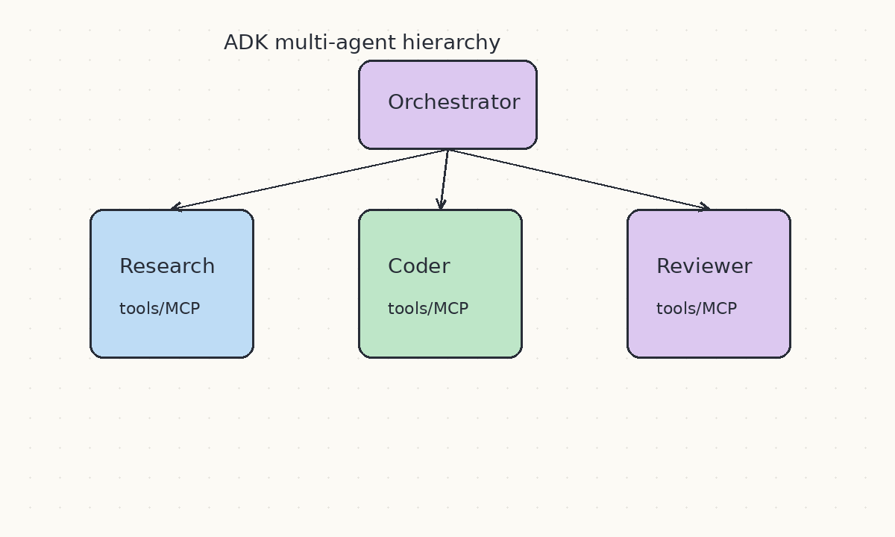
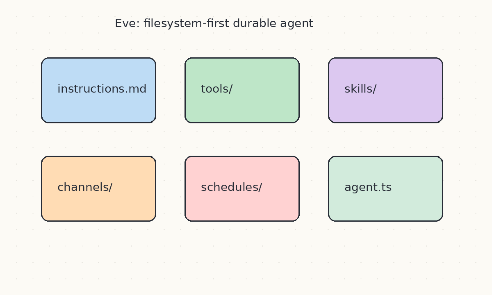
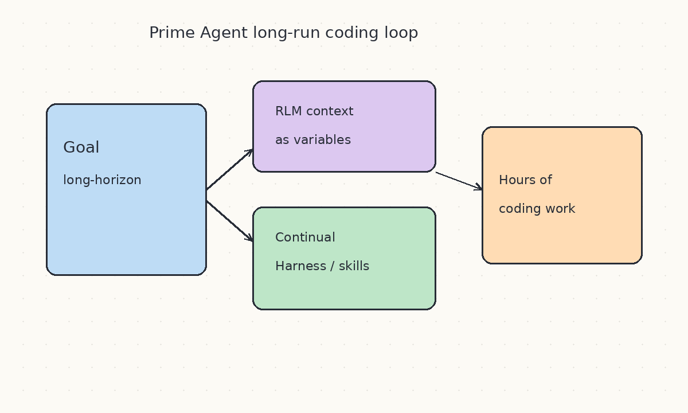
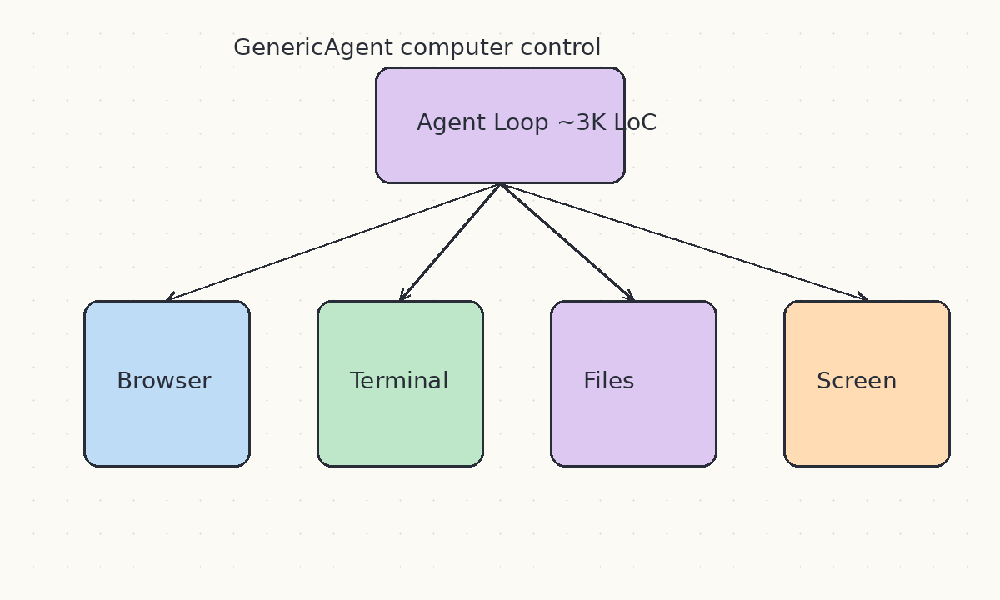
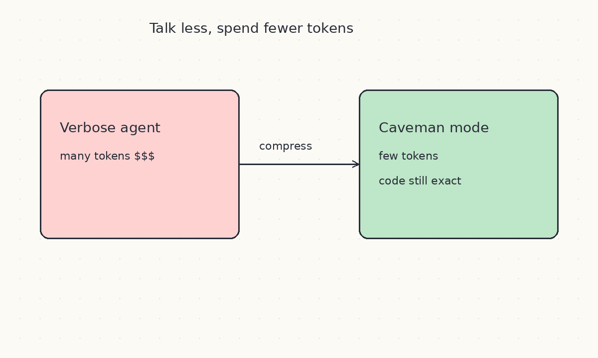
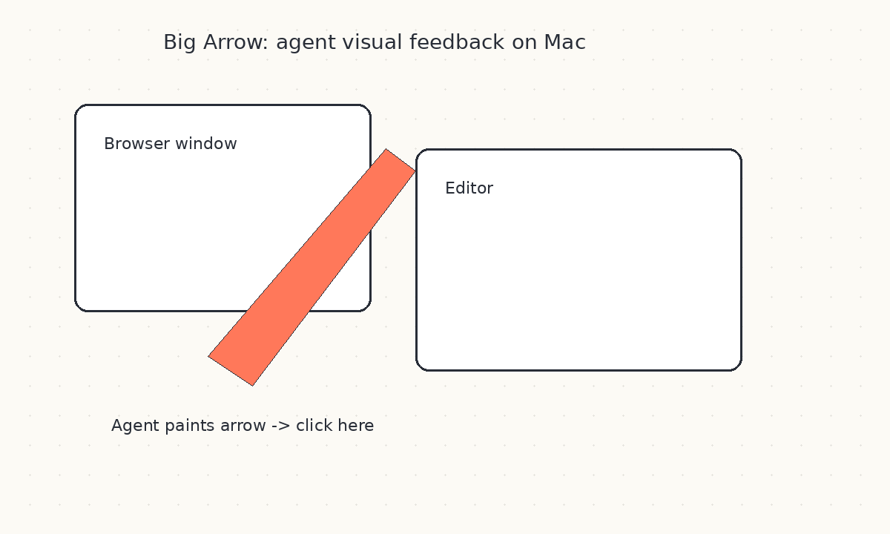
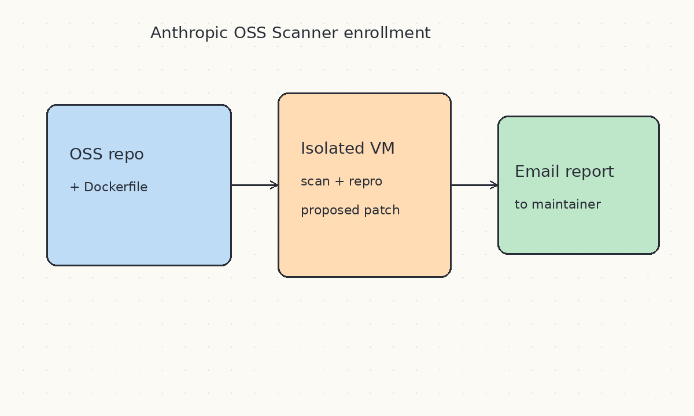

# 2026-10-12 GitHub 周报

上周（10/5–10/11）精选 10 个值得跟进的开源项目（偏 Agent / 工程实践 / 本周新锐）。

## 1. openai/math — 模型数学手稿与 Lean 形式化开放库

**介绍**  
OpenAI 于 10/6 前后开源的数学成果库：内部模型在约 4000 道开放研究问题上跑出的手稿与证明材料，目前整理为 719 篇稿、372 个主题家族，并持续补 Lean 形式化（约 42% 顶线结果已形式化）。把「模型会不会做真数学」从评测分数变成可审阅的论文与证明资产。

**用法**  
仓库：[github.com/openai/math](https://github.com/openai/math)  
先读 [overview.pdf](https://github.com/openai/math/blob/main/overview.pdf) 与 [CONTENTS.md](https://github.com/openai/math/blob/main/CONTENTS.md) 定位家族；需要机器可检证明时看 `lean/` 与 [formalization.yaml](https://github.com/openai/math/blob/main/lean/formalization.yaml)。引用请用各稿目录内的 BibTeX。

**应用场景**  
跟踪前沿定理证明能力、做形式化验证对照、为定理证明 / Lean agent 准备语料与基准。

**推荐学习程度**：深度

---

## 2. storytold/wordcraft — 纯 Rust 洁室重写的 Word

**介绍**  
10/7 现身并快速冲星的 ArtCraft 系列新成员：在纯 Rust 中洁室重实现 Microsoft Word 风格文字处理。与同周的 EffectCraft / DesignCraft / GridCraft 等一起，反映「把办公套件拆成可审计、可本地跑的开源实现」的趋势，也方便 coding agent 在无专有二进制的环境下操作文档。

**用法**  
仓库：[github.com/storytold/wordcraft](https://github.com/storytold/wordcraft)  
按 README 用 Rust 工具链构建；适合先跑通打开/编辑/导出链路，再接到 agent 的文档工具层。

**应用场景**  
本地离线文档自动化、agent 读写 docx 的沙箱替代、研究办公格式互操作。

**推荐学习程度**：进阶

---

## 3. zhongerxin/iPhone-use — 让 Codex 用 USB 操作真机 iPhone

**介绍**  
10/6 起热度很高的 macOS 插件：通过 WebDriverAgent + 本地 MCP，让 Codex 用自然语言点 App、滚动、输入，并在侧边栏实时看手机画面；控件定位失败时会引导模型看截图再坐标点击。把「电脑控制 agent」推进到真实 iOS 设备。

**用法**  
仓库：[github.com/zhongerxin/iPhone-use](https://github.com/zhongerxin/iPhone-use)  
需 macOS、完整 Xcode、可签名的 Apple 开发团队与 USB 真机；按 README 提示词让 Codex 跑 `scripts/install.sh`，再走 `iphone-use-setup` skill，直到 `pua_ready`。可用 `IPHONE_USE_ANALYTICS=0` 关闭匿名埋点。

**应用场景**  
iOS App 冒烟/回归、真实机上的表单与权限流、agent 驱动的移动端验收。

**推荐学习程度**：进阶

---

## 4. google/adk-python — Google Agent Development Kit

**介绍**  
本周仍高频更新的 code-first Python Agent 工具包：用普通软件工程方式定义 agent、工具与编排，支持多智能体层次、MCP/OpenAPI、评估与部署。模型无关，可对接 Gemini 以外运行时——适合当作「企业可测试 agent」基线。

**用法**  
仓库与文档：[github.com/google/adk-python](https://github.com/google/adk-python) · [ADK Docs](https://google.github.io/adk-docs/)  
用 Python 定义 agent 与 tools，本地跑通后再部署到 Cloud Run / Vertex Agent Engine。

**应用场景**  
企业级多智能体工作流、需要可版本化 agent 逻辑、把现有 OpenAPI/MCP 接到 agent。

**推荐学习程度**：进阶

---

## 5. vercel/eve — 文件系统优先的持久 Agent 框架

**介绍**  
Vercel 开源 Agent 框架（beta）：核心能力落在约定目录——`instructions.md`、`tools/`、`skills/`、`channels/`、`schedules/`，项目可检视、可扩展，偏「可运维的 durable agent」。本周仍持续推送。

**用法**  
[github.com/vercel/eve](https://github.com/vercel/eve) · [eve.dev](https://eve.dev)  
`npx eve@latest init my-agent` 后，在 `agent/tools/` 加 TypeScript 工具，在 `agent/agent.ts` 选模型即可；文档可在 `node_modules/eve/docs` 本地阅读。

**应用场景**  
带定时任务/多通道的长期 agent 产品，或希望 agent 配置像普通仓库一样 review。

**推荐学习程度**：进阶

---

## 6. PrimeIntellect-ai/prime-agent — RLM + 持续 Harness 的长程编码 Agent

**介绍**  
面向长程编码与研究的开源 agent：Recursive Language Model（上下文当变量、子 agent 当可编程调用）+ Continual Harness（记忆、skill、子 agent 规格可沉淀）。适合「跑很久」而不是单轮问答，本周仓库仍活跃。

**用法**  
[github.com/PrimeIntellect-ai/prime-agent](https://github.com/PrimeIntellect-ai/prime-agent)  
按 README 安装后用 TUI；可用 `/goal`、`/autonomous`、心跳与调度做跨会话目标与预算内自治。

**应用场景**  
多小时评测/研究流水线、需要跨终端重连的编码任务、研究持久状态如何反哺 agent。

**推荐学习程度**：深度

---

## 7. lsdefine/GenericAgent — ~3K 行自进化电脑控制 Agent

**介绍**  
极简自进化自主 agent：核心约 3K 行，用少量原子工具 + 短 Agent Loop，让 LLM 控制浏览器、终端、文件系统、键鼠与屏幕视觉（还可 ADB）。强调本地优先与 skill 树成长。

**用法**  
[github.com/lsdefine/GenericAgent](https://github.com/lsdefine/GenericAgent)  
克隆后配置模型与权限，`python launch.pyw` 或桌面端启动；先跑短任务观察工具调用与记忆，再试 Goal mode。

**应用场景**  
读懂「最小可用电脑控制 agent」、桌面/浏览器自动化、研究 skill 库如何从短种子长出来。

**推荐学习程度**：进阶

---

## 8. JuliusBrussee/caveman — 用「少说话」砍 Agent Token

**介绍**  
面向 coding agent 的 skill + 代理：逼输出变短（caveman 风格），在保持代码准确的前提下显著降 token；已被研究引用，也适合当作「输出压缩」实验对象。本周仍是高频讨论对象。

**用法**  
[github.com/JuliusBrussee/caveman](https://github.com/JuliusBrussee/caveman)  
装到 Claude Code 等环境后用 `/caveman`、`/caveman-review`、`/caveman-commit`；对照 `/caveman-stats` 看本会话真实省了多少。

**应用场景**  
长会话上下文吃紧、压低 coding agent 账单、研究风格约束如何影响工具调用成本。

**推荐学习程度**：入门

---

## 9. franzenzenhofer/big-arrow-on-the-screen — 给 Agent 一支可穿透的大箭头

**介绍**  
10/8 发布的 macOS CLI：让 AI agent 在屏幕上画大箭头、框与文字做视觉反馈，可点击穿透、自行消失；同时带 Claude Code / Codex 用的 skill。解决「agent 说了点哪里，人眼/子 agent 对不上」的问题。

**用法**  
仓库：[github.com/franzenzenhofer/big-arrow-on-the-screen](https://github.com/franzenzenhofer/big-arrow-on-the-screen)  
按 README 安装 CLI；skill 路径见仓库 `skill/big-arrow/SKILL.md`，在兼容 Agent Skills 的工具中加载后即可让 agent 标注屏幕焦点。

**应用场景**  
电脑控制 agent 的人机协同、远程演示「点这里」、UI 自动化失败时的可视化调试。

**推荐学习程度**：入门

---

## 10. anthropics/oss-scanner — Anthropic 开源关键漏洞扫描报名库

**介绍**  
10/8 前后公开的服务配套仓库：维护者通过 PR 登记 `projects/<name>`（`project.yaml` + Dockerfile，可选威胁模型），Anthropic 在隔离 VM、无外网环境下扫描，并把带复现与建议补丁的报告邮件发给 `primary_contact`。模型生成报告、不公开披露，适合关键项目主动接入。

**用法**  
仓库：[github.com/anthropics/oss-scanner](https://github.com/anthropics/oss-scanner) · 说明：[red.anthropic.com/oss-scanner](https://red.anthropic.com/oss-scanner)  
 fork 后按 `templates/project.yaml` 填仓库 URL、联系邮箱与构建方式，开 PR 完成报名（注意邮箱会公开）。

**应用场景**  
关键 OSS 维护者想要持续自动化安全扫描、需要可复现报告与建议补丁。

**推荐学习程度**：进阶
