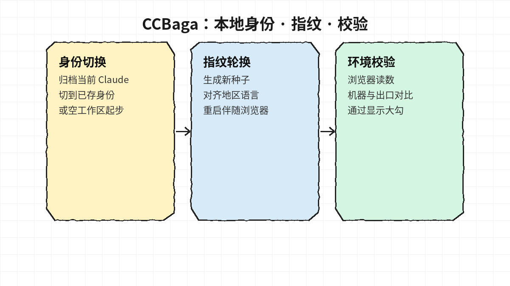
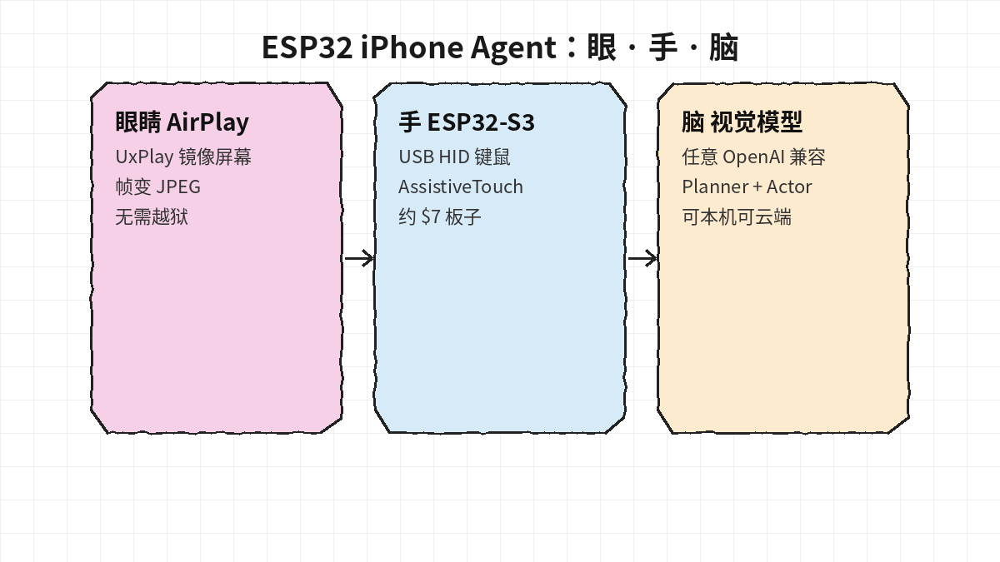
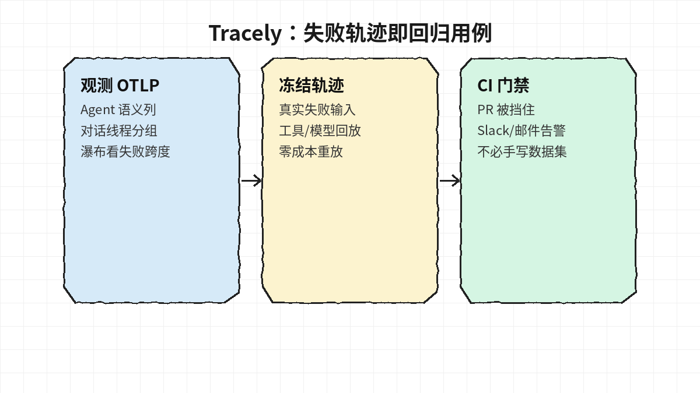
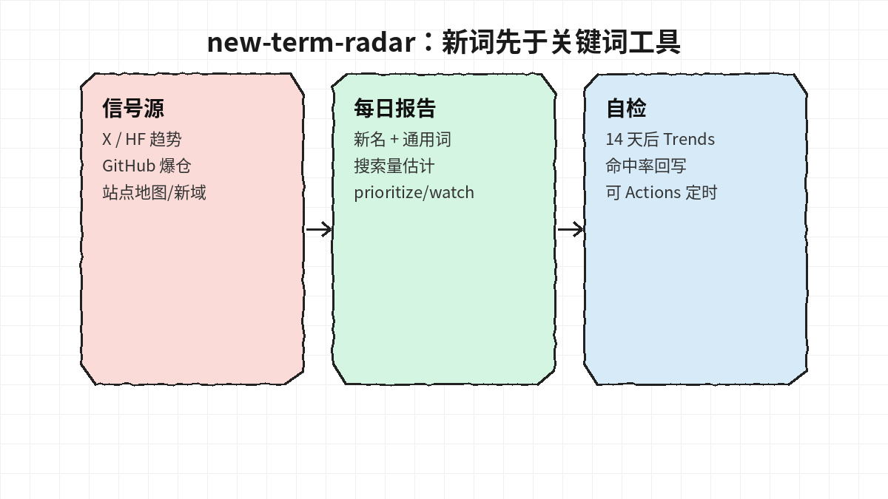

# 2026-10-13 GitHub 日报

今日精选 4 个近几天新起、可动手跟进的开源项目（Claude 工作区工具 / iPhone Agent / 观测 / 新词雷达）。与黑名单及往日日报不重复。

## 1. liseami/CCBaga — Claude 身份、浏览器指纹与环境校验桌面套件

**介绍**  
10/11 前后开源的原生桌面工具（Rust + Tauri）：**CCBaga-A** 管本机 Claude 身份归档/切换、系统时区语言与网络 Skill；**CCBaga-B** 跑隔离指纹 Chromium。改设置与「实测是否生效」分成两步，浏览器读数会和机器、网络出口对照。界面中英双语；MIT。

**用法**  
仓库：[github.com/liseami/CCBaga](https://github.com/liseami/CCBaga)。从 [Releases](https://github.com/liseami/CCBaga/releases/latest) 下平台包（macOS Apple Silicon DMG 含 A+B；Linux DEB/RPM/AppImage；Windows NSIS）。装好后开 CCBaga-A，选身份与地区后做环境校验。网络向导可复制 Skill 安装提示；也可 `npx skills add liseami/CCBaga --skill ccbaga-network --global`。

**应用场景**  
多 Claude 本地身份要干净切换、要轮换伴随浏览器指纹、或用 coding agent 配 VPS/代理并希望「改完能验」的人。

**推荐学习程度**：入门

---

## 2. onehumanbeing/esp32-iphone-agent — 约 $7 的 ESP32 让视觉模型操作真机 iPhone

**介绍**  
不用 Mac/Xcode/开发者账号/越狱：AirPlay 镜像当「眼睛」，ESP32-S3 插进 Lightning/USB-C 当 HID 键鼠「手」，任意 OpenAI 兼容视觉模型当「脑」（Planner + Actor）。指针相对移动会抖动校准；动作后检查屏幕是否真变。MIT；Python 3.10+。

**用法**  
仓库：[github.com/onehumanbeing/esp32-iphone-agent](https://github.com/onehumanbeing/esp32-iphone-agent)。刷 ESP32-S3 固件 → 装 UxPlay（`brew install uxplay` 或 apt）→ `python3 -m venv .venv && .venv/bin/pip install -e .`，配置 `server/.env` 后 `.venv/bin/python -m hidagent`。也可让本机 agent 按 README「Quick start」代装。

**应用场景**  
要在真 iPhone 上跑 computer-use（闹钟、白板、任意 App），又不想走 XCTest/WDA 签名续期的折腾。

**推荐学习程度**：进阶

---

## 3. jwuthri-cloud/Tracely-ai — 把生产失败轨迹冻成可重放的 Agent 回归用例

**介绍**  
Agent 可观测性不止仪表盘：OTLP 收齐带 agent/conversation/turn 语义的轨迹后，把**真实失败 run** 冻成密闭回归用例，CI 里用录制的工具/LLM fixture **零成本重放**；回归可挡 PR，并可告警到 Slack/邮件。另有 Python SDK、Railway 一键与 `npx skills add … --skill tracely`。MIT。

**用法**  
仓库：[github.com/jwuthri-cloud/Tracely-ai](https://github.com/jwuthri-cloud/Tracely-ai)。本地：`docker compose --profile demo up -d --build --wait`。SDK：`pip install "tracelyai-sdk[openai]"`（或 anthropic/langchain/all），点 OTLP 到 `POST {endpoint}/v1/traces`。Skill：`npx skills add https://github.com/jwuthri-cloud/Tracely-ai --skill tracely`。

**应用场景**  
线上 agent 偶发翻车、不愿手写 eval 集、希望「失败轨迹即测试」并挂进 PR 门禁的团队。

**推荐学习程度**：深度

---

## 4. zhuyansen/new-term-radar — 在关键词工具之前抓住新 AI 名词

**介绍**  
每日雷达：从 X、HF Trending、GitHub 爆仓、站点地图与新域名等抓「刚冒头」的模型/产品/仓库名，再拆出背后的通用搜索词与量级估计（prioritize / watch / skip），14 天后用 Google Trends 自检命中率。标准库为主；可选 AIsa / GoAnyAPI / GSC / Resend。MIT。

**用法**  
仓库：[github.com/zhuyansen/new-term-radar](https://github.com/zhuyansen/new-term-radar)。`git clone` → `cp config.example.json config.json` 填关注账号与站点 → `export AISA_API_KEY=…` → `python -m radar daily --out report.md`。可开仓库 Actions（设 `RADAR_ENABLED=true` 与密钥）定时跑。

**应用场景**  
做 AI 工具站 SEO、周报/目录站、想比竞品早几天占新词页面的人。

**推荐学习程度**：进阶
