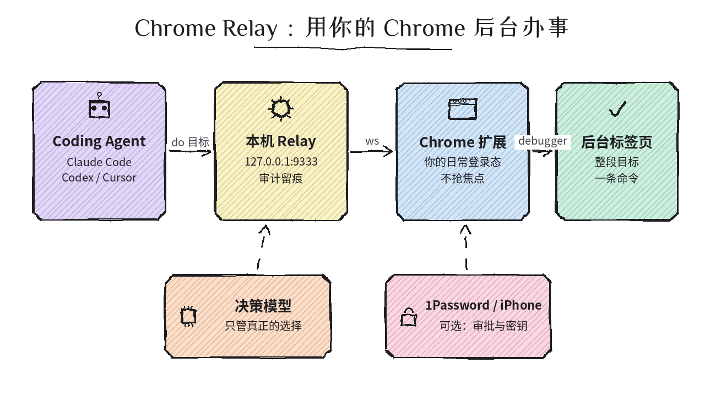
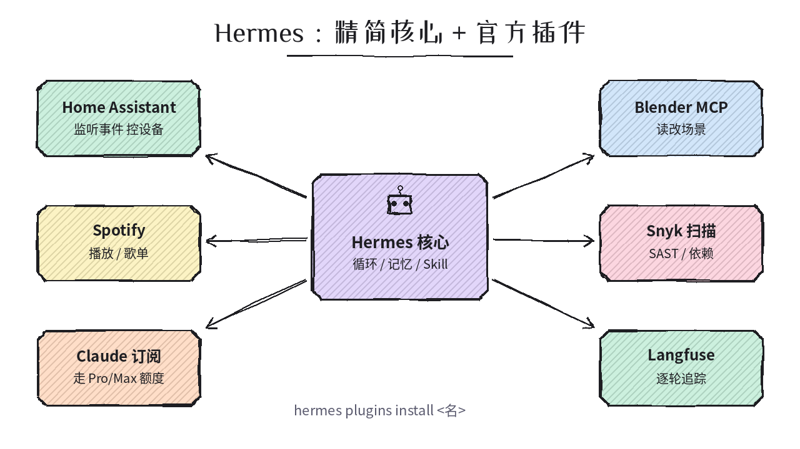
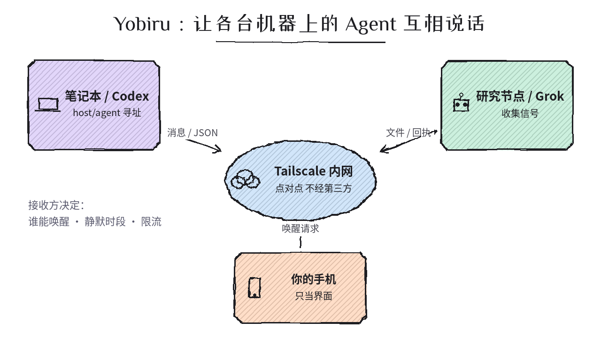
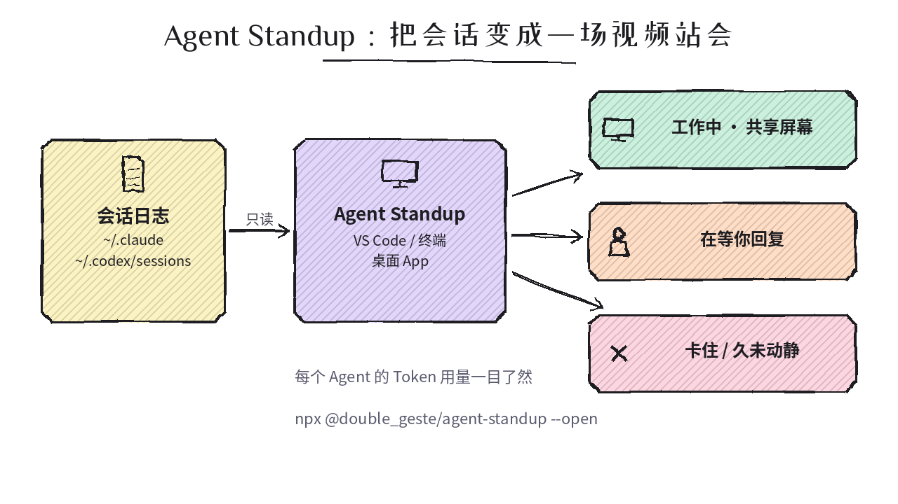
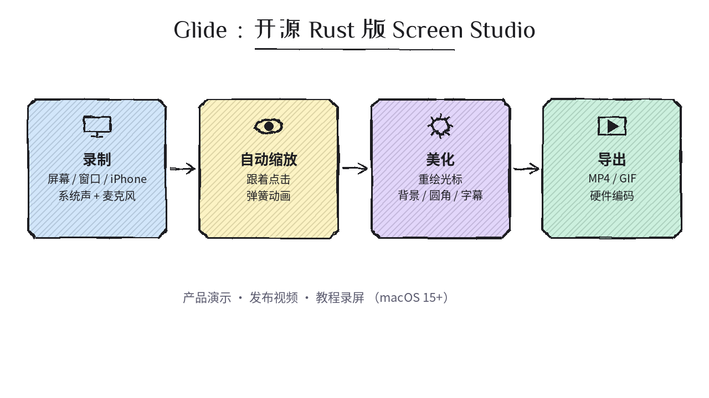

# 2026-10-14 GitHub 日报

今日精选 5 个近几天新起、可动手跟进的开源项目（Agent 用真 Chrome / Hermes 官方插件 / 跨机 Agent 通信 / 会话可视化 / 开源录屏）。与黑名单及往日日报不重复。

## 1. aindeev/agent-chrome-relay — 让 Coding Agent 用你登录好的 Chrome，在后台标签页里办完整件事

**介绍**  
10/10 开源（Go，MIT）：Claude Code / Codex / Cursor 通过本机 relay（`127.0.0.1:9333`）驱动**你日常的 Chrome**，带真实登录态、跑在后台标签页、不抢焦点不弹窗。`chrome-relay do` 一次交出整段目标（如「邀请新同事为管理员」），按 agent 给的数据填表、复用在该站点跑通过的步骤，只有真正需要选择时才问快速决策模型；有审计留痕。1Password 登录、Secure Enclave passkey、iPhone 审批均为可选。目前仅 macOS，需自行编译。

**用法**  
仓库：[github.com/aindeev/agent-chrome-relay](https://github.com/aindeev/agent-chrome-relay)。需 macOS + Chrome + Go 1.25+ + `npm i -g agent-browser`：`git clone https://github.com/aindeev/agent-chrome-relay && cd agent-chrome-relay && ./build && ./chrome-relay setup`；再到 `chrome://extensions` 开发者模式「加载已解压」仓库里的 `extension` 目录并固定，`chrome-relay doctor` 自检。也可把官网的 [setup prompt](https://agent-chrome-relay.aindeev.com/setup-prompt.txt) 贴给 agent 代装。

**应用场景**  
后台类 SaaS 操作（邀请成员、填表、改配置）要用自己的账号登录态，又不想把 cookie 交给云端浏览器、也不想 agent 抢走你的前台窗口。

**推荐学习程度**：进阶

---

## 2. NousResearch/hermes-official-plugins — Hermes Agent 官方插件仓：核心变瘦，集成按需装

**介绍**  
Nous Research 10/11 起把 Hermes Agent 的一方集成从核心里拆出来，统一放这个仓（MIT）：Home Assistant（监听事件、控设备）、Spotify、**Claude Subscription DirectSDK**（实验：经官方 Claude Code CLI 用你的 Pro/Max 订阅跑 Hermes）、Telegram Business 审批式秘书、Memory Wiki、Blender / Snyk / TouchDesigner MCP、Langfuse 逐轮追踪等。插件目录里每个条目**钉在审核过的 commit**，更新也只跟到下一个审过的 pin。

**用法**  
仓库：[github.com/NousResearch/hermes-official-plugins](https://github.com/NousResearch/hermes-official-plugins)；目录：[插件 catalog](https://hermes-agent.nousresearch.com/docs/plugins)。已装 Hermes 后：`hermes plugins search` 浏览 → `hermes plugins info spotify` 看依赖与 pin → `hermes plugins install langfuse`（或 `homeassistant` / `blender` 等）；Hermes Desktop 在「Capabilities → Plugins」。未装 Hermes 先跑仓库 README 里的官方 install 脚本。

**应用场景**  
在用或想试 Hermes 的人：给个人 agent 接智能家居、可观测（Langfuse）、安全扫描（Snyk），或想让 Hermes 走现成的 Claude 订阅额度。

**推荐学习程度**：入门

---

## 3. chekusu/yobiru — 通过 Tailscale 让不同机器上的 Agent 互相发消息、传文件、请求唤醒

**介绍**  
10/10 开源（MIT）：不是新聊天 App，而是一层通信：用 `host/agent` 寻址，跨电脑/云工作区的 agent 之间发文本、JSON、文件，带回执、进度、超时状态；接收方决定谁能唤醒哪个 agent，支持静默时段与限流。文件经 Tailscale 直接从发送方拉取，不经第三方存储。一个插件包含 6 个 skill + Python CLI，附 Codex / Cursor 清单；有中文 README。未做过独立安全审计。

**用法**  
仓库：[github.com/chekusu/yobiru](https://github.com/chekusu/yobiru)。Codex：`codex plugin marketplace add chekusu/yobiru && codex plugin add yobiru@yobiru`，新会话说「Set up Yobiru on this machine」。CLI：`git clone https://github.com/chekusu/yobiru.git && cd yobiru && Y="$PWD/plugins/yobiru/scripts/yobiru" && sh "$Y" onboard`（只读体检，列出 Tailscale / receiver 缺什么），再按 README「Quick start」给两台机器各 `setup --agent …`。

**应用场景**  
家里/公司/云上各跑一个 agent（研究、整理、写代码），想让它们直接交接结果，而不是你在窗口间复制粘贴当「传话人」。

**推荐学习程度**：进阶

---

## 4. Atoll92/agent-standup — 把 Claude Code / Codex 会话变成一场实时视频站会

**介绍**  
10/10 开源（MIT）：只读本机已有的会话文件（`~/.claude`、`~/.codex/sessions`、Mistral Vibe），把主 agent 和子 agent 画成「视频会议」里的人物：谁在干活、谁在共享屏幕、谁在等你回复、谁卡住超过一分钟或安静太久、失败工具调用计数；每个 agent 的 token 用量单独显示，方便找出最贵的子 agent。默认零 token 消耗。界面含简体中文。

**用法**  
仓库：[github.com/Atoll92/agent-standup](https://github.com/Atoll92/agent-standup)。免安装试：`npx @double_geste/agent-standup --open`（Node 18+，⚙ → Source → Demo 看演示）。编辑器：VS Code 市场或 Open VSX 搜「Agent Standup」（Cursor 可用）。Claude Code 状态栏：`npm i -g @double_geste/agent-standup` 后在 `~/.claude/settings.json` 配 `"statusLine": {"type":"command","command":"agent-standup statusline"}`。

**应用场景**  
同时开多个子 agent / 多个会话，想一眼看到谁在等你、谁卡死、哪条线最费 token。

**推荐学习程度**：入门

---

## 5. michaelshimeles/glide — 开源的 Rust 版 Screen Studio（macOS 录屏 + 自动缩放）

**介绍**  
10/13 开源（Apache-2.0）：原生 Rust 录屏，录整屏/窗口/区域/USB 连接的 iPhone，系统声与麦克风分轨；按点击自动缩放（弹簧动画 + 运动模糊）、重绘高清光标、背景/阴影/圆角/设备框；时间线剪辑、打码、本地 Whisper 字幕、配音与人声增强；VideoToolbox 硬件编码导出 MP4/GIF，通常快于实时。行为参考 Screen Studio 逆向分析，但不含其代码与素材。

**用法**  
仓库：[github.com/michaelshimeles/glide](https://github.com/michaelshimeles/glide)。需 macOS 15+、Rust（2024 edition）、Xcode、`brew install cmake`：`git clone https://github.com/michaelshimeles/glide && cd glide && scripts/build.sh && open dist/Glide.app`（默认快捷键 ⌥⇧⌘R 开录）。

**应用场景**  
做产品演示、发布视频、教程录屏，想要 Screen Studio 式「点哪放大哪」的成片效果，又想免费、可改源码。

**推荐学习程度**：入门
