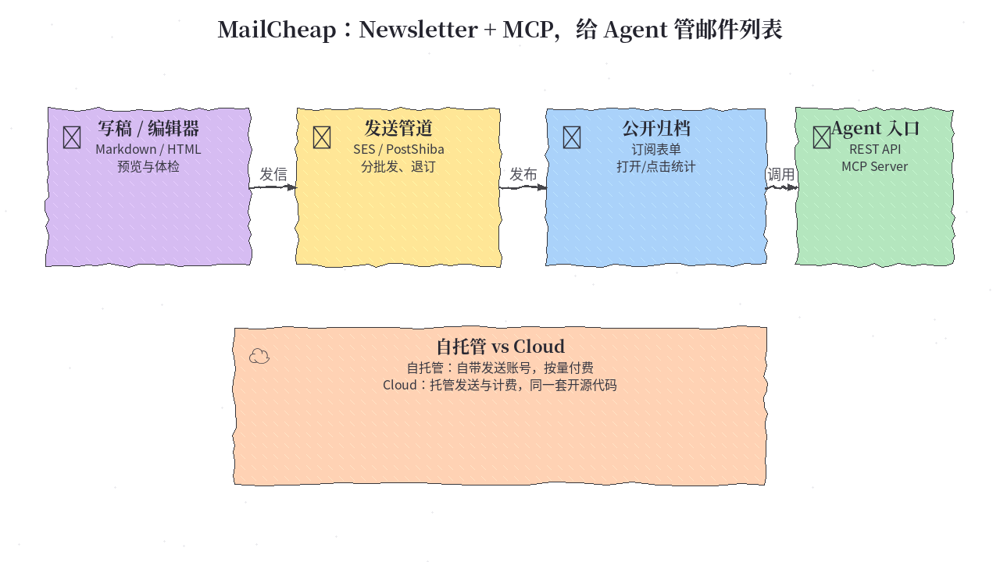
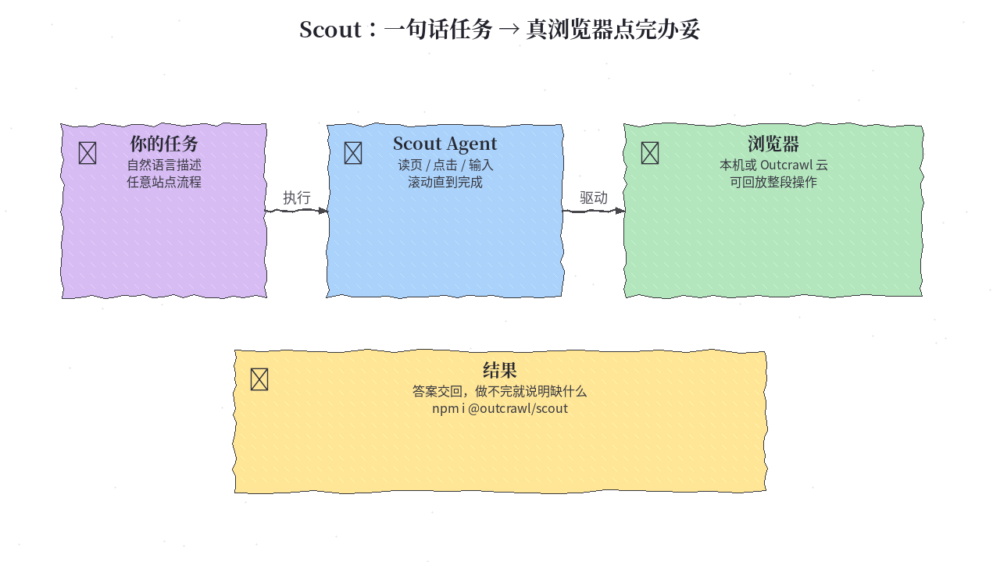
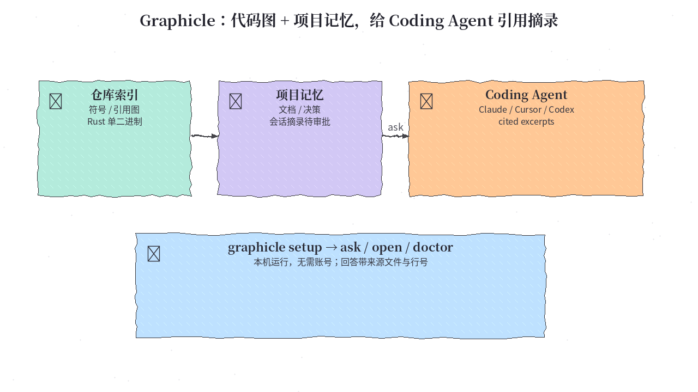
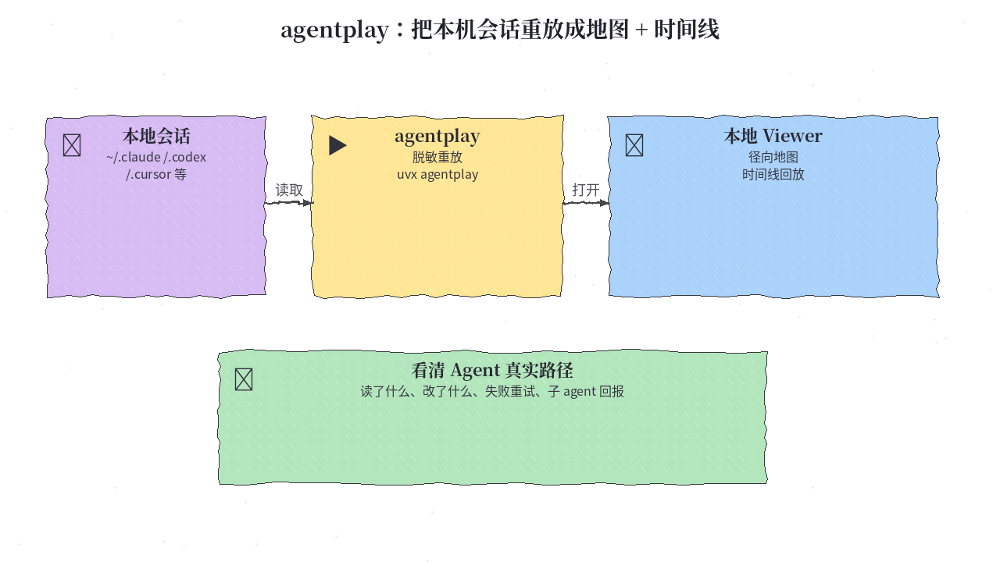
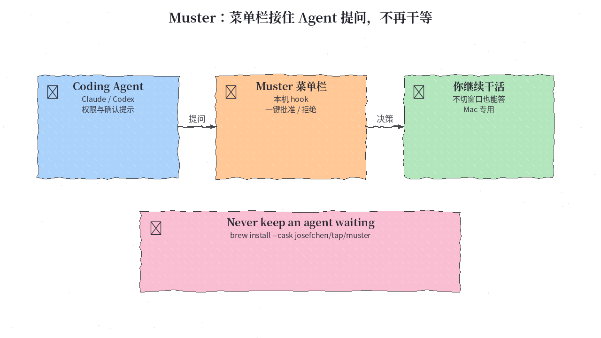

# 2026-10-15 GitHub 日报

今日精选 5 个近几天新起、可动手跟进的开源项目（Agent 时代 Newsletter / 开源浏览器 Agent / 代码图与记忆 / 会话重放 / 菜单栏接住提问）。与黑名单及往日日报、周报不重复。

## 1. marclou/mailcheap — 给 Agent 时代用的开源 Newsletter：自托管或托管，同一套代码还带 MCP

**介绍**  
10/10 开源（AGPL-3.0，★900+）：一整套 Next.js Newsletter——编辑器、订阅列表、确认订阅、退订、退信投诉、公开归档与统计。可用自己的 Amazon SES / PostShiba 自托管（按发送量付费），或走 MailCheap Cloud。仪表盘能做的事，REST API 和 **MCP Server** 也能做，方便 coding / 运营 agent 代写、代发、代查。作者明确：Issues 关闭、无支持，fork 自用或用云服务。

**用法**  
仓库：[github.com/marclou/mailcheap](https://github.com/marclou/mailcheap)。一键部署可用 README 的 Vercel Deploy；本地需配置 `MONGODB_URI`、`BETTER_AUTH_SECRET`、`ADMIN_EMAILS`、`EMAIL_FROM`，并接上 `RESEND_API_KEY` 或 SES/PostShiba。环境变量说明见仓库 README「Environment variables」。云端试用：[mailcheap.ai](https://mailcheap.ai)。

**应用场景**  
想自建产品周报 / Agent 更新信，列表和发送管道留在自己库里，又希望用 MCP 让 agent 直接操作订阅与发信。



**推荐学习程度**：进阶

---

## 2. outcrawlai/scout — 开源浏览器 Agent：说清任务，它打开真浏览器点到完

**介绍**  
10/13 开源（Apache-2.0，★650+）：用自然语言描述目标，Scout 在真实浏览器里读页、点击、输入、滚动，直到完成或说明缺什么。可配任意兼容 Chat Completions 的模型（含本机）。本机可跑，也推荐 Outcrawl 云浏览器（含验证码与全程回放；免费额度见官网）。npm 包 `@outcrawl/scout`，TypeScript / Node 22+。

**用法**  
仓库：[github.com/outcrawlai/scout](https://github.com/outcrawlai/scout)；文档：[outcrawl.ai/docs/scout](https://outcrawl.ai/docs/scout/overview)。  
```sh
npm i @outcrawl/scout
export OUTCRAWL_API_KEY=your-outcrawl-key   # 云浏览器可选；outcrawl.ai 可领免费额度
export SCOUT_BASE_URL=https://your-endpoint/v1
export SCOUT_API_KEY=your-model-key
export SCOUT_HANDS_MODEL=your-model-id
```
按 README「Start in three steps」跑第一条任务即可。

**应用场景**  
要 agent 在真实网页上完成「打开类目、点进商品、回报标题价格」这类操作，又不想自己拼 Playwright 脚本。



**推荐学习程度**：入门

---

## 3. Graphicle-AI/graphicle — 一个 Rust 程序：代码图 + 项目记忆，给 Coding Agent 带行号的摘录

**介绍**  
10/14 开源（Apache-2.0）：把仓库建成代码图，记住文档、决策与过往 agent 会话；agent 提问时返回**带文件与行号**的引用摘录，而不是整仓重读。支持 Claude Code / Cursor / Codex / VS Code / 任意 MCP 客户端。本机运行、无需账号与遥测。`graphicle setup` 会索引、接线、写 AGENTS.md 片段与 git hooks，并备份改动；`disconnect` 可撤销。

**用法**  
仓库：[github.com/Graphicle-AI/graphicle](https://github.com/Graphicle-AI/graphicle)。macOS/Linux：  
```sh
brew install graphicle-ai/tap/graphicle
# 或：curl -fsSL https://github.com/graphicle-ai/graphicle/releases/latest/download/install.sh | sh
cd your-repo && graphicle setup
graphicle ask "where is tax added to prices?"
graphicle doctor
```
也可把 README 里的安装提示贴给 coding agent 代装。

**应用场景**  
大仓库里 agent 总「瞎翻文件」：想用本地代码图 + 项目记忆，把检索压成可核对的摘录。



**推荐学习程度**：进阶

---

## 4. Entelligence-AI/agentplay — 把 Claude / Codex / Cursor 会话重放成地图与时间线

**介绍**  
10/14 开源（Apache-2.0）：只读本机已有会话目录（`~/.claude`、`~/.codex`、`~/.cursor`、Copilot、OpenCode、Kiro 等），脱敏后生成可回放的会话地图与时间线——读了哪些文件、改了什么、命令失败重试几次、上下文何时撑满、子 agent 带回什么。无账号、无 API Key；数据默认不出本机（可选邮箱可关，`AGENTPLAY_NO_NETWORK=1`）。纯标准库运行时依赖。

**用法**  
仓库：[github.com/Entelligence-AI/agentplay](https://github.com/Entelligence-AI/agentplay)。Python 3.11+：  
```sh
uvx agentplay
# 或：pipx run agentplay
# 或：pip install agentplay
```
一条命令扫描本机会话并打开本地 viewer。给 coding agent 安装可指向仓库 `install.md`。

**应用场景**  
想复盘「这次改动 agent 到底先看了啥、在哪卡住」，或对比多会话的工具失败模式——和实时站会类工具互补。



**推荐学习程度**：入门

---

## 5. josefchen/muster — Mac 菜单栏：别让 Agent 干等你点「允许」

**介绍**  
10/12 开源（MIT）：菜单栏小工具，通过 hook 接到 Claude Code / Codex 等本机设置，把权限与确认弹窗接到 Muster；你可一键批准/拒绝，不必每次切回 agent 窗口。改动会留 `.muster-original` / `.muster-backup`；解析不了的配置文件不动。Muster 未运行时 agent 仍走原有对话框。免费、本机、面向「别让 agent 空转」的 UX。

**用法**  
仓库：[github.com/josefchen/muster](https://github.com/josefchen/muster)；站点：[agentmuster.app](https://agentmuster.app)。  
```sh
brew install --cask josefchen/tap/muster
# 或下载：https://github.com/josefchen/muster/releases/latest/download/Muster.dmg
```
装好后在菜单栏按 README「Answer prompts from Muster」打开对应 agent 的 hook。

**应用场景**  
长时间跑 coding agent，频繁被权限提示打断；希望在菜单栏秒回，继续干别的事。



**推荐学习程度**：入门
