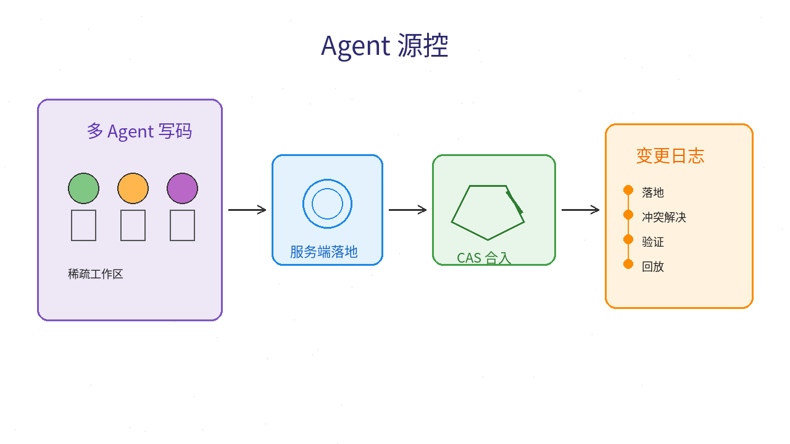
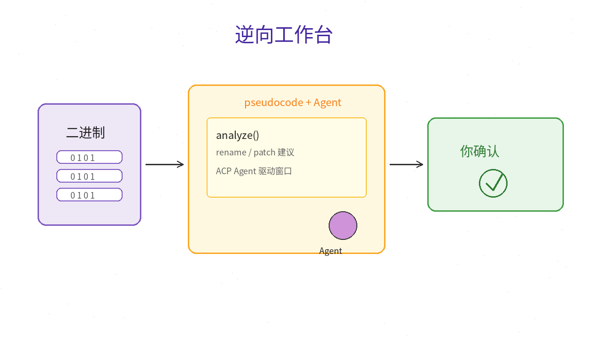
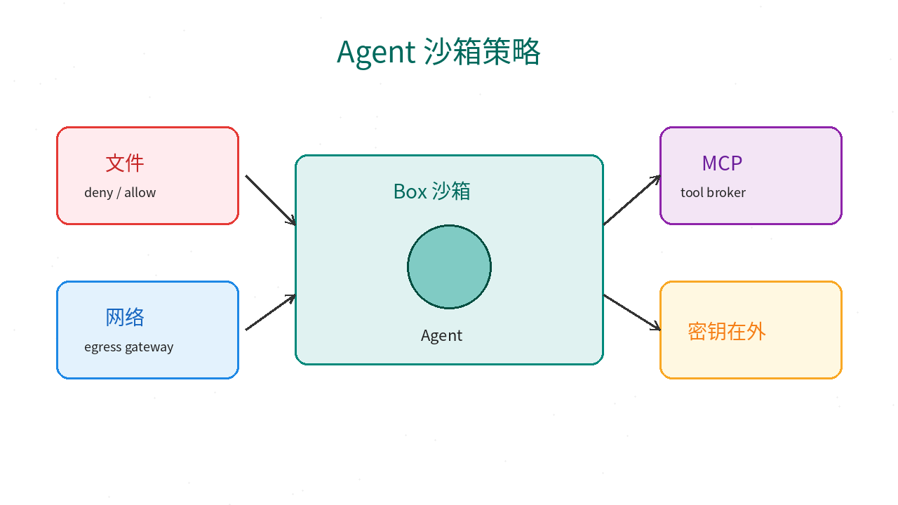
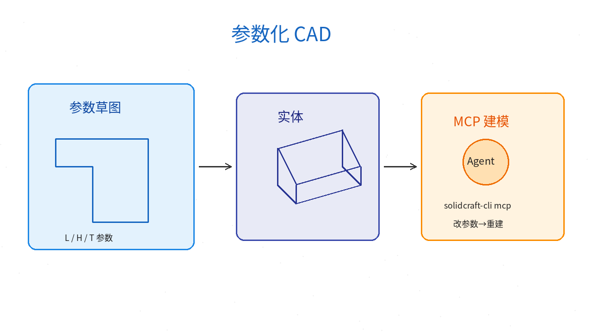
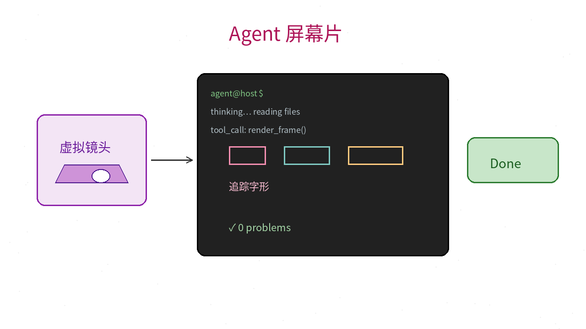

# 2026-10-16 GitHub 日报

今日精选 5 个近几天可动手跟进的开源项目（Agent 源控 / 逆向工作台 / 沙箱策略 / 参数化 CAD+MCP / Agent 屏幕片）。与往日日报、周报不重复。

## 1. feder-cr/open_scion — 面向 Coding Agent 的开源「Scion 式」源控

**介绍**  
10/15 开源（★700+）：按 Anthropic 公开文稿《Redesigning source control》的思路做的独立实现——短命 Agent 任务要频繁落地，经典「全量 clone + 合并队列」容易成为瓶颈。open_scion 把对象拉取、历史查询、落地（compare-and-swap）、变更日志放到服务端；底层仍可挂普通 Git 仓库。服务端不调模型，冲突解决器可接任意 LLM 或关掉。作者声明与 Anthropic 无隶属关系。

**用法**  
仓库：[github.com/feder-cr/open_scion](https://github.com/feder-cr/open_scion)。  
```bash
git clone https://github.com/feder-cr/open_scion.git
cd open_scion
# 按仓库 Makefile / doc 构建后：
examples/graft/quickstart.sh   # 临时目录里拉起 server、cache、两个 agent 与一次 land
./_build/bin/graft             # CLI
```
自建服务可改 `examples/graft/config.toml`；架构与存储见 `doc/graft/`。

**应用场景**  
一仓库上挂很多并行 coding agent，需要稀疏工作区、服务端落地与可回放的变更流，而不是每人一份全量 clone。



**推荐学习程度**：深度

---

## 2. Zfinix/eleven — Agent 优先的跨平台逆向工作台（ACP）

**介绍**  
10/13 开源（Apache-2.0，★480+）：把逆向做成「你盯着、Agent 动手」的桌面应用。任意支持 [Agent Client Protocol](https://agentclientprotocol.com) 的 Agent（Claude / Codex / Cursor / Copilot / OpenCode 等）可读伪代码、改名、记笔记、提议补丁；你在同一窗口批准。原生代码走 Ghidra（经 REA）或更快的 Rizin；Android 走 jadx。支持 Mach-O / ELF / PE、APK、GPU kernel、部分模型文件。

**用法**  
仓库：[github.com/Zfinix/eleven](https://github.com/Zfinix/eleven)。  
```sh
# macOS Apple Silicon
curl -fsSL https://eleven.chizi.app/install.sh | bash
# Windows
irm https://eleven.chizi.app/install.ps1 | iex
```
Linux 可下 AppImage / tar.gz（Releases）。首次运行会引导选引擎与 Agent，并按需装 Ghidra / Rizin。

**应用场景**  
手上有自家或授权二进制 / APK，想让 coding agent 帮你读流程、建议重命名与补丁，同时自己点确认。



**推荐学习程度**：进阶

---

## 3. strands-agents/box — 给 Agent 用的开源沙箱（OS 隔离 + Dogwood 策略）

**介绍**  
10 月初开源（Apache-2.0，★400+）：把 Agent 放进沙箱，用 `box.toml` 限制直接文件/程序/网络访问，再用 [Dogwood](https://dogwood-policy.github.io/dogwood/) 的 `permit` / `forbid` 写语义策略（可依赖历史操作与时间）。Shell、Python、egress 网关、MCP broker 共用同一策略引擎；允许的出站请求可由网关注入密钥，Agent 进程拿不到明文。当前预览：本机 macOS Apple silicon。

**用法**  
仓库：[github.com/strands-agents/box](https://github.com/strands-agents/box)；入门：[getting-started](https://github.com/strands-agents/box/blob/main/docs/user/getting-started.md)。  
```sh
curl -fsSL https://raw.githubusercontent.com/strands-agents/box/main/download.sh | sh
./box-core/box --version
# 再按文档写 box.toml / policy.dw 后运行
```
也可 `cargo build --release -p strands-box -p strands-box-containment`。

**应用场景**  
要在本机跑有工具调用的 Agent，又不想它随便读密钥、扫家目录或乱出网。



**推荐学习程度**：进阶

---

## 4. bherbruck/solidcraft — 纯 Rust 参数化 CAD，桌面/浏览器 + MCP 给 Agent 建模

**介绍**  
10/7 起持续更新（Apache-2.0，★2700+）：草图约束、特征时间线、改参数重算实体。可下桌面包，也可浏览器试用；内置 MCP（`solidcraft-cli mcp`），Agent 可无头或连到正在跑的 App 建模、测量、出图。官方称早期但可用简单零件；有社区用 MCP 搭科学漫游车一类复杂时间线的例子。

**用法**  
仓库：[github.com/bherbruck/solidcraft](https://github.com/bherbruck/solidcraft)；文档：[SolidCraft book](https://bherbruck.github.io/solidcraft/)；网页试用：[bherbruck.github.io/solidcraft/app](https://bherbruck.github.io/solidcraft/app/)。  
```sh
# 发行版：Releases 里的 dmg / msi / AppImage 等
# 或源码：
cargo run --release -p solidcraft -- --sample
cargo run --release -p solidcraft-cli -- mcp
```

**应用场景**  
想让 Agent 帮画支架、外壳这类参数件，或自己改尺寸后一键重建，而不是只生成不可编辑网格。



**推荐学习程度**：进阶

---

## 5. mrsarac/ff-tracking — 虚拟镜头拍 Agent 屏幕：字形级追踪 + 全代码成片

**介绍**  
10/9 开源（MIT，★430+）：用两遍 [fframes](https://github.com/dmtrKovalenko/fframes) + SkSL 着色器，把「Agent 在终端里思考 → 读文件 → Done」拍成有景深、调色与合成音效的短片；追踪框坐标是真实像素位置，不是随机数。无实拍素材、无库存音效。适合做 Agent 产品演示片，而不是又一个录屏工具。

**用法**  
仓库：[github.com/mrsarac/ff-tracking](https://github.com/mrsarac/ff-tracking)；样片：[tracking.mp4](https://github.com/mrsarac/ff-tracking/releases/download/v1.0.0/tracking.mp4)。按 README Quick start 装 Rust / fframes 依赖后渲染；续作见同作者 `ff-unmute`。

**应用场景**  
要给 coding / computer-use Agent 做一支「镜头跟着手指走」的发布短片，又不想剪实拍。



**推荐学习程度**：进阶
