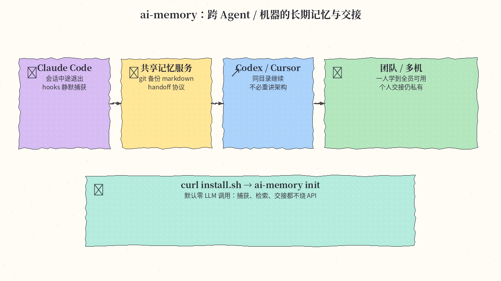
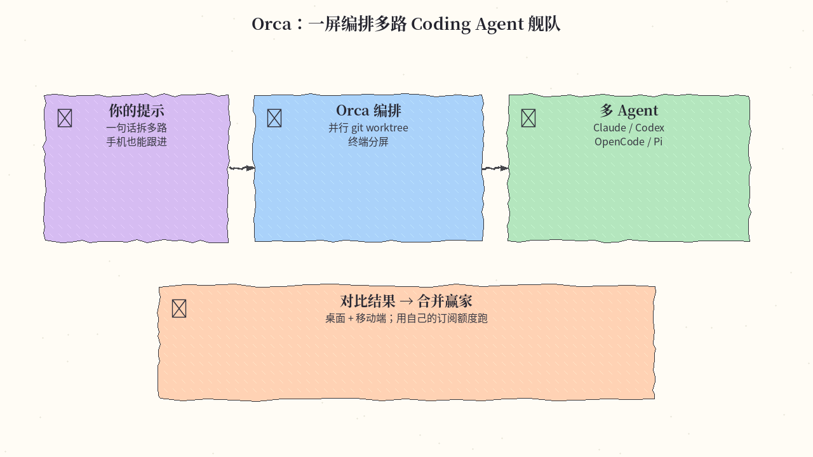
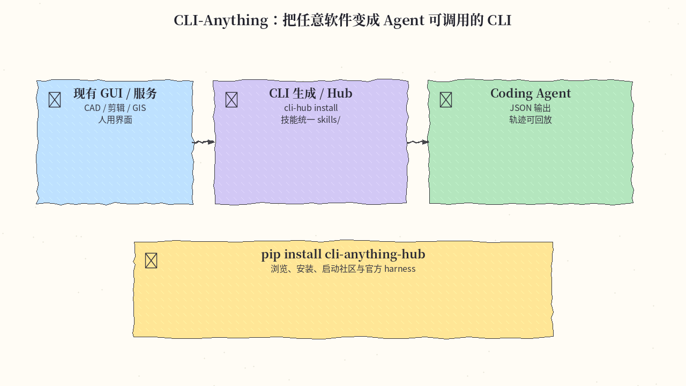
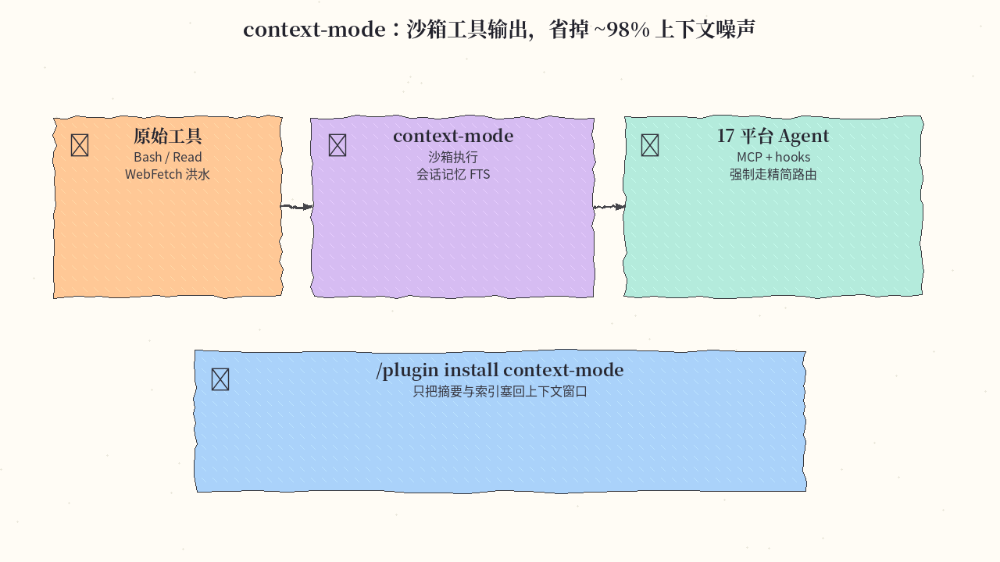
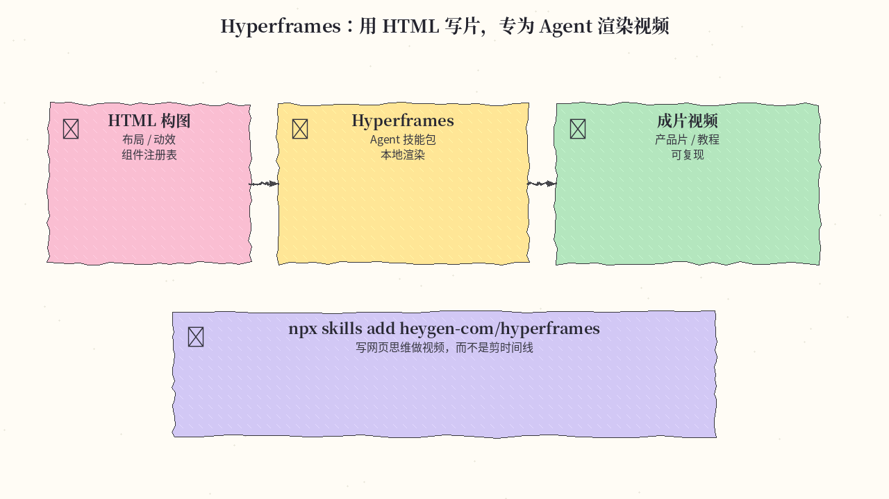
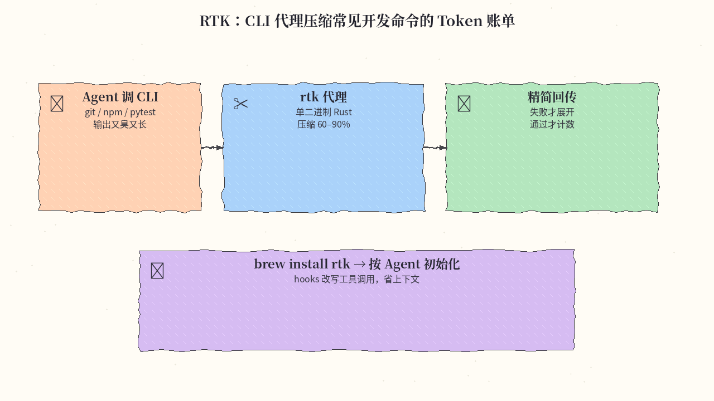

# 2026-10-19 GitHub 日报

今日精选 6 个近几天可动手跟进的开源项目（跨 Agent 记忆 / 舰队编排 / Agent 原生 CLI / 上下文省流 / HTML 成片 / CLI Token 代理）。与往日日报、周报不重复。

## 1. akitaonrails/ai-memory — 跨 Agent / 机器的长期记忆与交接

**介绍**  
Rust 实现的 Agent 长期记忆（MIT，★10500+，今日仍在冲星）：20+ harness（Claude Code / Codex / Cursor / Gemini CLI / OpenCode / Grok 等）共用一份记忆。中途换工具时走 typed handoff（有 owner、只被认领一次）；源真相是 git 备份的普通 `.md` wiki，可 grep / Obsidian / 手改。默认路径**零 LLM 调用**完成捕获、检索与交接；也可 `ai-memory run <agent>` 带上私有本地投影继续会话。

**用法**  
仓库：[github.com/akitaonrails/ai-memory](https://github.com/akitaonrails/ai-memory)；站：[aimemory.sh](https://aimemory.sh)。  
```bash
curl -fsSL https://github.com/akitaonrails/ai-memory/releases/latest/download/install.sh | sh
ai-memory init
# Claude Code 插件：
claude plugin marketplace add akitaonrails/ai-memory && claude plugin install ai-memory@ai-memory
```

**应用场景**  
Claude 做到一半改开 Codex，或桌面与笔记本接力同一仓库，不想每次重讲架构、失败路径与待决问题。



**推荐学习程度**：进阶

---

## 2. stablyai/orca — 一屏编排多路 Coding Agent 舰队

**介绍**  
桌面 + 移动端的 Agent 编排器（MIT，★96700+）：把 Codex / Claude Code / OpenCode / Pi 等并排放进各自 git worktree，终端分屏（Ghostty 级 WebGL）、手机端监控与跟进、Design Mode 点选真实 Chromium 元素把 HTML/CSS/截图塞进提示。用自己的订阅额度跑，不绑单一云厂商。

**用法**  
仓库：[github.com/stablyai/orca](https://github.com/stablyai/orca)；下载：[onorca.dev/download](https://onorca.dev/download)。  
装好桌面端后接好各 Agent CLI；iOS App Store / Android APK 可作 companion。

**应用场景**  
同一需求想并行试几条实现路线，或人在外面也要盯着 Agent 跑完再远程补一句。



**推荐学习程度**：入门

---

## 3. HKUDS/CLI-Anything — 让任意软件变成 Agent 可调用的 CLI

**介绍**  
学术向但落地很猛的「软件 Agent 化」框架（Apache-2.0，★54600+）：为 GUI/服务生成结构化 CLI（JSON + 人读输出），附预览与轨迹回环；配套 [CLI-Hub](https://hkuds.github.io/CLI-Anything/) 一键装社区 harness（CAD、3D、字幕、GIS 等）。技能统一进顶层 `skills/`，也可用 `npx skills add HKUDS/CLI-Anything --skill <name>`。

**用法**  
仓库：[github.com/HKUDS/CLI-Anything](https://github.com/HKUDS/CLI-Anything)。  
```bash
pip install cli-anything-hub
cli-hub list
cli-hub install <name>
cli-hub launch <name> --help
```

**应用场景**  
想让 coding agent 操作原本只有 GUI 的专业软件（建模、剪辑、地图），又不想手写脆弱的 RPA。



**推荐学习程度**：进阶

---

## 4. mksglu/context-mode — 沙箱工具输出，上下文可省约 98%

**介绍**  
面向 AI coding agent 的上下文省流层（★30700+）：把 Bash/Read/WebFetch 等大输出放进沙箱，只回摘要与可检索索引；会话记忆持久化，并用 MCP + hooks 在约 17 个平台上强制走精简路由。Claude Code 走插件市场最完整（含 doctor 与状态栏）。

**用法**  
仓库：[github.com/mksglu/context-mode](https://github.com/mksglu/context-mode)。  
```text
/plugin marketplace add mksglu/context-mode
/plugin install context-mode@context-mode
```
其他平台可 `npm install -g context-mode` 后接 MCP；详见 README 分组安装说明。

**应用场景**  
长会话里工具日志把窗口顶爆、频繁 compact，却仍想让 Agent 能搜到刚才跑过的输出。



**推荐学习程度**：进阶

---

## 5. heygen-com/hyperframes — 用 HTML 写片，专为 Agent 渲染视频

**介绍**  
HeyGen 开源的「写 HTML → 渲染视频」栈（★66700+）：面向 Agent 的创作工作流与技能包（路由 + domain skills），组件/效果可从 registry 安装；支持 Claude 插件与 `npx skills`。适合产品片、教程片——用网页构图思维而不是传统时间线剪辑。

**用法**  
仓库：[github.com/heygen-com/hyperframes](https://github.com/heygen-com/hyperframes)。  
```bash
npx skills add heygen-com/hyperframes
# 或 Claude：
claude plugin marketplace add heygen-com/hyperframes
claude plugin install hyperframes@hyperframes
```
非交互环境优先 `npx hyperframes skills update` 装核心集。

**应用场景**  
要让 Agent 稳定产出可复现的宣传/教程短片，而不是一次性剪辑工程。



**推荐学习程度**：进阶

---

## 6. rtk-ai/rtk — CLI 代理：常见开发命令 Token 可砍 60–90%

**介绍**  
Rust 单二进制 CLI 代理（★83800+）：拦截 git / npm / pytest / cargo 等百余条命令，把冗长通过输出压成计数与摘要，失败才展开细节；对接 Claude Code、Cursor、Hermes 等 hooks。Homebrew / winget / install.sh 均可装。

**用法**  
仓库：[github.com/rtk-ai/rtk](https://github.com/rtk-ai/rtk)；文档：[rtk-ai.app](https://www.rtk-ai.app/guide/getting-started/installation)。  
```bash
brew install rtk
# 或：curl -fsSL https://raw.githubusercontent.com/rtk-ai/rtk/refs/heads/master/install.sh | sh
# 再按文档为你的 Agent 跑一次 init
```

**应用场景**  
Agent 频繁跑测试与构建，上下文被成功日志淹没、账单飙升时。



**推荐学习程度**：入门

---
