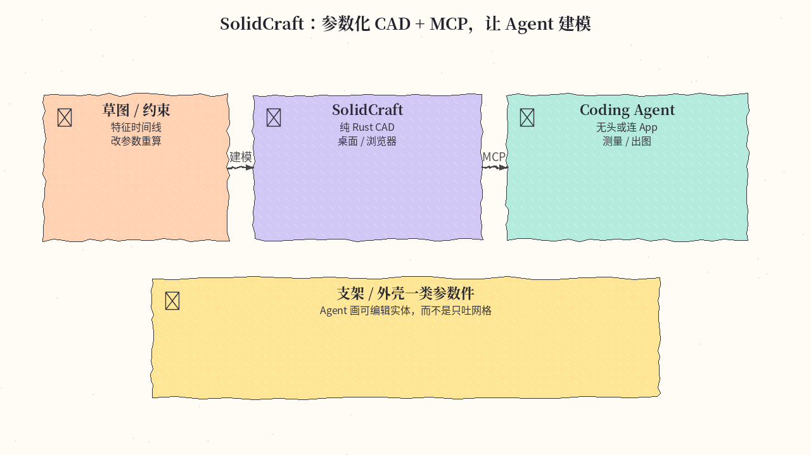
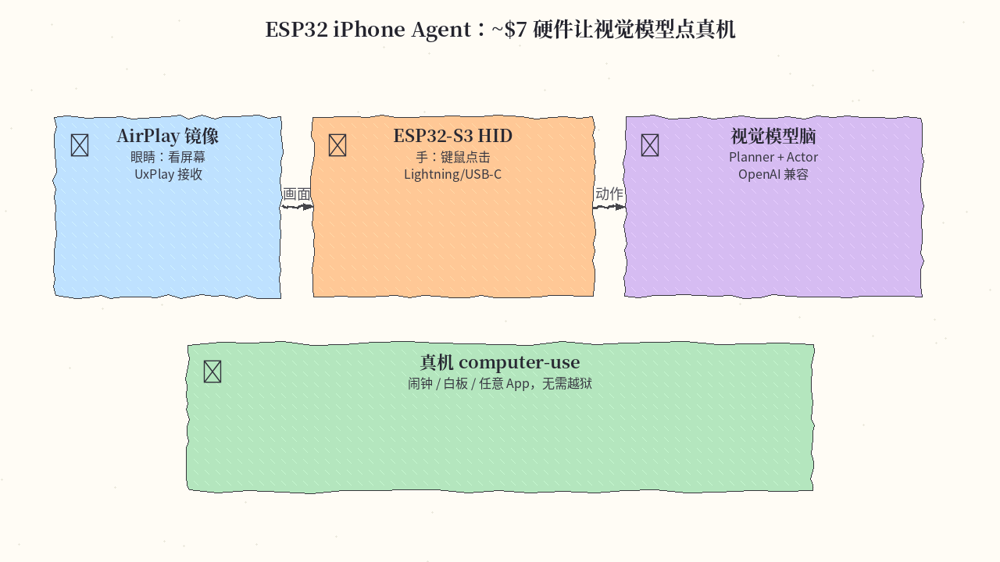
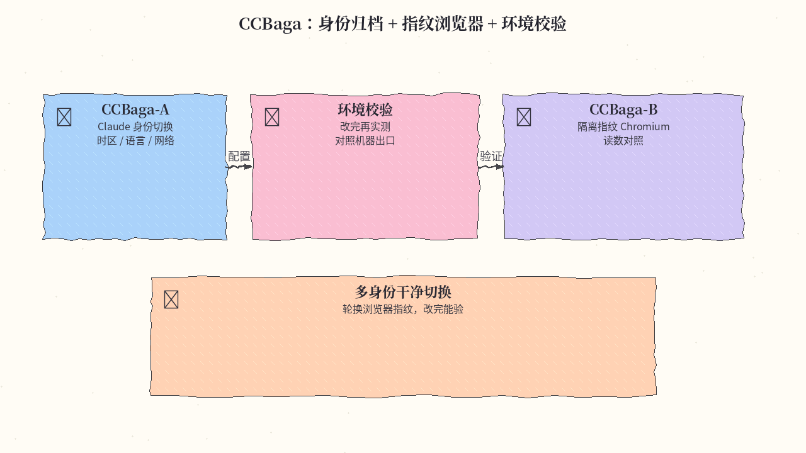
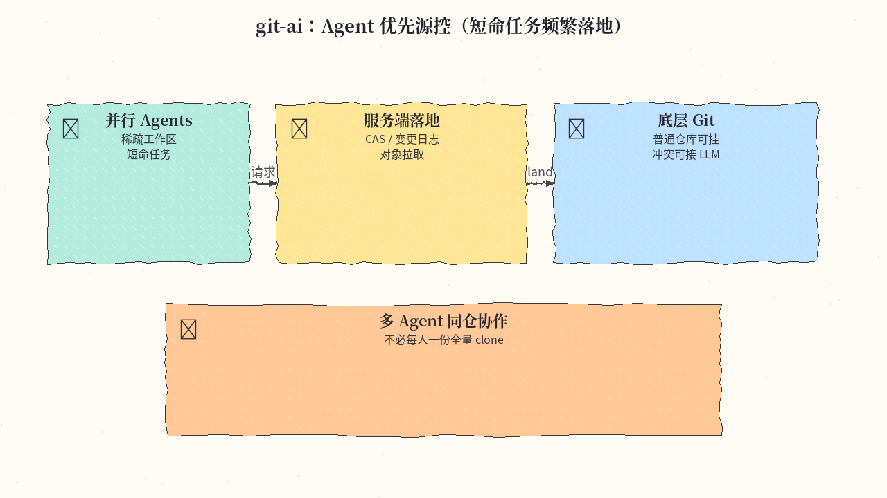
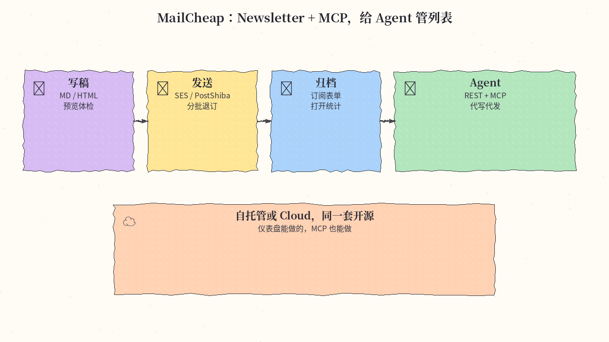
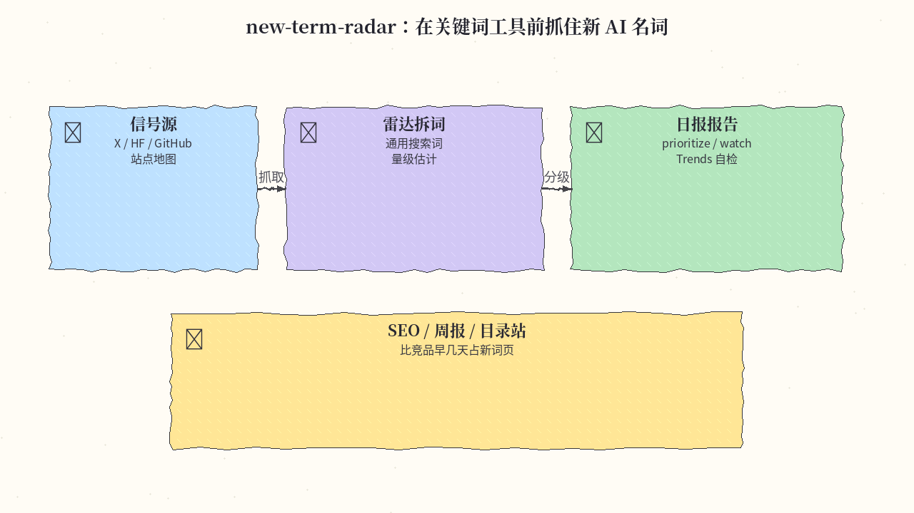
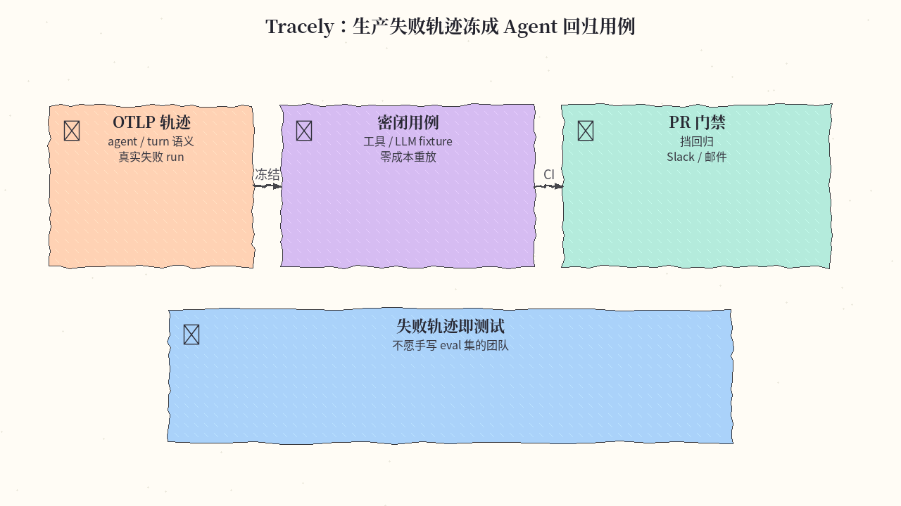
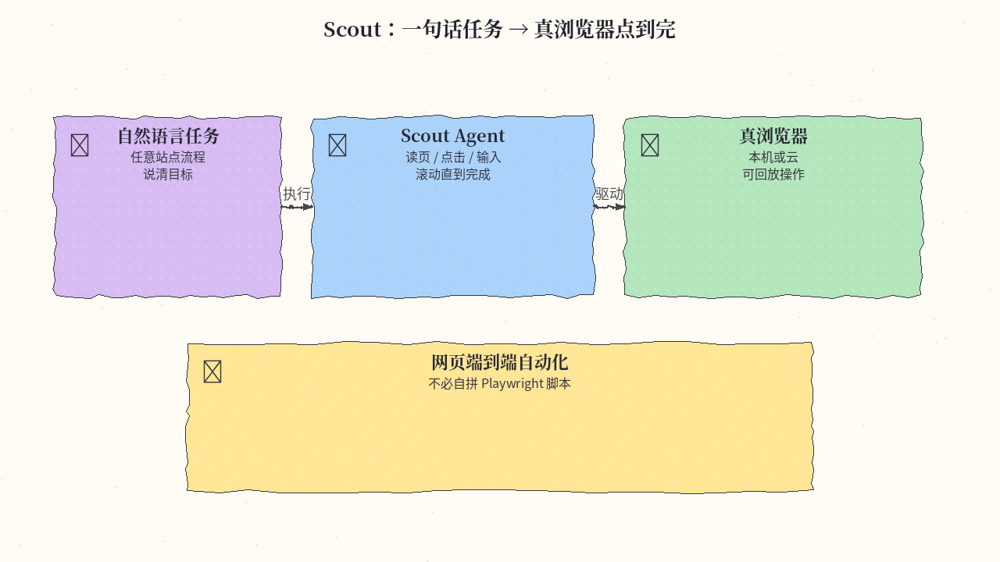
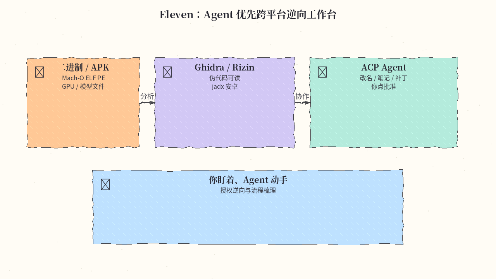
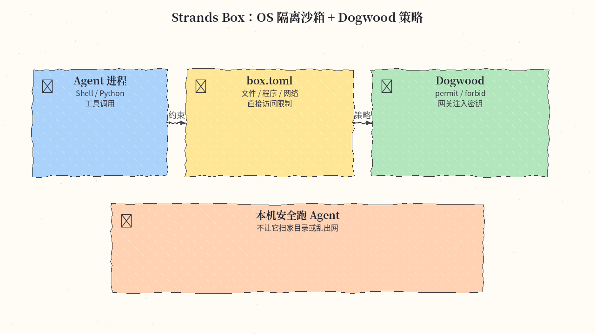

# 2026-10-19 GitHub 周报

上周（10/12–10/18）精选 10 个值得跟进的开源项目（偏 Agent / CAD / 真机控制 / 源控与沙箱）。

## 1. tangency-labs/solidcraft — 纯 Rust 参数化 CAD + MCP

**介绍**  
上周持续冲星的参数化 CAD（Apache-2.0，★5759）：草图约束、特征时间线、改参数重算实体。可下桌面包，也可浏览器试用；内置 MCP，Agent 可无头或连到正在跑的 App 建模、测量、出图。官方称早期但可用简单零件；有社区用 MCP 搭复杂时间线的例子。仓库现迁至 tangency-labs（原 bherbruck 会跳转）。

**用法**  
仓库：[github.com/tangency-labs/solidcraft](https://github.com/tangency-labs/solidcraft)；文档：[SolidCraft book](https://bherbruck.github.io/solidcraft/)；网页试用：[bherbruck.github.io/solidcraft/app](https://bherbruck.github.io/solidcraft/app/)。  
发行版见 Releases（dmg / msi / AppImage 等）；或源码：`cargo run --release -p solidcraft -- --sample`，MCP：`cargo run --release -p solidcraft-cli -- mcp`。

**应用场景**  
让 Agent 帮画支架、外壳这类参数件，或自己改尺寸后一键重建，而不是只生成不可编辑网格。



**推荐学习程度**：进阶

---

## 2. onehumanbeing/esp32-iphone-agent — ~$7 ESP32 让视觉模型操作真机 iPhone

**介绍**  
不用 Mac/Xcode/开发者账号/越狱：AirPlay 镜像当「眼睛」，ESP32-S3 插进 Lightning/USB-C 当 HID 键鼠「手」，任意 OpenAI 兼容视觉模型当「脑」（Planner + Actor）。指针相对移动会抖动校准；动作后检查屏幕是否真变。MIT；★3125。

**用法**  
仓库：[github.com/onehumanbeing/esp32-iphone-agent](https://github.com/onehumanbeing/esp32-iphone-agent)。刷 ESP32-S3 固件 → 装 UxPlay（`brew install uxplay` 或 apt）→ `python3 -m venv .venv && .venv/bin/pip install -e .`，配置 `server/.env` 后 `.venv/bin/python -m hidagent`。也可让本机 agent 按 README「Quick start」代装。

**应用场景**  
要在真 iPhone 上跑 computer-use（闹钟、白板、任意 App），又不想走 XCTest/WDA 签名续期的折腾。



**推荐学习程度**：进阶

---

## 3. liseami/CCBaga — Claude 身份 / 浏览器指纹 / 环境校验桌面套件

**介绍**  
原生桌面工具（Rust + Tauri，MIT，★2653）：**CCBaga-A** 管本机 Claude 身份归档/切换、系统时区语言与网络 Skill；**CCBaga-B** 跑隔离指纹 Chromium。改设置与「实测是否生效」分成两步，浏览器读数会和机器、网络出口对照。界面中英双语。

**用法**  
仓库：[github.com/liseami/CCBaga](https://github.com/liseami/CCBaga)。从 [Releases](https://github.com/liseami/CCBaga/releases/latest) 下平台包（macOS Apple Silicon DMG 含 A+B；Linux DEB/RPM/AppImage；Windows NSIS）。装好后开 CCBaga-A，选身份与地区后做环境校验。也可 `npx skills add liseami/CCBaga --skill ccbaga-network --global`。

**应用场景**  
多 Claude 本地身份要干净切换、要轮换伴随浏览器指纹、或用 coding agent 配 VPS/代理并希望「改完能验」。



**推荐学习程度**：进阶

---

## 4. feder-cr/git-ai — Agent 优先源控（原 open_scion）

**介绍**  
按 Anthropic 公开文稿《Redesigning source control》思路做的独立实现（★2299）：短命 Agent 任务要频繁落地，经典「全量 clone + 合并队列」容易成为瓶颈。把对象拉取、历史查询、落地（compare-and-swap）、变更日志放到服务端；底层仍可挂普通 Git。服务端不调模型，冲突解决器可接任意 LLM 或关掉。仓库现为 `feder-cr/git-ai`（原 open_scion 会跳转）。

**用法**  
仓库：[github.com/feder-cr/git-ai](https://github.com/feder-cr/git-ai)。克隆后按 Makefile / doc 构建；可用 examples 里的 quickstart 在临时目录拉起 server、cache、两个 agent 与一次 land。自建服务改配置；架构与存储见文档目录。

**应用场景**  
一仓库上挂很多并行 coding agent，需要稀疏工作区、服务端落地与可回放的变更流，而不是每人一份全量 clone。



**推荐学习程度**：深度

---

## 5. marclou/mailcheap — Agent 时代开源 Newsletter + MCP

**介绍**  
一整套 Next.js Newsletter（AGPL-3.0，★1235）：编辑器、订阅列表、确认订阅、退订、退信投诉、公开归档与统计。可用自己的 Amazon SES / PostShiba 自托管，或走 MailCheap Cloud。仪表盘能做的事，REST API 和 **MCP Server** 也能做，方便 agent 代写、代发、代查。作者明确：Issues 关闭、无支持，fork 自用或用云服务。

**用法**  
仓库：[github.com/marclou/mailcheap](https://github.com/marclou/mailcheap)；云端试用：[mailcheap.ai](https://mailcheap.ai)。一键部署可用 README 的 Vercel Deploy；本地需配置 `MONGODB_URI`、`BETTER_AUTH_SECRET`、`ADMIN_EMAILS`、`EMAIL_FROM`，并接上发送密钥（见 README「Environment variables」）。

**应用场景**  
想自建产品周报 / Agent 更新信，列表和发送管道留在自己库里，又希望用 MCP 让 agent 直接操作订阅与发信。



**推荐学习程度**：入门

---

## 6. zhuyansen/new-term-radar — 新 AI 名词雷达

**介绍**  
每日雷达（MIT，★1110）：从 X、HF Trending、GitHub 爆仓、站点地图与新域名等抓「刚冒头」的模型/产品/仓库名，再拆出背后的通用搜索词与量级估计（prioritize / watch / skip），14 天后用 Google Trends 自检命中率。标准库为主；可选 AIsa / GoAnyAPI / GSC / Resend。

**用法**  
仓库：[github.com/zhuyansen/new-term-radar](https://github.com/zhuyansen/new-term-radar)。`git clone` → `cp config.example.json config.json` 填关注账号与站点 → 配置可选 API Key → `python -m radar daily --out report.md`。可开仓库 Actions 定时跑。

**应用场景**  
做 AI 工具站 SEO、周报/目录站、想比竞品早几天占新词页面的人。



**推荐学习程度**：入门

---

## 7. jwuthri-cloud/Tracely-ai — 生产轨迹冻成 Agent 回归用例

**介绍**  
Agent 可观测性不止仪表盘（MIT，★1026）：OTLP 收齐带 agent/conversation/turn 语义的轨迹后，把**真实失败 run** 冻成密闭回归用例，CI 里用录制的工具/LLM fixture **零成本重放**；回归可挡 PR，并可告警到 Slack/邮件。另有 Python SDK、Railway 一键与 tracely skill。

**用法**  
仓库：[github.com/jwuthri-cloud/Tracely-ai](https://github.com/jwuthri-cloud/Tracely-ai)。本地：`docker compose --profile demo up -d --build --wait`。SDK：`pip install "tracelyai-sdk[openai]"`（或 anthropic/langchain/all），点 OTLP 到 `POST {endpoint}/v1/traces`。Skill：`npx skills add https://github.com/jwuthri-cloud/Tracely-ai --skill tracely`。

**应用场景**  
线上 agent 偶发翻车、不愿手写 eval 集、希望「失败轨迹即测试」并挂进 PR 门禁的团队。



**推荐学习程度**：进阶

---

## 8. outcrawlai/scout — 开源浏览器 Agent

**介绍**  
用自然语言描述目标，Scout 在真实浏览器里读页、点击、输入、滚动，直到完成或说明缺什么（Apache-2.0，★945）。可配任意兼容 Chat Completions 的模型（含本机）。本机可跑，也推荐 Outcrawl 云浏览器（含验证码与全程回放）。npm 包 `@outcrawl/scout`，TypeScript / Node 22+。

**用法**  
仓库：[github.com/outcrawlai/scout](https://github.com/outcrawlai/scout)；文档：[outcrawl.ai/docs/scout](https://outcrawl.ai/docs/scout/overview)。`npm i @outcrawl/scout`，配置 `SCOUT_BASE_URL` / `SCOUT_API_KEY` / `SCOUT_HANDS_MODEL`（云浏览器可选 `OUTCRAWL_API_KEY`），按 README「Start in three steps」跑第一条任务。

**应用场景**  
要 agent 在真实网页上完成「打开类目、点进商品、回报标题价格」这类操作，又不想自己拼 Playwright 脚本。



**推荐学习程度**：进阶

---

## 9. Zfinix/eleven — Agent 优先跨平台逆向工作台

**介绍**  
把逆向做成「你盯着、Agent 动手」的桌面应用（Apache-2.0，★759）。任意支持 Agent Client Protocol 的 Agent 可读伪代码、改名、记笔记、提议补丁；你在同一窗口批准。原生代码走 Ghidra（经 REA）或更快的 Rizin；Android 走 jadx。支持 Mach-O / ELF / PE、APK、GPU kernel、部分模型文件。

**用法**  
仓库：[github.com/Zfinix/eleven](https://github.com/Zfinix/eleven)。  
```sh
curl -fsSL https://eleven.chizi.app/install.sh | bash
```
Windows：`irm https://eleven.chizi.app/install.ps1 | iex`。Linux 可下 AppImage / tar.gz。首次运行引导选引擎与 Agent。

**应用场景**  
手上有自家或授权二进制 / APK，想让 coding agent 帮你读流程、建议重命名与补丁，同时自己点确认。



**推荐学习程度**：进阶

---

## 10. strands-agents/box — Agent 沙箱 OS 隔离 + Dogwood

**介绍**  
把 Agent 放进沙箱（Apache-2.0，★436）：用 `box.toml` 限制直接文件/程序/网络访问，再用 Dogwood 的 `permit` / `forbid` 写语义策略（可依赖历史操作与时间）。Shell、Python、egress 网关、MCP broker 共用同一策略引擎；允许的出站请求可由网关注入密钥，Agent 进程拿不到明文。当前预览偏本机 macOS Apple silicon。

**用法**  
仓库：[github.com/strands-agents/box](https://github.com/strands-agents/box)；入门：[getting-started](https://github.com/strands-agents/box/blob/main/docs/user/getting-started.md)。  
```sh
curl -fsSL https://raw.githubusercontent.com/strands-agents/box/main/download.sh | sh
./box-core/box --version
```
再按文档写 `box.toml` / `policy.dw` 后运行。

**应用场景**  
要在本机跑有工具调用的 Agent，又不想它随便读密钥、扫家目录或乱出网。



**推荐学习程度**：进阶
