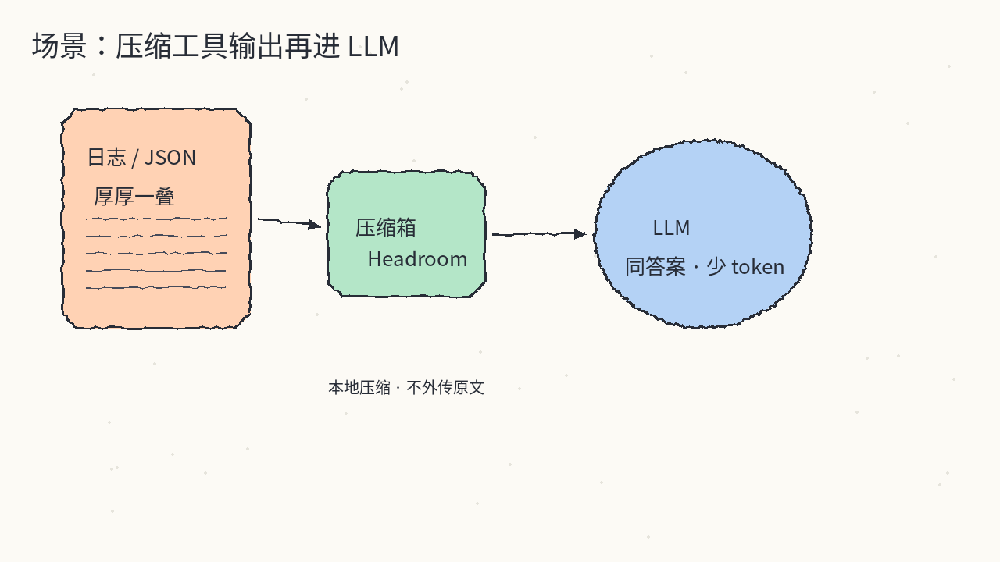
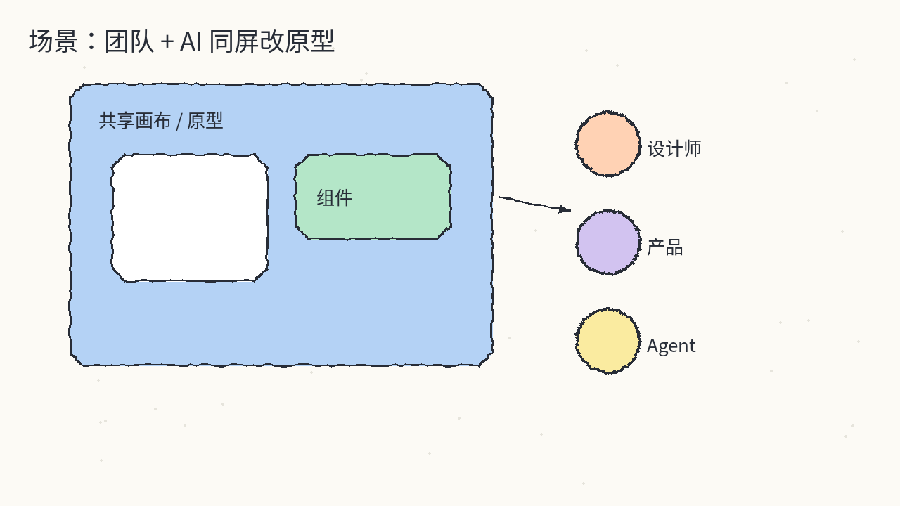
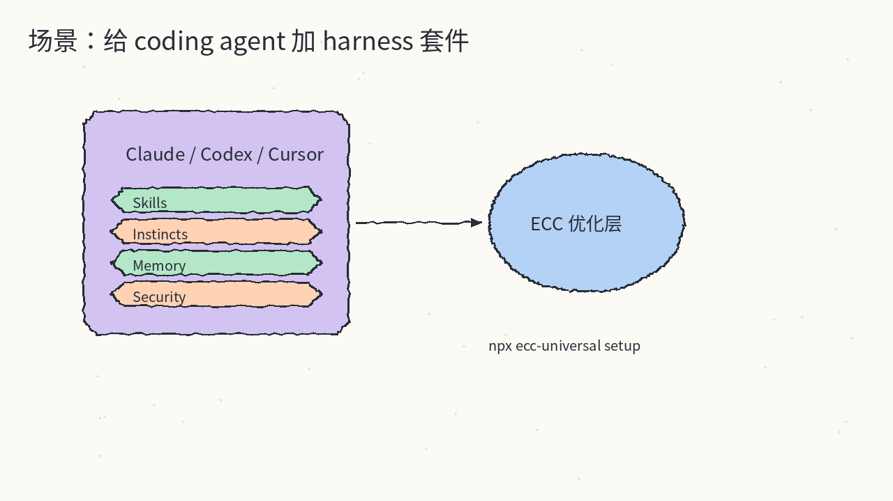
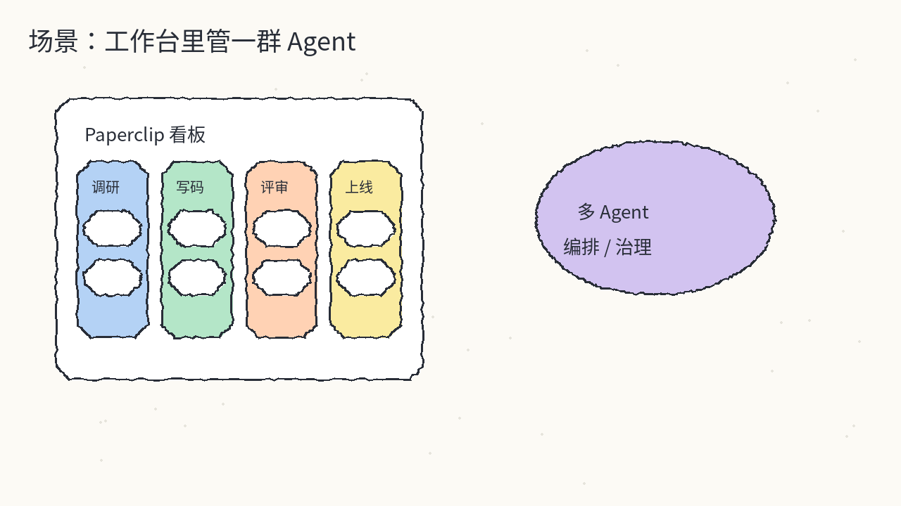
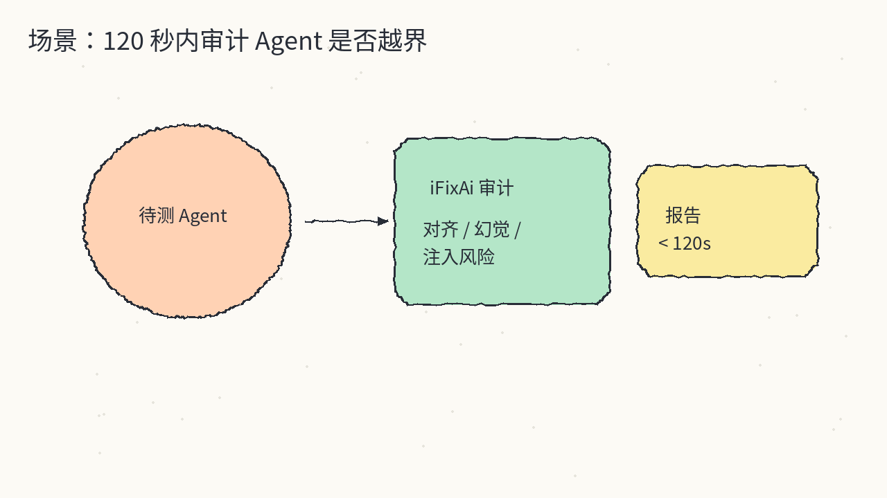
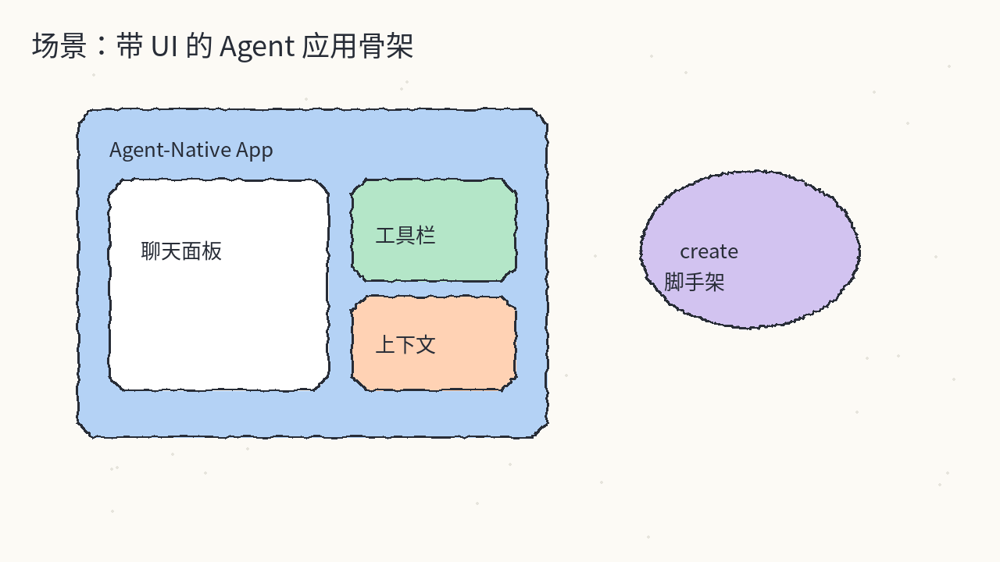
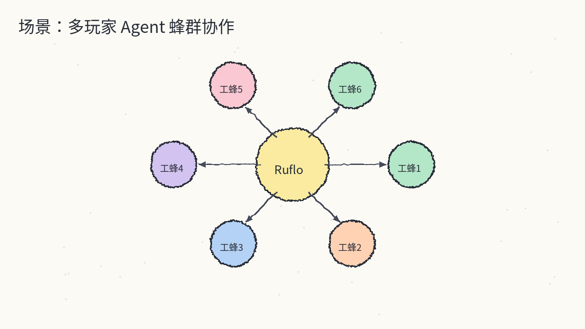
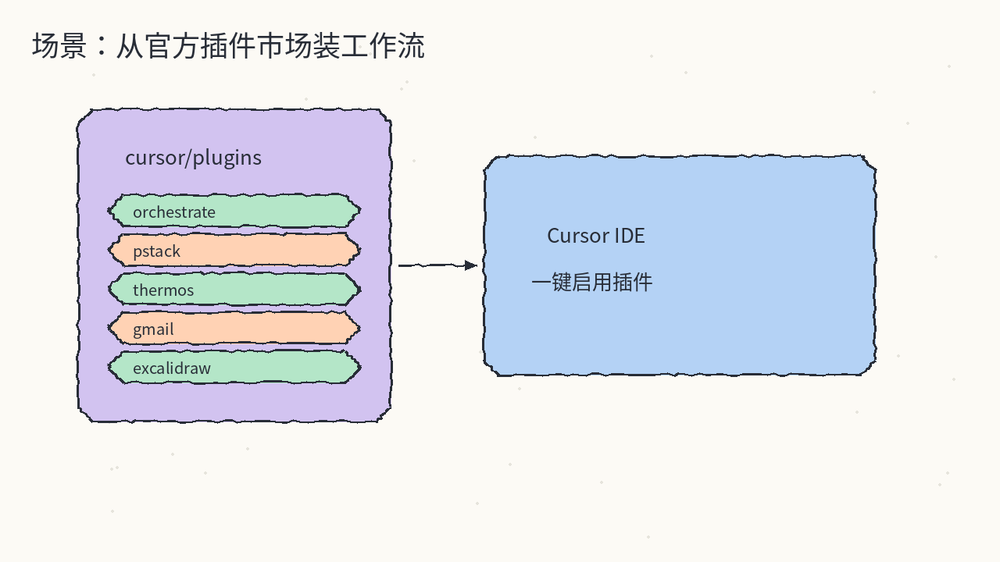

# 2026-10-20 GitHub 日报

今日精选 8 个近几天可动手跟进的开源项目（上下文压缩 / 协作设计 Agent / harness 套件 / Agent 工作台 / Agent 审计 / Agent 原生 UI / 蜂群 harness / Cursor 官方插件）。与往日日报、周报不重复。

## 1. headroomlabs-ai/headroom — 工具输出先压缩再进 LLM

**介绍**  
本地上下文压缩层（Apache-2.0，★~76k）：在工具输出、日志、RAG chunk、文件进模型前做压缩；JSON 可砍掉大半 token，编码场景常见约 20% 量级省流，答案侧尽量对齐。形态含库、`headroom proxy`、MCP，以及 `headroom wrap` 包一层 coding agent。压缩在本机跑，不把原文送到第三方去「帮你压」。

**用法**  
仓库：[github.com/headroomlabs-ai/headroom](https://github.com/headroomlabs-ai/headroom)；文档：[docs.headroomlabs.ai](https://docs.headroomlabs.ai/docs)。  
```bash
uv tool install --python 3.13 "headroom-ai[all]"
# 或：pip install "headroom-ai[all]"
headroom deploy          # 本地一键部署 + agent 配置
headroom wrap claude     # 包一层 coding agent
headroom proxy --port 8787
headroom doctor
```

**应用场景**  
Claude / Cursor 一类 agent 经常把巨型日志或 JSON 搜结果整段塞进上下文，想先本地压薄再问模型。



**推荐学习程度**：进阶

---

## 2. nexu-io/open-design — 本地优先的协作 AI 设计工作区

**介绍**  
开源协作设计 Agent 工作区（Apache-2.0，★~103k）：brief → 按设计系统出原型 / 动效 / 站点 / Dashboard / 演示稿，团队同项目里评论迭代；支持自带模型密钥与多种 coding agent 对接。桌面端零配置，也可 clone 后用 pnpm 跑 web。

**用法**  
仓库：[github.com/nexu-io/open-design](https://github.com/nexu-io/open-design)；站：[open-design.ai](https://open-design.ai)。  
```bash
# 推荐：官网 / Releases 下桌面端
# 或给 coding agent 装技能：
curl -fsSL https://open-design.ai/install.sh | sh -s <agent>
# 从源码：
git clone https://github.com/nexu-io/open-design.git
cd open-design && pnpm install && pnpm tools-dev run web
```

**应用场景**  
想让设计和工程共用一块可评论的原型画布，而不是截图在群里来回传。



**推荐学习程度**：入门

---

## 3. affaan-m/ECC — Agent harness 性能与能力套件

**介绍**  
面向 Claude Code / Codex / OpenCode / Cursor 等的 harness 优化系统（MIT，★~284k）：Skills、instincts、memory、安全与 research-first 工作流打包安装；CLI 为 `ecc-universal`，也可走 Claude 插件市场。适合想把「零散 tips」收成可复现安装面的人。

**用法**  
仓库：[github.com/affaan-m/ECC](https://github.com/affaan-m/ECC)；站：[ecc.tools](https://ecc.tools)。  
```bash
npx ecc-universal@2.2.3 setup
# 或引导式安装：
npx ecc-universal@2.2.3 install --guided
npx ecc-universal@2.2.3 doctor
```

**应用场景**  
新开一台机器或新 harness，希望一次装好技能 / 记忆 / 安全基线，而不是逐条复制 prompt。



**推荐学习程度**：进阶

---

## 4. paperclipai/paperclip — 管理工作里那群 Agent

**介绍**  
开源、可自托管的 Agent 工作管理应用（MIT，★~105k）：把多 agent 任务放进类似项目看板的编排面，强调治理与日常运营，而不是再写一个聊天框。Node 24+；`npx paperclipai@latest onboard` 可走引导。

**用法**  
仓库：[github.com/paperclipai/paperclip](https://github.com/paperclipai/paperclip)；站：[paperclip.ing](https://paperclip.ing)；五分钟路径：[docs](https://docs.paperclip.ing/guides/getting-started/five-minute-path/)。  
```bash
npx paperclipai@latest onboard --yes
# 试用：
npx paperclipai test-drive
```

**应用场景**  
团队里同时跑调研 / 写码 / 评审多个 agent，需要一张「谁在干什么、卡在哪」的工作台。



**推荐学习程度**：进阶

---

## 5. ifixai-ai/iFixAi — 两分钟内审计 Agent 是否在干正事

**介绍**  
独立 Agent 审计工具（Apache-2.0，★~30k）：人或 agent 自己触发，目标是在约 120 秒内回答「它是不是在做该做的事」。覆盖幻觉、注入、对齐与常见治理清单（OWASP LLM / NIST 等话题在 topic 里）。Python CLI，按要测的 provider 装 extra。

**用法**  
仓库：[github.com/ifixai-ai/iFixAi](https://github.com/ifixai-ai/iFixAi)；站：[ifixai.ai](https://www.ifixai.ai)。  
```bash
pip install "ifixai[openai]"    # 或 anthropic / gemini / all
# 完整路径见仓库 docs/get-started.md
```

**应用场景**  
上线前或事故后，想快速对某个 agent 路径做一刀独立体检，而不是只看自己人写的评测脚本。



**推荐学习程度**：进阶

---

## 6. BuilderIO/agent-native — 带 UI 的 Agent 应用框架

**介绍**  
Builder.io 的 agentic app 框架（MIT，★~7.4k）：不只做纯文本 agent，而是把聊天、工具与界面上下文放进同一套脚手架；`@agent-native/core` 可一键 `create` 出 standalone chat 模板。

**用法**  
仓库：[github.com/BuilderIO/agent-native](https://github.com/BuilderIO/agent-native)；文档：[agent-native.com](https://www.agent-native.com)。  
```bash
npx --yes @agent-native/core@latest create my-agent --standalone --template chat
```

**应用场景**  
要做一个「用户看得见的 Agent 产品」，而不是只在终端里跑 CLI agent。



**推荐学习程度**：入门

---

## 7. ruvnet/ruflo — 原初向的多玩家 Agent harness

**介绍**  
多智能体 / 蜂群向 harness（MIT，★~77k；站点 Cognitum.One）：自适应记忆、自学习、联邦与向量 RAG，并接 Claude Code / Codex / Hermes 等。可用 Claude 插件市场，或 `npx ruflo@latest init wizard` / 安装脚本。

**用法**  
仓库：[github.com/ruvnet/ruflo](https://github.com/ruvnet/ruflo)。  
```bash
# Claude Code（需较新版本）内：
# /plugin marketplace add ruvnet/ruflo
# /plugin install ruflo-...
npx ruflo@latest init wizard
# 或：
curl -fsSL https://cdn.jsdelivr.net/gh/ruvnet/ruflo@main/scripts/install.sh | bash
```

**应用场景**  
想把多角色 swarm、记忆与 MCP 编排收进同一套 harness，而不是手搓几份互不通信的 agent 配置。



**推荐学习程度**：深度

---

## 8. cursor/plugins — Cursor 官方插件规范与插件集

**介绍**  
Cursor 官方插件仓（★~13k，README 未标 SPDX）：根目录每个插件自带 `.cursor-plugin/plugin.json`。覆盖 orchestrate、pstack、thermos、continual-learning、各类 SaaS（Gmail / GitHub / Playwright 等）以及 create-plugin 脚手架。适合当「官方扩展面」索引，而不是再抄一份社区技能列表。

**用法**  
仓库：[github.com/cursor/plugins](https://github.com/cursor/plugins)。在 Cursor 插件市场按表内 `name` 安装对应目录；自建插件可参考 `create-plugin/`。无单独 npm 全局包——以 IDE 插件市场 / 仓内 manifest 为准。

**应用场景**  
要在 Cursor 里并行云端 agent、装团队工作流，或对接邮箱 / 日历 / 浏览器一类官方集成时，先翻这份清单。



**推荐学习程度**：入门
