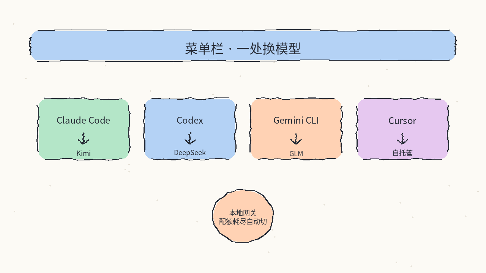
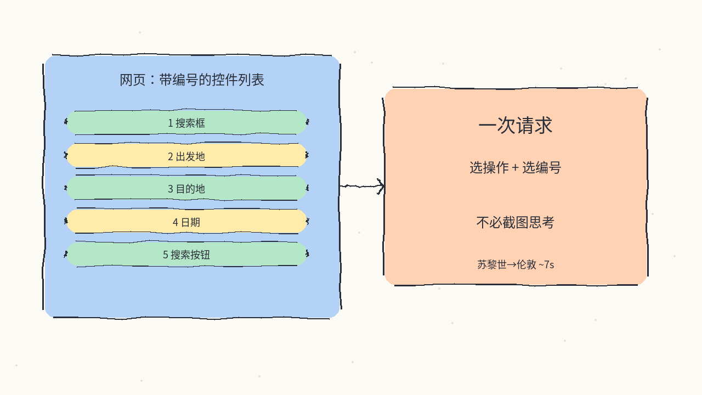
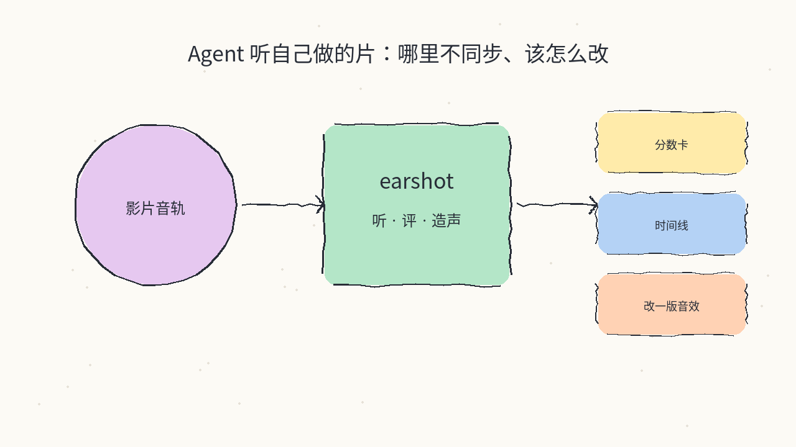
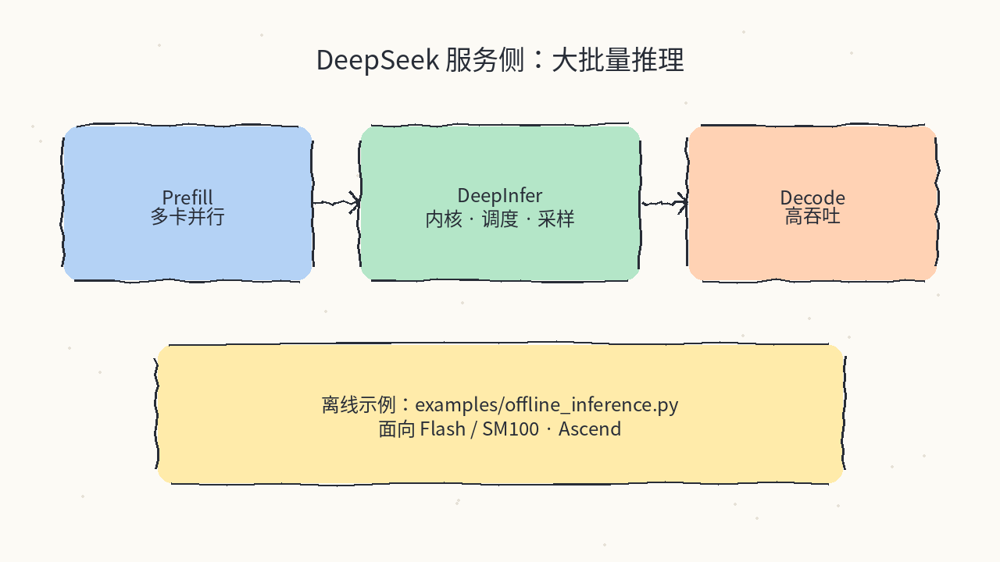
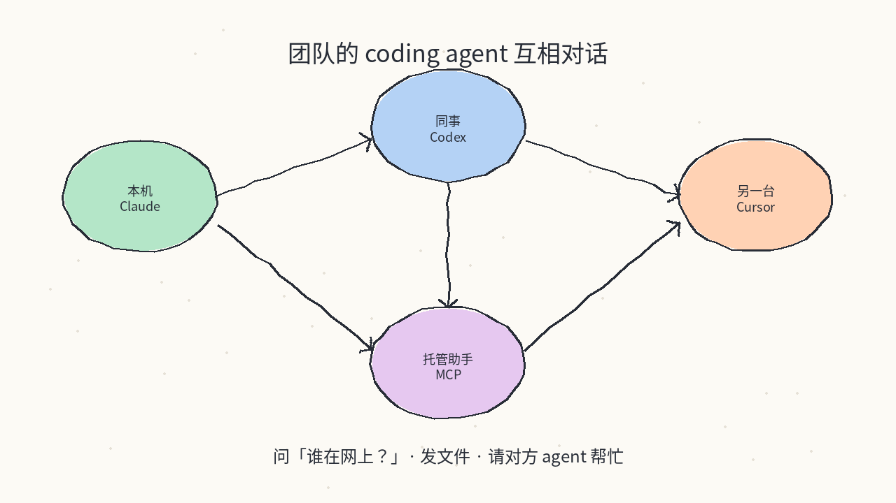
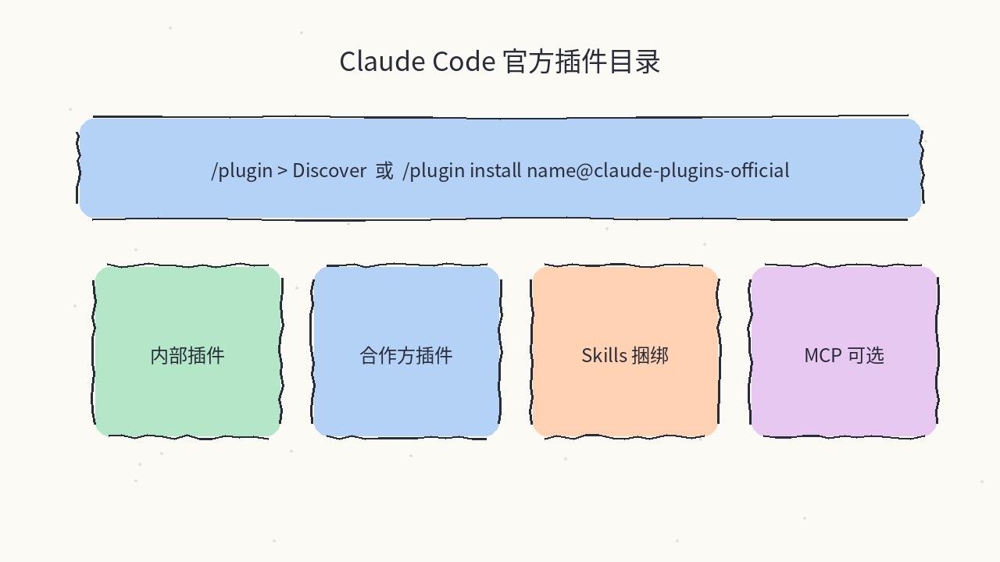
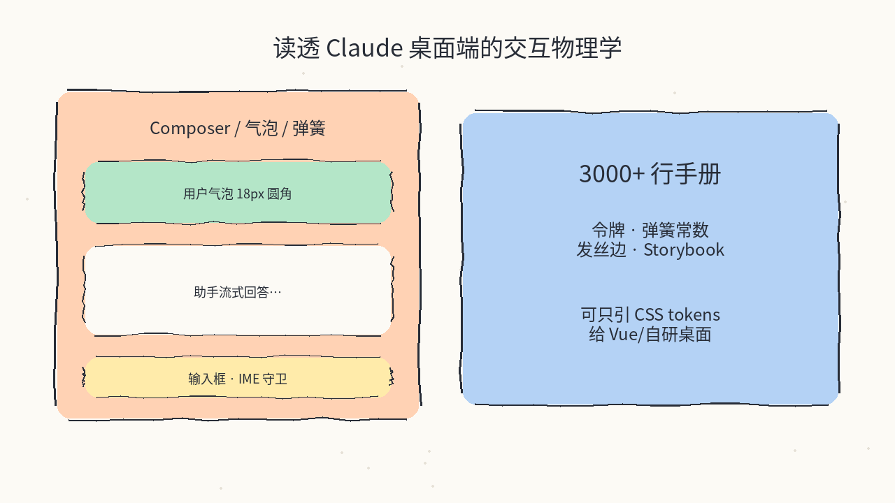

# 2026-10-21 GitHub 日报

今日精选 7 个近几天可动手跟进的开源项目（跨 Agent 换模型网关 / 结构化超快浏览器 Agent / Agent 听片评片 / DeepSeek 推理框架 / 团队 Agent 互通 / Claude 官方插件目录 / Claude 桌面 UI 洁室复现）。与往日日报、周报不重复。

## 1. yetone/magpie — 菜单栏里给每个 coding agent 换模型

**介绍**  
本地网关 + 菜单栏应用（MIT，★~18k）：Claude Code、Codex、Gemini CLI、Cursor 等各自藏模型配置的问题，收成「一个列表挑模型」。支持 API Key、本地模型，以及 Claude / ChatGPT / Copilot 等订阅；配额耗尽可按路由组静默切下一账号。macOS / Windows / Linux 桌面、TUI、Web、Docker、Termux 都有。

**用法**  
仓库：[github.com/yetone/magpie](https://github.com/yetone/magpie)；站：[usemagpie.ai](https://usemagpie.ai)；文档：[docs](https://usemagpie.ai/docs/start)。  
```bash
curl -fsSL https://usemagpie.ai/install.sh | sh
# 或官网下载桌面端
magpie provider add deepseek sk-…
magpie claude deepseek/deepseek-v4-pro
magpie codex moonshot/kimi-k2.5
magpie tui
```

**应用场景**  
同时开着 Claude Code / Codex / Cursor，想用同一套 DeepSeek 或 Kimi 配额，而不用进每个产品的配置文件改 base URL。



**推荐学习程度**：入门

---

## 2. browser-use/jev-ultrafast — 不靠截图循环的超快浏览器 Agent

**介绍**  
Browser Use × TypeSafe 的结构化浏览器 Agent（MIT，★~23k）：页面变成带编号的控件列表，模型一次请求同时选「操作 + 目标编号」；只有 `TYPE_TEXT` 才调用小模型写字。演示声称 Zürich→London 在 Google Flights 上约 7.1 秒（含加载；作者也标明这是少量跑次而非大基准）。默认环不吃截图。

**用法**  
仓库：[github.com/browser-use/jev-ultrafast](https://github.com/browser-use/jev-ultrafast)；站：[browser-use.com](https://browser-use.com)。  
```bash
git clone https://github.com/browser-use/jev-ultrafast.git
cd jev-ultrafast && uv sync
cp .env.example .env   # TYPESAFE_API_KEY + TEXT_MODEL_API_KEY
uv run jev             # http://127.0.0.1:8766
```

**应用场景**  
做网页自动化时受够了「截图→想→点→再截图」的慢环，想先用结构化 DOM 状态把速度拉回来。



**推荐学习程度**：进阶

---

## 3. Leonxlnx/earshot — 给 coding agent 装上耳朵

**介绍**  
CPU-only 的听音 / 评片 / 造声工具链（MIT，★~2k）：`describe` / `match` / `critique` / `timeline` / `sheet` 把声音变成 agent 能推理的证据；`forge` 用代码合成并按听感迭代；还带 200+ 无模型音效库与 MCP。解决「agent 能出片，但听不出音画不同步」的缺口。

**用法**  
仓库：[github.com/Leonxlnx/earshot](https://github.com/Leonxlnx/earshot)。需 Python 3.10+ 与 ffmpeg。  
```bash
git clone https://github.com/Leonxlnx/earshot && cd earshot
python -m venv .venv
.venv/bin/python -m pip install torch --index-url https://download.pytorch.org/whl/cpu
.venv/bin/python -m pip install -e ".[mcp,llm,dev]"
.venv/bin/python -m earshot doctor --load
# 技能：skills/earshot → ~/.claude/skills/
```

**应用场景**  
Agent 刚剪完产品演示片或 UI 动效，想让它自己听一遍并指出「击打晚了 80ms / 音乐鼓包错位」。



**推荐学习程度**：进阶

---

## 4. deepseek-ai/DeepInfer — DeepSeek 自家大规模推理框架开源

**介绍**  
DeepSeek 生产侧推理框架的离线开源版（Apache-2.0，★~13k，2026-10-16 起）：面向 DeepSeek-V4.1-Flash，含优化内核、Attention DP / MoE EP、异步调度、确定性采样、结构化输出等。硬件面写明 NVIDIA SM100 与华为 Ascend 950；完整在线服务还缺 KV 缓存系统等（README 已列）。

**用法**  
仓库：[github.com/deepseek-ai/DeepInfer](https://github.com/deepseek-ai/DeepInfer)。Python 3.12 + CUDA 13（或 Ascend CANN 9.2）。  
```bash
export DEEPINFER_ACCELERATOR=nvidia   # Ascend 用 ascend
./build.sh
python examples/offline_inference.py
# 默认拉 deepseek-ai/DeepSeek-V4.1-Flash-1017；本地可用 DEEPINFER_HF_MODEL_DIR=
```

**应用场景**  
自建 DeepSeek Flash 推理集群、要对齐官方吞吐/批不变量行为时，对照 vLLM/SGLang 之外的官方栈。



**推荐学习程度**：专精

---

## 5. reason-machines/reason-network — 让团队里的 coding agent 互相说话

**介绍**  
Reason Network 引擎（Apache-2.0，★~700）：本机小守护进程，把各机器上的 coding agent 连成网——问「谁在网上」、请对方 agent 办事、传文件；跨网用 iroh，必要时走只见密文的中继。托管助手可通过 MCP `https://mcp.reasonmachines.com/mcp` 接入。

**用法**  
仓库：[github.com/reason-machines/reason-network](https://github.com/reason-machines/reason-network)；站：[reasonmachines.com](https://reasonmachines.com)。  
```bash
curl -fsSL https://reasonmachines.com/install.sh | bash -s -- network
# 加入他人网络：
curl -fsSL https://reasonmachines.com/install.sh | bash -s -- network join '<link>'
reason network who
reason network send …
```

**应用场景**  
两台以上机器 / 多个 harness 并行干活，想让「我这边的 Claude」直接问「同事那边的 Codex」要一段上下文，而不是复制粘贴。



**推荐学习程度**：进阶

---

## 6. anthropics/claude-plugins-official — Anthropic 官方 Claude Code 插件目录

**介绍**  
Anthropic 维护的高质量 Claude Code 插件市场源（Apache-2.0，★~43k）：含官方内部插件与审核后的外部插件；条目可带 commands / agents / skills / MCP。本周仍在 trending 榜上，适合当作「先装官方市场再挑插件」的默认入口。

**用法**  
仓库：[github.com/anthropics/claude-plugins-official](https://github.com/anthropics/claude-plugins-official)；文档：[Plugins](https://code.claude.com/docs/en/plugins)。  
```bash
# 在 Claude Code 里：
/plugin install {plugin-name}@claude-plugins-official
# 或 /plugin → Discover 浏览
```

**应用场景**  
新开 Claude Code 环境，想从一个可信目录装自动化 / Skills / MCP，而不是随手 clone 陌生插件仓。



**推荐学习程度**：入门

---

## 7. Caho1/open-claude-ui — 高保真还原 Claude 桌面端 UI 与交互物理

**介绍**  
基于 REA 逆向整理的 Claude Design System 洁室复现（MIT，★~1.3k）：30 个独立模块 + 弹簧/发丝边/IME 守卫等交互常数，附 3000+ 行 CDS 手册与离线 Storybook。令牌与纯 CSS 层可脱离 React，给 Vue / 自研桌面 harness 直接 `@import`。

**用法**  
仓库：[github.com/Caho1/open-claude-ui](https://github.com/Caho1/open-claude-ui)。  
```bash
git clone https://github.com/Caho1/open-claude-ui.git
cd open-claude-ui && npm install
npm run build
npm run storybook   # 打开 docs/claude-components-storybook.html
# 只吃令牌：@import "open-claude-ui/tokens.css";
```

**应用场景**  
自己做 Agent 桌面壳或会话 UI，想对齐 Claude 那套陶土橙表面阶梯与 Composer 物理手感，而不是凭感觉抄截图。



**推荐学习程度**：进阶

---
