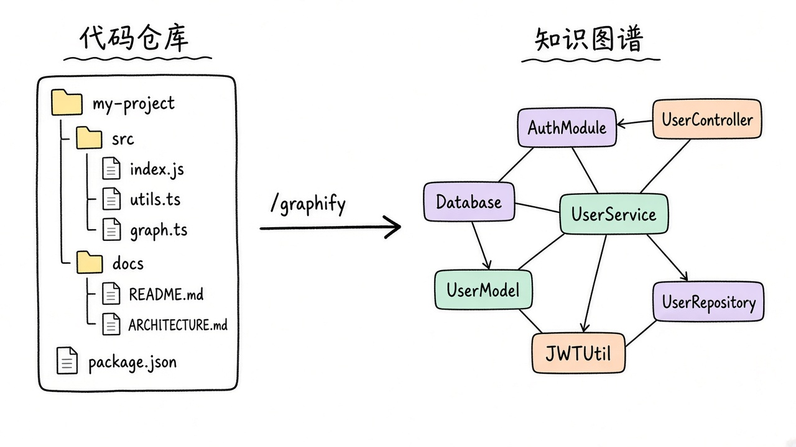
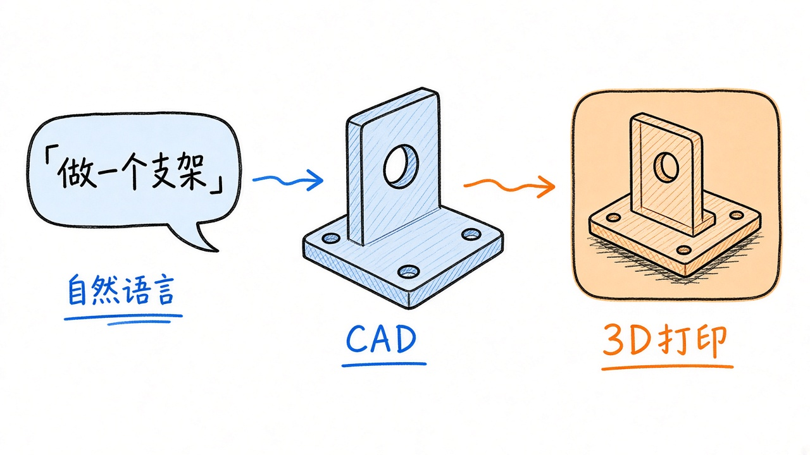
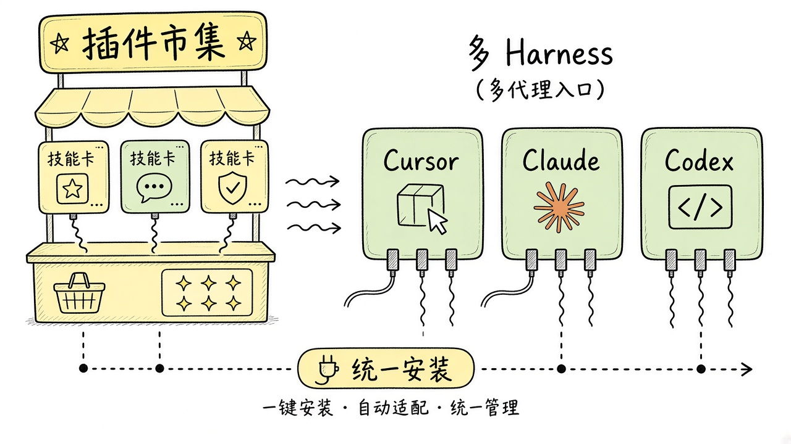
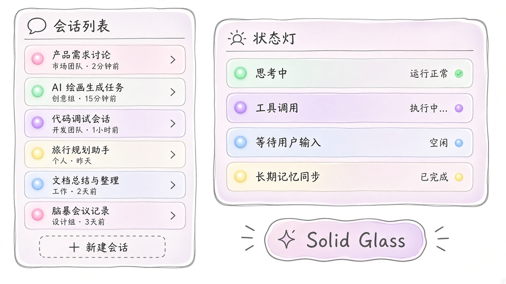
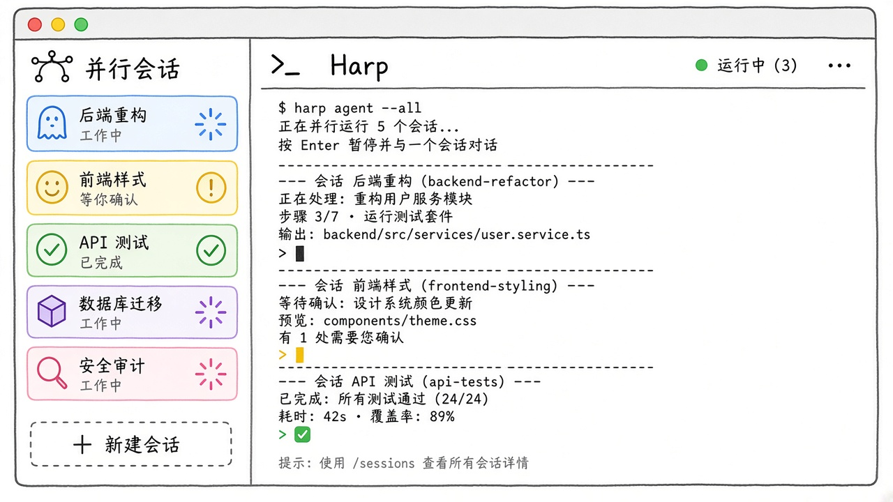
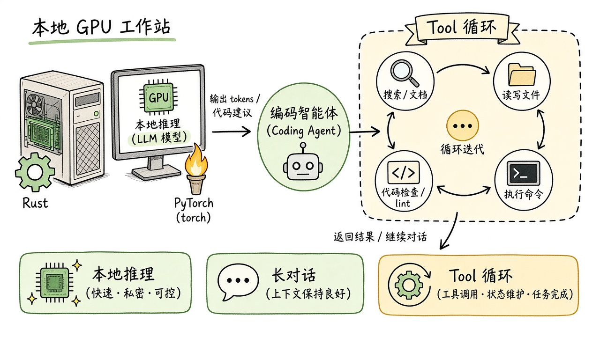
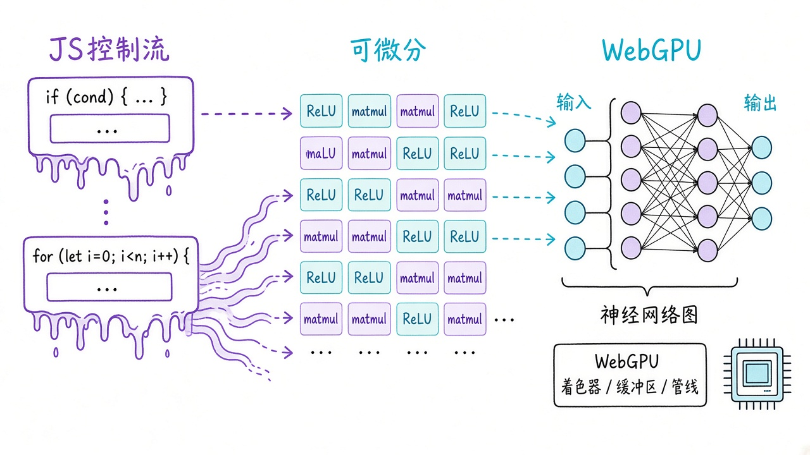

# 2026-10-22 GitHub 日报

今日精选围绕编码 Agent 知识图谱与多 harness 插件市集、本地语音与多 Agent 终端、CAD/求职等垂直技能。共 10 条，与往日日报、周报不重复。

## 1. Graphify-Labs/graphify — 把仓库焊成可查询知识图谱

**介绍**  
`/graphify` skill（Apache-2.0，★~132k）：用 tree-sitter 把 codebase、文档、PDF 打成可查询知识图谱，不依赖向量库。适合先摸清结构再改代码。

**用法**  
仓库：[github.com/Graphify-Labs/graphify](https://github.com/Graphify-Labs/graphify)；站：[graphify.com](https://www.graphify.com)；文档：[docs.graphify.com](https://docs.graphify.com)。  
```bash
uv tool install graphifyy
graphify install
# 在 agent 里：
/graphify .
```

**应用场景**  
接手陌生 monorepo 先建图谱再改代码。



**推荐学习程度**：进阶

---

## 2. morluto/rea — 用 Agent 逆向「任何」目标

**介绍**  
REA（MIT，★~358k）：面向「无源码也能拆」的 agent 逆向工作流，覆盖 app→native 一类目标；配套 `rea-agents` CLI 与站点。

**用法**  
仓库：[github.com/morluto/rea](https://github.com/morluto/rea)；站：[rea.tools](https://rea.tools)。  
```bash
npx rea-agents setup
# 或
npm i -g rea-agents
```

**应用场景**  
无源码客户端/模组定位协议钩子。


**推荐学习程度**：深入

---

## 3. earthtojake/text-to-cad — Agent 写 CAD 的 skills + MCP

**介绍**  
Text-to-CAD（MIT，★~22k）：给 coding agent 装 CAD 技能与 MCP，走自然语言出几何；有 Claude 插件市场安装路径与文档站。

**用法**  
仓库：[github.com/earthtojake/text-to-cad](https://github.com/earthtojake/text-to-cad)；文档：[texttocad.dev](https://www.texttocad.dev)。  
```bash
claude plugin marketplace add earthtojake/text-to-cad#latest
claude plugin install text-to-cad@earthtojake
```

**应用场景**  
自然语言出可 3D 打印支架+DFM。



**推荐学习程度**：进阶

---

## 4. wshobson/agents — 多 harness 共用的插件市集

**介绍**  
Agent 插件 / 技能市集（MIT，★~41k）：一套仓库给 Cursor、Claude 等多 harness 统一装技能；也可用 `npx skills` 按 skill 名拉取。

**用法**  
仓库：[github.com/wshobson/agents](https://github.com/wshobson/agents)；用法见仓内 `usage.md`。  
```bash
/plugin marketplace add wshobson/agents
# 再按文档 install 具体插件
# 或：
npx skills add wshobson/agents --skill python-testing-patterns
```

**应用场景**  
团队混用 Cursor/Claude 统一装技能。



**推荐学习程度**：入门

---

## 5. deeplethe/solid-glass — AI 应用向的 shadcn/Tailwind 设计系统

**介绍**  
Solid Glass（MIT，★~2.1k）：面向 AI 应用界面的 shadcn / Tailwind 设计系统，可一键 `shadcn add`；有在线 demo。

**用法**  
仓库：[github.com/deeplethe/solid-glass](https://github.com/deeplethe/solid-glass)；Demo：[deeplethe.github.io/solid-glass](https://deeplethe.github.io/solid-glass)。  
```bash
npx shadcn@latest add deeplethe/solid-glass/solid-glass
```

**应用场景**  
agent 控制台会话列表/状态灯。



**推荐学习程度**：入门

---

## 6. debpalash/VoiceStudio — 本地 ElevenLabs 替代

**介绍**  
VoiceStudio（AGPL-3.0，★~80k）：本机跑的语音克隆 / 合成栈，定位 ElevenLabs 一类云 TTS 的本地替代。许可证是 AGPL，商用分发前先读清义务。

**用法**  
仓库：[github.com/debpalash/VoiceStudio](https://github.com/debpalash/VoiceStudio)；站：[voicestudio.sh](https://voicestudio.sh)。  
```bash
curl -fsSL https://voicestudio.sh/install | sh
```

**应用场景**  
本地克隆音色批量旁白。


**推荐学习程度**：进阶

---

## 7. dominikmartn/harp — Warp 非官方 fork：侧栏并行多 Agent

**介绍**  
Harp（AGPL-3.0，★~537）：Warp 的非官方 fork，侧栏并行跑 Claude Code / Codex 等会话，方便一眼看谁在等你。从 Releases 下 DMG。

**用法**  
仓库：[github.com/dominikmartn/harp](https://github.com/dominikmartn/harp)。  
```bash
# 从 GitHub Releases 下载 macOS DMG 安装
```

**应用场景**  
多会话一眼看谁在等你。



**推荐学习程度**：进阶

---

## 8. NVIDIA/flare-local-inference — 本地推理研究栈（PyTorch + Rust）

**介绍**  
FLARE local inference（Apache-2.0，★~515）：本机 serving 研究代码——PyTorch 侧准备 + Rust Helios；细节与 agent 约定见仓内 `AGENTS.md`。

**用法**  
仓库：[github.com/NVIDIA/flare-local-inference](https://github.com/NVIDIA/flare-local-inference)。  
```bash
git clone https://github.com/NVIDIA/flare-local-inference
cd flare-local-inference
uv sync
cargo build
# 流程与约定见 AGENTS.md
```

**应用场景**  
本机长对话/tool 循环本地推理。



**推荐学习程度**：深入

---

## 9. chenglou/handwired — 把 JS 控制流焊成 ReLU/matmul 网

**介绍**  
Handwired（MIT，★~1.9k）：把 JavaScript 控制流编译/映射成 ReLU + matmul 风格神经网络；浏览器 demo 可直接玩。

**用法**  
仓库：[github.com/chenglou/handwired](https://github.com/chenglou/handwired)；Demo：[chenglou.me/handwired](https://chenglou.me/handwired/)。  
```bash
bun install && bun start
```

**应用场景**  
浏览器里把业务规则焊成可 GPU 图。



**推荐学习程度**：深入

---

## 10. ai-job-search-dev/ai-job-search — 本地 Claude Code 求职框架

**介绍**  
AI Job Search（MIT，★~63k）：面向 Claude Code 的本地求职工作流框架；建议私有 fork 后再跑 `/setup` `/scrape` `/apply`。步骤见 `SETUP.md`。

**用法**  
仓库：[github.com/ai-job-search-dev/ai-job-search](https://github.com/ai-job-search-dev/ai-job-search)。  
```bash
git clone https://github.com/ai-job-search-dev/ai-job-search
# 建议先 fork 为私有仓再配置
# agent 内：/setup  /scrape  /apply
# 详见 SETUP.md
```

**应用场景**  
批量抓岗+定制简历求职信。


**推荐学习程度**：入门
