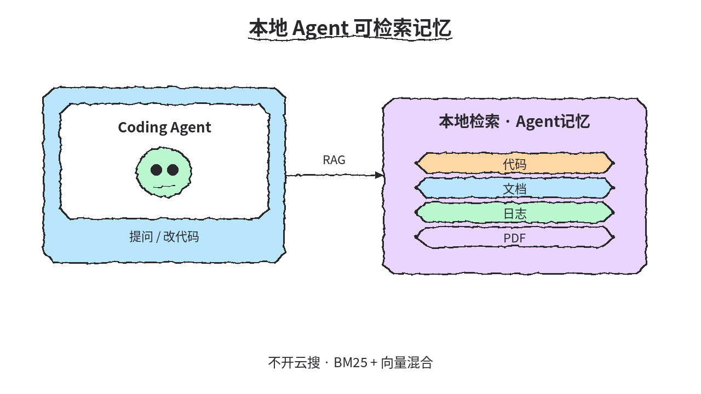
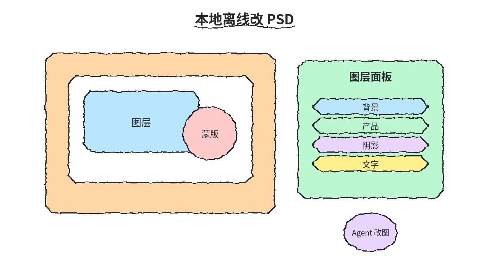
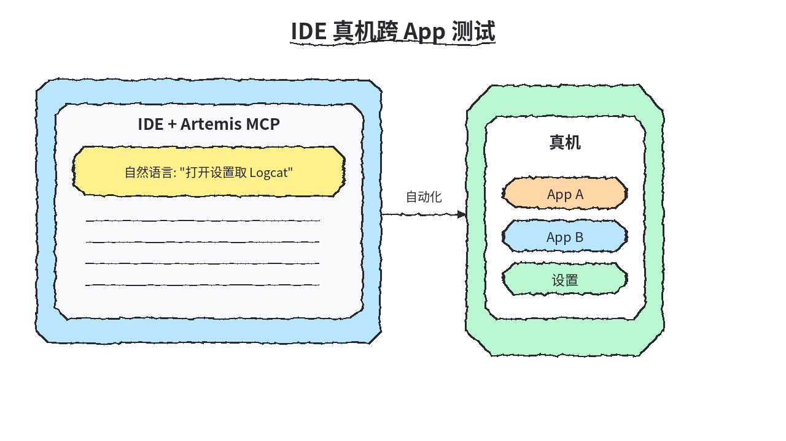
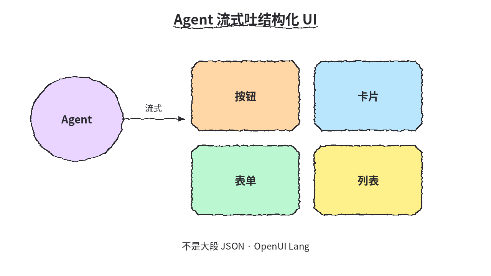
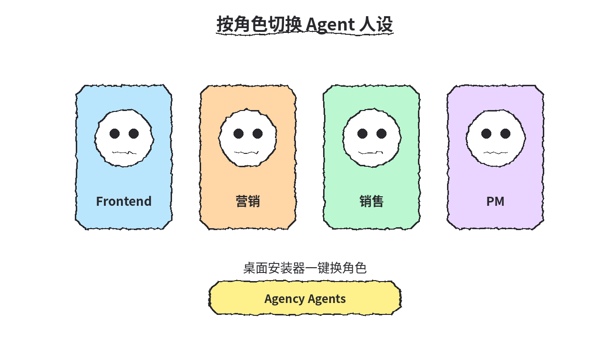
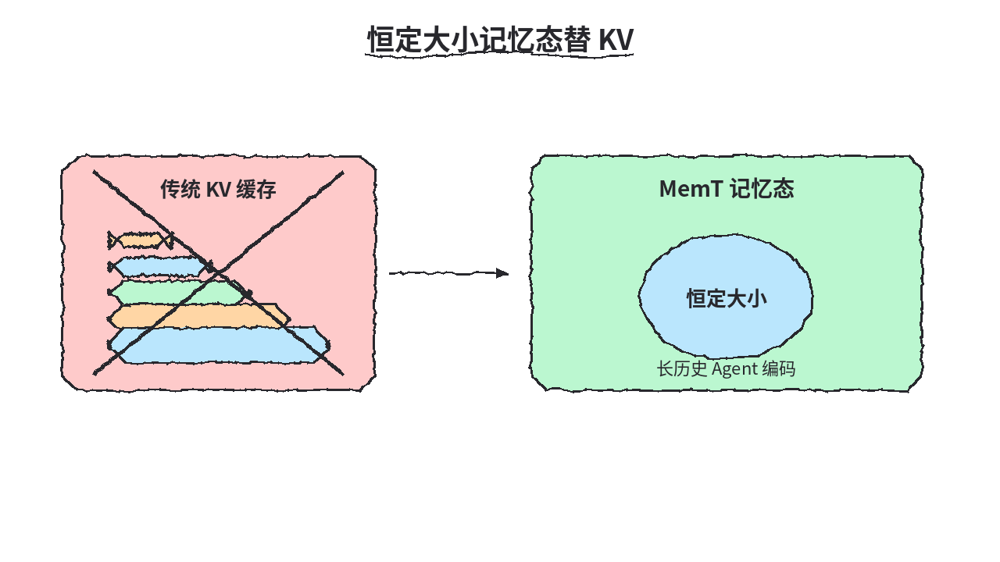
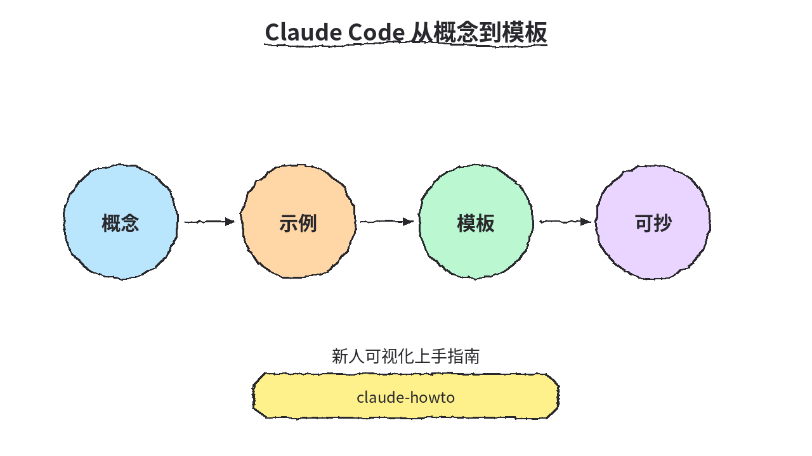

# 2026-10-23 GitHub 日报

今日精选 7 条：本地检索记忆与离线改图、Android 自动化、生成式 UI、角色人设、记忆原生模型与 Claude Code 上手指南。

## 1. xerj-org/xerj — 本地优先搜索引擎 + Agent MCP

**介绍**  
xerj（Apache-2.0，Rust，★~13135）：本地优先搜索引擎，给 agent 挂 BM25 + 向量 + 混合检索；可索引代码/文档/日志/PDF，提供 ES 兼容 API，兼作 agent memory。

**用法**  
仓库：[github.com/xerj-org/xerj](https://github.com/xerj-org/xerj)；文档：[xerj.org](https://xerj.org)。  
```bash
curl -fsSL https://xerj.org/get | sh
```

**应用场景**  
本地给 coding agent 挂可检索记忆/RAG 而不开云搜。



**推荐学习程度**：进阶

---

## 2. storytold/photocraft — 干净室 Photoshop 式编辑器

**介绍**  
PhotoCraft（MIT/Apache，Rust，★~71400）：干净室实现的 Photoshop 类编辑器，支持图层/蒙版/PSD；带 AGENTS.md，方便 agent 改图。

**用法**  
仓库：[github.com/storytold/photocraft](https://github.com/storytold/photocraft)；发布：[releases](https://github.com/storytold/photocraft/releases)；站：[getartcraft.com/apps/photocraft](https://getartcraft.com/apps/photocraft)。  
```bash
git clone https://github.com/storytold/photocraft
cargo run --release -p photocraft -- image.psd
```

**应用场景**  
本地离线改 PSD/图层且给 agent 改图。



**推荐学习程度**：进阶

---

## 3. google/artemis — NL→Android 自动化 + IDE MCP

**介绍**  
Artemis（Apache-2.0，★~13829）：自然语言驱动 Android 自动化，并提供 IDE 用 MCP；AndroidWorld 成绩 99%+。

**用法**  
仓库：[github.com/google/artemis](https://github.com/google/artemis)。  
```bash
git clone https://github.com/google/artemis.git && cd artemis && ./start.sh
uv run artemis run "打开设置并取 Logcat" --profile flash
uv run artemis mcp --install all
```

**应用场景**  
IDE 里用真机跑跨 App 测试/取 Logcat。



**推荐学习程度**：进阶

---

## 4. thesysdev/openui — 生成式 UI 标准

**介绍**  
OpenUI（MIT，★~13103）：生成式 UI 标准；OpenUI Lang 可流式输出，覆盖 React/Vue/Svelte/Angular。

**用法**  
仓库：[github.com/thesysdev/openui](https://github.com/thesysdev/openui)；文档：[openui.com](https://openui.com)。  
```bash
npm install @openuidev/react-lang @openuidev/react-ui
```

**应用场景**  
Agent 流式吐结构化 UI 而不是大段 JSON。



**推荐学习程度**：进阶

---

## 5. msitarzewski/agency-agents — 专业 Agent 人设名册

**介绍**  
Agency Agents（MIT，★~163288）：按角色整理的 AI agent 人设花名册，附桌面安装器，可一键切 Frontend/营销等人格。

**用法**  
仓库：[github.com/msitarzewski/agency-agents](https://github.com/msitarzewski/agency-agents)；应用：[agencyagents.app](https://agencyagents.app)。  
```bash
# brew cask 或：
./scripts/install.sh --tool claude-code
```

**应用场景**  
按角色切换 Frontend/营销等 agent 人设。



**推荐学习程度**：入门

---

## 6. MemTensor/MemT-1.0 — 记忆原生基础模型

**介绍**  
MemT-1.0（★~344）：memory-native 基础模型，动态本地记忆 + 超记忆；Nano/Flash 权重在 HF，论文见 arXiv。

**用法**  
仓库：[github.com/MemTensor/MemT-1.0](https://github.com/MemTensor/MemT-1.0)；HF 集合：[MemTensor/memt-1](https://huggingface.co/collections/MemTensor/memt-1)；论文：[arxiv.org/abs/2610.26825](https://arxiv.org/abs/2610.26825)。

**应用场景**  
长历史 agent 编码时用恒定大小记忆态替 KV。



**推荐学习程度**：深入

---

## 7. luongnv89/claude-howto — Claude Code 可视化上手

**介绍**  
claude-howto（MIT，★~43270）：示例驱动的 Claude Code 可视化指南 + 可抄模板，帮新人从概念走到能用。

**用法**  
仓库：[github.com/luongnv89/claude-howto](https://github.com/luongnv89/claude-howto)。  
```bash
git clone https://github.com/luongnv89/claude-howto
# 按仓内示例与模板跟练
```

**应用场景**  
新人把 Claude Code 从概念走到可抄模板。



**推荐学习程度**：入门
