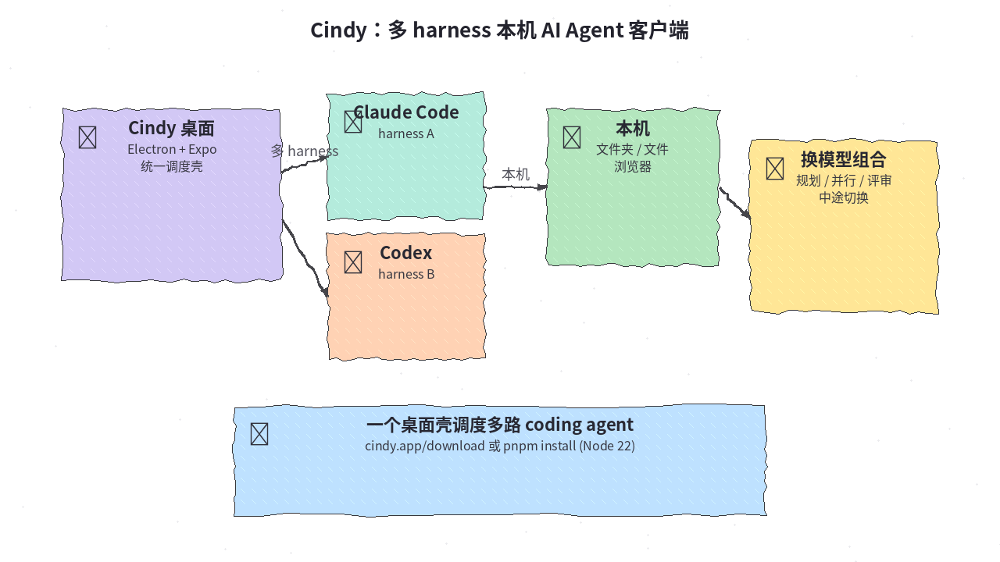
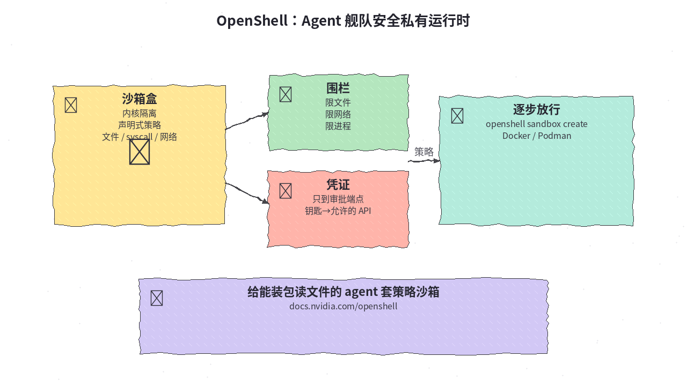
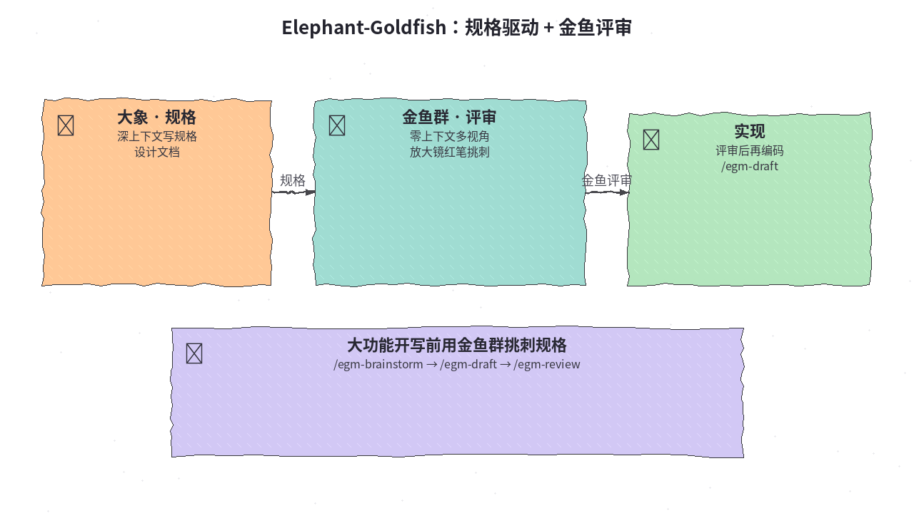
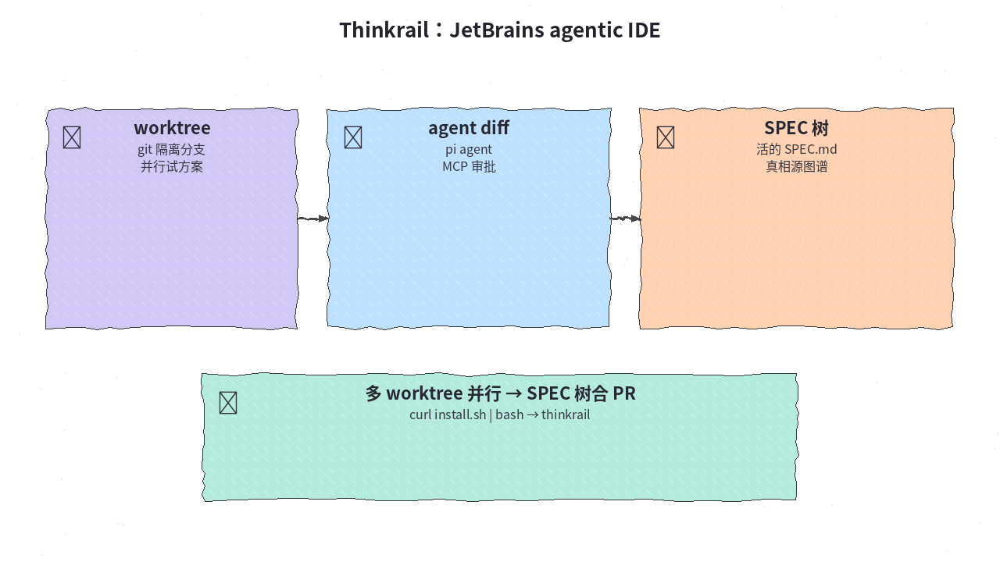
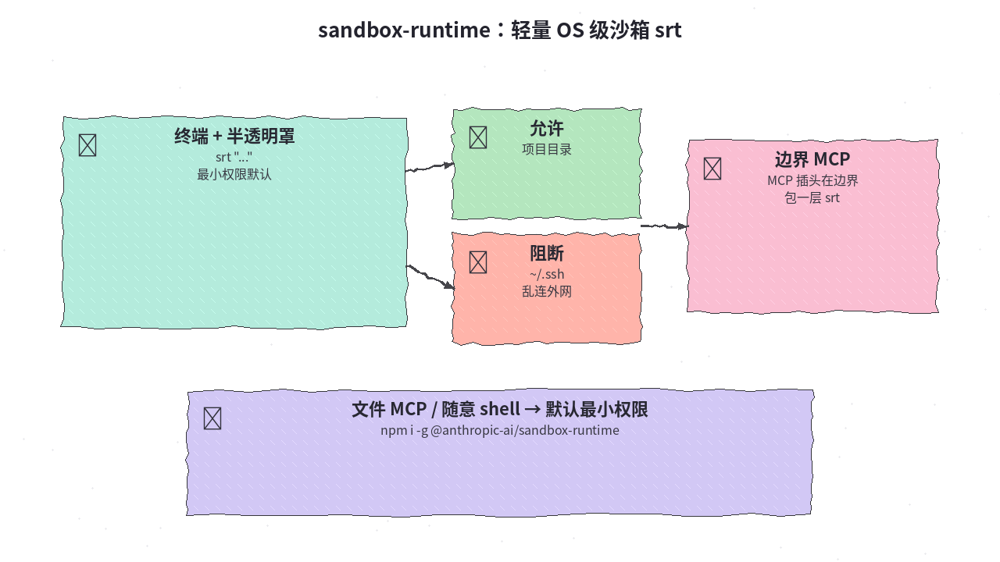

# 2026-10-26 GitHub 日报

今日精选 5 条：本地多 harness 客户端、Agent 沙箱运行时、规格驱动方法与 agentic IDE。

## 1. makecindy/cindy — 开箱即用多 harness AI Agent 客户端

**介绍**  
Cindy（Apache-2.0，★~4938）：开箱即用的开源 AI Agent 客户端；统一 Claude Code/Codex 等多 harness 与本机文件/浏览器；可中途换模型组合。桌面 Electron + 移动 Expo monorepo。

**用法**  
仓库：[github.com/makecindy/cindy](https://github.com/makecindy/cindy)；下载：[cindy.app/download](https://cindy.app/download/)。  
```bash
git clone https://github.com/makecindy/cindy && cd cindy
git lfs pull && pnpm install   # Node 22
```

**应用场景**  
一个桌面壳调度多路 coding agent，规划/并行/评审换不同模型。



**推荐学习程度**：入门

---

## 2. NVIDIA/OpenShell — Agent 舰队安全私有运行时

**介绍**  
OpenShell（Apache-2.0，★~19886）：自主 agent 舰队的安全私有运行时；内核隔离 + 声明式策略限文件/syscall/网络；凭证只到审批端点。

**用法**  
仓库：[github.com/NVIDIA/OpenShell](https://github.com/NVIDIA/OpenShell)；文档：[docs.nvidia.com/openshell](https://docs.nvidia.com/openshell/)。  
```bash
curl -fsSL https://raw.githubusercontent.com/NVIDIA/OpenShell/main/install.sh | sh
openshell sandbox create --name demo   # 需 Docker/Podman
# 也可：npx skills add NVIDIA/OpenShell
```

**应用场景**  
给能装包读文件的 agent 套策略沙箱再逐步放行。



**推荐学习程度**：专题深挖

---

## 3. google/elephant-goldfish-model — Spec-Driven 大象规格 + 金鱼评审

**介绍**  
elephant-goldfish-model（Apache-2.0，★~1019）：Google 开源 Spec-Driven Development 方法与技能；大象深上下文写规格，金鱼零上下文多视角压力测试后再实现。非 Google 官方产品。站：[egm.dev](https://egm.dev)。

**用法**  
仓库：[github.com/google/elephant-goldfish-model](https://github.com/google/elephant-goldfish-model)。  
```bash
# Claude：marketplace add + plugin install egm@egm
/egm-brainstorm → /egm-draft → /egm-review
```

**应用场景**  
大功能开写前用金鱼群挑刺规格再编码。



**推荐学习程度**：进阶

---

## 4. JetBrains/thinkrail — JetBrains incubator agentic IDE

**介绍**  
Thinkrail（Apache-2.0，★~1804）：JetBrains incubator agentic IDE；pi agent、git worktree 隔离、活的 SPEC.md 图谱、MCP 审批；桌面或 CLI。站：[thinkrail.ai](https://thinkrail.ai/)。

**用法**  
仓库：[github.com/JetBrains/thinkrail](https://github.com/JetBrains/thinkrail)；Releases 安装包或：  
```bash
curl -fsSL https://thinkrail.ai/install.sh | bash
thinkrail
```

**应用场景**  
多 worktree 并行试方案，SPEC 树为真相源再合 PR。



**推荐学习程度**：进阶

---

## 5. anthropics/sandbox-runtime — 轻量 OS 级沙箱 srt

**介绍**  
sandbox-runtime（Apache-2.0，★~6608）：Anthropic 轻量 OS 级沙箱 srt；macOS sandbox-exec / Linux bubblewrap + 网络代理过滤；可包 agent、MCP、bash。研究预览。

**用法**  
仓库：[github.com/anthropics/sandbox-runtime](https://github.com/anthropics/sandbox-runtime)。  
```bash
npm i -g @anthropic-ai/sandbox-runtime
srt "..."
# MCP command 包一层 srt；配置 ~/.srt-settings.json
```

**应用场景**  
给文件 MCP/随意 shell 默认最小权限，挡 ~/.ssh 与乱连外网。



**推荐学习程度**：进阶
