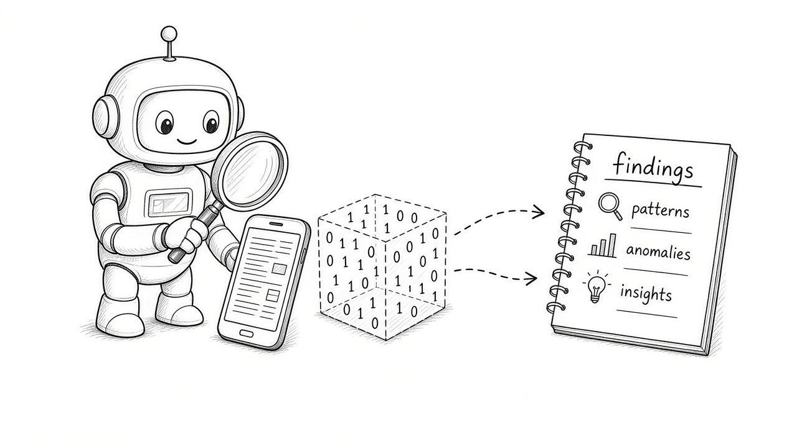
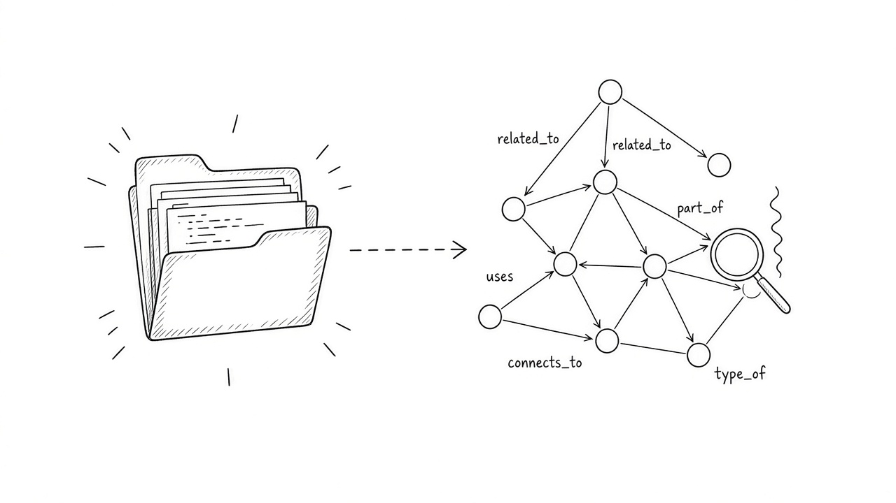
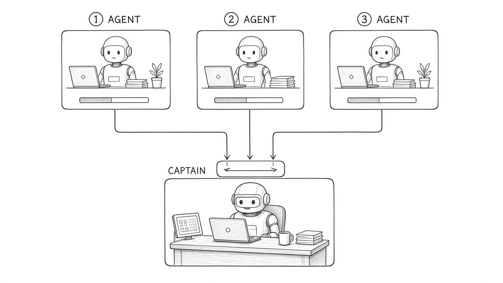
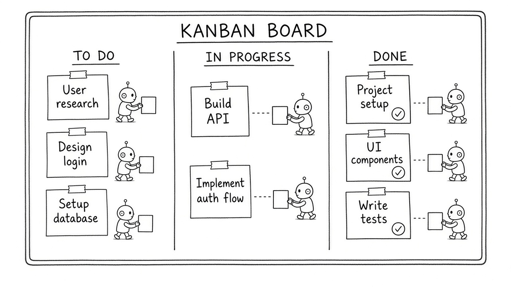
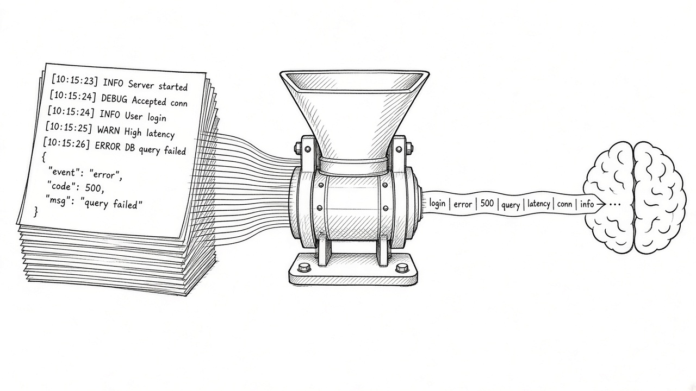
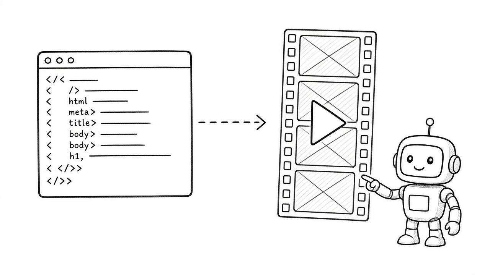
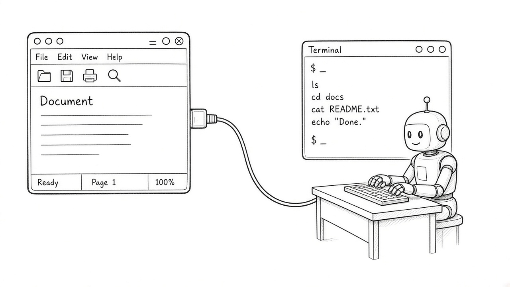
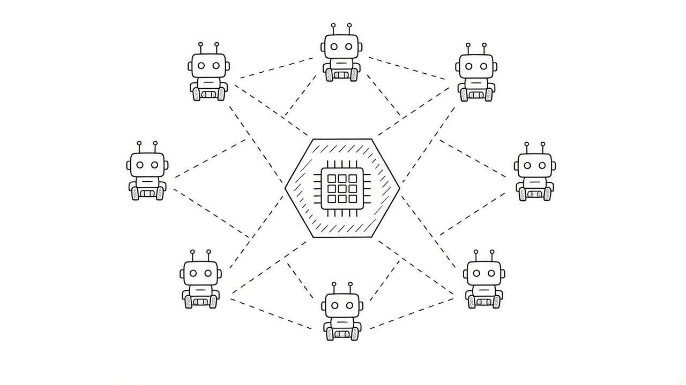
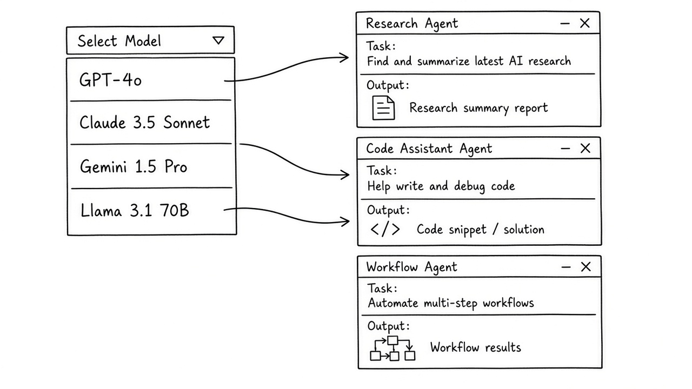

# 2026-10-26 GitHub 周报

上周（10/19–10/25）精选 10 个值得跟进的开源项目（偏逆向 / 知识图谱 / Agent 编排 / 上下文压缩 / 视频与 CLI）。

## 1. morluto/rea — 用 Agent 逆向「任何」目标

**介绍**  
REA（Reverse Engineer Anything）是一套面向 coding agent 的逆向工程 MCP/CLI（MIT）：从应用行为一路拆到原生二进制，并把发现连同证据一起交回，方便 agent 解释功能或复现。本周仍是 GitHub 周趋势与多家周榜的头号话题。

**用法**  
官方入口：[github.com/morluto/rea](https://github.com/morluto/rea) 或 [rea.tools](https://rea.tools)；一键：`npx rea-agents setup`（也可 `npm i -g rea-agents`）。装好后把 MCP 接到 Claude Code / Codex 等 harness 再下分析任务。

**应用场景**  
手里只有闭源客户端或模组、没有源码，却想让 agent 定位协议钩子、关键路径或某段原生逻辑的证据链。

**推荐学习程度**：专家

---

## 2. Graphify-Labs/graphify — 把仓库焊成可查询知识图谱

**介绍**  
Graphify 把 codebase、文档、SQL schema、配置与 PDF 打成可查询知识图谱（Apache-2.0）：本地 tree-sitter 确定性 AST 解析，边可解释，不依赖向量库。提供 `/graphify` skill，对接 Claude Code / Cursor / Codex / Gemini CLI 等。

**用法**  
仓库：[github.com/Graphify-Labs/graphify](https://github.com/Graphify-Labs/graphify)。`uv tool install graphifyy` 后执行 `graphify install`；在 agent 会话里对仓库跑 `/graphify .`。文档见 [docs.graphify.com](https://docs.graphify.com)。

**应用场景**  
接手陌生 monorepo 时先建结构图谱，再按路径/概念查询改代码，避免反复全文扫盘。

**推荐学习程度**：进阶

---

## 3. stablyai/orca — 一屏编排多路 Coding Agent 舰队

**介绍**  
Orca 是桌面+移动端的 Agent 编排环境（MIT）：把 Claude Code / Codex / OpenCode 等并排放进各自 git worktree，一屏跟踪、手机 companion 跟进，用你自己的订阅额度跑，不绑单一云厂商。

**用法**  
仓库：[github.com/stablyai/orca](https://github.com/stablyai/orca)。从 onorca.dev/download 装桌面端，接好各 Agent CLI；可选 iOS App Store / Android APK 作 companion。装好后同一提示可扇出到多路 worktree 再合并赢家。

**应用场景**  
同一需求想并行试几条实现路线，或人在外面也要盯着 agent 跑完再远程补一句指令。

**推荐学习程度**：入门

---

## 4. paperclipai/paperclip — 管理工作里那群 Agent

**介绍**  
开源可自托管的 Agent 工作管理应用（MIT，★107309）：把多 agent 任务放进类似项目看板的编排面，强调治理与日常运营，而不是再写一个聊天框。

**用法**  
仓库：[github.com/paperclipai/paperclip](https://github.com/paperclipai/paperclip)；站：[paperclip.ing](https://paperclip.ing)。`npx paperclipai@latest onboard --yes` 或 `npx paperclipai test-drive`。

**应用场景**  
团队里同时跑调研 / 写码 / 评审多个 agent，需要「谁在干什么、卡在哪」的工作台。

**推荐学习程度**：进阶

---

## 5. headroomlabs-ai/headroom — 工具输出先压缩再进 LLM

**介绍**  
本地上下文压缩层（Apache-2.0，★77819）：工具输出、日志、RAG chunk 进模型前先压薄；形态含库、`headroom proxy`、MCP、`headroom wrap`。压缩在本机跑，不把原文送第三方。

**用法**  
仓库：[github.com/headroomlabs-ai/headroom](https://github.com/headroomlabs-ai/headroom)；文档：[docs.headroomlabs.ai](https://docs.headroomlabs.ai/docs)。`uv tool install --python 3.13 "headroom-ai[all]"` 后 `headroom deploy` / `headroom wrap claude`。

**应用场景**  
coding agent 常把巨型日志或 JSON 搜结果整段塞进上下文，想先本地压薄再问模型。

**推荐学习程度**：进阶

---

## 6. storytold/photocraft — 干净室 Photoshop 式编辑器

**介绍**  
纯 Rust 开源照片编辑器（★72849）：从零实现图层/选区/滤镜一类工作流，定位「干净室」可审计实现，方便 agent 或工具链嵌入本地改图。

**用法**  
仓库：[github.com/storytold/photocraft](https://github.com/storytold/photocraft)。按 README 拉发行版或源码构建桌面端；把导出路径交给本机 agent 做批处理改图。

**应用场景**  
要在本机批量抠图、调色、出素材，又希望链路可审计、可脚本化。

**推荐学习程度**：进阶

---

## 7. heygen-com/hyperframes — 用 HTML 写片，专为 Agent 渲染视频

**介绍**  
HeyGen 开源的 HyperFrames（Apache-2.0）：用普通 HTML/CSS（可接 GSAP/Lottie/Three 等）写出画面，再确定性渲成 MP4。面向 agent——HTML 可浏览器预览，比强绑 React 构建链的方案更易让模型生成与迭代。

**用法**  
仓库：[github.com/heygen-com/hyperframes](https://github.com/heygen-com/hyperframes)。克隆仓库后按 README 用 CLI 脚手架项目、本地预览与渲染（支持本地或 AWS Lambda）。适合让 coding agent 直接写 HTML 成片脚本。

**应用场景**  
产品演示、功能解说或动效短片要可复现导出 MP4，又希望 agent 用 HTML 改稿而不是专有时间线编辑器。

**推荐学习程度**：进阶

---

## 8. HKUDS/CLI-Anything — 让任意软件变成 Agent 可调用的 CLI

**介绍**  
港大等团队的 CLI-Hub 思路（★57125）：把 GUI / 专有软件封装成 Agent 可调用的命令行接口，降低「只会点界面」工具进 agent 工作流的门槛。

**用法**  
仓库：[github.com/HKUDS/CLI-Anything](https://github.com/HKUDS/CLI-Anything)；Hub：[clianything](https://clianything.com)。按文档为你的目标软件生成/注册 CLI wrapper，再挂到 agent 工具列表。

**应用场景**  
公司内部还有只能 GUI 操作的设计/仿真软件，想让 coding agent 也能「下命令」驱动它。

**推荐学习程度**：进阶

---

## 9. ruvnet/ruflo — 多玩家 Agent harness 蜂群

**介绍**  
Ruflo 是挂在 Claude Code / Codex 等外的 agent meta-harness（MIT）：蜂群协作、自适应记忆、联邦与 MCP/hooks，强调在不换主工具的前提下加多智能体编排与护栏。

**用法**  
仓库：[github.com/ruvnet/ruflo](https://github.com/ruvnet/ruflo)。Claude Code 插件市场添加 ruvnet/ruflo 后安装；或 `npx ruflo@latest init wizard`，也可按 README 跑官方 install 脚本。

**应用场景**  
已在用 Claude Code/Codex，想加多角色 swarm、持久记忆与跨机协作，而不想整套迁到新框架。

**推荐学习程度**：专家

---

## 10. yetone/magpie — 菜单栏里给每个 coding agent 换模型

**介绍**  
Magpie 是本地网关 + 菜单栏应用（MIT）：把 Claude Code、Codex、Gemini CLI、Cursor 等各自的模型配置收成「一个列表挑模型」，可接 API Key、本地模型与多种订阅；配额耗尽可按路由组切换。

**用法**  
仓库：[github.com/yetone/magpie](https://github.com/yetone/magpie)；`curl -fsSL https://usemagpie.ai/install.sh | sh` 或官网下桌面端；例如 `magpie provider add deepseek sk-…` 后 `magpie claude deepseek/deepseek-v4-pro`，也可用 `magpie tui`。

**应用场景**  
同时开着多个 coding agent，想统一用 DeepSeek / Kimi 等额度，而不用分别改每个产品的 base URL 配置。

**推荐学习程度**：入门
