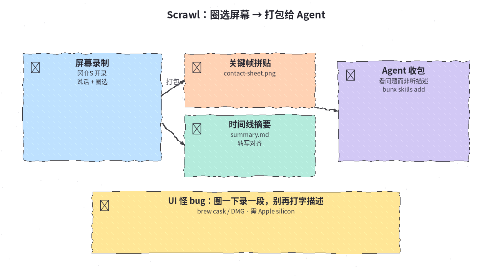
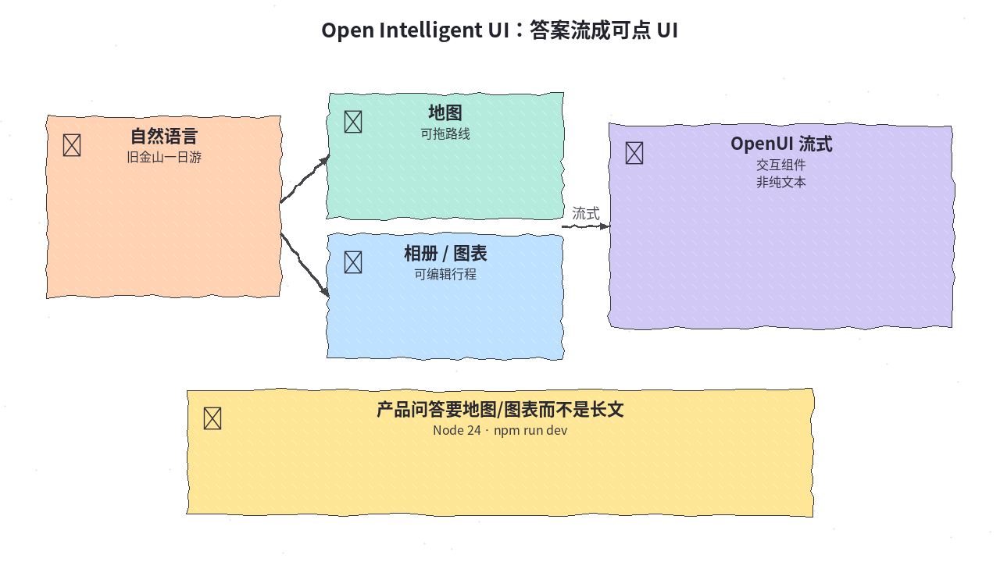
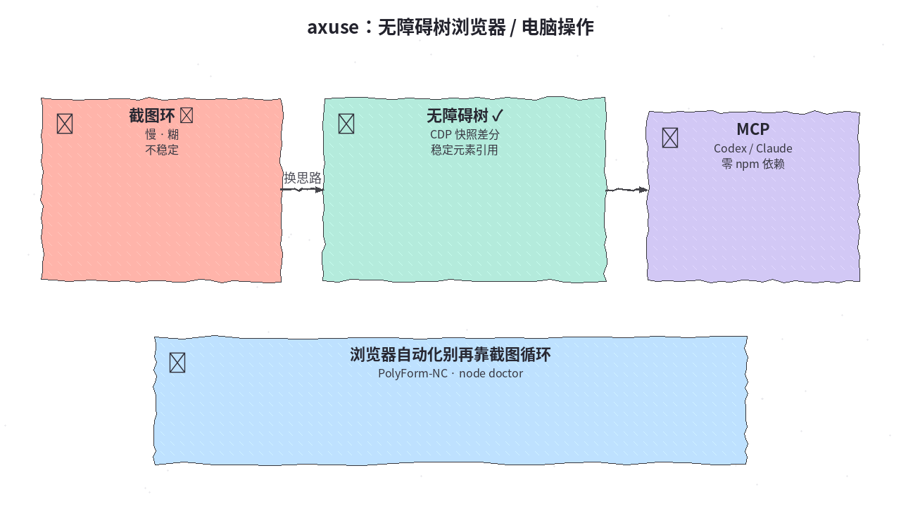
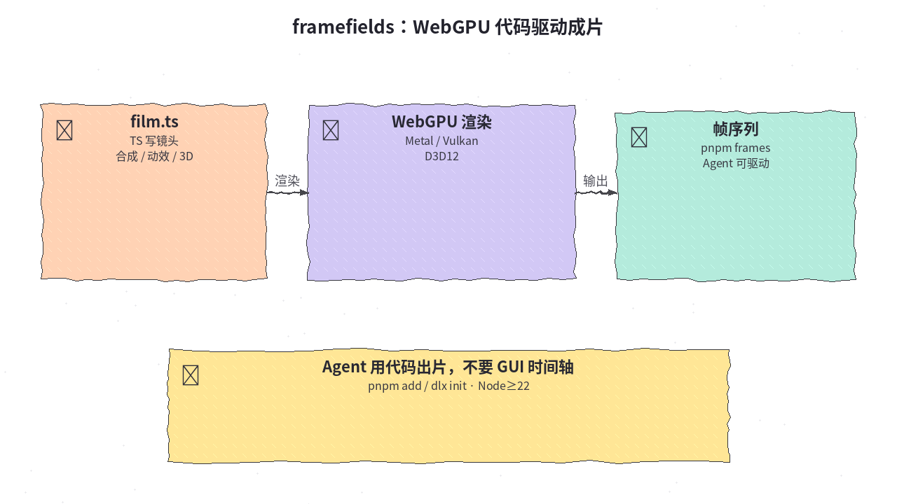
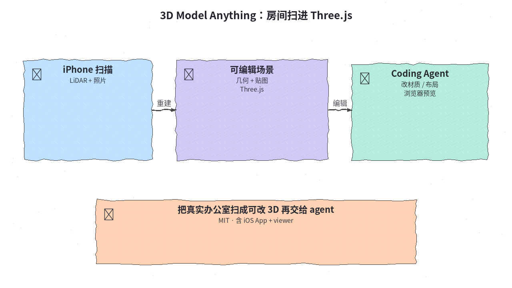
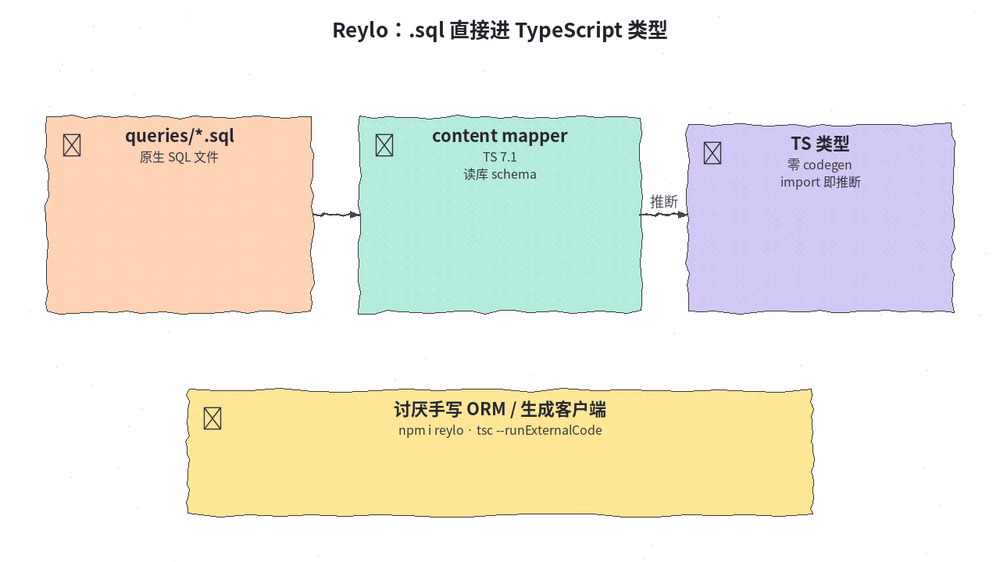
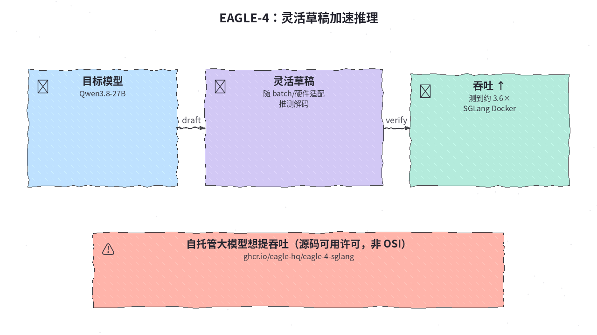

# 2026-10-27 GitHub 日报

今日精选 7 个近几天可动手跟进的开源项目（屏幕圈选喂 Agent / 交互式 Intelligent UI / 无障碍树浏览器操控 / WebGPU 代码成片 / 房间扫进 Three.js / SQL→TS 零 codegen / 推测解码加速）。与往日日报、周报不重复。

## 1. kitlangton/scrawl — 圈选屏幕，打包给 Agent 看

**介绍**  
Scrawl（MIT，★~767）：快捷键开录，边说边点边画，结束后打成 contact sheet、关键帧、对齐转写与时间线摘要，再交给 coding agent——让它「看见问题」而不是听你打字描述。带 Claude Code / Codex 等 skill；macOS（Apple silicon）完整，Windows 预览未签名。

**用法**  
仓库：[github.com/kitlangton/scrawl](https://github.com/kitlangton/scrawl)；站：[scrawl.kitlangton.com](https://scrawl.kitlangton.com)。  
```bash
brew install --cask kitlangton/tap/scrawl
# 或官网 / Releases 下 DMG、Windows zip
bunx skills add kitlangton/scrawl
# 默认 ⌥⇧S 开录/停录
```

**应用场景**  
UI 怪 bug 或动效时序问题，懒得写长复现步骤，想直接圈一下录一段丢给 agent。



**推荐学习程度**：入门

---

## 2. thesysdev/open-intelligent-ui — 答案流成可点的交互 UI

**介绍**  
Open Intelligent UI（MIT，★~847）：开源复现 ChatGPT「Intelligent UI」体验——问「旧金山一日游」返回可拖地图、相册、可编辑行程，而不是长文。基于 [OpenUI](https://openui.com)；可走 Thesys Gateway，也可接任意 OpenAI 兼容 Chat Completions。

**用法**  
仓库：[github.com/thesysdev/open-intelligent-ui](https://github.com/thesysdev/open-intelligent-ui)；演示：[openui.com/demo/intelligent-ui](https://www.openui.com/demo/intelligent-ui)。需 Node 24。  
```bash
git clone https://github.com/thesysdev/open-intelligent-ui.git
cd open-intelligent-ui
cp .env.example .env
npm install && npm run generate:apiKey && npm run dev
# http://localhost:3000
```

**应用场景**  
做助手产品时，想先摸清「结构化交互答案」的交互与网关接入，而不是纯 markdown 气泡。



**推荐学习程度**：进阶

---

## 3. ctoldigital/axuse — 用无障碍树做浏览器 / 电脑操控

**介绍**  
axuse（PolyForm-Noncommercial-1.0.0，★~508）：面向 Codex / Claude Code / OpenCode 等的 MCP——经 CDP 读 DOM/无障碍树差分快照与稳定元素引用，替代「截图→想→点」慢环；声明零 npm 依赖（Node ≥22）。Windows 桌面驱动已验证；macOS / Linux 桌面有明确边界说明。

**用法**  
仓库：[github.com/ctoldigital/axuse](https://github.com/ctoldigital/axuse)；站：[ax-use.com](https://ax-use.com)。  
```bash
git clone https://github.com/ctoldigital/axuse.git && cd axuse
node src/cli.js doctor
node src/cli.js setup --browser chrome --harness codex
# 非商业许可：商用前先读 LICENSE
```

**应用场景**  
网页自动化受够截图循环，想用结构化无障碍状态把速度和稳定性拉回来（个人/研究场景优先）。



**推荐学习程度**：进阶

---

## 4. gatewai-dev/framefields — WebGPU 上的代码优先成片

**介绍**  
framefields（Apache-2.0，★~492）：一个 npm 包，让 Agent（或你）用 TypeScript 写合成、动效与 3D，在原生 WebGPU（Metal / Vulkan / D3D12）上渲染；无 GPU 机器可用 lavapipe / WARP 兜底。`framefields init` 可脚手架整部片子。

**用法**  
仓库：[github.com/gatewai-dev/framefields](https://github.com/gatewai-dev/framefields)；文档：[framefields.dev](https://framefields.dev)。需 Node ≥22。  
```bash
pnpm add framefields
pnpm dlx framefields init my-film --install
cd my-film && pnpm frames -- 0 30 60
```

**应用场景**  
想让 coding agent 用代码出短片/动效，而不是在 GUI 时间轴里点来点去。



**推荐学习程度**：进阶

---

## 5. wesbos/3d-model-anything — 把房间扫成可编辑 Three.js

**介绍**  
3D Model Anything（MIT，★~2.0k；`data/` 与部分图另有资源许可）：iPhone 端 LiDAR + 照片采集，重建可编辑 Three.js 场景，再交给 AI coding agent 改材质、布局并在浏览器里探索。含 iOS App、viewer 与脚手架。

**用法**  
仓库：[github.com/wesbos/3d-model-anything](https://github.com/wesbos/3d-model-anything)；演示：[wesbos.github.io/3d-model-anything](https://wesbos.github.io/3d-model-anything/)。按 README 装 App → 扫描 → 导出到仓库 viewer；再让 agent 改 `scene` 相关代码。

**应用场景**  
真实办公室/展厅要数字化布置或做可漫游 demos，想「扫一遍 → agent 改场景」。



**推荐学习程度**：进阶

---

## 6. colinhacks/reylo — `.sql` 直接进 TypeScript 类型

**介绍**  
Reylo（MIT，★~1.3k；Zod 作者）：用 TypeScript 7.1 content mappers 把 `.sql` 文件映射成带完整推断的 TS，运行时读当前库 schema（Postgres / MySQL 8.0.22+ / SQLite），零传统 codegen。需 Node 24+ 与 `tsc --runExternalCode`。

**用法**  
仓库：[github.com/colinhacks/reylo](https://github.com/colinhacks/reylo)；站：[reylo.dev](https://reylo.dev)。  
```bash
npm install reylo
npm install -D @reylosql/postgres typescript@beta
# tsconfig 加 contentMappers：reylo + .sql / .reylo.yaml
# package.json: "typecheck": "tsc --noEmit --runExternalCode"
```

**应用场景**  
喜欢手写 SQL、讨厌 ORM 生成客户端漂移，又想在 TS 里保住类型安全。



**推荐学习程度**：专精

---

## 7. eagle-hq/EAGLE-4 — 一套灵活草稿加速推理

**介绍**  
EAGLE-4（Eagle 源码可用许可，非 OSI 开源，★~1.0k）：新一代推测解码——单一灵活 draft 模型按 batch / 硬件自适应。官方给出 Qwen3.8-27B + [EAGLE-Corp/Qwen3.8-27B-EAGLE4](https://huggingface.co/EAGLE-Corp/Qwen3.8-27B-EAGLE4) 在 SPEED-Bench 上约 3.59×（相对 vanilla，测法见 README）。提供 SGLang Docker 镜像。

**用法**  
仓库：[github.com/eagle-hq/EAGLE-4](https://github.com/eagle-hq/EAGLE-4)；站：[eagle.ai](https://eagle.ai)。  
```bash
docker run --gpus all --ipc host -p 127.0.0.1:30000:30000 \
  -e HF_HOME=/hf -v ~/.cache/huggingface:/hf \
  ghcr.io/eagle-hq/eagle-4-sglang:0.1.2 \
  sglang serve --model-path Qwen/Qwen3.8-27B --host 0.0.0.0 \
  --disable-overlap-schedule --speculative-algorithm EAGLE_HARNESS \
  --speculative-draft-model-path EAGLE-Corp/Qwen3.8-27B-EAGLE4
# 首次会拉约 62GB；商用前读 LICENSE
```

**应用场景**  
自托管 Qwen3.8-27B 一类大模型，想在保持输出分布的前提下抬吞吐。



**推荐学习程度**：专精
