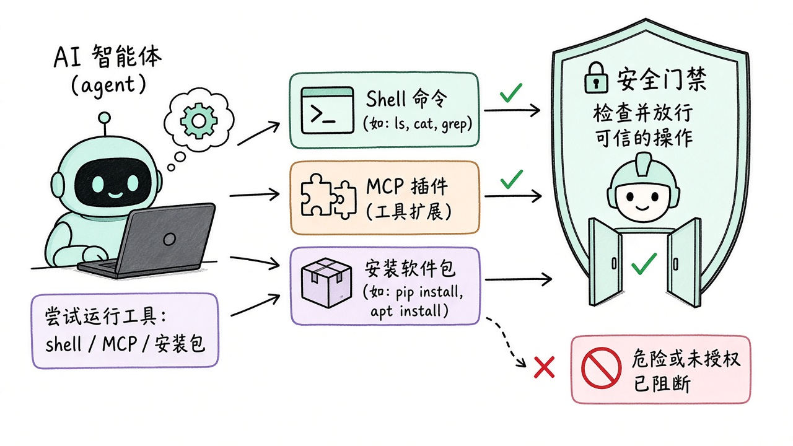
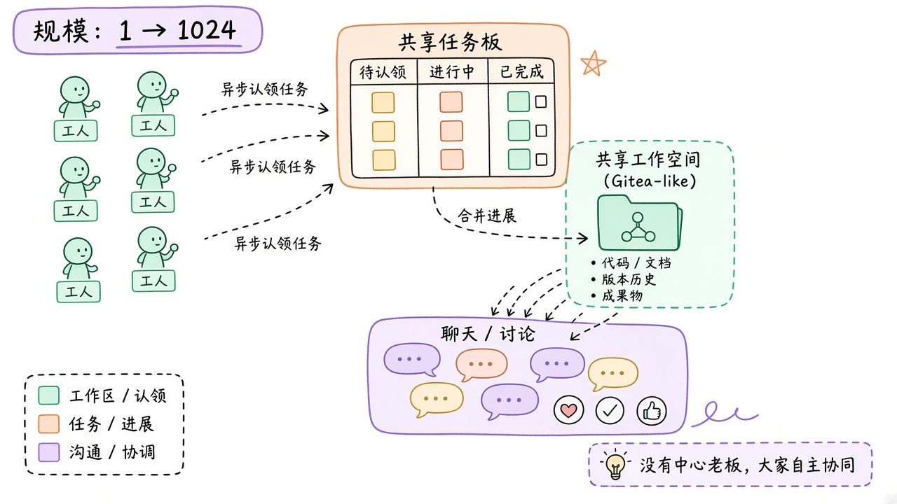
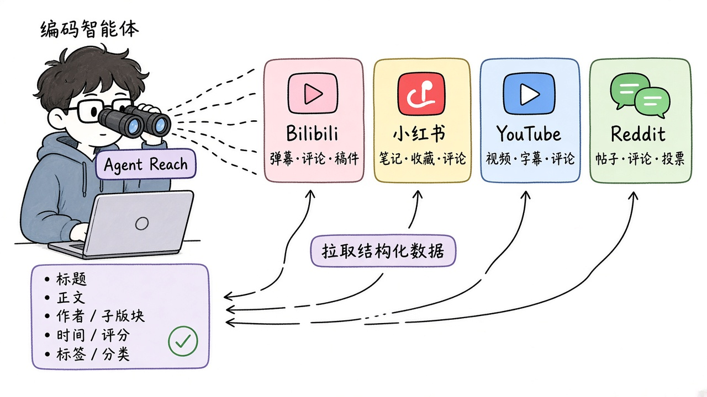
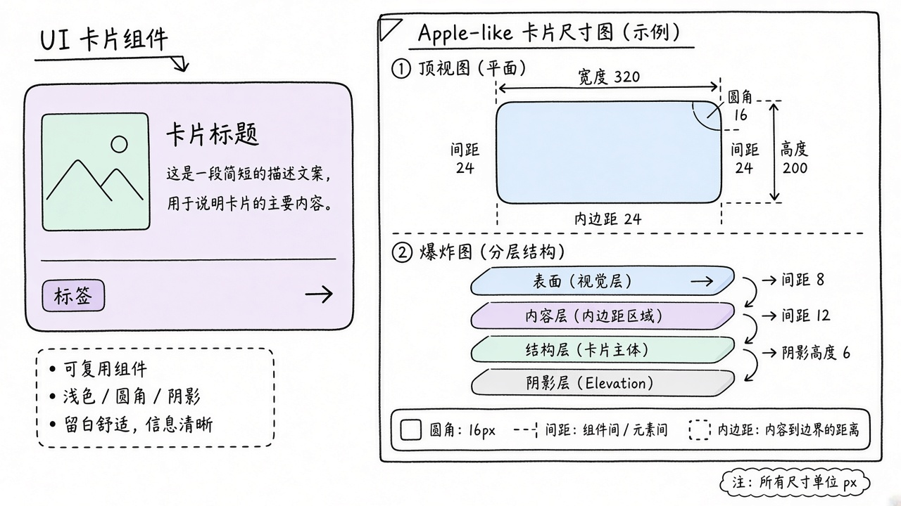
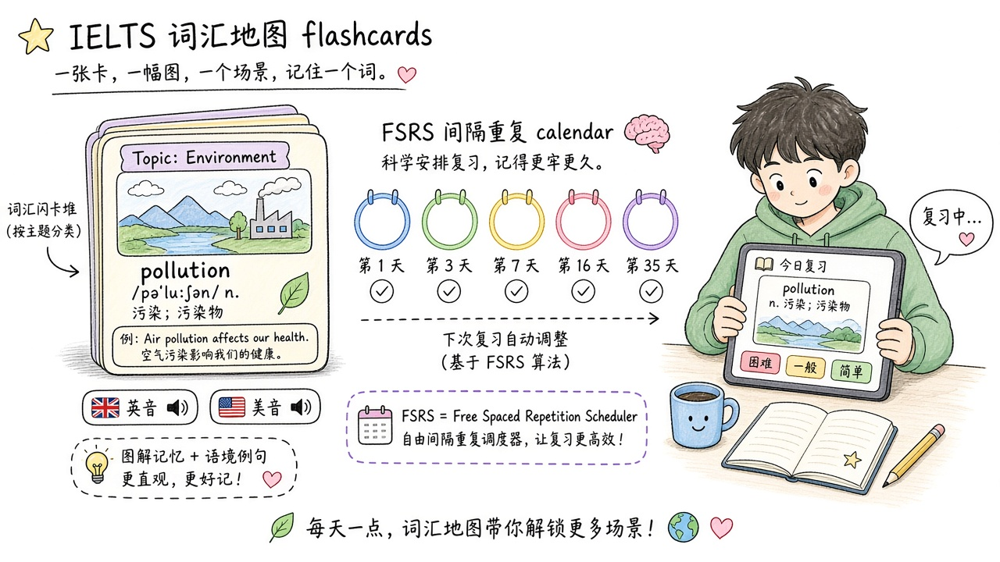

# 2026-10-28 GitHub 日报

今日精选 6 条：Agent 运行时杀毒、千级多智能体 harness、跨平台「眼睛」、安卓去广告、Apple 风尺寸图，以及开源雅思词光。

## 1. hashgraph-online/hol-guard — Agent 本地杀毒门禁

**介绍**  
HOL Guard（Apache-2.0，★~1002）：本地优先的 AI agent 安全层，在 shell / 文件 / 装包 / MCP / skills 真正执行前审查，可放行、拦截或要求批准；覆盖 Codex、Claude Code、Cursor、OpenCode 等。

**用法**  
仓库：[github.com/hashgraph-online/hol-guard](https://github.com/hashgraph-online/hol-guard)；文档：[hol.org/guard](https://hol.org/guard/activate)。  
```bash
pipx install hol-guard
hol-guard init
hol-guard status
```

**应用场景**  
给日常 coding agent 加一道本地安全门，拦 prompt injection / 泄密 / 恶意 skill。



**推荐学习程度**：进阶

---

## 2. microsoft/Agensh — 去中心化可扩到 1024 的多智能体 harness

**介绍**  
Agensh（MIT，★~768，2026-10-24 开源）：无共享工作区 + 消息 + 共享上下文，让 agent 异步认领子任务、校验并合并进展，无中央编排；论文与复现指南齐全。

**用法**  
仓库：[github.com/microsoft/Agensh](https://github.com/microsoft/Agensh)；论文：[arxiv.org/abs/2609.26781](https://arxiv.org/abs/2609.26781)；复现：[REPRODUCE.md](https://github.com/microsoft/Agensh/blob/main/REPRODUCE.md)。  
```bash
git clone https://github.com/microsoft/Agensh
# 按 REPRODUCE.md 用 Docker Compose 起单节点团队
```

**应用场景**  
研究/复现「大团队 agent 无老板协同」时按官方脚本跑 Pandoc 等 ProgramBench。



**推荐学习程度**：深入

---

## 3. Panniantong/Agent-Reach — 给 Agent 装上够得着的互联网眼睛

**介绍**  
Agent Reach（MIT，★~10.5万）：一条 CLI 读搜 Twitter/Reddit/YouTube/GitHub/B 站/小红书等；覆盖登录墙、字幕/转写与中文平台，返回结构化内容，零平台 API 费。

**用法**  
仓库：[github.com/Panniantong/Agent-Reach](https://github.com/Panniantong/Agent-Reach)。把安装说明丢给 agent 即可：  
```text
帮我安装 Agent Reach：https://raw.githubusercontent.com/Panniantong/Agent-Reach/main/docs/install.md
```
```bash
agent-reach channels
agent-reach bilibili search "大模型"
agent-reach read https://www.v2ex.com/t/123
```

**应用场景**  
CLI agent 要读小红书笔记、B 站字幕或雪球结构化数据时挂上。



**推荐学习程度**：入门

---

## 4. rddmwmddr/android-ad-cleaner — 国产安卓去广告（可 agent 代跑）

**介绍**  
android-ad-cleaner（MIT，★~3395，2026-10-24 起）：不 root，用 adb 关系统广告/热搜/营销推送；桌面客户端 + AI 智能体一键执行，可还原。v0.2.5（10-27）加了错误日志上报。

**用法**  
仓库：[github.com/rddmwmddr/android-ad-cleaner](https://github.com/rddmwmddr/android-ad-cleaner)；介绍页：[rddmwmddr.github.io/android-ad-cleaner](https://rddmwmddr.github.io/android-ad-cleaner/)。  
从 [Releases](https://github.com/rddmwmddr/android-ad-cleaner/releases) 下 Mac/Windows 客户端，或对 agent 说：  
```text
请克隆 https://github.com/rddmwmddr/android-ad-cleaner ，读 AGENTS.md，帮我给连着电脑的这台手机去广告。
```

**应用场景**  
插线给国产安卓去商店轮播/营销通知，保留快递与更新类推送。


**推荐学习程度**：入门

---

## 5. enesozturk/dimensional-drawing — Apple 风组件尺寸图 Skill

**介绍**  
dimensional-drawing（MIT，★~1258，2026-10-23）：给 UI 组件出一页技术尺寸图（平面/爆炸层/圆角间距表），风格接近 Apple dimensional drawings；可再动画化。

**用法**  
仓库：[github.com/enesozturk/dimensional-drawing](https://github.com/enesozturk/dimensional-drawing)。  
```bash
npx skills add enesozturk/dimensional-drawing
# 或：git clone 后 cp -r skills/* ~/.claude/skills/
```
对 agent 说：`给 src/components/Card.tsx 画一张 dimensional drawing`。

**应用场景**  
设计评审前让 agent 从代码/截图吐出标注齐全的一页尺寸图。



**推荐学习程度**：进阶

---

## 6. designfuchen/word-atlas — 词光：插画雅思词库 + FSRS

**介绍**  
Word Atlas / 词光（数据 CC BY 4.0，★~2554，2026-10-25）：7298 词插画词库 + 英美音 + FSRS 复习；开源 Web 应用与 JSON/CSV 数据集。

**用法**  
仓库：[github.com/designfuchen/word-atlas](https://github.com/designfuchen/word-atlas)。  
```bash
git clone --depth 1 https://github.com/designfuchen/word-atlas.git
cd word-atlas && npm ci && npm run dev
# http://localhost:5188
```

**应用场景**  
本地跑雅思词库，或把开放数据接到自己的 Anki/学习工具。



**推荐学习程度**：入门
