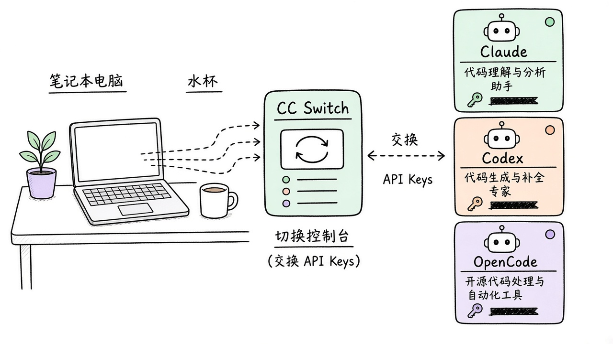
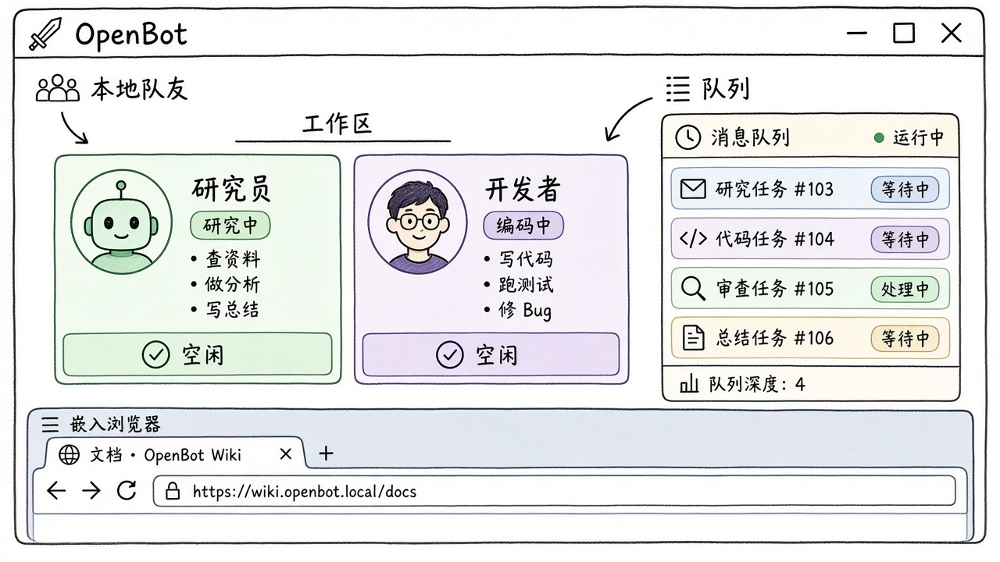
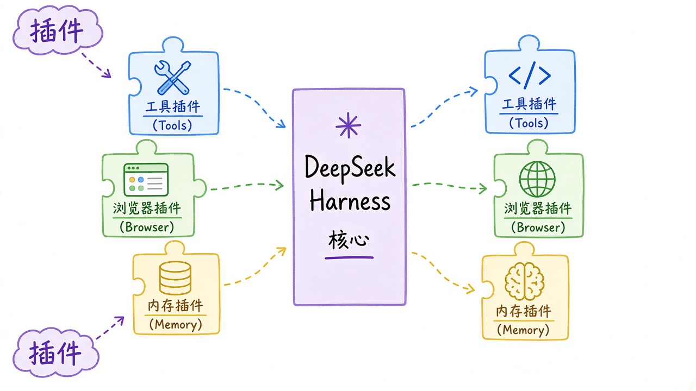
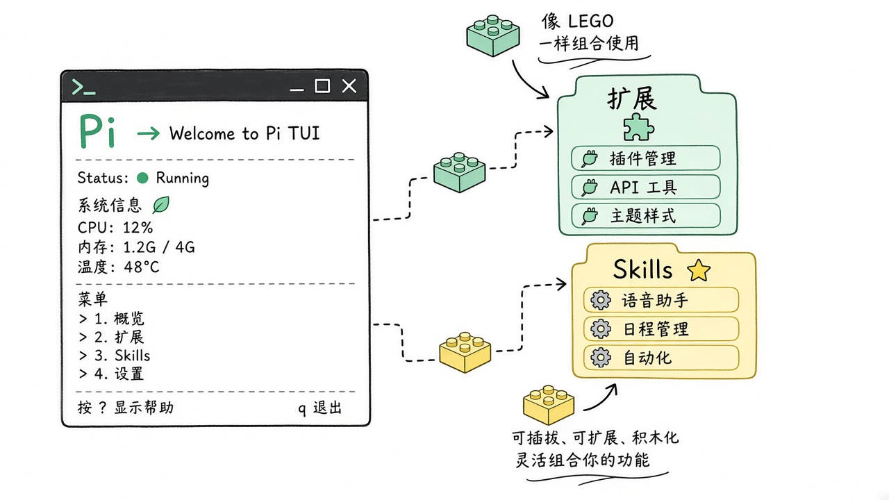
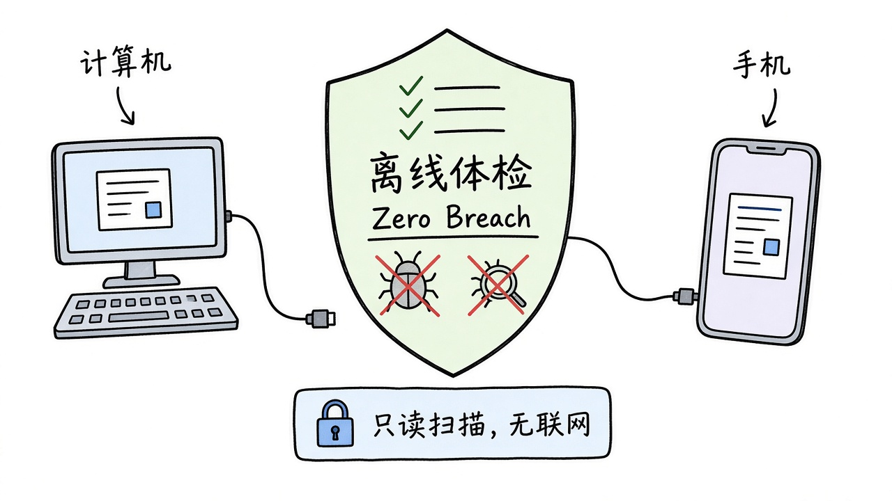
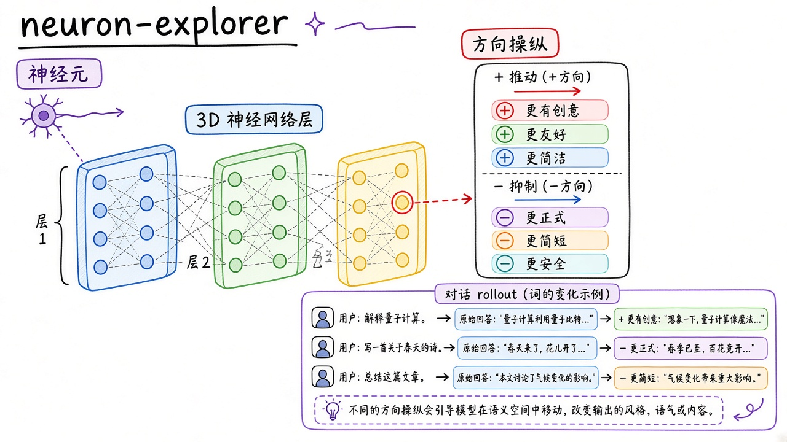

# 2026-10-29 GitHub 日报

今日精选 8 条：多 harness 一键换源、本地队友工作区、DeepSeek 插件式 harness、Pi 工具包、商业间谍软件离线体检、主动式 OpenDuet、终身家教 DeepTutor，以及神经元方向探索器。

## 1. farion1231/cc-switch — 多 Coding Agent 的一站式配置台

**介绍**  
CC Switch（MIT，★~15 万）：用桌面端统一管 Claude Code / Codex / OpenCode / OpenClaw / Hermes / Pi / Grok Build 等的 API 源、MCP、Skills 与提示词，少手改 JSON/TOML。

**用法**  
仓库：[github.com/farion1231/cc-switch](https://github.com/farion1231/cc-switch)；官网：[ccswitch.io](https://ccswitch.io)；从 [Releases](https://github.com/farion1231/cc-switch/releases) 下 macOS / Windows / Linux 安装包。装好后导入各 agent 配置，一点切换供应商。

**应用场景**  
同时用好几套 coding agent，想在官方源与中继之间秒切、集中管 MCP/Skills。



**推荐学习程度**：入门

---

## 2. nightly-labs/openbot — 本地优先的持久 AI 队友桌面

**介绍**  
OpenBot（PolyForm Noncommercial，★~3295）：给 Codex / Claude / Grok / OpenCode / Gemini / Cursor / Cline 各开独立工作区与会话；本地队列、文件互传、内嵌浏览器、agent 互聊。开发预览：默认 `danger-full-access`，先看 Security。

**用法**  
仓库：[github.com/nightly-labs/openbot](https://github.com/nightly-labs/openbot)。从 [Releases](https://github.com/nightly-labs/openbot/releases) 下 `.dmg` / `.exe` / `.AppImage`，首次启动确认权限后再建队友。

**应用场景**  
本机养几个长期队友分工写代码、查网页、互相交任务，不想开一堆终端。



**推荐学习程度**：进阶

---

## 3. deepseek-ai/deepseek-harness — Everything is a Plugin

**介绍**  
DeepSeek Harness（MIT，★~26 万）：官方 agent harness，核心极瘦，能力全靠插件扩展；带 Web / Desktop 入口，适合跟 DeepSeek 模型一起跑长任务。

**用法**  
仓库：[github.com/deepseek-ai/deepseek-harness](https://github.com/deepseek-ai/deepseek-harness)。
```bash
npx @deepseek-ai/dsh web
# 或源码：
git clone https://github.com/deepseek-ai/deepseek-harness.git
cd deepseek-harness && pnpm install && pnpm run build && pnpm dsh web
```

**应用场景**  
用 DeepSeek 做主模型时，要可插拔工具链而不是绑死一家 CLI。



**推荐学习程度**：进阶

---

## 4. earendil-works/pi — 可扩展的 AI Agent 工具包

**介绍**  
Pi（MIT，★~11.9 万）：统一 LLM API + agent loop + TUI + coding CLI；用 extensions / skills / 主题 / Pi packages 定制，可交互也可 RPC / SDK 嵌入。

**用法**  
仓库：[github.com/earendil-works/pi](https://github.com/earendil-works/pi)；文档：[pi.dev](https://pi.dev)。
```bash
curl -fsSL https://pi.dev/install.sh | sh
# 或：npm install -g --ignore-scripts @earendil-works/pi-coding-agent
pi
```

**应用场景**  
想自建轻量 coding agent，或把 agent loop 嵌进自家工具，而不是整仓 fork。



**推荐学习程度**：进阶

---

## 5. interplains/Zero-Breach-Toolkit — 商业间谍软件离线体检

**介绍**  
Zero Breach Toolkit（Apache-2.0，★~2805，2026-10-25）：只读扫描本机 / Android / iPhone 备份里已知雇佣间谍软件痕迹（Pegasus 等）；扫描过程不联网，报告写明证据强度与未覆盖项。

**用法**  
仓库：[github.com/interplains/Zero-Breach-Toolkit](https://github.com/interplains/Zero-Breach-Toolkit)。下 ZIP，装 Python 后：
```bash
cd ~/Downloads/Zero-Breach-Toolkit-main
python3 -X utf8 scan/zero-breach-toolkit.py
# Windows 可双击 scan/run-scan.cmd
```
Mac 需给 Terminal 完整磁盘访问；疑似被实时盯梢时先找专业援助。

**应用场景**  
记者/活动者/高敏账号定期做本机只读体检，或帮亲友检查手机备份。



**推荐学习程度**：入门

---

## 6. CopilotKit/OpenDuet — 主动干活、关键动作先问你

**介绍**  
OpenDuet（MIT，★~1337，2026-10-21）：自托管主动式 agent 模板（基于 OpenBot + CopilotKit）。早报分拣邮件日历、离开时继续干活；发消息/付款/删除前展示原文等你批准；密码走遮罩框不进对话。

**用法**  
仓库：[github.com/CopilotKit/OpenDuet](https://github.com/CopilotKit/OpenDuet)。
```bash
git clone https://github.com/CopilotKit/OpenDuet.git
cd OpenDuet && bun install
npx --yes copilotkit@latest login
npx --yes copilotkit@latest project select
# 按 README Quick start 起本地服务
```

**应用场景**  
想自建「会早报、会分拣、危险动作必确认」的个人助理原型。


**推荐学习程度**：进阶

---

## 7. HKUDS/DeepTutor — 终身个性化家教

**介绍**  
DeepTutor（Apache-2.0，★~4.8 万）：本地/自托管个性化辅导；知识库、练习、可叙述视频课、模块化安装。v1.7.0（10-28）拆成 `deeptutor[full]` Web+CLI。

**用法**  
仓库：[github.com/HKUDS/DeepTutor](https://github.com/HKUDS/DeepTutor)；站：[deeptutor.info](https://deeptutor.info/)。
```bash
pip install -U "deeptutor[full]"
deeptutor init
deeptutor start   # 默认 http://127.0.0.1:3782
# 或：docker run --rm -p 127.0.0.1:3782:3782 -v deeptutor-data:/app/data ghcr.io/hkuds/deeptutor:latest
```

**应用场景**  
把教材/笔记丢进本地知识库，按自己节奏练题、听讲解视频。


**推荐学习程度**：入门

---

## 8. lyramakesmusic/neuron-explorer — 方向操纵看清每个神经元

**介绍**  
neuron-explorer（MIT，★~1620，2026-10-21）：对 Qwen3.5-4B 每个 MLP 神经元做正负 steering，保留全部 rollout，用 3D 图浏览；可接 Claude CLI 当 MCP 一起查。

**用法**  
仓库：[github.com/lyramakesmusic/neuron-explorer](https://github.com/lyramakesmusic/neuron-explorer)。
```bash
uv sync
uv run python explorer/server.py   # http://localhost:8791
# 大规模 sweep 需 CUDA + RhizoNymph/vllm fork，见 README Sweep
```

**应用场景**  
想直观看「推某个神经元会改什么词」，做可解释性或课程演示。



**推荐学习程度**：深入
