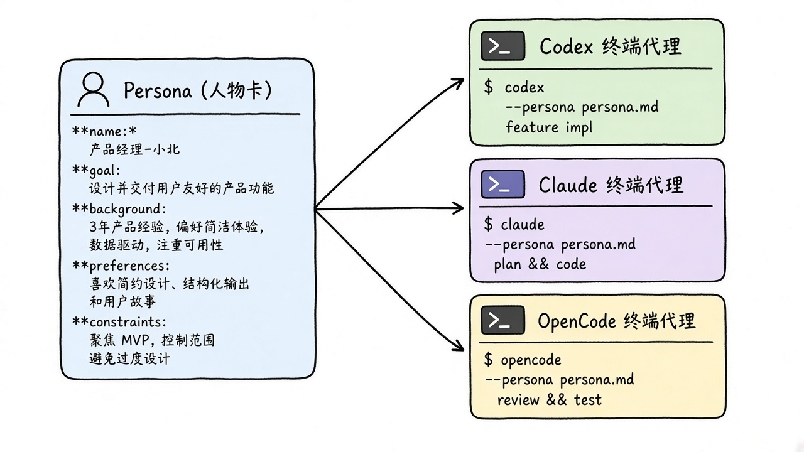
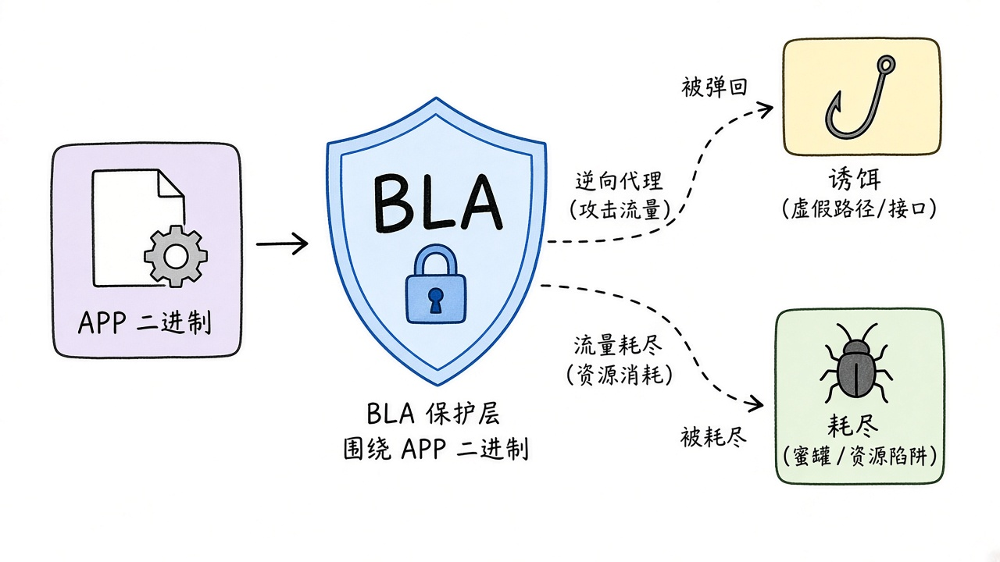
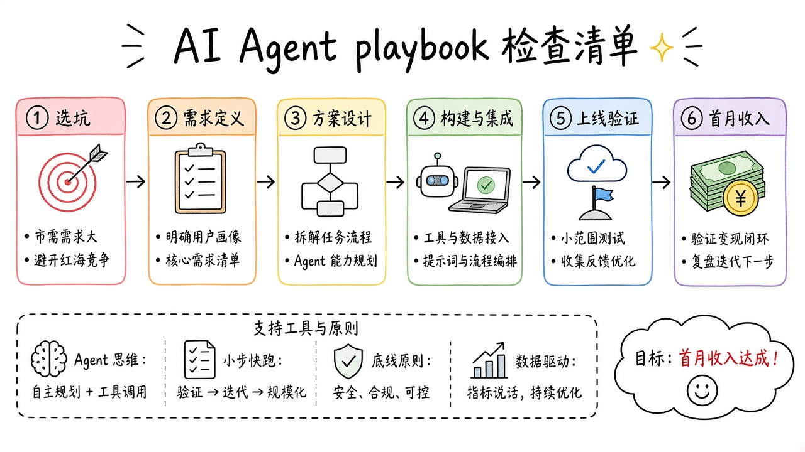
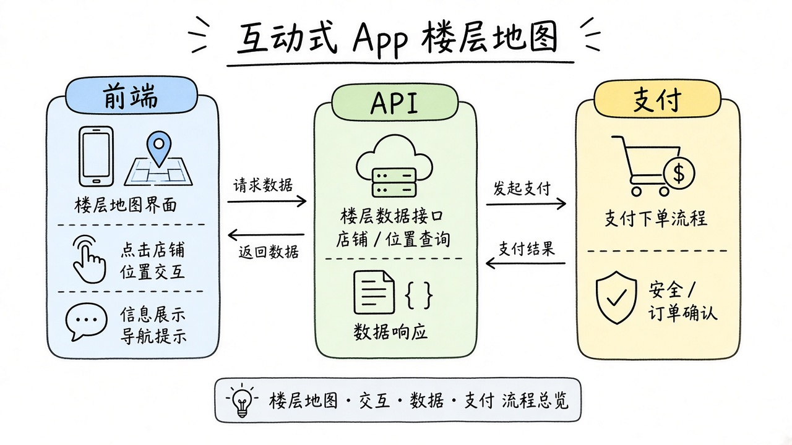
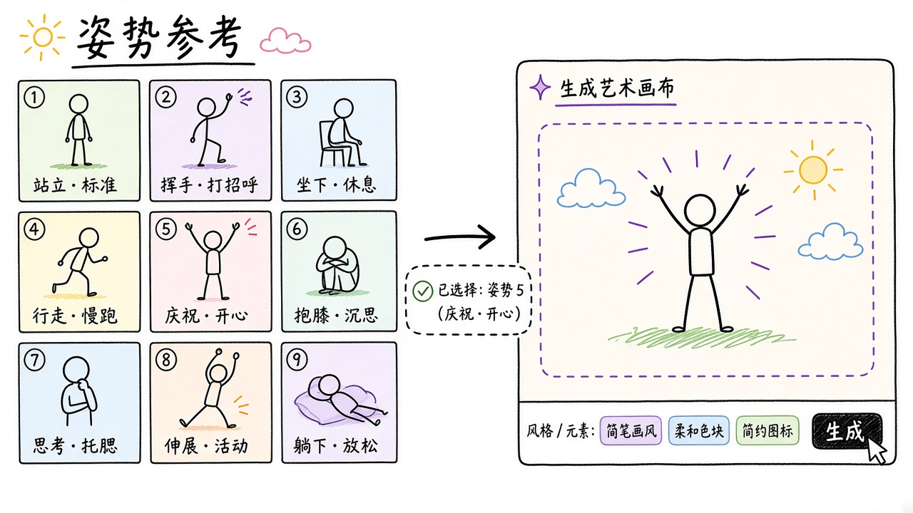
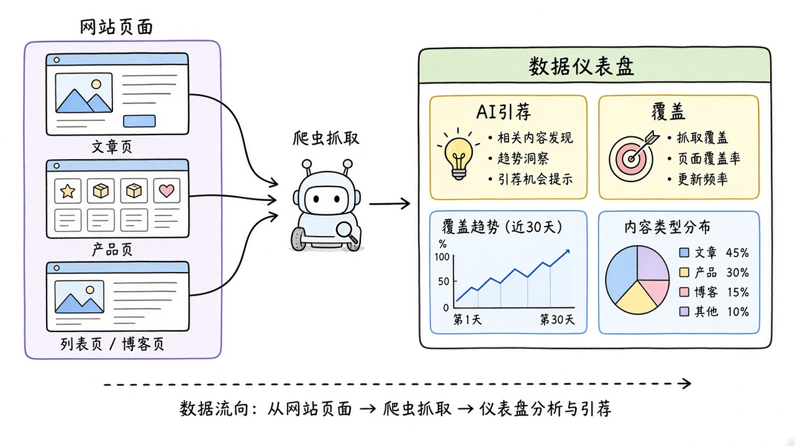
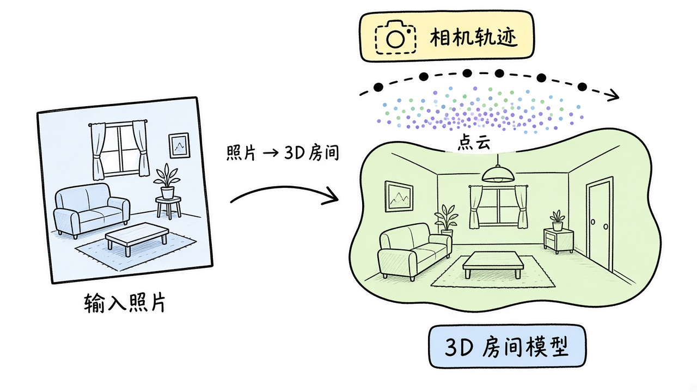
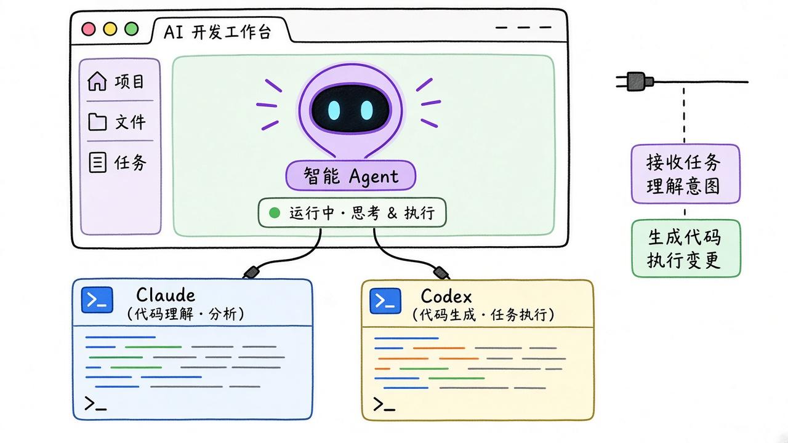
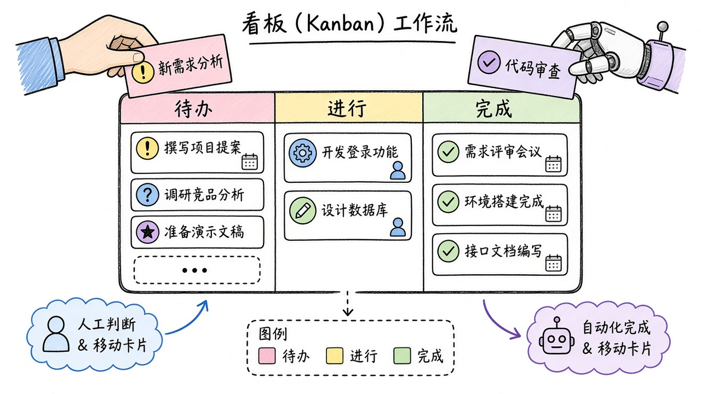

# 2026-10-30 GitHub 日报

今日精选 10 个近几天可动手跟进的开源项目（多 Harness 统一、对抗 REA 的制品致盲、2026 盈利 App 、代码库交互平面图、中文 AI 姿势参考图库 等）。与往日日报、周报不重复。

## 1. ZiChuanLan/agent-purge — 多 Harness 统一人设注入

**介绍**  
一份系统提示词喂给 Codex / Claude / OpenCode / Grok / Hermes / Pi 等多家 coding agent：支持 replace / append / strict / off，可热切换且可逆。MIT，约 880★，创建于 2026-10-25；Node≥20，零依赖 npm 包。

**用法**  
`npm i -g agent-purge`（或 `npx agent-purge web`）→ 打开 http://127.0.0.1:7788 选人设 → `agent-purge use <id>` / `agent-purge codex` 启动。数据默认在 `~/.agent-purge/`。

**应用场景**  
同一「资深审阅者」人设一键同步到本机 Codex 与 Claude，开会前统一口吻。

**推荐学习程度**：进阶

---

## 2. qybaihe/bla — 对抗 REA 的制品致盲盾

**介绍**  
BLA（Blind LLM Agents）给自己的发布制品做 Counter-REA：在保持运行等价的前提下，用 Poison / Exhaust / Hallucinate 让逆向 agent 烧预算、跟诱饵。MIT，约 810★，创建于 2026-10-25；npm `bla-agents`，自带 MCP。

**用法**  
Node ^22.23.4 或 24：`npx bla-agents setup` 注册 MCP/skill，再 `npx bla-agents harden .`（或对 agent 说「Harden my software against REA」）。分阶段可用 audit / protect / verify。

**应用场景**  
桌面 Electron 应用发版前跑一遍 harden，降低被 REA 一类 agent 批量拆穿的风险。

**推荐学习程度**：深入

---

## 3. blakeandersonw/ai-app-playbook — 2026 盈利 App 施工手册

**介绍**  
面向 coding agent 的 AGENTS.md 施工手册：从选坑、Cloudflare 栈、鉴权支付到首月获客，作者自述多款 App 做到 $100k+ MRR。MIT，约 580★，创建于 2026-10-26；空目录里让 agent 读 AGENTS.md 即可开干。

**用法**  
空文件夹里对 Claude Code / OpenCode 粘贴：`Clone https://github.com/blakeandersonw/ai-app-playbook and read AGENTS.md`。也可 `git clone` 后按 `playbook/` 分阶段文档执行。

**应用场景**  
一人团队用 Claude Code 按手册从零搭健康类订阅 App 的 Workers + 支付骨架。

**推荐学习程度**：入门

---

## 4. haydenschmitty/floorplan — 代码库交互平面图

**介绍**  
让 Claude / Codex 读你的多仓应用，画出可缩放的白话架构图：页面、文件、前后端请求连线都能点开追问。MIT，约 390★，创建于 2026-10-27；零依赖 Node 插件，有在线 demo。

**用法**  
Claude Code：`claude plugin marketplace add haydenschmitty/floorplan` 再 `claude plugin install floorplan@floorplan`。Codex 在 Plugins → Add marketplace 填 `haydenschmitty/floorplan`。装完新开会话即可要一张 floorplan。Demo：https://haydenschmitty.github.io/floorplan-demo/

**应用场景**  
新同事打开咖啡订阅 App 的 floorplan，从结账页一路点到 Stripe 相关文件。

**推荐学习程度**：入门

---

## 5. anhao/ai-pose-gallery-zh — 中文 AI 姿势参考图库

**介绍**  
ai-pose-gallery-zh（★~3.2k，创建于 2026-10-27）：1439 组 / 2878 张姿势参考的完整汉化静态画廊，零依赖，可 Cloudflare Pages 部署。面向文生图/角色一致性时快速找姿势，而不是翻英文图站。许可为 Other，用前看仓库声明。

**用法**  
仓库：[github.com/anhao/ai-pose-gallery-zh](https://github.com/anhao/ai-pose-gallery-zh)。克隆后本地开静态站或按 README 部署到 Pages；浏览器里搜姿势组，下载原图喂给生图工作流。

**应用场景**  
做角色设定时在汉化图库里挑一组多视角姿势，再丢进文生图保持动作一致。

**推荐学习程度**：入门

---

## 6. yaojingang/GEOInflow — GEOInflow：自托管 GEO / AI 爬虫分析

**介绍**  
GEOInflow（MIT，★~730，创建于 2026-10-26）：面向 Generative Engine Optimization 的自托管分析——访客、AI 搜索引荐、爬取日志、内容覆盖与转化。猎看科技与北京日报社智源 GEO 联合开源，栈含 PostgreSQL。

**用法**  
仓库：[github.com/yaojingang/GEOInflow](https://github.com/yaojingang/GEOInflow)。按 README 用 Docker / 自建 Postgres 拉起；埋点后看 AI 爬虫与引荐面板。

**应用场景**  
内容站想看 ChatGPT/Perplexity 类爬虫覆盖了哪些页、哪些带来转化。

**推荐学习程度**：进阶

---

## 7. deepopen-com/deepopen-3d-webs — DeepOpen：图像驱动三维场景

**介绍**  
deepopen-3d-webs（★~560，创建于 2026-10-26）：给参考图 + 提示词，按相机轨迹生成可预览、可回放、可追溯的三维场景；浏览器可直接看彩色/深度动画与高斯点云演示资源。适合评估「图→可漫游 3D」管线。仓库未在元数据声明 SPDX。

**用法**  
仓库：[github.com/deepopen-com/deepopen-3d-webs](https://github.com/deepopen-com/deepopen-3d-webs)。按 README 起服务或打开官方演示资产；上传参考图与提示，预览轨迹与点云。

**应用场景**  
用一张展厅照片生成可回放相机轨迹的三维预览，再决定要不要进完整重建。

**推荐学习程度**：进阶

---

## 8. D3voz/openjutsu — OpenJutsu：本地一键视频换角

**介绍**  
OpenJutsu（MIT，★~370，创建于 2026-10-26）：开源本地「角色替换」视频管线，对标闭源 Genjutsu 一类体验；基于 ComfyUI + MiniMax H3，并带 FLUX.3 Klein 补光。可自托管 Next.js 前端。

**用法**  
仓库：[github.com/D3voz/openjutsu](https://github.com/D3voz/openjutsu)。按 README 装 ComfyUI 节点与权重，起前端后上传源片与目标角色图做换角。

**应用场景**  
短片里把临时演员换成固定 IP 形象，本地跑完再导出。

**推荐学习程度**：深入

---

## 9. ChannelCooperStart/capri-ai — Capri：桌面赛博风 AI Agent 壳

**介绍**  
Capri（★~430，创建于 2026-10-27）：Edgerunners 灵感的桌面 AI agent 壳，可接 Claude Code / Codex / Antigravity 等。偏「好看又能干活」的本机伴侣，而不是又一个纯 CLI。许可未在元数据声明，clone 前看 LICENSE。

**用法**  
仓库：[github.com/ChannelCooperStart/capri-ai](https://github.com/ChannelCooperStart/capri-ai)。按 README 安装桌面端，配置后端 harness（Claude Code / Codex 等）后当日常桌面 agent 用。

**应用场景**  
本机开着赛博风桌宠壳，把日常改码任务丢给已接好的 Claude Code。

**推荐学习程度**：入门

---

## 10. emanuele-em/kanzo — Kanzo：人与 Agent 共用的看板

**介绍**  
Kanzo（AGPL-3.0，★~180，创建于 2026-10-25）：给人与 coding agent 共用的自托管看板；单二进制约 4MB、启动约 2ms、零配置，SQLite，带 MCP。适合把「任务板」直接暴露给 Claude Code / Codex。

**用法**  
仓库：[github.com/emanuele-em/kanzo](https://github.com/emanuele-em/kanzo)。下 Release 二进制或按 README 编译；起服务后给 agent 配 MCP，人在网页拖卡片。

**应用场景**  
小团队把需求卡放进 Kanzo，人和 agent 在同一块板上认领与回写状态。

**推荐学习程度**：入门
