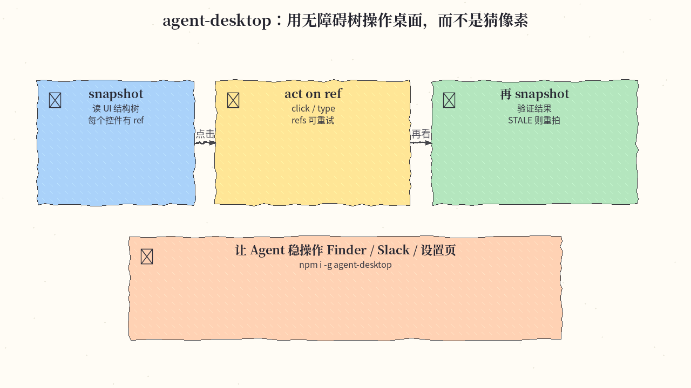
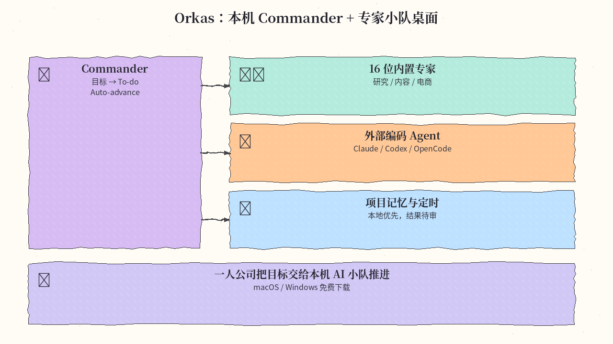
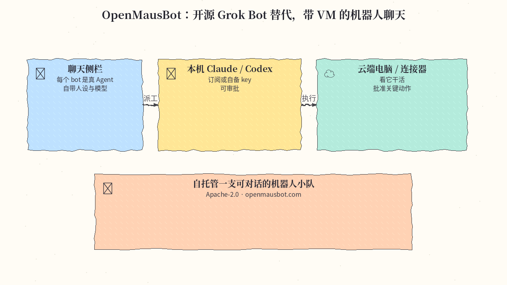
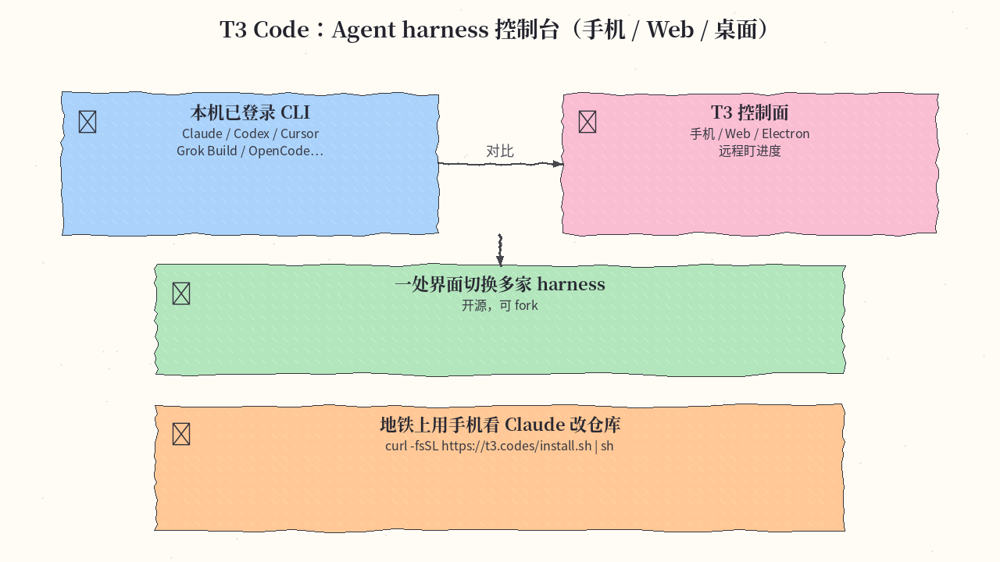
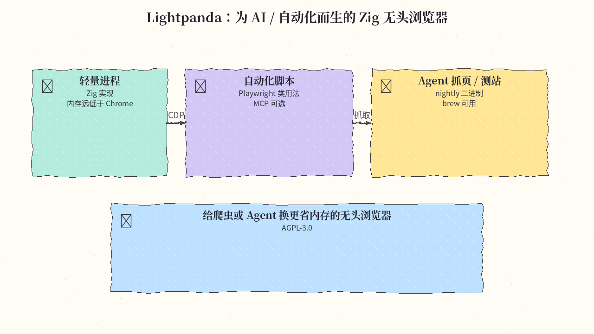
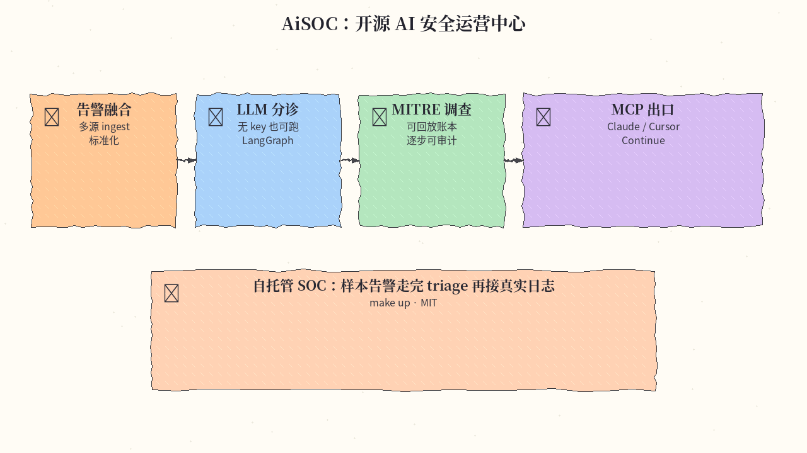
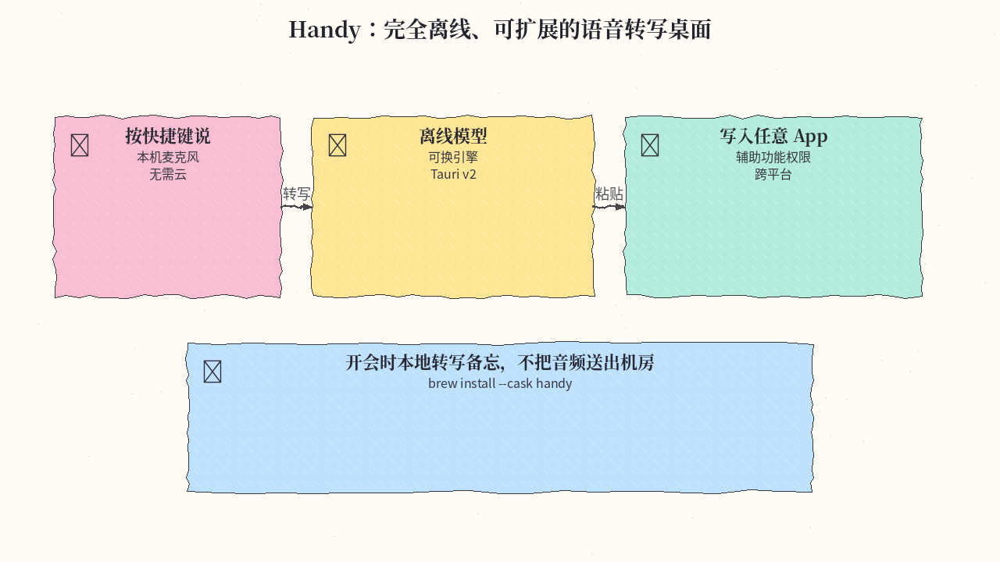
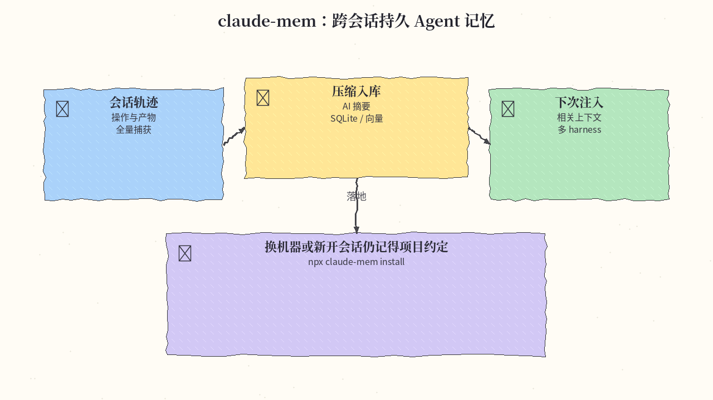
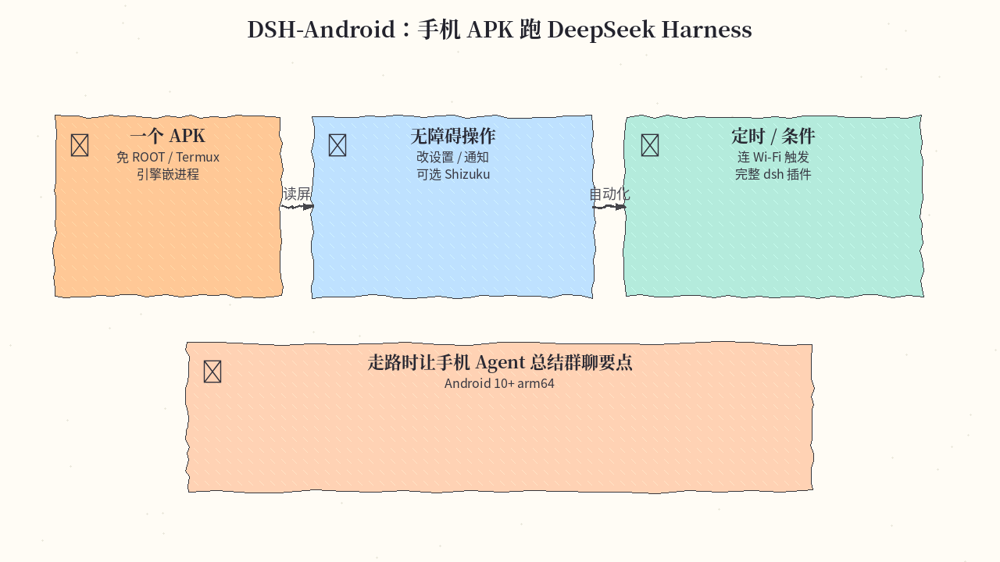

# 2026-11-02 GitHub 日报

今日精选 9 条：桌面无障碍 computer-use、本机 AI 小队与 Grok Bot 开源替代、harness 控制台、轻量无头浏览器、开源 AI SOC、离线听写、跨会话记忆，以及手机上的 DeepSeek Harness。与往日日报、周报不重复。

## 1. vercel-labs/agent-desktop — 无障碍树桌面 computer-use

**介绍**  
Rust / CLI：通过操作系统无障碍树读取任意 App 的真实 UI 结构，对稳定 ref 点击、输入、滚动，再 snapshot 验证；不靠像素猜测，动作可安全重试。Apache-2.0，约 7.0k★；macOS / Windows / Linux，npm 包含原生二进制。

**用法**  
仓库：[github.com/vercel-labs/agent-desktop](https://github.com/vercel-labs/agent-desktop)；站：[agent-browser.dev/desktop](https://agent-browser.dev/desktop)。

```bash
npm install -g agent-desktop
agent-desktop snapshot --app Finder -i
agent-desktop click '@s8f3k2p9:e8'
# 可选：npx skills add https://github.com/vercel-labs/agent-desktop --skill agent-desktop
```

**应用场景**  
让本机 Agent 稳定操作 Finder 下载目录、Slack 未读或系统设置页，而不是截图瞎点。



**推荐学习程度**：进阶

---

## 2. Orkas-AI/Orkas — 本机优先的 AI 小队桌面

**介绍**  
MIT 开源桌面：Commander 把目标拆成 To-do，协调 16 位内置专家，并可拉上 Claude Code / Codex / OpenCode / OpenClaw / Hermes；项目记忆、定时自动化与连接器本地存放。macOS / Windows 免费 App，可用内置额度或自备 key。约 7.4k★。

**用法**  
仓库：[github.com/Orkas-AI/Orkas](https://github.com/Orkas-AI/Orkas)；下载：[orkas.ai/download](https://orkas.ai/download/?source=gh-orkas)。装好后新建 Project，对 Commander 说目标，审阅交付物；编码任务可指定外接 coding agent。

**应用场景**  
一人公司把「调研竞品 → PPT → 落地页」交给本机小队，自己只审批关键节点。



**推荐学习程度**：入门

---

## 3. milind-soni/OpenMausBot — 开源 Grok Bot 替代（带 VM）

**介绍**  
自托管聊天式 bot 桌面：侧栏每个联系人是真实 Agent（Claude / Codex 等），自带人设、模型与云电脑/连接器；可看着干活并批准关键动作。Apache-2.0，约 10.6k★；Electron，宣称对标 Grok Bot / Meta Muse 一类产品（独立项目，非官方）。

**用法**  
仓库：[github.com/milind-soni/OpenMausBot](https://github.com/milind-soni/OpenMausBot)；站：[openmausbot.com](https://www.openmausbot.com/)。从 [Releases](https://github.com/milind-soni/OpenMausBot/releases/latest) 装桌面端，配置本机 Claude/Codex 后新建 bot。

**应用场景**  
团队自托管一支「运营 / 研发」机器人通讯录，敏感操作必须人工点头。



**推荐学习程度**：进阶

---

## 4. pingdotgg/t3code — Agent harness 控制台

**介绍**  
开源「agent harness 控制面」：手机（iOS/Android）、Web 与 Electron 桌面统一操控本机已登录的 Claude Code / Codex / Cursor / Grok Build / OpenCode / Antigravity / fx。MIT，约 38k★；不卖订阅，强调可 fork。

**用法**  
仓库：[github.com/pingdotgg/t3code](https://github.com/pingdotgg/t3code)；站：[t3.codes](https://t3.codes)。

```bash
# 先装好并登录至少一家 CLI，再：
curl -fsSL https://t3.codes/install.sh | sh
# 或 brew install --cask t3-code
```

**应用场景**  
通勤时用手机盯本机 Claude 改 PR 进度，回家切回桌面继续。



**推荐学习程度**：入门

---

## 5. lightpanda-io/browser — 面向 AI 的 Zig 无头浏览器

**介绍**  
用 Zig 写的无头浏览器，面向抓取与自动化，内存占用显著低于 Chrome；支持 CDP 类自动化，并提供 MCP。AGPL-3.0，约 40k★；提供 Linux/macOS nightly 与 Homebrew。

**用法**  
仓库：[github.com/lightpanda-io/browser](https://github.com/lightpanda-io/browser)；站：[lightpanda.io](https://lightpanda.io)。

```bash
brew install lightpanda-io/browser/lightpanda
# 或下载 nightly：
# curl -L -o lightpanda https://github.com/lightpanda-io/browser/releases/download/nightly/lightpanda-x86_64-linux && chmod a+x ./lightpanda
./lightpanda version
```

**应用场景**  
给爬虫或 Agent 换更省内存的无头浏览器跑批量页面抽取。



**推荐学习程度**：进阶

---

## 6. beenuar/AiSOC — 开源 AI 安全运营中心

**介绍**  
自托管 AI SOC：告警融合、LLM Agent 分诊、MITRE ATT&CK 调查，以及每步可回放的决策账本；默认可无云 API key 跑通。MIT，约 6.3k★；附 MCP，方便 Claude / Cursor / Continue 接入。

**用法**  
仓库：[github.com/beenuar/AiSOC](https://github.com/beenuar/AiSOC)；文档：[beenuar.github.io/AiSOC](https://beenuar.github.io/AiSOC/)。

```bash
git clone https://github.com/beenuar/AiSOC && cd AiSOC
make up          # 需 Docker Compose；make doctor / make smoke 自检
# 无 Docker：pip install aisoc-sandbox && aisoc-sandbox demo
```

**应用场景**  
先用样本告警走完 triage，再把 CrowdStrike / Splunk 一类源接到自家 SOC 控制台。



**推荐学习程度**：深水

---

## 7. cjpais/Handy — 离线可扩展语音转写

**介绍**  
免费开源听写桌面：完全离线、可换模型/扩展，Tauri v2 跨平台。MIT，约 36.6k★；官网 handy.computer，另有 Homebrew cask / winget（第三方维护）。

**用法**  
仓库：[github.com/cjpais/Handy](https://github.com/cjpais/Handy)；站：[handy.computer](https://handy.computer)。从 Releases 安装，或：

```bash
brew install --cask handy
```

授权麦克风与辅助功能后设快捷键即可听写。

**应用场景**  
会议纪要本地转写粘贴进文档，音频不离开本机。



**推荐学习程度**：入门

---

## 8. thedotmack/claude-mem — 跨会话持久 Agent 记忆

**介绍**  
捕获 agent 会话中的操作与产物，压缩后入库，并在后续会话注入相关上下文；支持 Claude Code、OpenClaw、Codex、Gemini、Hermes、Copilot、OpenCode、Grok Bot、T3 Code、Pi、DSH 等。Apache-2.0，约 109k★。

**用法**  
仓库：[github.com/thedotmack/claude-mem](https://github.com/thedotmack/claude-mem)；站：[claude-mem.ai](https://claude-mem.ai)。

```bash
npx claude-mem install
# 例：npx claude-mem install --ide grok-bot
# 例：npx claude-mem install --ide t3code
```

**应用场景**  
新开一周后的 coding 会话仍记得仓库约定与上次未完成项。



**推荐学习程度**：进阶

---

## 9. jackwener/DSH-Android — 手机上跑 DeepSeek Harness

**介绍**  
一个 APK：免 ROOT、免 Termux，在 Android 进程内嵌 Node 跑完整 DeepSeek Harness；读屏操作 App、改系统设置、定时/条件自动化，可选 Shizuku。Apache-2.0，约 700★，2026-10-27 起；需 Android 10+ arm64，能访问 DeepSeek（或其他兼容）API。

**用法**  
仓库：[github.com/jackwener/DSH-Android](https://github.com/jackwener/DSH-Android)。从 [Releases](https://github.com/jackwener/DSH-Android/releases) 下载 APK，核对 SHA-256 后安装；授予无障碍等权限，在设置里填模型 key。Play 保护可能误报，需「仍要安装」。

**应用场景**  
通勤时让手机 Agent 读通知、改勿扰或总结微信群要点。



**推荐学习程度**：进阶

---
