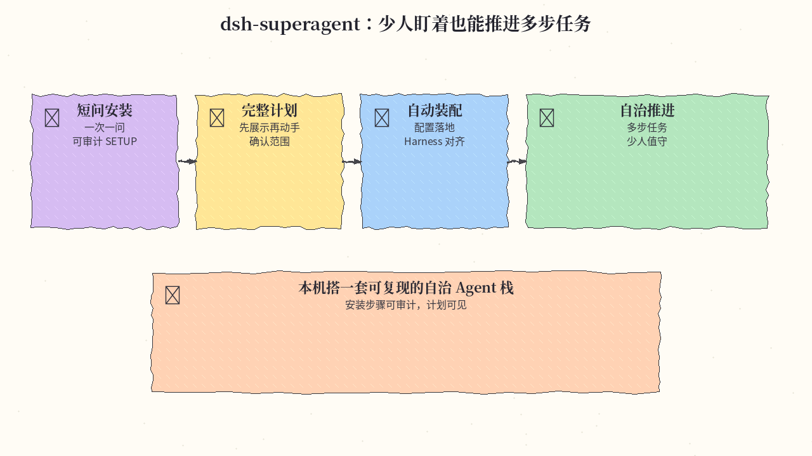
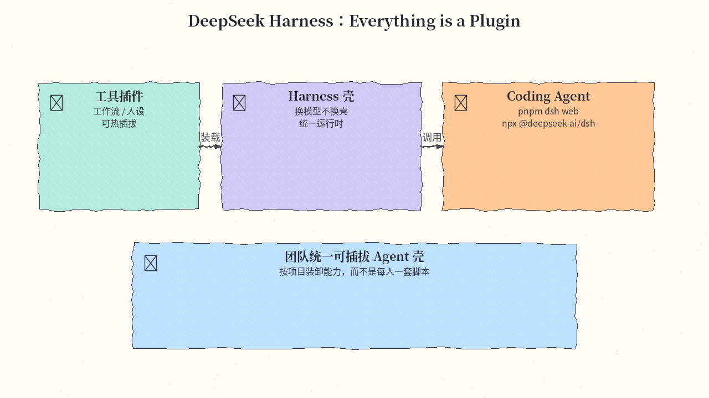
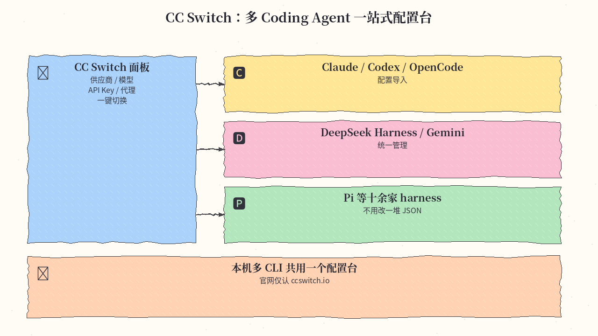
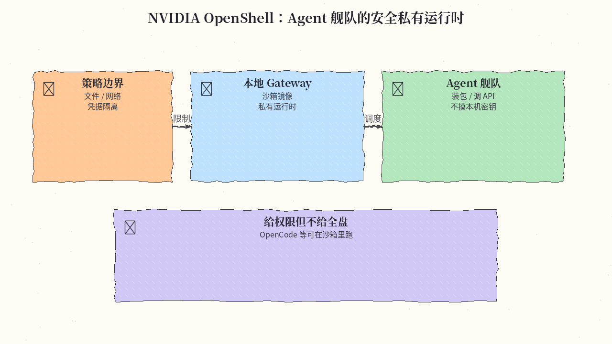
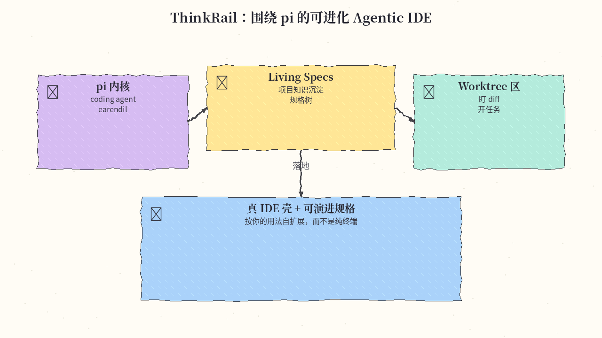
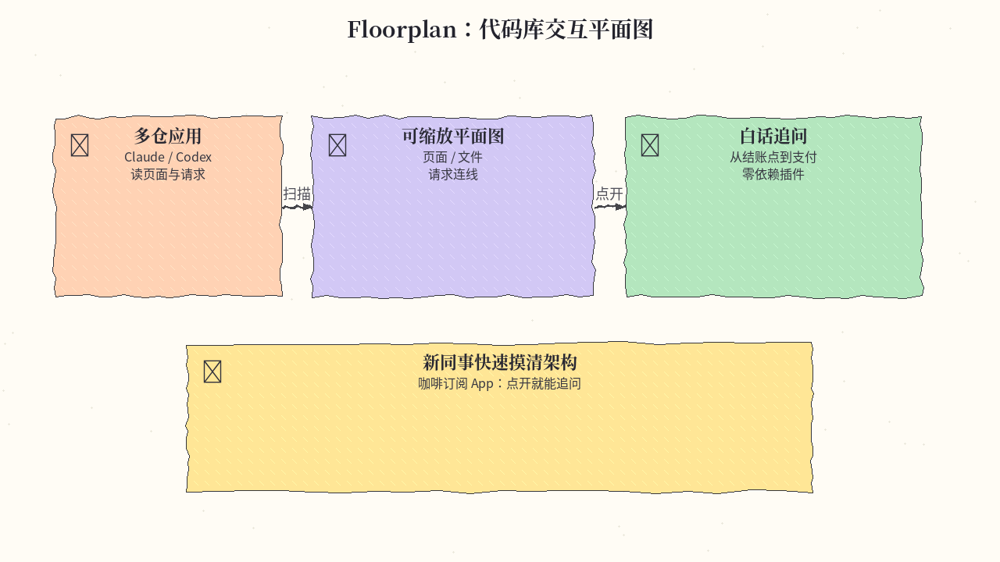
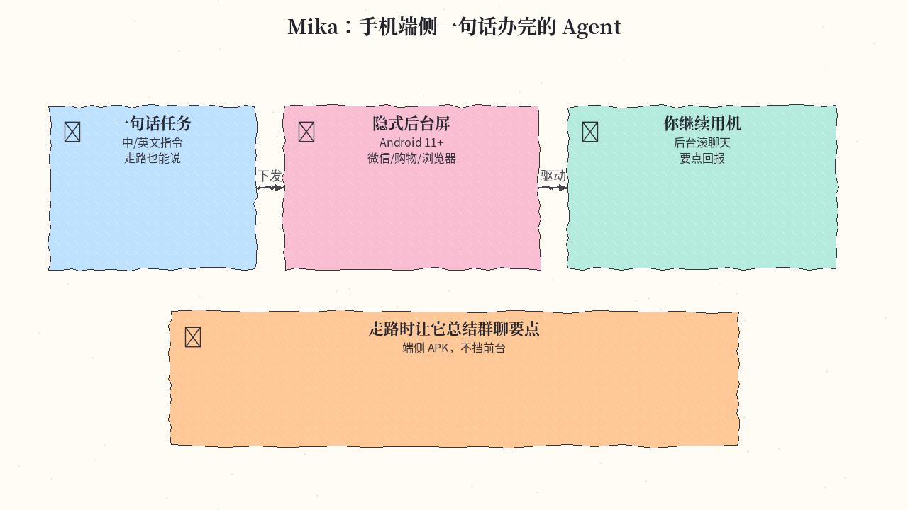
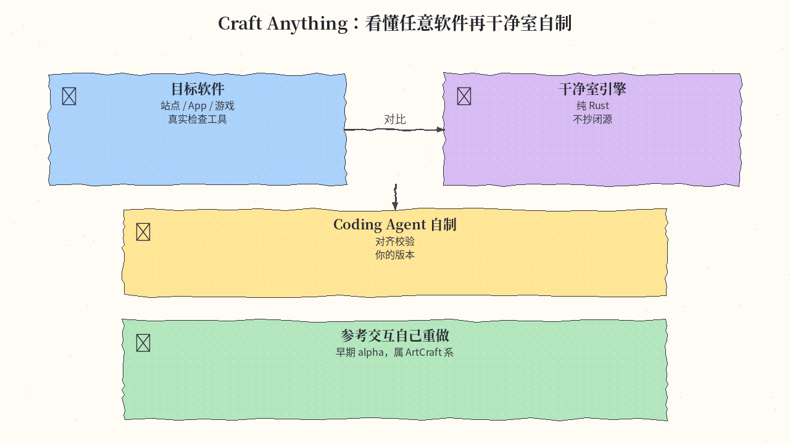
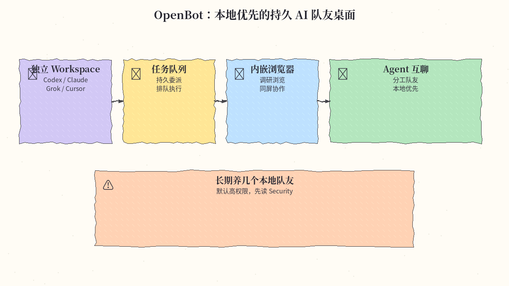
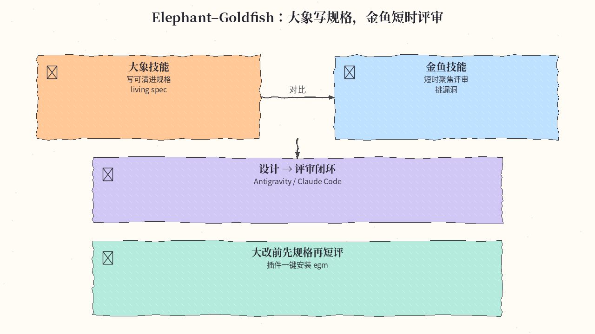

# 2026-11-02 GitHub 周报

上周（10/26–11/01）精选 10 个值得跟进的开源项目（偏自治 Agent / harness 配置 / 安全运行时 / Agentic IDE / 端侧与干净室）。

## 1. deepseek-ai/dsh-superagent-prototype — 更自治的 Agent 系统原型

**介绍**  
DeepSeek 本周新开源的 dsh-superagent 原型（MIT，★~7.7k，创建于 2026-10-31）：面向「更自治的 Agent 系统」，安装向导一次只问一个短问题、展示完整计划后再自动装好配置；配套 SETUP.md 可审计。与同系 DeepSeek Harness 插件生态对齐。

**用法**  
仓库：[github.com/deepseek-ai/dsh-superagent-prototype](https://github.com/deepseek-ai/dsh-superagent-prototype)。按 README Setup 跑安装向导（跟随 SETUP.md）；开发用 `pnpm check` 做类型检查/测试/构建。

**应用场景**  
想在本机搭一套尽量少人盯着、能自己推进多步任务的 Agent 栈，又希望安装步骤可复现。

**推荐学习程度**：进阶

---

## 2. deepseek-ai/deepseek-harness — Everything is a Plugin 的 Agent 运行时

**介绍**  
DeepSeek Harness（MIT，★~26.8 万）：把工具、工作流、人设都做成插件的 coding agent 运行时，本周随 dsh-superagent / 配置类项目一起继续冲榜。定位「Everything is a Plugin」，方便换模型与换能力而不换壳。

**用法**  
装好 Node.js 后：`npx @deepseek-ai/dsh web`；或 `git clone` 后 `pnpm install && pnpm run build && pnpm dsh web`。仓库：[github.com/deepseek-ai/deepseek-harness](https://github.com/deepseek-ai/deepseek-harness)。

**应用场景**  
团队要统一一套可插拔 Agent 壳，按项目装卸插件而不是每人一套自定义脚本。

**推荐学习程度**：进阶

---

## 3. farion1231/cc-switch — 多 Coding Agent 一站式配置台

**介绍**  
CC Switch（MIT，★~15 万）：跨平台桌面「All-in-One」管理器，覆盖 Claude Code / Codex / OpenCode / DeepSeek Harness / Gemini CLI / Pi 等十余家 harness 的供应商、模型与配置切换。官方站仅认 [ccswitch.io](https://ccswitch.io)。

**用法**  
从 [ccswitch.io](https://ccswitch.io) 或仓库 Release 下载安装；按 Quick Start 导入各 CLI 配置后一键切换供应商。仓库：[github.com/farion1231/cc-switch](https://github.com/farion1231/cc-switch)。

**应用场景**  
本机同时装了 Claude / Codex / DSH，想用一个面板改 API Key、默认模型与代理而不改一堆 JSON。

**推荐学习程度**：入门

---

## 4. NVIDIA/OpenShell — Agent 舰队的安全私有运行时

**介绍**  
NVIDIA OpenShell（Apache-2.0，★~2.1 万）：给自治 Agent 舰队的安全私有运行时——按策略限制可读文件、网络与凭据，本地 gateway + 沙箱镜像，避免「给 agent 全盘权限」。本周日报与周趋势都在推。

**用法**  
`curl -LsSf https://raw.githubusercontent.com/NVIDIA/OpenShell/main/install.sh | sh` 装 CLI 与本地 gateway；再按 [Run Your First Agent](https://docs.nvidia.com/openshell/latest/about/run-your-first-agent) 在沙箱里跑 OpenCode 等。仓库：[github.com/NVIDIA/OpenShell](https://github.com/NVIDIA/OpenShell)。

**应用场景**  
要让 agent 装包、调 API，又不想它摸到本机密钥或任意外网。

**推荐学习程度**：进阶

---

## 5. JetBrains/thinkrail — 围绕 pi 的可进化 Agentic IDE

**介绍**  
JetBrains incubator 的 ThinkRail（Apache-2.0，★~7k）：以 earendil `pi` coding agent 为内核的轻量 IDE，用 living specs / worktree 工作区沉淀项目知识，并计划让 IDE 按你的用法自扩展。本周仍在 GitHub Trending。

**用法**  
站：[thinkrail.ai](https://thinkrail.ai/)；仓库：[github.com/JetBrains/thinkrail](https://github.com/JetBrains/thinkrail)。按站点/Release 装桌面端，接好 pi 后用 Specs 与 worktree 开任务。

**应用场景**  
想要「真 IDE 壳 + 可演进规格」而不是纯终端 agent，方便盯 diff 与规格树。

**推荐学习程度**：进阶

---

## 6. haydenschmitty/floorplan — 代码库交互平面图

**介绍**  
Floorplan（MIT，★~1.8k，创建于 2026-10-27）：让 Claude / Codex 读多仓应用，画出可缩放白话架构图——页面、文件、请求连线都能点开追问。零依赖 Node 插件，有在线 demo。

**用法**  
Claude：`claude plugin marketplace add haydenschmitty/floorplan` 再 `claude plugin install floorplan@floorplan`。Codex 在 Plugins → Add marketplace 填同仓库。Demo：[haydenschmitty.github.io/floorplan-demo](https://haydenschmitty.github.io/floorplan-demo/)。

**应用场景**  
新同事打开咖啡订阅 App 的 floorplan，从结账页一路点到支付相关文件。

**推荐学习程度**：入门

---

## 7. wangzan101/Mika — 手机端侧一句话办完的 Agent

**介绍**  
Mika（Apache-2.0，★~3.9k，创建于 2026-10-29）：跑在 Android 后台隐式屏上的端侧 Agent——一句话驱动微信/购物/浏览器等 App 与网页，你可继续用手机。提供 APK（Android 11+）。

**用法**  
从 [Releases](https://github.com/wangzan101/Mika/releases/latest) 下 APK 安装，按权限指引开无障碍/后台屏；用中文或英文下一句任务即可。仓库：[github.com/wangzan101/Mika](https://github.com/wangzan101/Mika)。

**应用场景**  
走路时说「把群聊今天要点总结出来」，让它在后台滚聊天记录再回报。

**推荐学习程度**：入门

---

## 8. storytold/craft-anything — 看懂任意软件再干净室自制

**介绍**  
Craft Anything（MIT/Apache-2.0，★~1.2k，创建于 2026-10-31）：纯 Rust 干净室引擎——指向目标站点/App/游戏，用真实检查工具研究原作，再驱动 coding agent 做「你的版本」并对齐校验。早期 alpha，属 ArtCraft 系。

**用法**  
站：[getartcraft.com](https://getartcraft.com/)；仓库：[github.com/storytold/craft-anything](https://github.com/storytold/craft-anything)。按 Downloads 装桌面端，指向目标并描述要仿的能力。

**应用场景**  
想参考某款小工具的交互自己重做一版，又不想抄闭源实现。

**推荐学习程度**：专家

---

## 9. nightly-labs/openbot — 本地优先的持久 AI 队友桌面

**介绍**  
OpenBot（PolyForm Noncommercial，★~4.5k）：本地优先桌面工作区，给 Codex / Claude / Grok / OpenCode / Cursor CLI 等各开独立 workspace、队列、内嵌浏览器与 agent 互聊。开发预览：默认高权限，需先读 Security。

**用法**  
仓库：[github.com/nightly-labs/openbot](https://github.com/nightly-labs/openbot)。从 Release 装 macOS/Windows/Linux 客户端，接好本机各 Agent CLI 后创建持久队友。

**应用场景**  
要长期养几个分工明确的本地队友（调研/写码/浏览），并在一个桌面里排队委派。

**推荐学习程度**：进阶

---

## 10. google/elephant-goldfish-model — 大象规格 + 金鱼评审的设计技能

**介绍**  
Google 开源的 Elephant–Goldfish Model（Apache-2.0，★~9k）：一组面向 AI agent 的软件设计/评审 skills——「大象」写可演进规格，「金鱼」做短时聚焦评审。适配 Antigravity / Claude Code 等插件安装。本周日报多次出现。

**用法**  
Antigravity：`agy plugin install https://github.com/google/elephant-goldfish-model`；Claude Code：`claude plugin install egm@egm`（按仓库 Install 节）。仓库：[github.com/google/elephant-goldfish-model](https://github.com/google/elephant-goldfish-model)。

**应用场景**  
大改前先让 agent 写 living spec，再开一轮短时评审挑漏洞。

**推荐学习程度**：进阶

---
