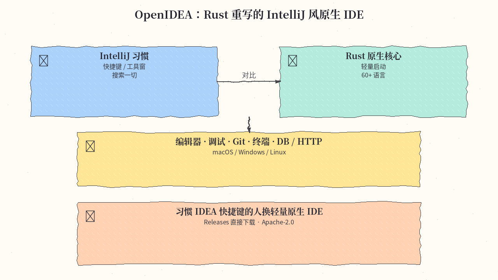
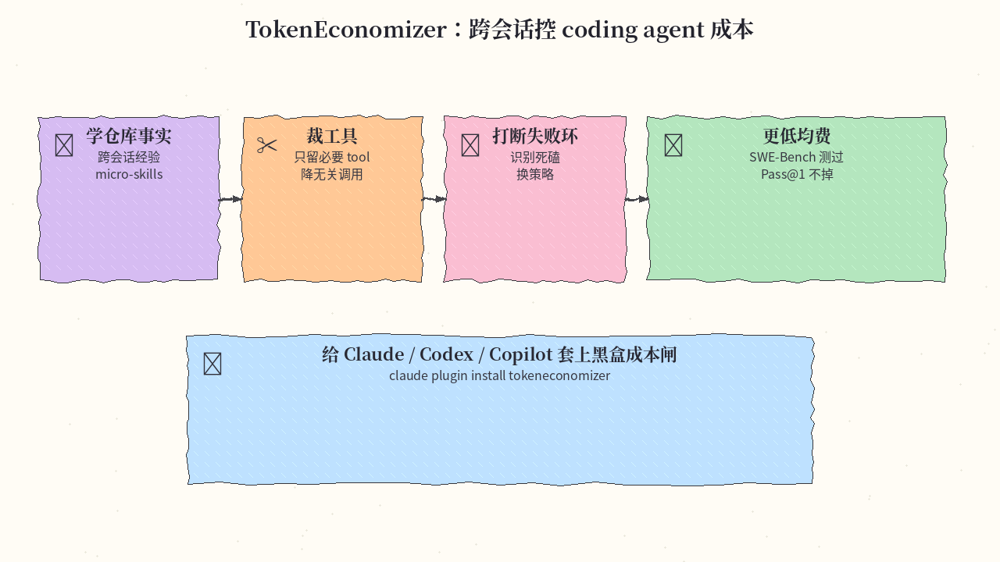
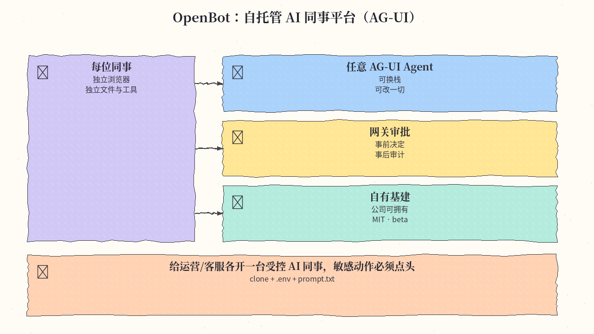
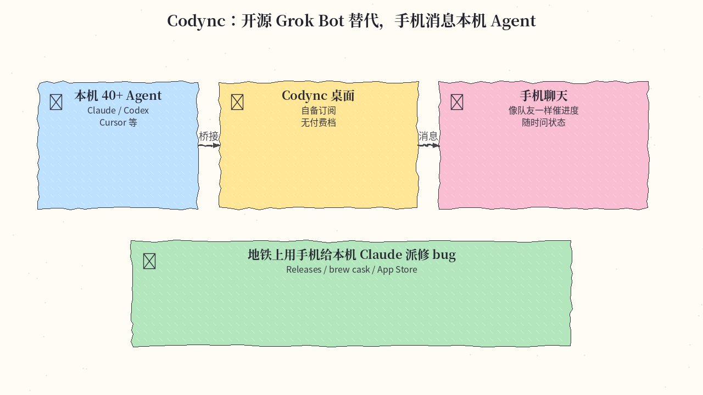
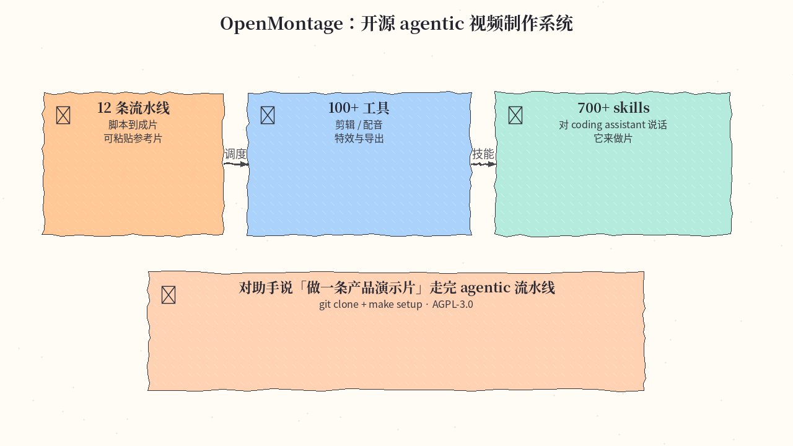
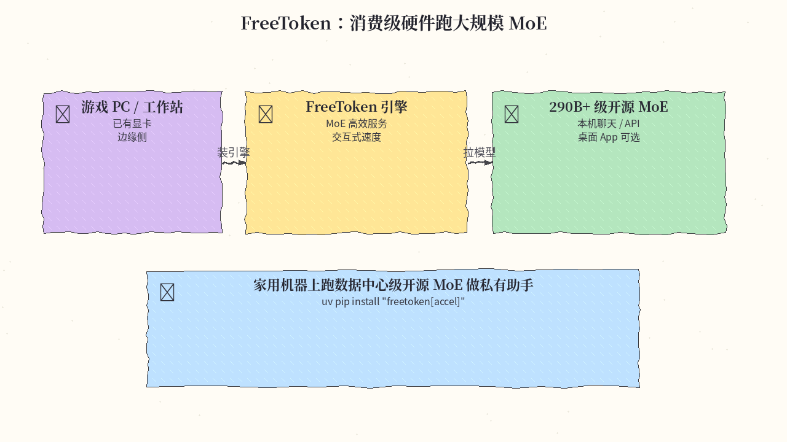
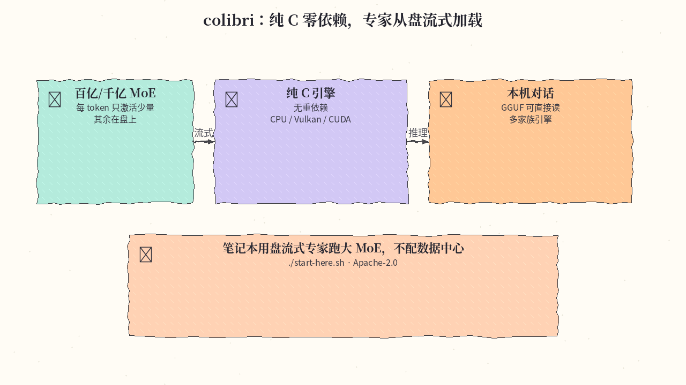
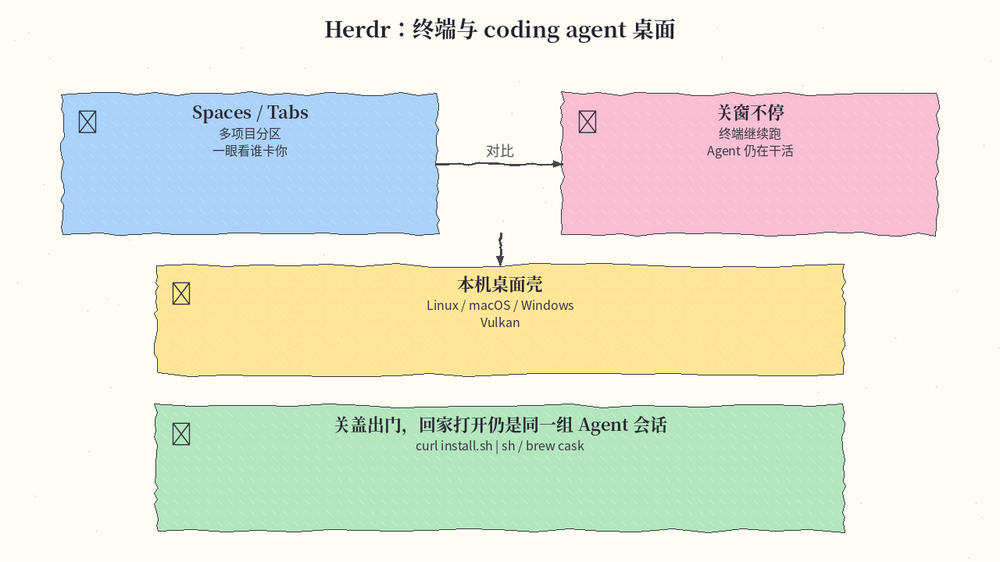
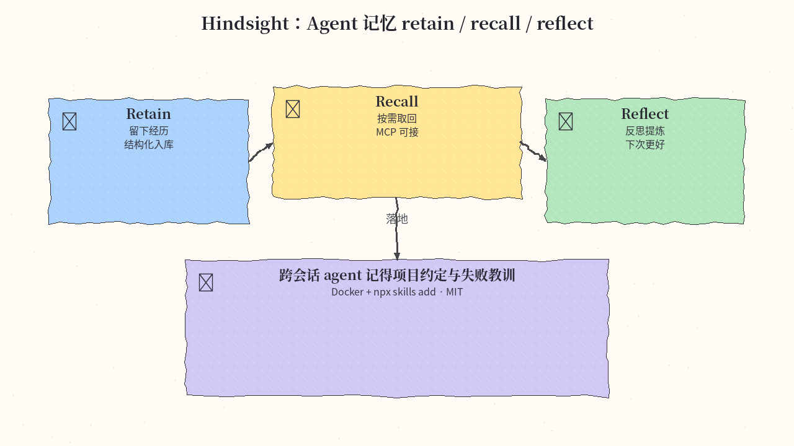
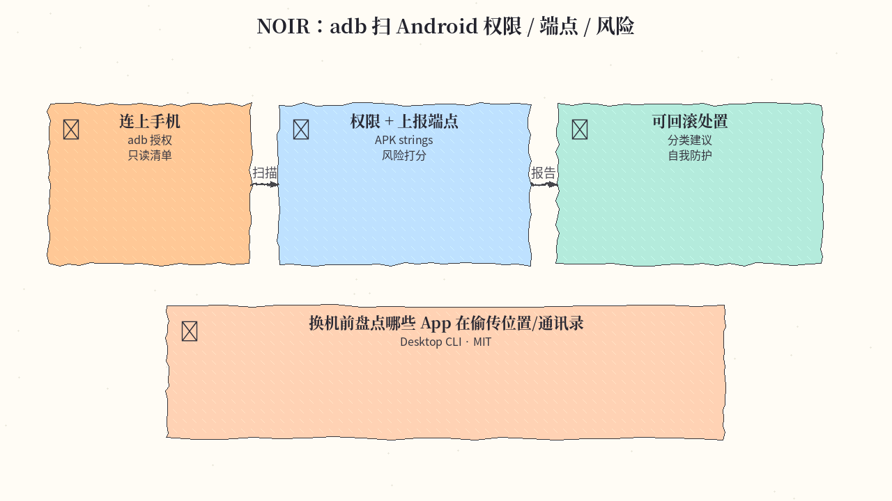

# 2026-11-03 GitHub 日报

今日精选 10 条：Rust 重写的 IntelliJ 风 IDE、coding agent 成本闸、自托管 AI 同事、开源 Grok Bot 替代、agentic 视频系统、消费级/纯 C MoE 推理、终端 Agent 桌面、Agent 记忆与 Android 权限审计。与往日日报、周报不重复。

## 1. l0ng-ai/openidea — Rust 重写的 IntelliJ 风原生 IDE

**介绍**  
OpenIDEA 把 IntelliJ 的工作方式（快捷键、工具窗、「搜一切」）搬到 Rust 核心的原生应用：编辑器、代码洞察、调试、Git、终端、数据库与 HTTP 客户端，覆盖 60+ 语言；提供 macOS / Windows / Linux 构建。Apache-2.0，约 5.0k★。

**用法**  
仓库：[github.com/l0ng-ai/openidea](https://github.com/l0ng-ai/openidea)。从 [Releases](https://github.com/l0ng-ai/openidea/releases/latest) 下载对应平台安装包即可；基准对比与路线图见 README。

**应用场景**  
习惯 IDEA 快捷键的人换轻量原生 IDE，少拖一整套 JVM IDE 全家桶。



**推荐学习程度**：入门

---

## 2. microsoft/TokenEconomizer — 经验驱动的 coding agent 成本控制

**介绍**  
微软等合作的黑盒成本闸：跨会话学习仓库事实（micro-skills）、裁剪无关工具、打断失败死循环，从而压低 coding agent 均费；SWE-Bench 测过约 18–31% 更低均费且多数组合 Pass@1 不掉。Apache-2.0，约 4.5k★；可接 Claude Code / Codex / Copilot 等。

**用法**  
仓库：[github.com/microsoft/TokenEconomizer](https://github.com/microsoft/TokenEconomizer)；项目页：[tokeneconomizer.github.io](https://tokeneconomizer.github.io)。

```bash
git clone https://github.com/microsoft/TokenEconomizer.git
# Claude Code 示例：
claude plugin marketplace add ./TokenEconomizer   # 或按 README 指向的 marketplace
claude plugin install tokeneconomizer@tokeneconomizer
# Codex / Copilot 安装见仓库对应说明
```

**应用场景**  
团队给长期跑仓库的 coding agent 套成本闸，少花 token 又不牺牲合入率。



**推荐学习程度**：进阶

---

## 3. CopilotKit/OpenBot — 自托管 AI 同事平台

**介绍**  
公司可真正拥有的 AI 助手形态：每人独立浏览器、登录态、文件与授权工具；动作经网关事前审批、事后审计；任意 AG-UI agent 栈可换。MIT，约 9.9k★，目前 beta。勿与 nightly-labs/openbot 混淆。

**用法**  
仓库：[github.com/CopilotKit/OpenBot](https://github.com/CopilotKit/OpenBot)；站：[copilotkit.ai/openbot](https://copilotkit.ai/openbot)。

```bash
git clone https://github.com/CopilotKit/OpenBot.git && cd OpenBot
cp .env.example .env   # 填 CopilotKit key 与模型 key；其余可由启动脚本补齐
# 建议先把 prompt.txt 贴给助手，再按 README Quick start 启动
```

**应用场景**  
给运营/客服各开一台受控 AI 同事，敏感动作必须人工点头。



**推荐学习程度**：进阶

---

## 4. leepokai/Codync — 开源 Grok Bot 替代

**介绍**  
把本机已登录的 Claude Code / Codex / Cursor / Gemini CLI 等 40+ agent 变成可从手机消息的队友；自备订阅，无付费档。Apache-2.0，约 1.7k★；站 codync.dev。

**用法**  
仓库：[github.com/leepokai/Codync](https://github.com/leepokai/Codync)；站：[codync.dev](https://www.codync.dev)。从 [Releases](https://github.com/leepokai/Codync/releases/latest) 装桌面端，或 brew cask / App Store（以官网渠道为准）；配置本机 agent 后用手机会话催进度。

**应用场景**  
通勤时用手机给本机 Claude 派修 bug，回家桌面接着看 diff。



**推荐学习程度**：入门

---

## 5. calesthio/OpenMontage — 开源 agentic 视频制作系统

**介绍**  
面向「对 coding assistant 说话就能做片」的视频生产系统：宣称 12 条流水线、100+ 工具、700+ skills，可从参考片起步。AGPL-3.0，约 75k★；站 openmontage.video。

**用法**  
仓库：[github.com/calesthio/OpenMontage](https://github.com/calesthio/OpenMontage)；站：[openmontage.video](https://openmontage.video)。

```bash
git clone https://github.com/calesthio/OpenMontage.git && cd OpenMontage
make setup
# 然后对你的 coding assistant 说要做什么片；提示词示例见 README「Try These Prompts」
```

**应用场景**  
产品演示短片：说明目标与参考片，让 agentic 流水线跑完剪辑与配音。



**推荐学习程度**：进阶

---

## 6. FlashML-org/FreeToken — 消费级硬件上的大规模 MoE 推理

**介绍**  
边缘侧 MoE 服务引擎：目标在游戏 PC / 工作站上以交互速度跑 290B+ 级开源 MoE；提供桌面 App 与 CLI。Apache-2.0，约 16k★；站 flashml.ai，附论文。

**用法**  
仓库：[github.com/FlashML-org/FreeToken](https://github.com/FlashML-org/FreeToken)；下载：[flashml.ai](https://www.flashml.ai/)。

```bash
uv pip install "freetoken[accel]"
# 或 git clone 后 uv pip install -e ".[accel]"；模型与 CLI 见 docs/
```

**应用场景**  
家用机器跑私有大 MoE 助手，不把对话送出机房。



**推荐学习程度**：深水

---

## 7. JustVugg/colibri — 纯 C 零依赖、专家从盘流式加载

**介绍**  
「小引擎、大模型」：纯 C、按家族单文件引擎，激活专家留内存、其余从盘流式读取；可 CPU / Vulkan / CUDA，并直接读已有 GGUF。Apache-2.0，约 47k★；站 justvugg.github.io/colibri。

**用法**  
仓库：[github.com/JustVugg/colibri](https://github.com/JustVugg/colibri)；站：[justvugg.github.io/colibri](https://justvugg.github.io/colibri)。

```bash
git clone https://github.com/JustVugg/colibri.git && cd colibri
./start-here.sh
```

**应用场景**  
笔记本用盘流式专家跑大 MoE，不配数据中心显存。



**推荐学习程度**：深水

---

## 8. herdrdev/herdr-app — 终端与 coding agent 桌面

**介绍**  
面向终端与 coding agent 的桌面壳：用 spaces/tabs 组织项目，能看见谁在等你；关掉窗口终端与 agent 仍继续跑。Apache-2.0，约 1.6k★；Linux / macOS / Windows。

**用法**  
仓库：[github.com/herdrdev/herdr-app](https://github.com/herdrdev/herdr-app)；站：[herdr.dev](https://herdr.dev)。

```bash
curl -fsSL https://releases.herdr.dev/app/install.sh | sh
# macOS Apple Silicon 也可：brew install --cask herdr-app
# Windows：irm https://releases.herdr.dev/app/install.ps1 | iex
```

**应用场景**  
关盖出门，回家打开仍是同一组 agent 会话与滚动日志。



**推荐学习程度**：入门

---

## 9. vectorize-io/hindsight — Agent 记忆 retain / recall / reflect

**介绍**  
Agent 记忆栈：retain 入库、recall 取回、reflect 提炼；提供 API / UI / MCP，可 Docker 一键起。MIT，约 58k★；文档 hindsight.vectorize.io。

**用法**  
仓库：[github.com/vectorize-io/hindsight](https://github.com/vectorize-io/hindsight)；文档：[hindsight.vectorize.io](https://hindsight.vectorize.io)。

```bash
export OPENAI_API_KEY=sk-xxx
docker run -it --pull always --name hindsight --restart unless-stopped \
  -p 8888:8888 -p 9999:9999 \
  -e HINDSIGHT_API_LLM_API_KEY=$OPENAI_API_KEY \
  -v hindsight-data:/home/hindsight/.pg0 \
  ghcr.io/vectorize-io/hindsight:latest
# API :8888 · UI :9999
npx skills add https://github.com/vectorize-io/hindsight --skill hindsight-docs
```

**应用场景**  
跨会话 coding agent 记得项目约定与上次失败教训。



**推荐学习程度**：进阶

---

## 10. Verlintas/NOIR — Android 权限 / 上报端点审计

**介绍**  
跑在电脑上的审计 CLI：经 adb 盘点有网络/敏感权限的 App，从 APK 抽上报端点，分类打分并给出可执行、可回滚的处置建议；可选 jadx。MIT，约 1.3k★；面向自我防护与已授权研究。

**用法**  
仓库：[github.com/Verlintas/NOIR](https://github.com/Verlintas/NOIR)；站：[verlintas.dev/noir](https://verlintas.dev/noir/)。从 Releases 装 Desktop CLI，手机开 USB 调试并授权 adb 后按文档扫描。

**应用场景**  
换机前盘点哪些 App 在偷传位置/通讯录，再逐项回滚权限。



**推荐学习程度**：进阶

---
