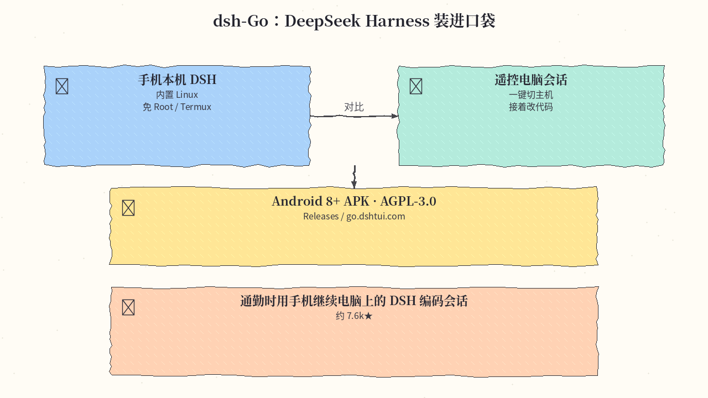
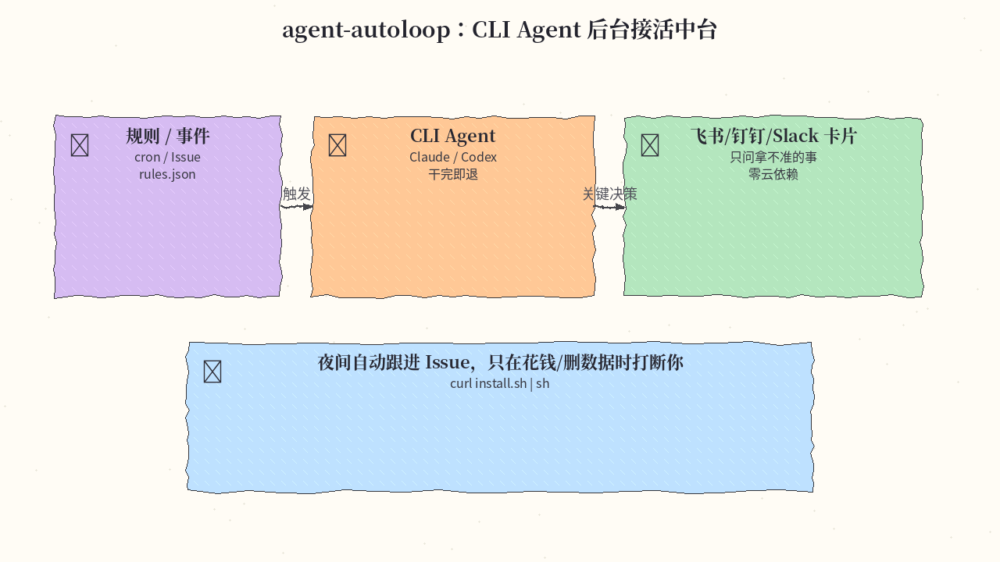
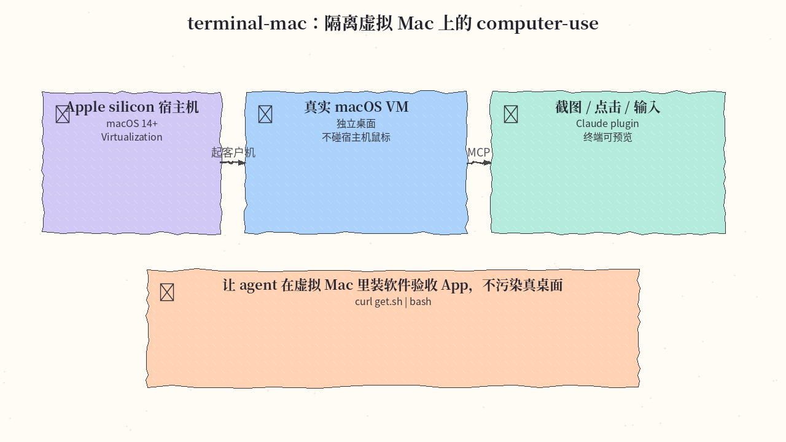
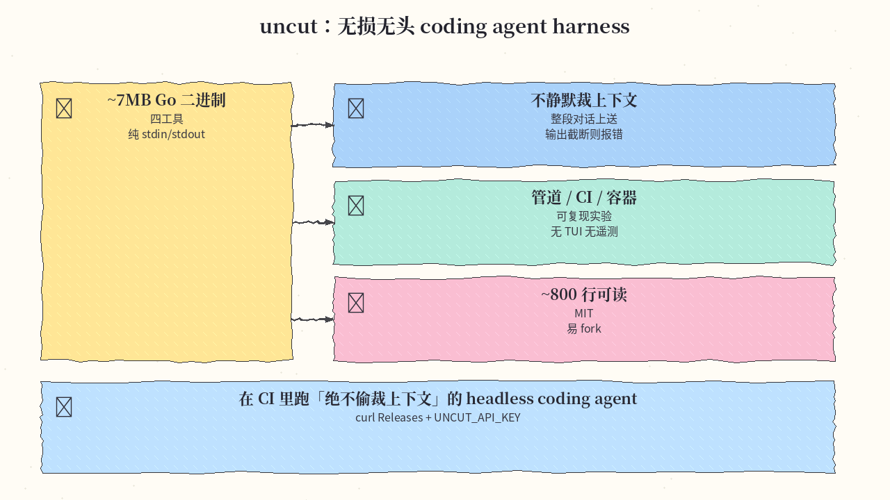
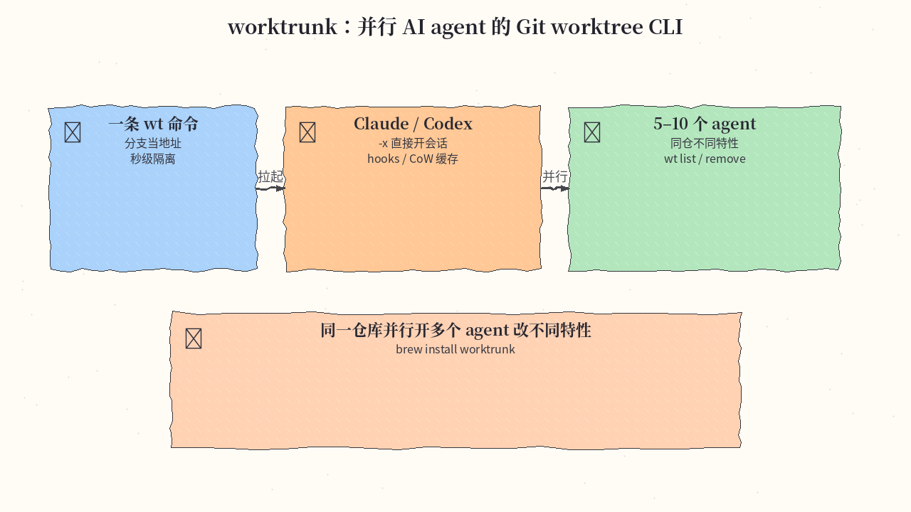
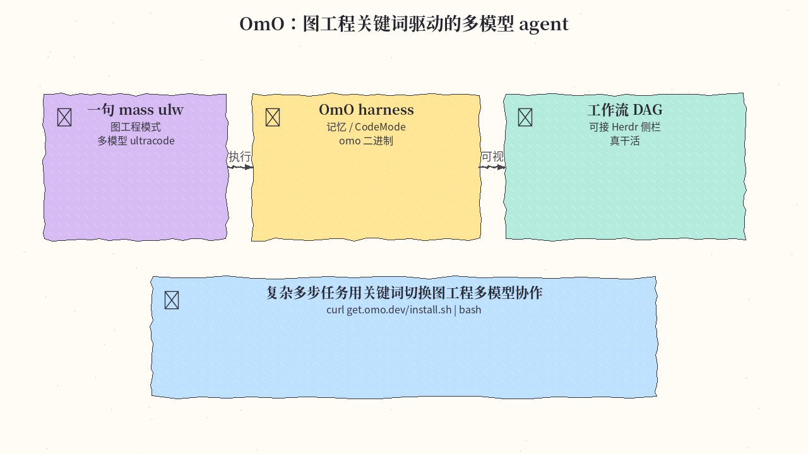
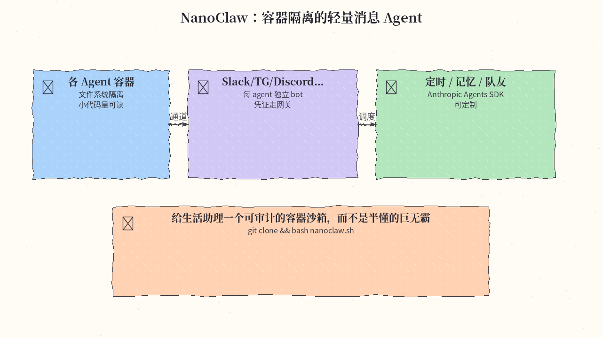

# 2026-11-04 GitHub 日报

今日精选 7 条：DSH 手机端、CLI Agent 后台中台、隔离虚拟 Mac computer-use、无损 headless harness、并行 worktree、OmO 图工程 agent，以及容器隔离的 NanoClaw。与往日日报、周报不重复。

## 1. ccch1mneyyy/dsh-Go — DeepSeek Harness 装进口袋

**介绍**  
DeepSeek Harness 的非官方 Android 客户端：内置 Linux 环境，免 Root、免 Termux，可在手机本机跑 DSH，也能一键遥控电脑上的 DSH 会话。AGPL-3.0，约 7.6k★。

**用法**  
仓库：[github.com/ccch1mneyyy/dsh-Go](https://github.com/ccch1mneyyy/dsh-Go)。从 [Releases](https://github.com/ccch1mneyyy/dsh-Go/releases/latest) 下载 arm64 APK（或官网 go.dshtui.com/download）；Android 8+ 安装后按 docs/guide 配模型与密钥。若曾装过不同签名测试包，需先卸载旧版。

**应用场景**  
通勤时用手机继续电脑上的 DSH 编码会话，或在手机内置 Linux 里跑轻量 agent 任务。



**推荐学习程度**：入门

---

## 2. KKKKhazix/agent-autoloop — CLI Agent 后台接活中台

**介绍**  
轻量命令行 Agent 自动化中台：把 Claude Code / Codex 等挂到 cron、GitHub Issue 等事件上后台接活，干完一轮就退出；只有删数据、花钱、对外发消息等拿不准的事才推飞书/钉钉/Slack/桌面卡片让你拍板。零云依赖，MIT，约 0.5k★（2026-11-03 新建仓）。

**用法**  
仓库：[github.com/KKKKhazix/agent-autoloop](https://github.com/KKKKhazix/agent-autoloop)。需 Node 24、Git、curl，以及已登录的 CLI Agent。

```bash
curl -fsSL https://raw.githubusercontent.com/KKKKhazix/agent-autoloop/main/install.sh | sh
agent-autoloop try
agent-autoloop status
# 日常在 ~/.agent-autoloop/rules.json 写规则
```

**应用场景**  
把「盯着终端守 agent」变成夜间/上班时自动跟进 Issue，只在关键决策时被卡片打断。



**推荐学习程度**：进阶

---

## 3. govijr/terminal-mac — 隔离虚拟 Mac 上的 computer-use

**介绍**  
Apple silicon 专用：用 Apple Virtualization 起一台真实 macOS 客户机，把截图/点击/输入做成 MCP 工具，让 coding agent 在隔离虚拟 Mac 上做 computer-use，不移动宿主机鼠标、不碰剪贴板。MIT，约 0.3k★（2026-11-03）。

**用法**  
仓库：[github.com/govijr/terminal-mac](https://github.com/govijr/terminal-mac)。要求 Apple silicon、macOS 14+。

```sh
curl -fsSL https://github.com/govijr/terminal-mac/releases/latest/download/get.sh | bash
terminal-mac up
# Claude Code：
/plugin install terminal-mac --marketplace govijr/terminal-mac
# 或其他 MCP 客户端：
terminal-mac mcp --config
```

客户机内需打开 TerminalMacGuest.app 并授予 Screen Recording + Accessibility。

**应用场景**  
让 agent 在独立虚拟 Mac 里装软件、点 UI、验收原生 App，而不污染你正在用的真桌面。



**推荐学习程度**：深水

---

## 4. Balanov/uncut — 无损、无头 coding agent harness

**介绍**  
单文件约 7MB 静态 Go 二进制：仅四个工具，纯 stdin/stdout，无 TUI、无遥测、不做静默上下文裁剪；整段对话每次完整上送，输出被截断则报错而非假装成功。MIT，约 0.6k★。

**用法**  
仓库：[github.com/Balanov/uncut](https://github.com/Balanov/uncut)。

```sh
VERSION=0.1.1; ARCH=amd64  # macOS Apple 硅用 darwin + arm64
curl -fSLo uncut "https://github.com/Balanov/uncut/releases/download/v${VERSION}/uncut-linux-${ARCH}"
install -m 0755 uncut "$HOME/.local/bin/uncut"
export UNCUT_API_KEY=... UNCUT_MODEL=...
uncut "Inspect this repository and fix the failing tests"
git diff | uncut "Review this diff. Do not edit files."
```

**应用场景**  
在 CI 或脚本里跑「绝不偷裁上下文」的 headless coding agent，或 fork 其约 800 行实现做自家 harness 实验。



**推荐学习程度**：专精

---

## 5. max-sixty/worktrunk — 并行 AI agent 的 Git worktree CLI

**介绍**  
用分支名当地址的 worktree CLI：`wt switch -c -x claude feat` 即可建 worktree 并拉起 Claude/Codex；配套 hooks 与 CoW 构建缓存，面向同时跑 5–10 个 agent。MIT OR Apache-2.0，约 10.5k★，今日仍在日榜。

**用法**  
仓库：[github.com/max-sixty/worktrunk](https://github.com/max-sixty/worktrunk)。

```bash
brew install worktrunk && wt config shell install
# 或 cargo install worktrunk && wt config shell install
wt switch -c -x claude feat
wt list
wt remove
```

**应用场景**  
同一仓库并行开多个 agent 改不同特性时，用 wt 秒级隔离工作区并一键进入对应终端会话。



**推荐学习程度**：入门

---

## 6. code-yeongyu/oh-my-openagent — OmO 图工程多模型 agent

**介绍**  
OmO（oh-my-openagent）：面向「真干活」的 agent 工具；会话里配合 `mass ulw` 等关键词切换图工程/多模型 ultracode，带记忆与 CodeMode，可与 Herdr 侧栏看工作流 DAG。约 70k★；许可为 SUL-1.0（非 OSI 常见宽松证，商用前读 LICENSE）。

**用法**  
仓库：[github.com/code-yeongyu/oh-my-openagent](https://github.com/code-yeongyu/oh-my-openagent)；文档：[omo.dev](https://omo.dev)。

```bash
curl -fsSL https://get.omo.dev/install.sh | bash
omo
# Windows PowerShell：irm https://get.omo.dev/install.ps1 | iex
# 或 bun add -g omo-ai / npm i -g omo-ai
```

**应用场景**  
复杂多步工程任务：用关键词打开图工程多模型协作，在侧栏盯 DAG 推进。



**推荐学习程度**：进阶

---

## 7. nanocoai/nanoclaw — 容器隔离的轻量消息 Agent

**介绍**  
相对巨型 OpenClaw 的轻量替代：每个 agent 跑在独立 Linux 容器里做文件系统隔离；凭证经本机网关注入，不进容器。可接 Slack / Telegram / Discord / WhatsApp 等，支持定时任务与记忆。MIT，约 31k★。

**用法**  
仓库：[github.com/nanocoai/nanoclaw](https://github.com/nanocoai/nanoclaw)；文档：[docs.nanoclaw.dev](https://docs.nanoclaw.dev)。

```bash
git clone https://github.com/nanocoai/nanoclaw.git nanoclaw-v2
cd nanoclaw-v2
bash nanoclaw.sh   # 引导装 Node/pnpm/Docker、凭证网关、容器与首个通道
```

**应用场景**  
给生活/工作助理一个可审计的容器沙箱，而不是半懂的巨无霸进程。



**推荐学习程度**：进阶

---
