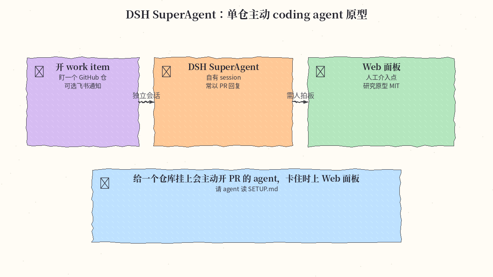
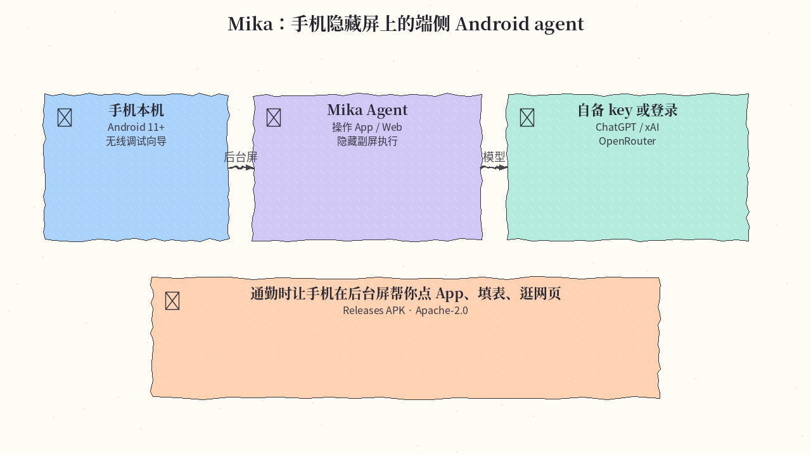
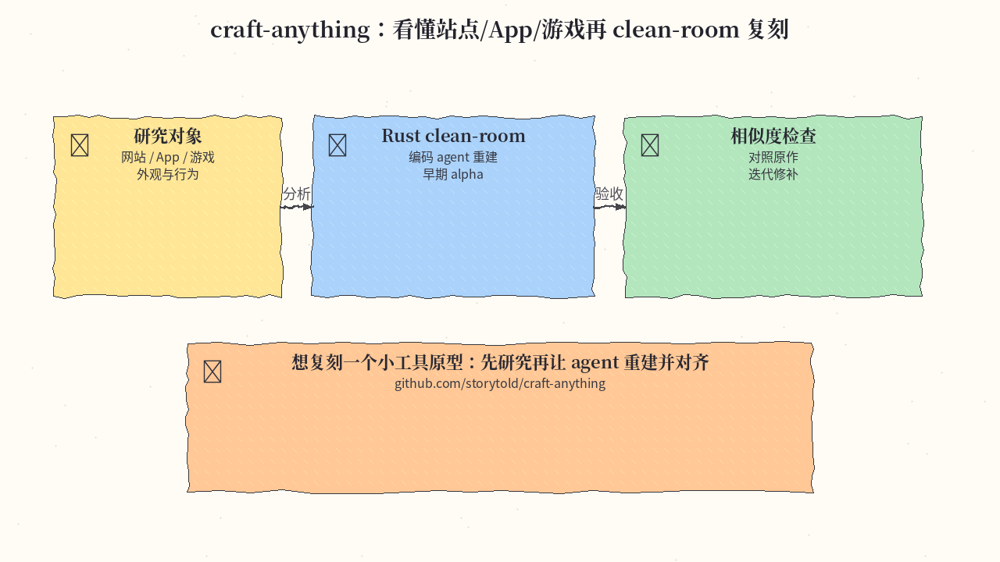
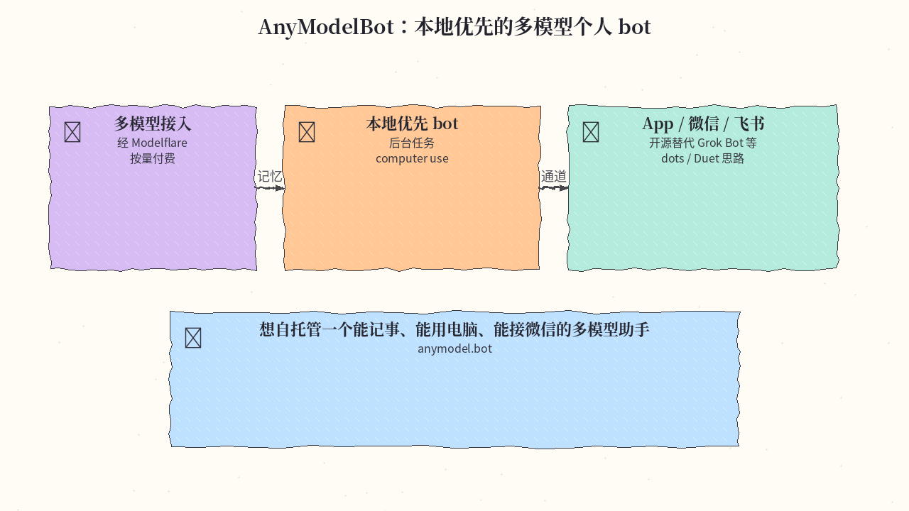
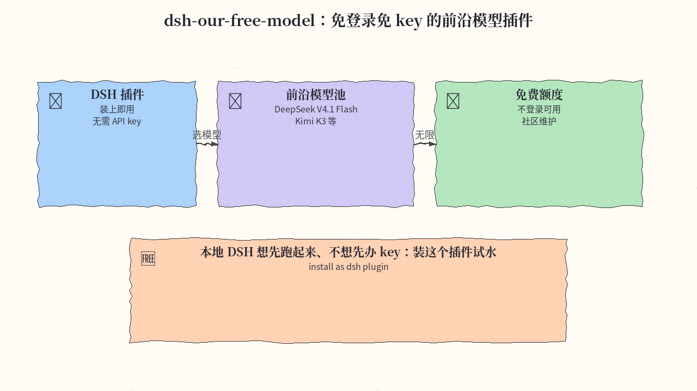
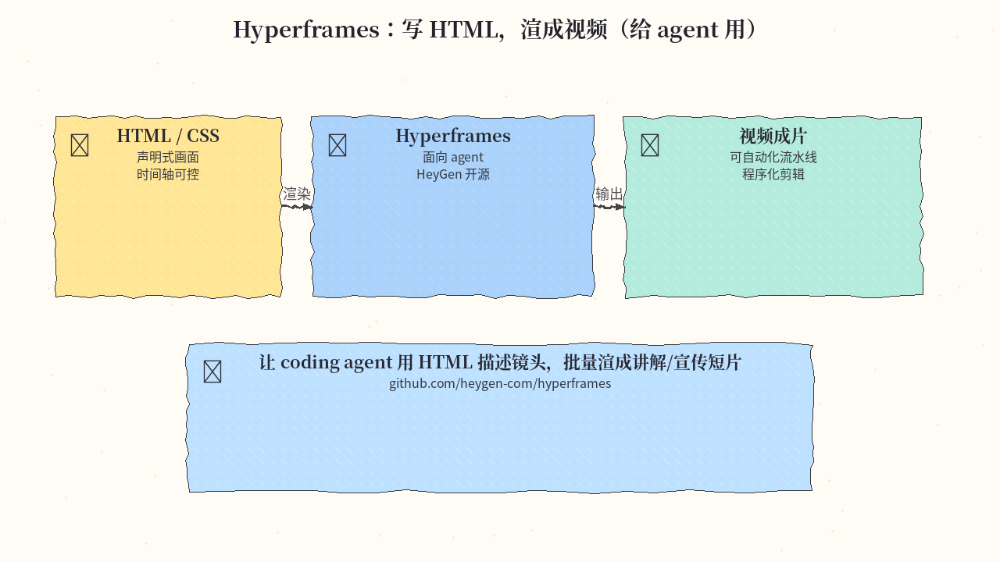
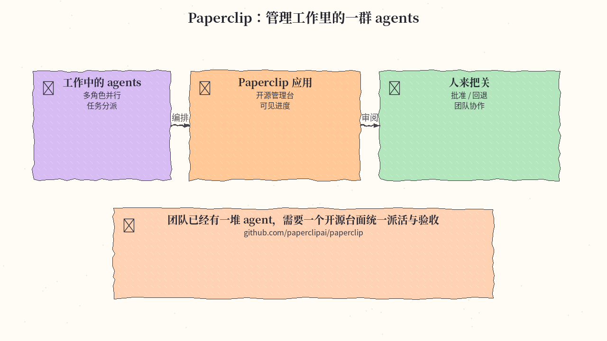

# 2026-11-05 GitHub 日报

今日精选 7 条：单仓主动 agent 原型、端侧 Android 操控、Rust clean-room 复刻、本地多模型 bot、DSH 免 key 插件、HTML→视频，以及工作 agent 管理台。与往日日报、周报不重复。

## 1. deepseek-ai/dsh-superagent-prototype — 单仓主动 coding agent 原型

**介绍**  
DSH bundle 研究原型：面向**一个** GitHub 仓库的主动 coding agent（可选飞书）。会自己开 work item、在独立 session 里干活，多数时候用 PR 回复；需要人拍板时走 Web 面板。MIT，约 18.6k★（2026-10-31 建仓）。

**用法**  
仓库：[github.com/deepseek-ai/dsh-superagent-prototype](https://github.com/deepseek-ai/dsh-superagent-prototype)。按仓库说明配置后，直接让 agent 阅读 `SETUP.md` 完成安装与接线。

**应用场景**  
给一个核心业务仓挂上会主动开 PR 的 agent；卡住或要删数据/花钱时上 Web 面板人工介入。

**推荐学习程度**：深水

---

## 2. wangzan101/Mika — 隐藏副屏上的端侧 Android agent

**介绍**  
端侧 Android agent：在隐藏后台屏上操作本机 App 与网页，不抢你正在看的前台。Apache-2.0，约 6.7k★。Android 11+；可自备 API key，或登录 ChatGPT / xAI / OpenRouter。

**用法**  
仓库：[github.com/wangzan101/Mika](https://github.com/wangzan101/Mika)。从 [Releases](https://github.com/wangzan101/Mika/releases) 装 APK，按无线调试向导完成手机控制授权，再配置模型入口。

**应用场景**  
通勤或开会时让手机在后台屏帮你点 App、填表、逛网页，前台屏幕照常用。

**推荐学习程度**：入门

---

## 3. storytold/craft-anything — 研究后 clean-room 复刻

**介绍**  
纯 Rust clean-room：先研究目标网站 / App / 游戏，再由 coding agent 重建，并对齐相似度。早期 alpha，约 12k★。

**用法**  
仓库：[github.com/storytold/craft-anything](https://github.com/storytold/craft-anything)。按 README 安装 Rust 工具链后，指向目标 URL/包，跑「研究 → 生成 → 验收」循环。

**应用场景**  
想快速得到一个小工具/小游戏的可改源码原型：先让它研究再重建，而不是从零手写。

**推荐学习程度**：进阶

---

## 4. modelflare-ai/AnyModelBot — 本地优先的多模型个人 bot

**介绍**  
开源、本地优先的个人 bot，定位接近 Grok Bot / OpenAI dots / Claude Duet 一类体验：经 Modelflare 接多模型，支持记忆、后台任务与 computer use，可走 App / 微信 / 飞书，按量付费。约 2.7k★。

**用法**  
仓库：[github.com/modelflare-ai/AnyModelBot](https://github.com/modelflare-ai/AnyModelBot)；站点：[anymodel.bot](https://anymodel.bot/)。按 README 本地部署或使用托管入口，绑定模型与消息通道。

**应用场景**  
想自托管一个能记事、能用电脑、能接微信/飞书的多模型助手，而不是绑死单一闭源 bot。

**推荐学习程度**：入门

---

## 5. Ebony-Vinyl/dsh-our-free-model — DSH 免登录免 key 模型插件

**介绍**  
DSH 插件：接入 DeepSeek V4.1 Flash、Kimi K3 等前沿模型，无需登录、无需 API key，宣称免费不限量。约 60k★。

**用法**  
仓库：[github.com/Ebony-Vinyl/dsh-our-free-model](https://github.com/Ebony-Vinyl/dsh-our-free-model)。按 README 以 dsh plugin 方式安装并启用；具体模型列表以仓库当前说明为准。

**应用场景**  
本地 DSH 想先跑通流程、暂时不想办云厂商 key：装插件试水再决定是否换自有额度。

**推荐学习程度**：入门

---

## 6. heygen-com/hyperframes — 写 HTML，渲成视频

**介绍**  
面向 agent 的视频管线：用 HTML/CSS 描述画面与时间轴，渲染成视频。HeyGen 开源，约 79k★。

**用法**  
仓库：[github.com/heygen-com/hyperframes](https://github.com/heygen-com/hyperframes)。按 README 安装 CLI/库，用 HTML 写镜头，调用渲染命令输出成片；可嵌进 agent 工作流批量生产。

**应用场景**  
让 coding agent 用 HTML 描述讲解镜头，批量渲成产品介绍或内部培训短片。

**推荐学习程度**：进阶

---

## 7. paperclipai/paperclip — 管理工作里的 agents

**介绍**  
开源应用：把工作中的一群 agents 放到同一台面上派活、看进度、做人审。约 111k★。

**用法**  
仓库：[github.com/paperclipai/paperclip](https://github.com/paperclipai/paperclip)。按 README 部署应用，接入现有 agent 运行时，配置任务队列与人工审批点。

**应用场景**  
团队已经有多个 agent 并行干活，需要一个开源中台统一分派与验收，而不是散落在各聊天窗口。

**推荐学习程度**：进阶

---
