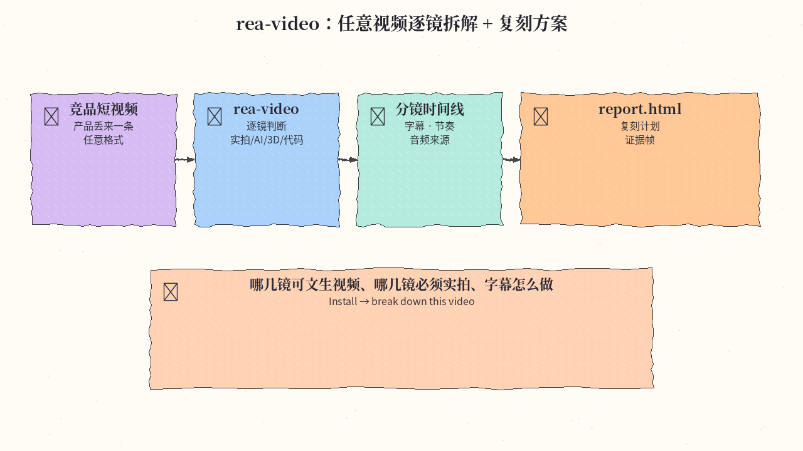
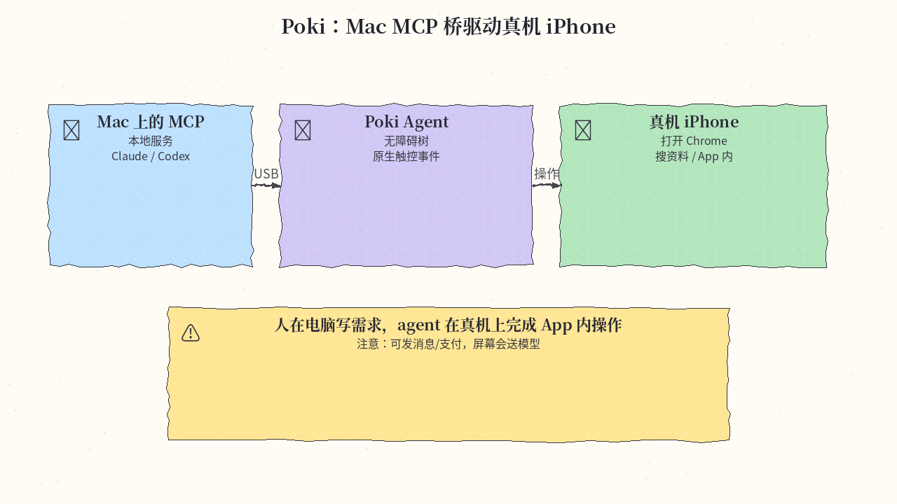
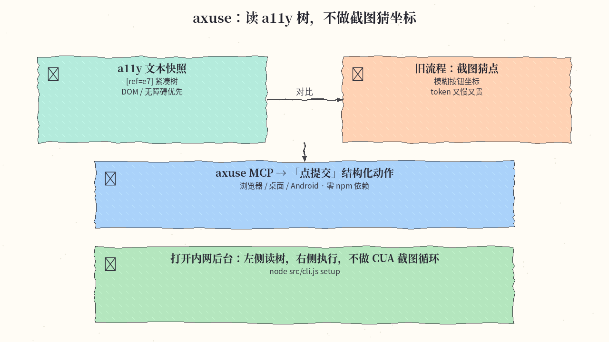
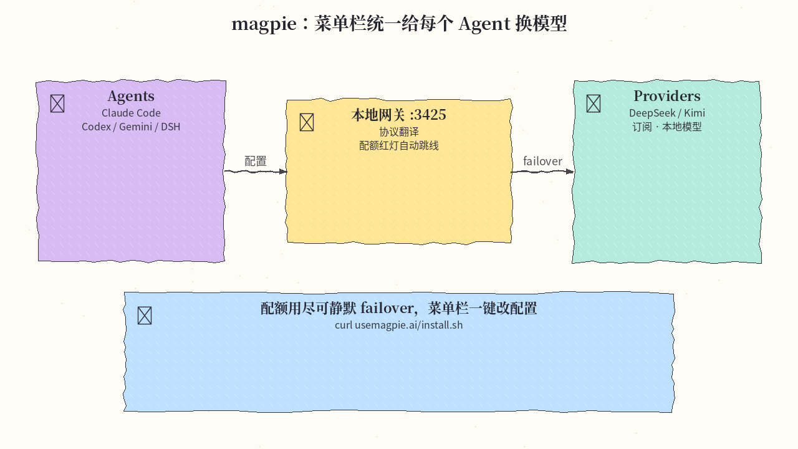

# 2026-11-06 GitHub 日报

今日四条偏「能立刻接到现有 coding agent」：逐镜拆视频、真机 iPhone MCP、无障碍树操控、菜单栏统一换模型。

## 1. JuneYaooo/rea-video — 任意视频逐镜逆向 + 复刻方案

**介绍**  
rea-video 是给 Claude Code / Codex 等 coding agent 用的「视频逆向」技能与 CLI。它不只说「像 AI 生成」，而是按镜头判断实拍、文生视频、3D、代码 UI、录屏或混剪，并拆字幕样式、剪辑节奏与音频来源。输出含一句话结论、复刻计划与带证据帧的 `report.html`，可接视觉模型提高判断精度。约 2.1k★。

**用法**  
仓库：[github.com/JuneYaooo/rea-video](https://github.com/JuneYaooo/rea-video)。需要 ffmpeg + Python 3.10+。直接让 agent：`Install https://github.com/JuneYaooo/rea-video, then break down this video: /path/to/video.mp4`

```bash
brew install ffmpeg   # 或: sudo apt install ffmpeg
git clone https://github.com/JuneYaooo/rea-video && cd rea-video
bash scripts/install_skill.sh
rea-video --help
```

**应用场景**  
产品同学丢来一条竞品短视频：agent 跑完后在报告里标出「哪几镜可文生视频、哪几镜必须实拍、字幕怎么做」。



**推荐学习程度**：进阶

---

## 2. JosssphZhou/poki — 无越狱操作真机 iPhone 的本地 MCP

**介绍**  
Poki 在 Mac 上跑本地 MCP 服务与可选终端 Agent，经 USB 配对实体 iPhone，用无障碍树与原生触控事件驱动 App。可挂到 Claude Code / Codex 等 MCP 客户端，也可用自带 `poki` Agent；支持 iMessage / Telegram 通道。AGPL-3.0，站：[poki.bot](https://poki.bot)。注意：真机会执行发消息/支付等危险操作，屏幕内容会送到你配置的模型服务。约 228★（新建仓，正在起势）。

**用法**  
仓库：[github.com/JosssphZhou/poki](https://github.com/JosssphZhou/poki)。要求 macOS 15+、完整 Xcode、Node.js 24+、ffmpeg。

```bash
git clone https://github.com/JosssphZhou/poki.git
cd poki
./bin/setup
npm start
# 另开终端注册 MCP：
claude mcp add --scope user poki-mcp -- node "$PWD/src/stdio.mjs"
# 或: codex mcp add poki-mcp -- node "$PWD/src/stdio.mjs"
```

也可从 Releases 下预编译包；真机先按 `docs/physical-iphone.md` USB 配对。

**应用场景**  
人在电脑写需求，agent 经 Mac 上的 MCP 桥、USB 线，在真机上完成 App 内操作（例如打开 Chrome 搜资料）。



**推荐学习程度**：进阶

---

## 3. ctoldigital/axuse — 无障碍树优先的浏览器/电脑操控 MCP

**介绍**  
axuse 强调：机器该读 DOM/无障碍树，而不是对着截图猜坐标。一个零 npm 依赖的 MCP，可接 Codex、Claude Code、OpenCode、Antigravity 等；覆盖浏览器（含已登录日常 Chrome 桥）、桌面（Win 已验、macOS 显式 opt-in、Linux X11）以及 Android 手机侧 axdroid。官方基准称浏览器任务中位耗时与 token 明显优于截图式方案。站：[ax-use.com](https://ax-use.com)。约 793★。

**用法**  
仓库：[github.com/ctoldigital/axuse](https://github.com/ctoldigital/axuse)。Node.js 22+，本机有 Chromium 系浏览器即可：

```bash
git clone https://github.com/ctoldigital/axuse.git
cd axuse
node src/cli.js doctor
node src/cli.js setup --browser chrome --harness codex
codex mcp add axuse -- node /abs/path/axuse/src/cli.js mcp
# Claude Code:
# claude mcp add --scope user axuse -- node /abs/path/axuse/src/cli.js mcp
```

非开发者也可在 Claude Desktop 双击下载的 `axuse.mcpb`，或让 agent 跟随 https://ax-use.com/install.md。

**应用场景**  
agent 打开内网后台：左侧是紧凑的 a11y 文本快照与 `[ref=e7]`，右侧是「点提交」动作——对比旁边一张模糊截图猜按钮的旧流程。



**推荐学习程度**：进阶

---

## 4. yetone/magpie — 菜单栏/本地网关统一换模型

**介绍**  
magpie 解决「每个 agent 各写一份模型配置」：在 Agents 页选 `provider/model`，原子改写该 agent 自己的配置；本地 `127.0.0.1:3425` 网关翻译 OpenAI / Anthropic / Gemini 协议。支持 API key、订阅登录与本地模型，可做 routing group 与配额面板；可选提示词脱敏。覆盖 macOS / Windows / Linux（菜单栏、TUI、Web、CLI）及 Docker / Termux。站：[usemagpie.ai](https://usemagpie.ai)。约 30.5k★。

**用法**  
仓库：[github.com/yetone/magpie](https://github.com/yetone/magpie)。

```bash
curl -fsSL https://usemagpie.ai/install.sh | sh
magpie provider add deepseek sk-…
magpie claude deepseek/deepseek-v4-pro
magpie codex moonshot/kimi-k2.5
magpie quota
```

或从 https://usemagpie.ai 下桌面端；文档：https://usemagpie.ai/docs/start

**应用场景**  
菜单栏小图标：左边挂着 Claude Code / Codex / Gemini 三个插头，右边一排 DeepSeek / Kimi / 订阅账号，中间一根「网关」线在配额红灯时自动跳线。



**推荐学习程度**：入门

---
