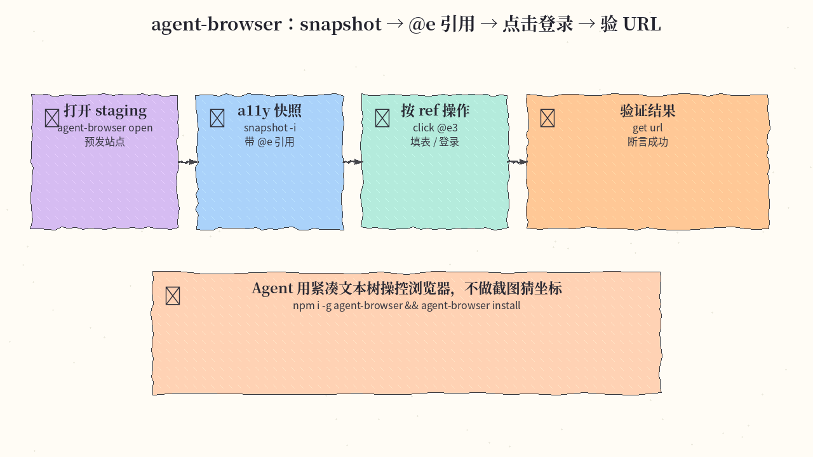
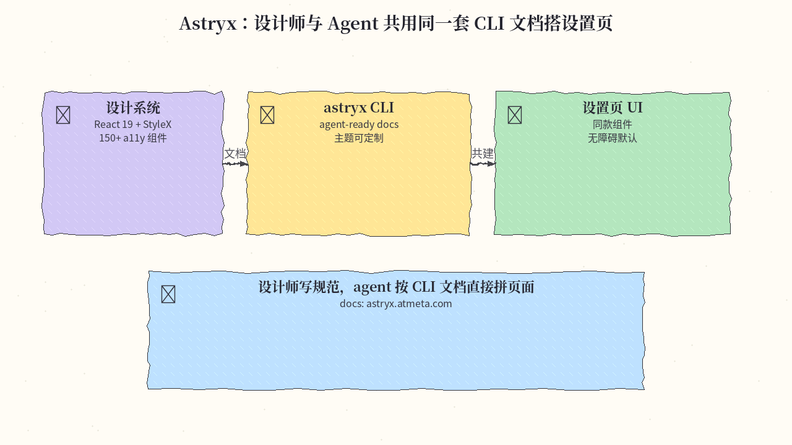
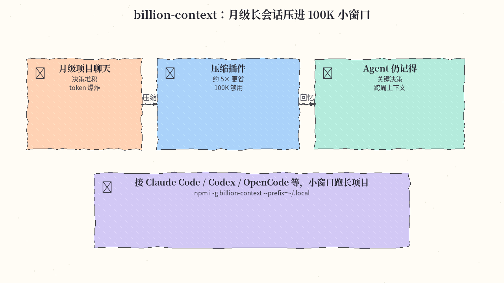
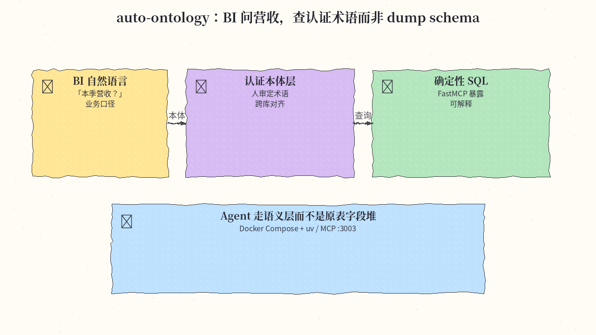
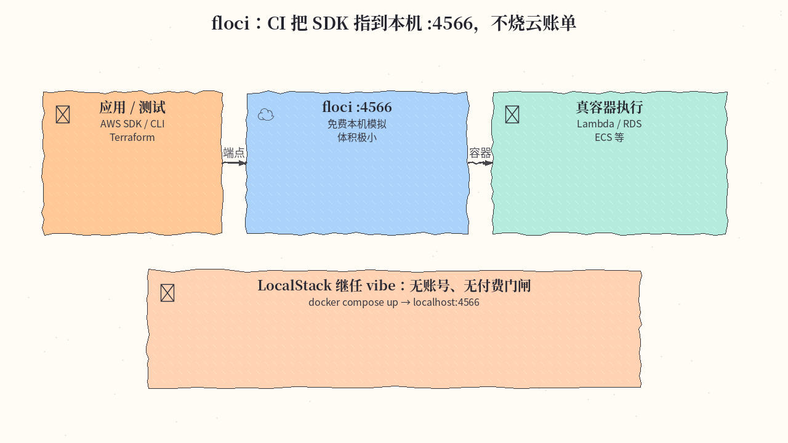
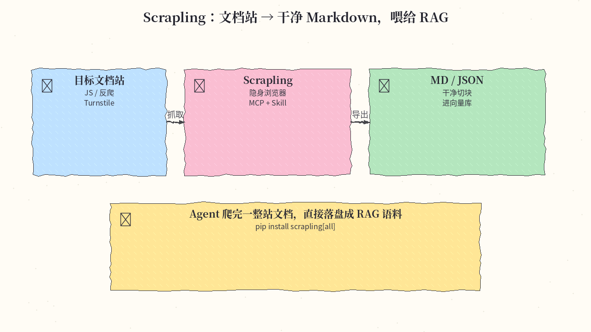
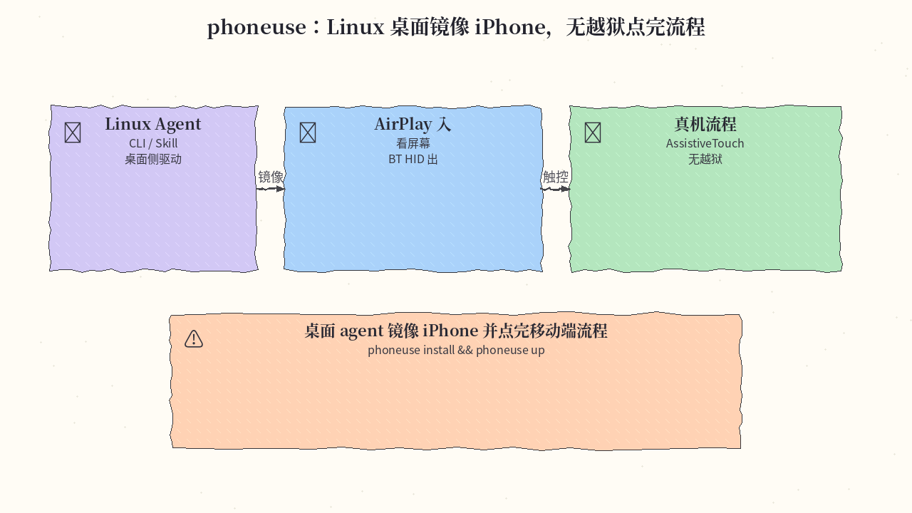

# 2026-11-09 GitHub 日报

今日七条围绕「agent 的手与眼」：浏览器 CLI、设计系统、长上下文压缩、本体层 SQL、本机 AWS 模拟、爬虫框架、Linux 控 iPhone。

## 1. vercel-labs/agent-browser — a11y 快照驱动的浏览器自动化 CLI

**介绍**  
agent-browser 是给 AI agent 用的浏览器自动化 CLI（Rust 原生）：`snapshot` 返回带 `@e` 引用的紧凑无障碍文本，再按 ref 点击/填表，最后 `get url` 等做校验。和 agent-desktop 同门；可装 discovery skill，也可 `agent-browser mcp`。约 47.7k★。

**用法**  
仓库：[github.com/vercel-labs/agent-browser](https://github.com/vercel-labs/agent-browser)。文档：[agent-browser.dev](https://agent-browser.dev)。

```bash
npm i -g agent-browser && agent-browser install
# 或: brew install agent-browser && agent-browser install
npx skills add vercel-labs/agent-browser
agent-browser mcp   # 可选 MCP
agent-browser open https://staging.example.com
agent-browser snapshot -i
agent-browser click @e3
agent-browser get url
```

**应用场景**  
Agent 打开预发站：snapshot 给出 `@e` refs，点登录、填表，再核 URL 是否进仪表盘。



**推荐学习程度**：入门

---

## 2. meta/astryx — Meta 开源、agent-ready 设计系统（beta）

**介绍**  
Astryx 是 Meta 开源设计系统（beta）：React 19 + StyleX，150+ 无障碍组件，CLI/文档按 agent 可读方式组织，主题可换。站：[astryx.atmeta.com](https://astryx.atmeta.com)。约 17k★。

**用法**  
仓库：[github.com/meta/astryx](https://github.com/meta/astryx)。

```bash
npm i @astryxdesign/core @astryxdesign/theme-neutral @stylexjs/stylex
npm i -D @astryxdesign/cli
# 可选全局 CLI，方便任意目录 / coding agent 调用文档：
npm i -g @astryxdesign/cli
astryx docs global/project-global-or-both
```

**应用场景**  
设计师与 agent 共用同一套 CLI 文档，一起搭设置页：组件、间距、a11y 默认都对齐。



**推荐学习程度**：进阶

---

## 3. ranxianglei/billion-context — 月级长会话的上下文压缩插件

**介绍**  
billion-context 把超长单会话压进小窗口：宣称 100K 上下文够用、约 5× 更少 token，面向月级项目聊天。可挂 Claude Code / Codex / OpenCode 等。约 5.2k★。

**用法**  
仓库：[github.com/ranxianglei/billion-context](https://github.com/ranxianglei/billion-context)。

```bash
npm i -g billion-context --prefix=~/.local
# 按仓库说明接到你的 coding agent / 插件目录后开长会话
```

**应用场景**  
一个月的项目聊天被压进小窗口，agent 仍能回忆关键决策与取舍，而不是每次把整段历史塞回。



**推荐学习程度**：进阶

---

## 4. NVIDIA/auto-ontology — 给 text-to-SQL agent 的本体层

**介绍**  
Auto Ontology 在数据库之上建语义/图推理层：人审定术语与口径，再经 FastMCP / CLI / API 暴露给任意 agent harness，减少「乱 dump schema」导致的错数。支持 Docker Compose 与 uv；可 Helm。约 10.4k★。

**用法**  
仓库：[github.com/NVIDIA/auto-ontology](https://github.com/NVIDIA/auto-ontology)。Quickstart 用 Wide World Importers 样例库。

```bash
# 见仓库 Quickstart：先起 Postgres，再 compose 起服务
docker compose up -d --build
# MCP（示例）：uvx --from "git+https://github.com/NVIDIA/auto-ontology.git#subdirectory=mcp" auto-ontology-mcp
# 或指向 http://localhost:3003/mcp
```

**应用场景**  
BI 聊天问「本季营收」：agent 查已认证的本体术语与度量，而不是把原始表结构一股脑塞进 prompt。



**推荐学习程度**：深度

---

## 5. floci-io/floci — 免费本机 AWS 模拟器（LocalStack 继任 vibe）

**介绍**  
floci 给本机 AWS 形 API：默认 `localhost:4566`，无账号、无 auth token、无付费门闸，MIT，镜像体积极小。Lambda/RDS 等关键服务走真 Docker 容器。站：[floci.io/floci](https://floci.io/floci/)。约 31k★。

**用法**  
仓库：[github.com/floci-io/floci](https://github.com/floci-io/floci)。

```bash
# compose.yaml 里把 4566:4566 映射后：
docker compose up
export AWS_ENDPOINT_URL=http://localhost:4566
# 也可用 Releases 里的 standalone floci-aws 二进制（无 Docker）
```

**应用场景**  
CI 把 SDK/CLI 指到 floci：本地跑 Lambda/RDS 相关集成测，不烧云账单。



**推荐学习程度**：入门

---

## 6. D4Vinci/Scrapling — Python 爬虫框架 + MCP / Agent Skill

**介绍**  
Scrapling 把 HTTP、隐身浏览器、解析、并发爬取收进一个库；可处理 Turnstile 等挑战，导出 Markdown/JSON；自带 MCP 与 Agent Skill，方便 coding agent 直接用。约 100k★。

**用法**  
仓库：[github.com/D4Vinci/Scrapling](https://github.com/D4Vinci/Scrapling)。文档：[scrapling.readthedocs.io](https://scrapling.readthedocs.io/en/latest/)。

```bash
pip install "scrapling[all]"   # 或 scrapling[ai] / [fetchers] / [shell]
# MCP / Agent Skill 见文档 ai/mcp-server 与 ai/agent-skill
```

**应用场景**  
Agent 爬一整站文档，吐出干净 Markdown，直接进 RAG 切块与向量库。



**推荐学习程度**：进阶

---

## 7. lxe/phoneuse — Linux 上看并操作未越狱 iPhone

**介绍**  
phoneuse（2026-11-07 新建）：Linux PC 经 AirPlay 镜像入、蓝牙 HID 鼠标/键盘出，操控未修改的 iPhone；另有 CLI 与 agent skill。约 453★。

**用法**  
仓库：[github.com/lxe/phoneuse](https://github.com/lxe/phoneuse)。

```bash
git clone https://github.com/lxe/phoneuse.git ~/phoneuse
ln -s ~/phoneuse/bin/phoneuse ~/.local/bin/phoneuse
phoneuse install   # needs sudo：装 HID daemon
phoneuse up
phoneuse cursor on
```

**应用场景**  
Linux 桌面 agent 镜像 iPhone，点完一段移动端流程——无需越狱。



**推荐学习程度**：进阶

---
