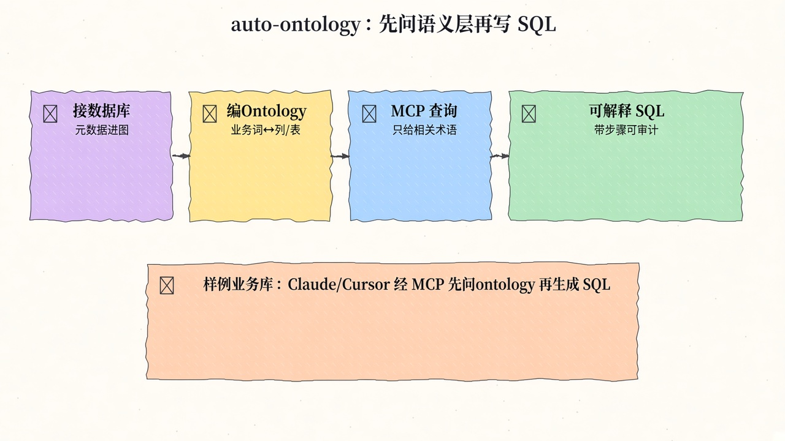
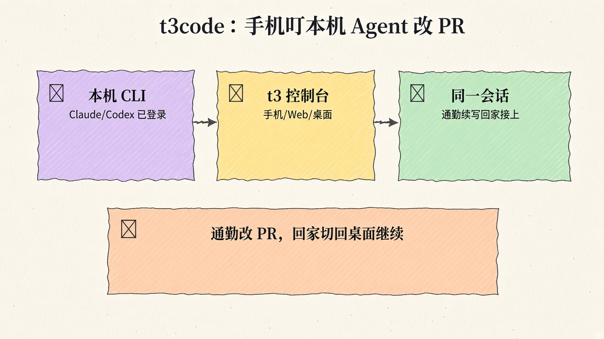
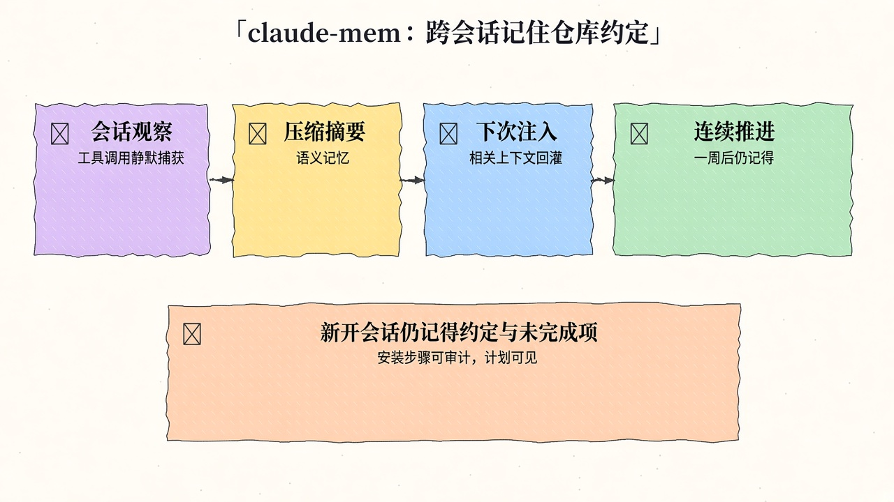
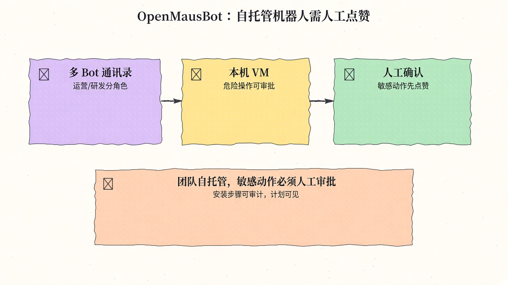
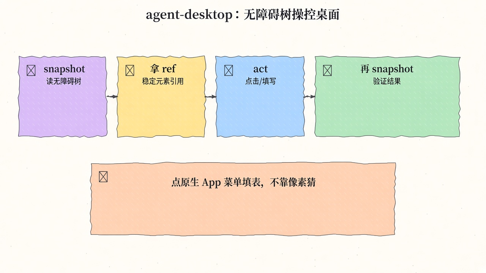
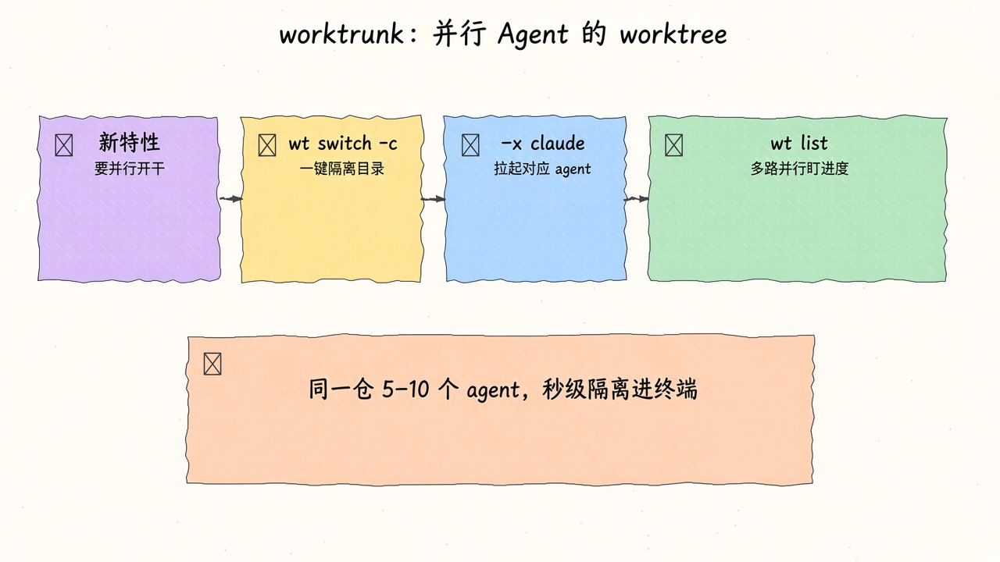
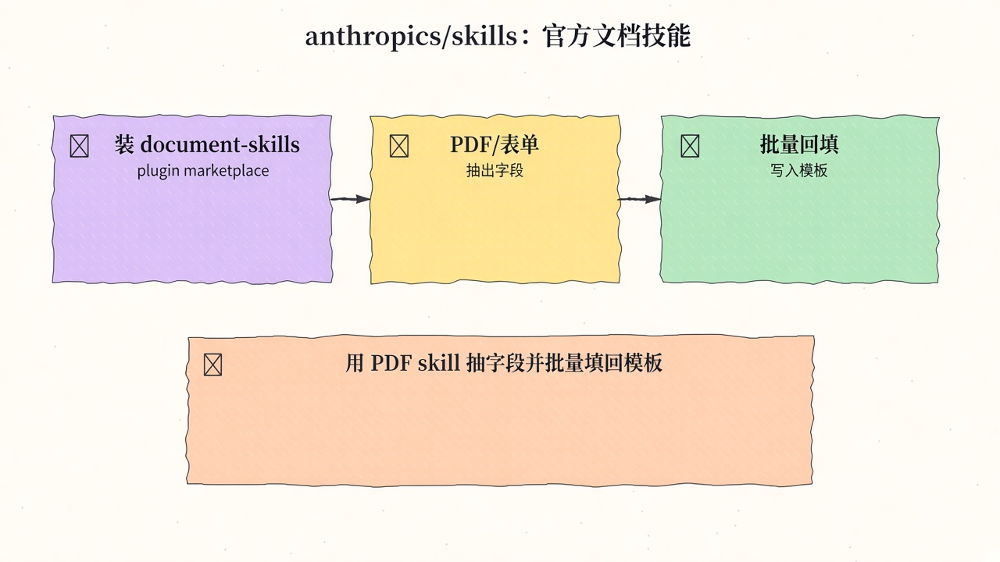
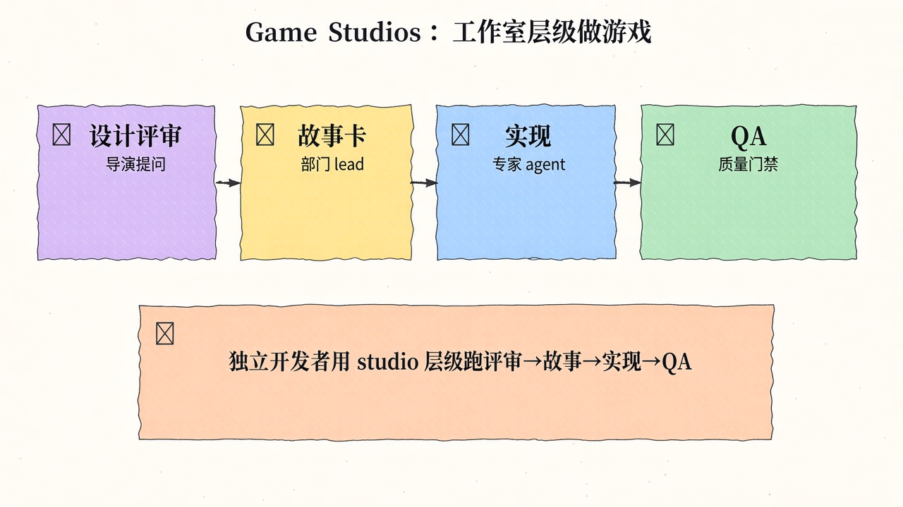
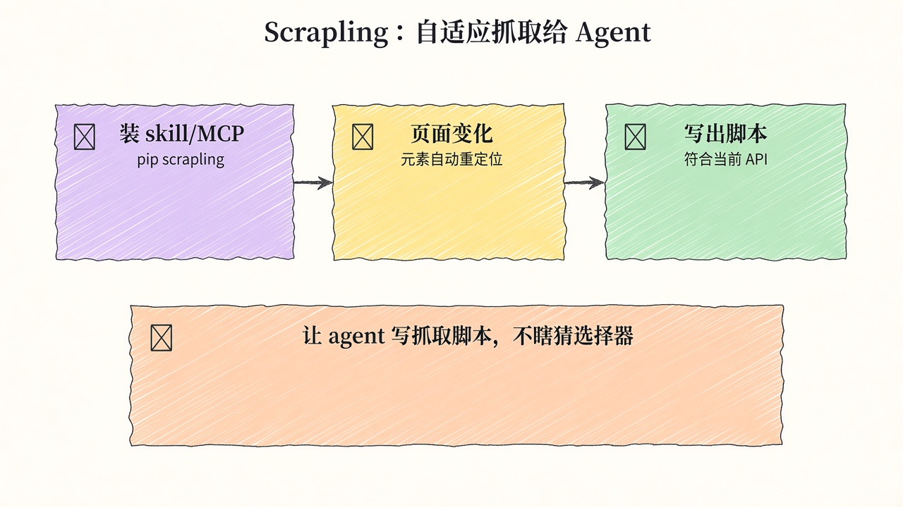
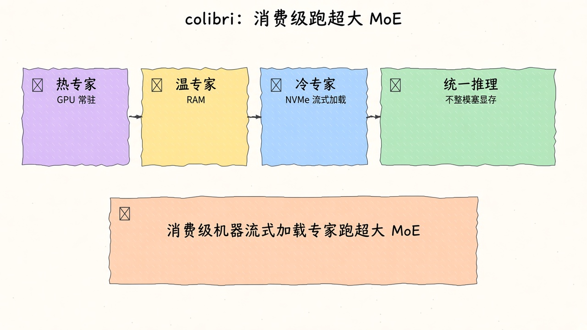

# 2026-11-09 GitHub 周报

上周（11/02–11/08）精选 10 个值得跟进的开源项目（偏 Agent Skills / 多 Agent 控制面 / harness 并行）。

## 1. NVIDIA/auto-ontology — 给 Agent 的企业语义 Ontology / NL-to-SQL 上下文层

**介绍**  
Auto Ontology（Apache-2.0，★~10.4k）：给 Agent 的企业语义 Ontology / NL-to-SQL 上下文层，本周周榜常驻第一梯队。把业务语义做成可查询图，让 LLM 先问 ontology 再生成可解释 SQL。

**用法**  
仓库：[github.com/NVIDIA/auto-ontology](https://github.com/NVIDIA/auto-ontology)。

```bash
git clone https://github.com/NVIDIA/auto-ontology.git && cd auto-ontology
cp .env.example .env   # Docker Compose v2、uv、NVIDIA API key
docker compose up      # README Quickstart
# MCP：
uvx --from "git+https://github.com/NVIDIA/auto-ontology.git#subdirectory=mcp" auto-ontology-mcp
```

**应用场景**  
把样例业务库接上，让 Claude/Cursor 经 MCP 先问 ontology 再生成可解释 SQL。



**推荐学习程度**：专家

---

## 2. pingdotgg/t3code — 手机盯本机 Claude 改 PR

**介绍**  
t3code（MIT，★~52.5k）：跨端 coding agent 会话壳，homepage [t3.codes](https://t3.codes)。通勤手机、回家桌面可续同一会话。

**用法**  
仓库：[github.com/pingdotgg/t3code](https://github.com/pingdotgg/t3code)。

```bash
curl -fsSL https://t3.codes/install.sh | sh
# 或：brew install --cask t3-code
```

**应用场景**  
通勤用手机盯本机 Claude 改 PR，回家切回桌面继续同一会话。



**推荐学习程度**：入门

---

## 3. thedotmack/claude-mem — 跨会话持久上下文

**介绍**  
claude-mem（Apache-2.0，★~114.9k）：捕获 agent 会话、压缩后注入未来会话；站 [claude-mem.ai](https://claude-mem.ai)。适配 Claude Code / Codex / Cursor 等。

**用法**  
仓库：[github.com/thedotmack/claude-mem](https://github.com/thedotmack/claude-mem)。

```bash
npx claude-mem install
# 例：npx claude-mem install --ide t3code
```

**应用场景**  
一周后新开 coding 会话仍记得仓库约定与上次未完成项。



**推荐学习程度**：进阶

---

## 4. milind-soni/OpenMausBot — 自托管运营/研发机器人通讯录

**介绍**  
OpenMausBot（Apache-2.0，★~18.3k）：开源机器人控制面，带虚拟机供 bot 使用；站 [mausbot.com](https://www.mausbot.com/)。敏感动作可做人审。

**用法**  
仓库：[github.com/milind-soni/OpenMausBot](https://github.com/milind-soni/OpenMausBot)。从 [Releases/latest](https://github.com/milind-soni/OpenMausBot/releases/latest) 装桌面端，配置本机 Claude/Codex 后新建 bot。

**应用场景**  
团队自托管「运营/研发」机器人通讯录，敏感动作必须人工点头。



**推荐学习程度**：进阶

---

## 5. vercel-labs/agent-desktop — 无障碍树桌面 computer-use

**介绍**  
agent-desktop（Apache-2.0，★~19.7k）：面向 AI agents 的桌面 Computer-use CLI（macOS/Windows/Linux）。snapshot→ref→act→verify，默认无头；靠无障碍树 ref 而不是截图像素猜。站 [agent-browser.dev/desktop](https://agent-browser.dev/desktop)。

**用法**  
仓库：[github.com/vercel-labs/agent-desktop](https://github.com/vercel-labs/agent-desktop)。

```bash
npm install -g agent-desktop
agent-desktop status
agent-desktop permissions --guide   # macOS 需 Accessibility 权限
agent-desktop snapshot --app Finder -i
agent-desktop click '@s8f3k2p9:e8'
```

**应用场景**  
让 agent 点原生桌面 App 菜单填表，靠无障碍树 ref 而不是截图像素猜。



**推荐学习程度**：进阶

---

## 6. max-sixty/worktrunk — Git worktree 并行 agent

**介绍**  
Worktrunk（MIT OR Apache-2.0，★~12.1k）：面向并行 AI agent 的 Git worktree CLI；站 [worktrunk.dev](https://worktrunk.dev)。秒级隔离特性分支并进入对应终端。

**用法**  
仓库：[github.com/max-sixty/worktrunk](https://github.com/max-sixty/worktrunk)。

```bash
brew install worktrunk && wt config shell install
wt switch -c -x claude feat
```

**应用场景**  
同一仓并行 5–10 个 agent 改不同特性，用 wt 秒级隔离并进入对应终端。



**推荐学习程度**：入门

---

## 7. anthropics/skills — 官方 Agent Skills 样例

**介绍**  
anthropics/skills（★~189.7k）：Anthropic 官方 Agent Skills 样例仓（含 document-skills 等），可经 Claude Code plugin marketplace 安装。

**用法**  
仓库：[github.com/anthropics/skills](https://github.com/anthropics/skills)。

```text
/plugin marketplace add anthropics/skills
/plugin install document-skills@anthropic-agent-skills
```

**应用场景**  
让 Claude 用 PDF skill 抽出表单字段并批量填回模板。



**推荐学习程度**：入门

---

## 8. Donchitos/Claude-Code-Game-Studios — 游戏工作室层级 Agent 编排

**介绍**  
Claude-Code-Game-Studios（MIT，★~37k）：把 Claude Code 变成完整游戏开发工作室——约 49 agents / 74 skills，按真实 studio 层级协调设计→故事→实现→QA。

**用法**  
仓库：[github.com/Donchitos/Claude-Code-Game-Studios](https://github.com/Donchitos/Claude-Code-Game-Studios)。

```bash
git clone https://github.com/Donchitos/Claude-Code-Game-Studios.git my-game && cd my-game
# 开 Claude Code，用 /start、/design-system、/dev-story
```

**应用场景**  
独立开发者用 studio 层级跑「设计评审→故事卡→实现→QA」。



**推荐学习程度**：进阶

---

## 9. D4Vinci/Scrapling — Web 抓取框架（可给 Agent 写选择器）

**介绍**  
Scrapling（BSD-3-Clause，★~99.9k）：从单请求到全站爬取的 Web Scraping 框架；docs [scrapling.readthedocs.io](https://scrapling.readthedocs.io/)。适合给 coding agent 装 skill，写符合当前页面的抓取脚本。

**用法**  
仓库：[github.com/D4Vinci/Scrapling](https://github.com/D4Vinci/Scrapling)。

```bash
pip install scrapling
pip install "scrapling[fetchers]" && scrapling install   # 抓取
pip install "scrapling[ai]"                              # AI 扩展
```

**应用场景**  
给 coding agent 装 Scrapling skill，写符合当前页面的抓取脚本而不是瞎猜选择器。



**推荐学习程度**：进阶

---

## 10. JustVugg/colibri — 消费级硬件上流式 MoE 推理

**介绍**  
colibri（Apache-2.0，★~49k）：纯 C 的层级 MoE 推理引擎——热专家在 GPU/内存、冷专家从 NVMe 流式加载；可在消费级硬件跑超大 MoE，不整模塞进显存。站 [justvugg.github.io/colibri](https://justvugg.github.io/colibri)。

**用法**  
仓库：[github.com/JustVugg/colibri](https://github.com/JustVugg/colibri)。

```bash
# Linux 示例
sudo apt install git python3 build-essential
git clone https://github.com/JustVugg/colibri.git && cd colibri
./start-here.sh
# 之后：./coli chat
```

**应用场景**  
消费级机器上流式加载专家跑超大 MoE，不整模塞进显存。



**推荐学习程度**：专家

---
