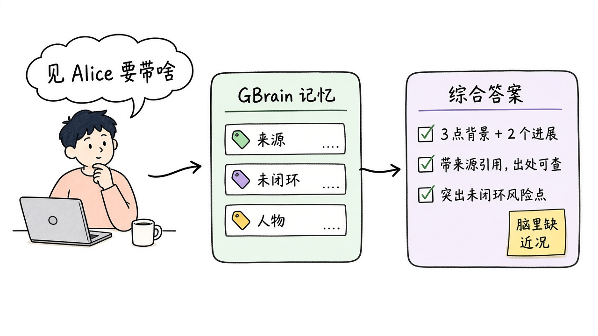
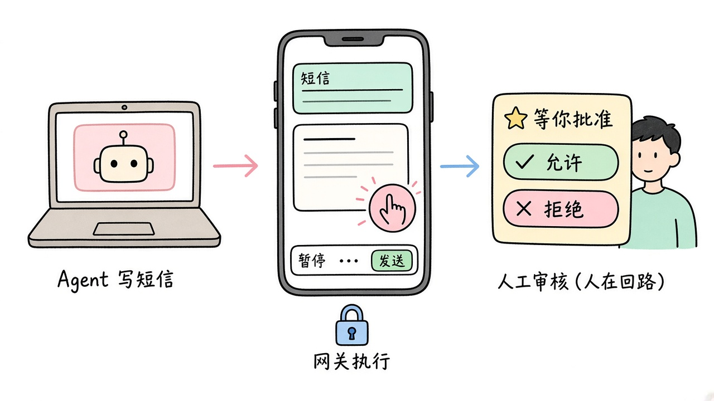
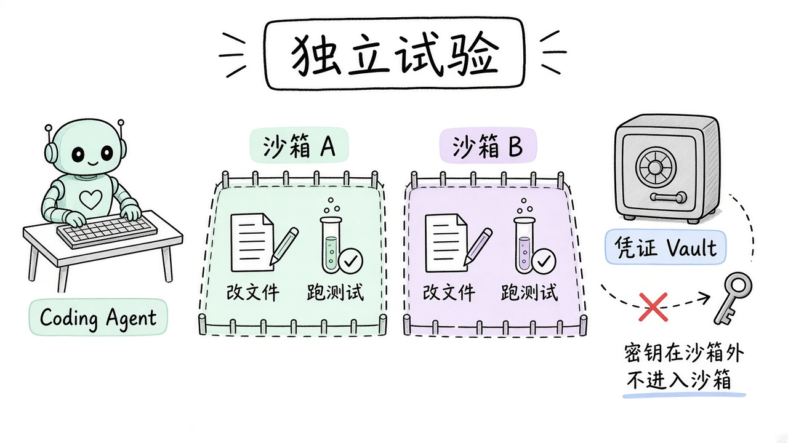
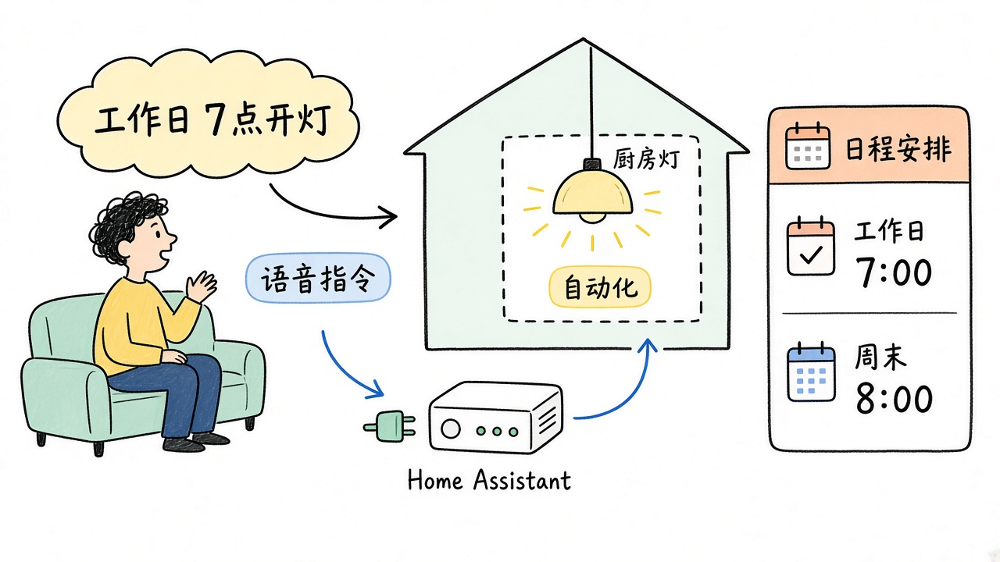

# 2026-11-10 GitHub 日报

今日四条：可控记忆层、人在环里的手机操控、AAIF 沙箱运行时，以及用自然语言管 Home Assistant。

## 1. garrytan/gbrain — 带来源、可修正、跨 agent 共享的记忆层

**介绍**  
GBrain 给已有 agent 加一层你能掌控的记忆：事实带来源，支持更正与撤回，并可在多个 agent 间共用。可先无密钥、关键词检索起步，再按需打开语义检索、综合回答与后台 enrichment。MIT，可自托管；[gbrain.io](https://gbrain.io) 为可选托管。需 Bun 1.4.4+。仓库明确：**不要**从 npm 装名为 `gbrain` 的包（与本项目无关）。约 32.2k★。

**用法**  
仓库：[github.com/garrytan/gbrain](https://github.com/garrytan/gbrain)。

```bash
bun install -g github:garrytan/gbrain#stable
gbrain setup claude-code              # 或: gbrain setup codex
gbrain init --pglite --no-embedding   # 其他 harness / 先单独建脑
```

**应用场景**  
开会前问 agent「明天见 Alice 要带上哪些未闭环事项」：它综合记忆里的来源给出答案，并标明脑里缺了哪些近况。



**推荐学习程度**：进阶

---

## 2. DIYgod/pinky — 人在环里，让 agent 用你的手机

**介绍**  
Pinky（pre-alpha，2026-11-06 新建；今日有 Release `v2026.1110.3`）：在 macOS / Windows / Linux 上，通过 MCP 让 Claude Code、Codex、Cursor 等操作真机 iPhone 或 Android，你在电脑上盯着、批准高风险步骤、随时接管。支付/转账等默认等人点允许，规则跑在网关里，agent 不能自己放行。Apache-2.0，无需账号。约 1.4k★。

**用法**  
仓库：[github.com/DIYgod/pinky](https://github.com/DIYgod/pinky)。安装包见 [Releases](https://github.com/DIYgod/pinky/releases/latest)。

```bash
# macOS 也可用：
brew install --cask diygod/tap/pinky
# 打开 Pinky → Add phone，再在 Settings › Agents 里 Connect
# 其他 agent 可手动加 MCP（stdio）：
# { "mcpServers": { "pinky": { "command": "pinkyctl", "args": ["mcp"] } } }
```

**应用场景**  
Agent 在手机上写好一条短信，Pinky 把「发送」按住等你点允许，你点了才真的发出去。



**推荐学习程度**：进阶

---

## 3. opensandbox-group/OpenSandbox — 给 agent 用的自托管沙箱运行时

**介绍**  
OpenSandbox 是 Agentic AI Foundation（AAIF）项目：在自有基础设施上给 AI 应用隔离环境，执行代码/命令、管文件，以及跑浏览器或桌面。本地 Docker 起步，同一套 API 可上 Kubernetes；提供多语言 SDK、`osb` CLI 与 MCP。官方称 Fast Sandbox（Firecracker）创建时延约 64 ms P50（串行）。Apache-2.0。约 16.9k★。

**用法**  
仓库：[github.com/opensandbox-group/OpenSandbox](https://github.com/opensandbox-group/OpenSandbox)。项目页：[aaif.io/projects/opensandbox](https://aaif.io/projects/opensandbox)。

```bash
uvx opensandbox-server init-config ~/.sandbox.toml --example docker
uvx opensandbox-server
pip install opensandbox          # Python SDK：Sandbox.create(...)
pip install opensandbox-mcp
opensandbox-mcp --domain localhost:8080 --protocol http
```

**应用场景**  
评测或 CI 里，每个 coding agent trial 进独立沙箱改文件、跑测试，凭证走 Vault，不把真密钥暴露给工作负载。



**推荐学习程度**：进阶

---

## 4. homeassistant-ai/ha-mcp — 用 AI 助手配置与自动化 Home Assistant

**介绍**  
HA-MCP 把 Home Assistant 交给 Claude、ChatGPT 等助手：查询状态、调用服务、写自动化（文档称约 87 个工具）。推荐用 **HA-MCP integration**，经 HACS 安装；Home Assistant 2026.11+ 也可走内置 Marketplace，在进程内跑完整服务。MIT。约 6.0k★。

**用法**  
仓库：[github.com/homeassistant-ai/ha-mcp](https://github.com/homeassistant-ai/ha-mcp)。文档与客户端向导：[homeassistant-ai.github.io/ha-mcp](https://homeassistant-ai.github.io/ha-mcp/)。

```text
# 推荐：HA 2026.11+ 打开 Settings → Marketplace，搜索 HA-MCP 并安装
# （2026.8–2026.10 走 HACS 搜索 HA-MCP → Download）
# 重启后添加 integration，按向导配置管理员令牌/专用账号与连接方式
# 再把 Configure 页里的 MCP URL 贴进 AI 客户端
```

**应用场景**  
对助手说「工作日 7 点开厨房灯、周末推迟到 8 点」：它查现有实体并写好自动化，你在 HA 里确认。



**推荐学习程度**：入门

---
