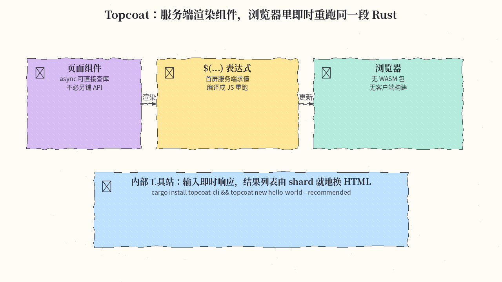
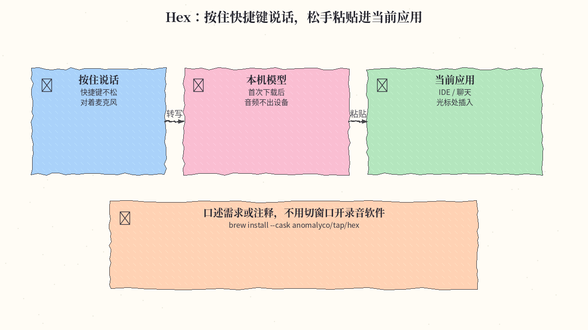
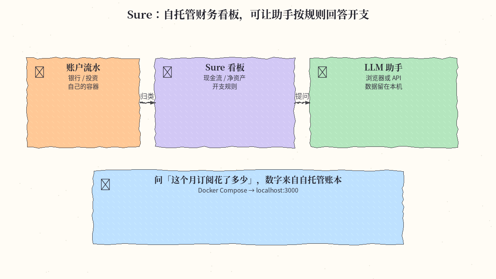

# 2026-11-11 GitHub 日报

今日三条：Tokio 官方全栈框架、本机按住说话即粘贴，以及 Maybe Finance 的社区续作。

## 1. tokio-rs/topcoat — Tokio 官方全栈 Rust Web 框架

**介绍**  
Topcoat 是 Tokio 项目的模块化、开箱即用全栈框架：页面组件在服务端渲染，async 组件可直接查库，不必另铺一层 API。`$(...)` 是经过类型检查的 Rust——首屏在服务端求值，同时被翻译成 JavaScript，在浏览器里即时重跑，没有 WASM 包、也没有客户端构建步骤。需要回服务器的局部（例如搜索结果）标成 `#[shard]`，参数变化时只换那一块 HTML。路由可从模块目录推断。官方标明早期实验，会有破坏性变更。MIT，约 6.9k★，当日仍在 GitHub Trending。

**用法**  
仓库：[github.com/tokio-rs/topcoat](https://github.com/tokio-rs/topcoat)。文档：[Getting started](https://github.com/tokio-rs/topcoat/blob/main/docs/getting_started.md)；给 agent 可读 [llms.txt](https://raw.githubusercontent.com/tokio-rs/topcoat/refs/heads/main/llms.txt)。

```bash
cargo install topcoat-cli
topcoat new hello-world --recommended
cd hello-world
cargo run -- toasty migration generate
cargo run -- toasty migration apply
topcoat dev
# http://127.0.0.1:3000
```

`--recommended` 会带上模块路由、Tailwind、Toasty + SQLite 和 todo 示例；`--minimal` 则是无数据库的精简模板。

**应用场景**  
用 Rust 搭一个带搜索的内部工具站：输入框在浏览器里即时响应，结果列表是 `#[shard]` 组件，打字时服务端查 SQLite，再把新 HTML 就地换上。



**推荐学习程度**：进阶

---

## 2. anomalyco/hex — 本机按住说话，松手粘贴

**介绍**  
Hex 是 anomalyco（OpenCode 团队）的本地语音听写：按住快捷键说话，松开后在设备上转写，并粘贴到当前应用的光标处。第一次运行会下载语音模型，之后音频不出本机。覆盖 macOS / Windows / Linux；实验功能放在侧栏 Labs。MIT，约 6.2k★，本周持续上涨。

**用法**  
仓库：[github.com/anomalyco/hex](https://github.com/anomalyco/hex)。站：[anoma.ly/hex](https://anoma.ly/hex)。

```bash
# macOS
brew install --cask anomalyco/tap/hex
# Linux
# curl -fsSL https://anoma.ly/hex/install-linux.sh | sh
```

也可从官网下各平台安装包（含 Windows）。第一次使用需授权麦克风；要在任意应用里粘贴，还需辅助功能权限。

**应用场景**  
在 IDE 或聊天窗口里按住说话，口述一段需求或代码注释，松手文字直接进光标处，不用切出去开录音软件。



**推荐学习程度**：入门

---

## 3. we-promise/sure — Maybe Finance 的社区续作，自托管个人财务

**介绍**  
Sure 是已停更的 Maybe Finance 的社区维护分支（AGPL-3.0；与 Maybe 商标无关）。功能仍是完整的个人财务应用：现金流、净资产、开支规则，可从浏览器、macOS 桌面、移动端、API 以及 LLM agent 使用，并可接 OpenAI 或外部助手。约 12.0k★，当日仍在 Trending。文档：[sure.am](https://sure.am)、[docs.sure.am](https://docs.sure.am/)。

**用法**  
仓库：[github.com/we-promise/sure](https://github.com/we-promise/sure)。自托管指南：[docs/hosting/docker.md](https://github.com/we-promise/sure/blob/main/docs/hosting/docker.md)。

```bash
mkdir -p ~/docker-apps/sure && cd ~/docker-apps/sure
curl --fail --location --silent --show-error --output compose.yml \
  https://raw.githubusercontent.com/we-promise/sure/main/compose.example.yml
# 若暴露到局域网以外，再拉 .env.example 并设置 SECRET_KEY_BASE
docker compose up -d
# 默认 http://localhost:3000
```

本机开发则是 `bin/setup && bin/dev`。也可经 Render / PikaPods 等一键部署。

**应用场景**  
把银行流水和投资账户接到自己的容器里，在看板问「这个月订阅花了多少」——助手按规则归类后给出数字，账本数据留在自托管环境。



**推荐学习程度**：入门

---
