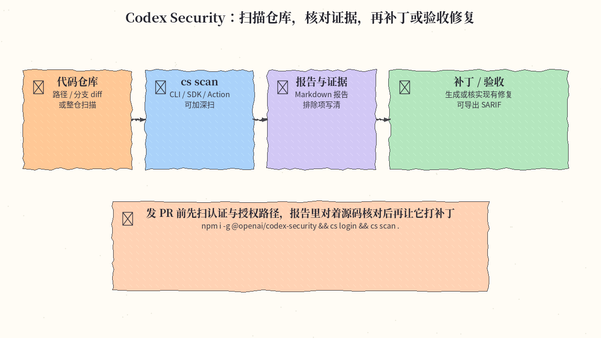
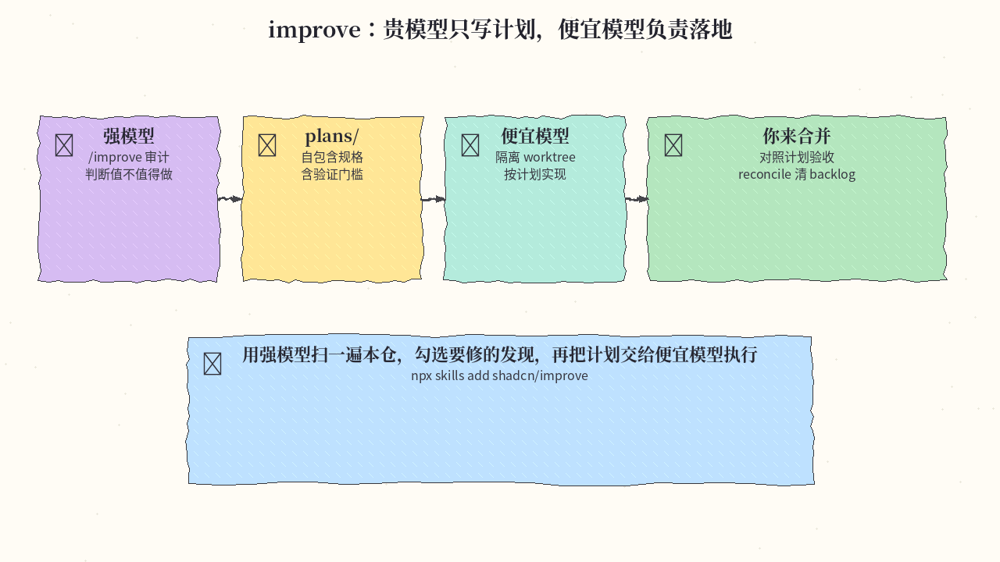
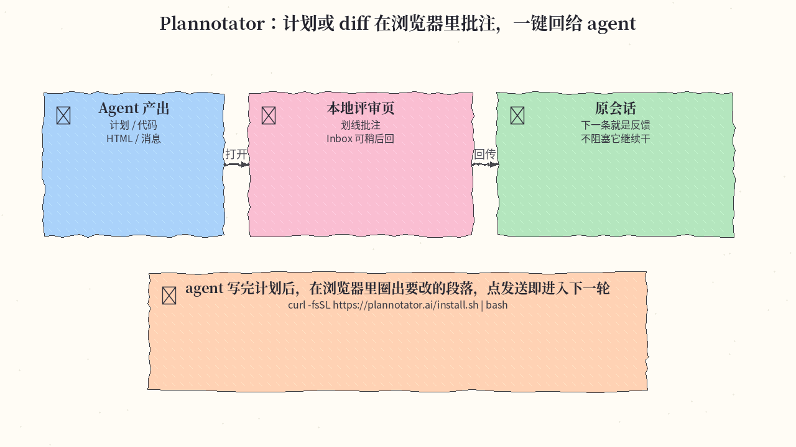
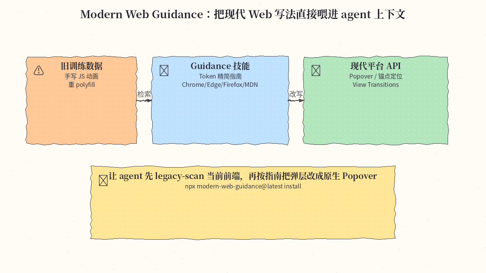

# 2026-11-12 GitHub 日报

今日四条：OpenAI 官方安全扫描 CLI、shadcn 的「贵模型写计划」技能、本地批注 agent 产出的评审台，以及浏览器厂商联合维护的现代 Web 指南。

## 1. openai/codex-security — OpenAI 官方安全扫描 CLI / SDK

**介绍**  
Codex Security 用来在代码里发现、核对并修复漏洞：可在 Codex 会话里走安全工作流，也可用 `@openai/codex-security` CLI 和 TypeScript SDK 自动化。支持扫整仓、指定路径或 Git diff；Deep 模式会重复 Standard 扫描并去重。它能核验候选发现、生成补丁、验收已有修复，也可起草 `SECURITY.md`、按自有尺度评严重度、从源码和 Git 历史建议负责人，并导出 SARIF / JSON / CSV，或同步到 Linear、Jira、GitHub。Apache-2.0，约 11.8k★，当日仍在 GitHub Trending。文档：[developers.openai.com/codex/security](https://developers.openai.com/codex/security)。

**用法**  
仓库：[github.com/openai/codex-security](https://github.com/openai/codex-security)。需要 Node.js 22.13+（22.x）或 24.x / 26.x，以及 Python 3.10+。

```bash
npm install --global @openai/codex-security
cs login
cs scan .
# 指定路径或相对 origin/main 的已提交改动
cs scan . --path src --path tests
cs scan . --diff origin/main
cs scan . --mode deep
```

`cs` 与 `codex-security` 是同一条命令；若短名冲突，用全名或 `npx @openai/codex-security`。CI 里给扫描进程设置 `OPENAI_API_KEY` 或 `CODEX_API_KEY`。扫完后打开终端里给出的 REPORT 路径；也可在同仓库运行 `cs scans show`。

**应用场景**  
发 PR 前先扫认证与授权相关路径，对着报告里的源码证据核对，再让它生成补丁或验收已有修复。



**推荐学习程度**：进阶

---

## 2. shadcn/improve — 贵模型只写计划，便宜模型负责落地

**介绍**  
improve 是 shadcn 的 Agent Skill：用最强的模型做会复利的那一步——读懂仓库、判断值不值得做、写出规格——再把执行交给更便宜的模型。技能本身不实现任何东西，计划才是产物。`/improve` 会审计并排出发现，按你的选择在 `plans/` 写下自包含规格（含本仓的测试/lint 命令和 STOP 条件）；`/improve execute` 可在隔离 worktree 里派便宜模型执行，并对照计划验收，合并仍由你决定。MIT，约 10.9k★，当日仍在 Trending。

**用法**  
仓库：[github.com/shadcn/improve](https://github.com/shadcn/improve)。兼容 [Agent Skills](https://agentskills.io) 格式。

```bash
npx skills add shadcn/improve
```

在仓库里打开 agent 后常用：

```
/improve                 # 全量审计 → 发现表 → 计划
/improve quick           # 便宜快扫：热点与靠前发现
/improve security        # 也可换成 perf、tests、bugs 等
/improve branch          # 只审当前分支改动
/improve execute 001     # 派便宜模型执行编号计划
/improve reconcile       # 核对已落地项，清理 backlog
```

典型流程：先跑 `/improve` 或 `/improve quick`，回复「plan 1, 3 and 5」，读完 `plans/` 再交给任意 agent 实现，或用 `/improve execute`。

**应用场景**  
用强模型先扫一遍本仓，勾选要修的发现，把生成的计划交给便宜模型在隔离 worktree 里执行，你只看 diff 和验收结论。



**推荐学习程度**：入门

---

## 3. backnotprop/plannotator — 在浏览器里批注计划与 diff，一键回给 agent

**介绍**  
Plannotator 是本地、浏览器里的评审台：当 Claude Code、Codex、Copilot CLI、Gemini CLI、OpenCode、Pi 等提出计划、写出 HTML 或改完代码，工作会在浏览器打开，你划线、批注，再把反馈直接发回原会话。也支持审本地改动或远程 PR/MR（Git、GitButler、Jujutsu、Perforce、GitHub、GitLab）。新的 Inbox 让 agent 把问题、文件和引导式评审留在一个本地窗口，不必为了等你而占着会话。默认不采集用量分析，计划与批注留在本机。Apache-2.0，约 10.1k★，当日仍在更新。站：[plannotator.ai](https://plannotator.ai)，安装说明：[docs.plannotator.ai](https://docs.plannotator.ai/open-source/start/installation)。

**用法**  
仓库：[github.com/backnotprop/plannotator](https://github.com/backnotprop/plannotator)。一条安装脚本会装上 `plannotator` 二进制，并按已装的 agent 配置 hook、skill 和斜杠命令：

```bash
# macOS / Linux / WSL
curl -fsSL https://plannotator.ai/install.sh | bash
# 只要二进制：再加 -- --minimal
```

Windows 用 PowerShell：`irm https://plannotator.ai/install.ps1 | iex`。Claude Code 还需 `/plugin marketplace add backnotprop/plannotator`，然后 `/plugin install plannotator@plannotator` 并重启。计划模式一般由 hook 自动打开评审页。常用命令：

```
/plannotator-annotate README.md
/plannotator-review
/plannotator-review <github-pr-url>
plannotator inbox
```

**应用场景**  
agent 写完实现计划后，在浏览器里圈出要改的段落并写评语，点发送后反馈进入原会话下一轮，不必把窗口一直挂着等你。



**推荐学习程度**：入门

---

## 4. GoogleChrome/modern-web-guidance — 把现代 Web 写法直接喂进 agent

**介绍**  
Modern Web Guidance 是一套面向 coding agent 的技能：把 Web 平台专长、最佳实践和浏览器兼容数据嵌进上下文，减少模型因训练数据偏旧而写出过时模式（例如本可用原生 API 却堆一层 JavaScript）。指南按 token 效率裁剪，覆盖近几年到较新的平台能力：View Transitions、容器查询、锚点定位、Popover、`scheduler.yield` 等。由 Chrome、Edge、Firefox 与 MDN 团队及社区共同维护。Apache-2.0。今日 Trending 的是源码与评测仓 [modern-web-guidance-src](https://github.com/GoogleChrome/modern-web-guidance-src)（约 1.8k★，当日仍在推送）；面向安装的发布仓是 [GoogleChrome/modern-web-guidance](https://github.com/GoogleChrome/modern-web-guidance)（约 5.1k★）。文档：[developer.chrome.com/docs/modern-web-guidance](https://developer.chrome.com/docs/modern-web-guidance)。

**用法**

```bash
npx modern-web-guidance@latest install
```

也可先不安装，直接检索、按 ID 取指南，或扫描仓库里的过时写法：

```bash
npx modern-web-guidance@latest search "animate a dialog modal backdrop"
npx modern-web-guidance@latest retrieve "animate-to-from-top-layer"
npx modern-web-guidance@latest legacy-scan .
```

**应用场景**  
让 agent 先对现有前端跑一遍 `legacy-scan`，再按指南把自制弹层改成原生 Popover 与锚点定位，而不是再引入一套组件库。



**推荐学习程度**：入门
