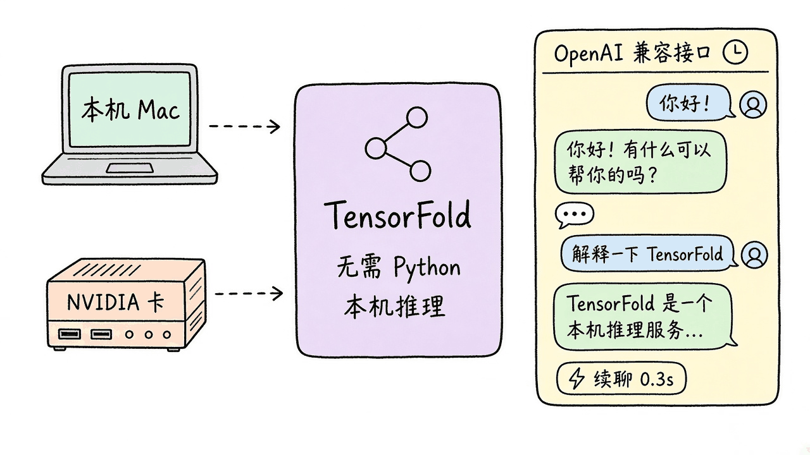
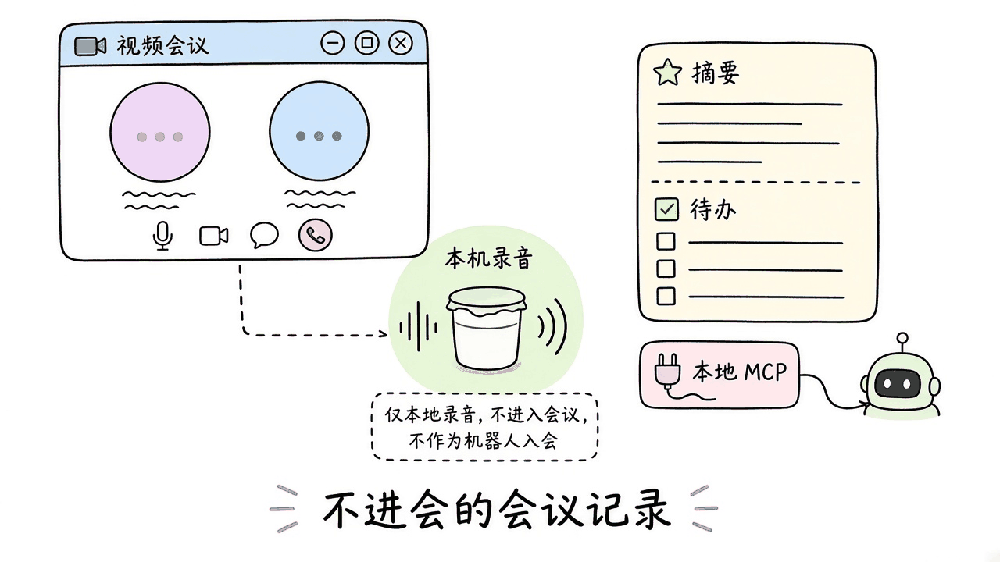
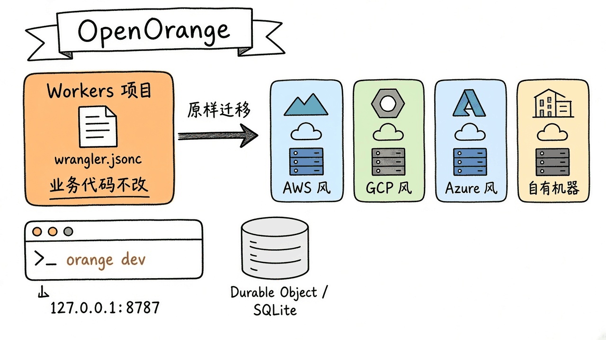
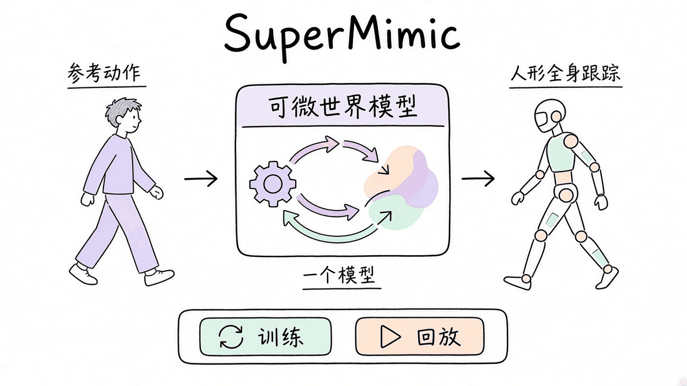

# 2026-11-13 GitHub 日报

今日四条：Zig 写的本地推理引擎 TensorFold、本机开会记录 Yogurt、把 Cloudflare Workers 原样跑到别的云上的 OpenOrange，以及用一个可微世界模型做人形全身跟踪的 SuperMimic。

## 1. ashhart/TensorFold — 不用 Python 的本地 LLM 推理引擎

**介绍**  
TensorFold 用 Zig 在本机提供语言模型推理，直接跑 Metal 或 CUDA 内核，不依赖 Python / MLX 运行时。仓库简介还写了 Vulkan。它从检查点读权重、做分词，并通过兼容 OpenAI、Responses、Anthropic Messages 的 HTTP 接口对外服务；也支持投机解码、跨请求复用 prompt 状态，以及并发会话。Apache-2.0，约 1.9k★，当日仍在 GitHub Trending。最新稳定版 [v1.2.7](https://github.com/ashhart/TensorFold/releases/tag/v1.2.7)（2026-11-11）侧重大段对话续聊：Qwen3.8-27B 在 Metal 上可从历史末尾接着生成（作者在 M3 Ultra 上测到首 token 约 0.3 秒，而不是重算整段的约 85 秒）；磁盘恢复失败时回退到内存里已有的状态；CUDA 上的 GLM-5.3-Flash 可选择从上一轮接着聊。该版本还为 Responses API 加了 WebSocket，并在 CUDA 上支持 LightOnOCR-3 图像对话。文档：[tensorfold.dev](https://tensorfold.dev)。

**用法**  
仓库：[github.com/ashhart/TensorFold](https://github.com/ashhart/TensorFold)。模型权重另有许可证，需单独核对。Apple Silicon 可用 Homebrew：

```sh
brew install ashhart/tensorfold/tensorfold
tensorfold pull mlx-community/Qwen3.5-2B-MLX-4bit@93760be4f1f69842a46bc13dbdc0f19e291392a3
tensorfold serve mlx-community/Qwen3.5-2B-MLX-4bit --name local-model --context 8192 --no-thinking
```

Linux + NVIDIA 需 glibc 2.28+、驱动 R580+（CUDA 13.0，提供 `libcuda.so.1`）。从 [Releases](https://github.com/ashhart/TensorFold/releases) 取对应平台的 `tensorfold-1.2.7-linux-x86_64` 或 `linux-aarch64` 归档，校验 sha256 后把 `bin` 加进 `PATH`，同样 `pull` / `serve`。另开终端发请求：

```sh
curl -fsS http://127.0.0.1:8080/v1/chat/completions \
  -H 'Content-Type: application/json' \
  -d '{"model":"local-model","messages":[{"role":"user","content":"Say hello in one sentence."}],"max_tokens":128,"temperature":0}'
```

`/v1/models` 会列出当前服务名。也可以直接 serve 本地检查点目录或已有的 Hugging Face 缓存。

**应用场景**  
在本机 Mac 或带 NVIDIA 卡的机器上起一个兼容 OpenAI 的接口，把编辑器或 coding agent 指过去；长会话续聊时不必每次重算整段上下文。



**推荐学习程度**：进阶

---

## 2. FrigadeHQ/yogurt — 不进会的本机 AI 会议记录

**介绍**  
Yogurt 是 Frigade 做的开源会议记录桌面应用：在本机录麦克风和系统声音，不往会议里加 bot。它用 whisper.cpp（在支持的 Mac 上也可走 Apple SpeechAnalyzer）做实时转写，再用本机的开源模型经 llama.cpp 写摘要、回答关于历史会议的问题（带出处链接）。音频、转写和推理默认留在本机；联网主要用于下载模型和检查更新。另有本地 MCP，可按你的授权让助手读取笔记。MIT，约 960★。支持 99 种语言的转写；从 Zoom / Teams / Meet 识别发言人姓名目前仅 Mac。系统要求：macOS 14.4+（Apple Silicon）、Windows 10 2004+（x64）、Ubuntu 22.04+ 同类发行版（x64 AppImage），内存至少 8 GB。最新版 [v0.3.9](https://github.com/FrigadeHQ/yogurt/releases/tag/v0.3.9) 于今日上午发布。站点：[yogurt.so](https://yogurt.so)。

**用法**  
仓库：[github.com/FrigadeHQ/yogurt](https://github.com/FrigadeHQ/yogurt)。从最新 Release 下载安装包：

- Mac：[Yogurt-mac-arm64.dmg](https://github.com/FrigadeHQ/yogurt/releases/latest/download/Yogurt-mac-arm64.dmg)
- Windows：[Yogurt-windows-x64.exe](https://github.com/FrigadeHQ/yogurt/releases/latest/download/Yogurt-windows-x64.exe)
- Linux：[Yogurt-linux-x86_64.AppImage](https://github.com/FrigadeHQ/yogurt/releases/latest/download/Yogurt-linux-x86_64.AppImage)

装好后先下载模型（README 说会先下一套约 5 GB 的笔记模型，再按机器能力下载可能 14 GB 以上的更大模型）。通话开始时可提醒录音，结束自动停止。笔记和转写可复制，或导出为 Markdown。本地构建见仓库 [docs/building.md](https://github.com/FrigadeHQ/yogurt/blob/main/docs/building.md)。录音前应告知其他与会者。

**应用场景**  
日常站会或一对一不希望再加一个「会议 bot」时，在本机边录边出转写和摘要，会后用本地 MCP 让助手根据带出处的笔记跟进行动项。



**推荐学习程度**：入门

---

## 3. rivet-dev/open-orange — 把 Cloudflare Workers 原样跑到别的云上

**介绍**  
OpenOrange 让现有的 Cloudflare Workers / Durable Objects 项目不改业务代码，跑到 AWS、Google Cloud、Azure 或自有机器上。本地把 `wrangler dev` 换成 `orange dev`；每个 Durable Object 作为 Rivet Actor 带着自己的 SQLite，数据落在 `.open-orange/`。部署可用 Rivet Cloud、BYOC（你的云账号、Rivet 代运维），或 Apache-2.0 自托管。项目还提供 `orange migrate`，用于把 Durable Objects 从 Cloudflare 迁出并声称可零停机。仓库于 2026-11-12 公开，约 240★。文档：[openorange.dev](https://openorange.dev)。费用对照是项目自己按 AWS us-east-1 粗算的：Durable Object 计算约便宜 4.8 倍、存储约便宜 8.7 倍，需自行核实。

**用法**  
仓库：[github.com/rivet-dev/open-orange](https://github.com/rivet-dev/open-orange)。需要已有 `wrangler.jsonc` / `wrangler.json` / `wrangler.toml` 的 Worker 项目（或用仓里的 `examples/hello-durable-object`）、Node.js 22+ 和 pnpm；部署还需要 Docker。

```sh
pnpm add -g open-orange
# 在 Worker 项目目录
orange dev          # 本地 http://127.0.0.1:8787
# 部署到 Rivet 集群
orange login
orange link --cluster <cluster-name>
orange deploy
```

自托管：`orange deploy --dry-run --outdir out` 只出镜像构建、不调 API，再按 [自托管说明](https://openorange.dev/docs/deploy/) 跑控制面和 worker 节点。迁移步骤见 [migration 指南](https://openorange.dev/docs/migrate/)。

**应用场景**  
已经用 Workers 和 Durable Objects 跑着服务，想放到自己的 AWS / GCP 账号或机房，又不愿重写绑定和状态模型：先在本机 `orange dev` 对一下行为，再决定托管还是自建。



**推荐学习程度**：进阶

---

## 4. HybridRobotics/supermimic — 一个可微世界模型，跟踪人形全身动作

**介绍**  
SuperMimic 训练人形机器人的全身运动跟踪策略，核心是一个可微世界模型，建立在 [mjlab](https://github.com/mujocolab/mjlab) 上。论文：[SuperMimic: Scaling Humanoid Whole-Body Control with One Differentiable World Model](https://arxiv.org/abs/2610.28480)（2026-10-20）。Apache-2.0，约 1.3k★（11-10 开源后三天）。项目页：[supermimic.github.io](https://supermimic.github.io)。提供两种任务表示：广义坐标 `SuperMimic-GenCoord-G1` 与最大坐标 `SuperMimic-MaxCoord-G1`。

**用法**  
仓库：[github.com/HybridRobotics/supermimic](https://github.com/HybridRobotics/supermimic)。先装 [uv](https://docs.astral.sh/uv/)，并把本仓与 `mjlab_research` 作为兄弟目录克隆：

```bash
curl -LsSf https://astral.sh/uv/install.sh | sh
mkdir supermimic_ws && cd supermimic_ws
git clone https://github.com/HybridRobotics/supermimic.git
git clone https://github.com/HybridRobotics/mjlab_research.git
cd supermimic

CUDA_VISIBLE_DEVICES=<GPU_ID> uv run src/supermimic/scripts/train.py \
  SuperMimic-GenCoord-G1 --runner.run_name <description>

uv run src/supermimic/scripts/play.py \
  SuperMimic-GenCoord-G1 --wandb-path <RUN_PATH>
```

训练需要可用的 NVIDIA GPU；回放要提供对应的 W&B 运行路径。

**应用场景**  
在仿真里用一份参考动作（行走、转身、全身协调）训练跟踪策略，训完后用 `play.py` 回放，检查人形在同一世界模型下是否跟得上。



**推荐学习程度**：深入
