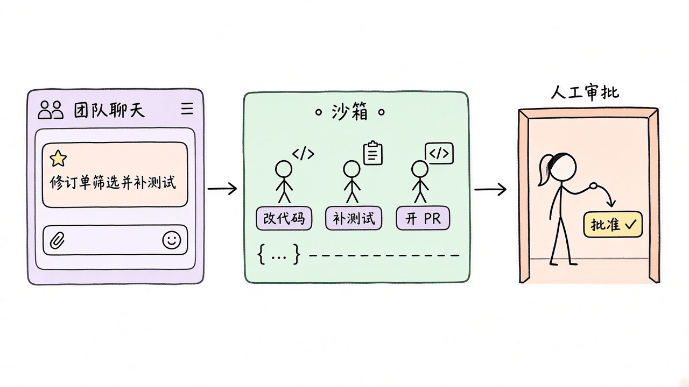
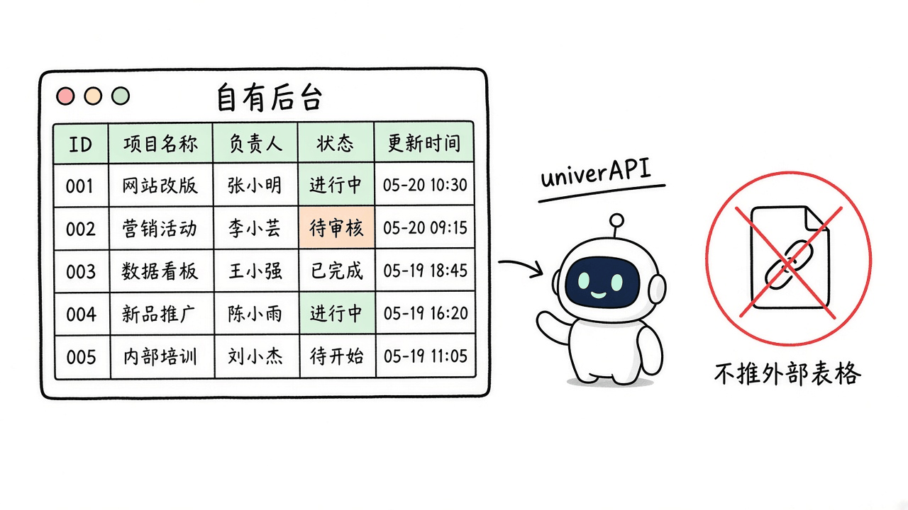
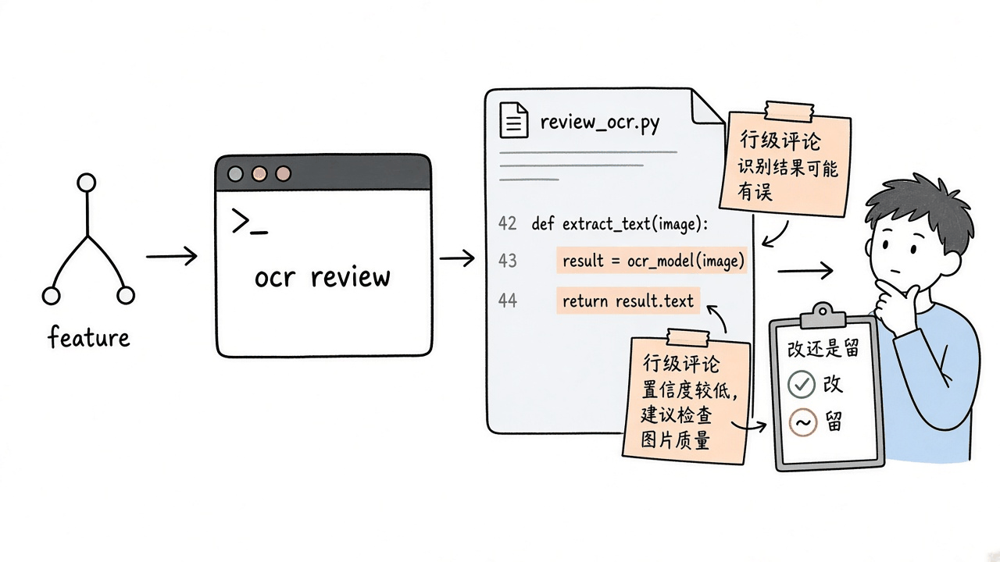
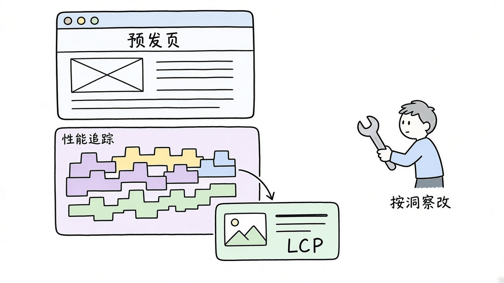
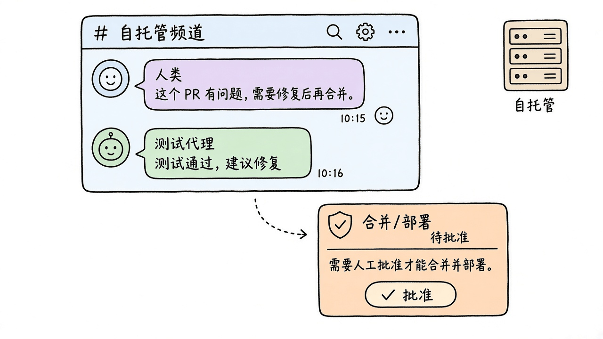

# 2026-11-16 GitHub 日报

今日五条：腾讯自托管的编码代理工作流 LoopForge、周末发布 1.5.0 的办公 SDK Univer、阿里开源代码审查 CLI、Chrome 官方 DevTools MCP，以及人和智能体共用的自托管聊天 agentes.chat。

## 1. Tencent/LoopForge — 自托管编码代理交付工作流

**介绍**  
LoopForge 是腾讯开源的自托管工作区：用 SOP（Agent / Script / 人工审批 / 子 SOP）编排 CodeBuddy、Codex、Claude Code 等，在 Docker 沙箱里改代码、开 PR。不想跑平台时，也可用 LoopForge Local 把内置交付流程装进现有编码助手。README 还写了 OpenCode、Cursor CLI、Antigravity、Kimi Code、Pi、DeepSeek Harness、ZCode。根目录 LICENSE 正文为 MIT（第三方组件保留原许可证；GitHub SPDX 显示 NOASSERTION）。约 1.6k★。周六凌晨发布预发布版 [v0.3.9-rc.1](https://github.com/Tencent/LoopForge/releases/tag/v0.3.9-rc.1)，之后 main 仍有提交；周一仍在 GitHub 日榜。站点：[loopforge.cn](https://loopforge.cn)。

**用法**  
仓库：[github.com/Tencent/LoopForge](https://github.com/Tencent/LoopForge)。日常安装按 README 走 main（不要默认 checkout RC 标签）。需要 Git、Docker、Compose、Python 3、curl：

```bash
git clone https://github.com/Tencent/LoopForge.git
cd LoopForge
./start.sh
```

安装器会拉取 `compose.yaml` 里钉死的 GHCR 镜像、拉起 MySQL 与平台服务。默认监听 `0.0.0.0:8090`，安装器打印的地址上创建的第一个账号是管理员。ghcr.io 慢时可 `MIRROR=ghcr.nju.edu.cn ./start.sh`（这会信任该镜像主机）。

只想在现有助手里跑内置工作流（需 Node.js 20+、Python 3.8+），在目标项目里：

```bash
npx -y loopforge-cli@latest install claude
```

然后在 Claude Code 里执行 `/start-devflow "<your request>"`。部署与 Local 说明见仓库 [docs/deployment.md](https://github.com/Tencent/LoopForge/blob/main/docs/deployment.md)、[docs/local/usage.md](https://github.com/Tencent/LoopForge/blob/main/docs/local/usage.md)。

默认 Compose 通过宿主机 Docker socket 起沙箱，README 写明只适合受信任团队，不是多租户隔离。新安装监听所有网卡，登录用户可跨实例读项目；登录页默认可注册，可在 `.env` 设 `AGENTFLOW_ALLOW_SIGNUP=false` 关掉。真正干活需要所选执行器的 API key；改已有仓库并开 PR 还要连接 GitHub。

**应用场景**  
团队在聊天里把「修订单筛选并补测试」交给 Main Bot，沙箱里分角色改代码并开 PR，SOP 在人工门停下等你批准再继续。



**推荐学习程度**：进阶

---

## 2. dream-num/univer — AI 办公 SDK，周末发布 1.5.0

**介绍**  
Univer 是 TypeScript 写的办公 SDK（Apache-2.0）：把表格、文档等编辑能力嵌进自己的产品或智能体。开源核心覆盖 Sheets / Docs 等；站点把开源包和 Pro 分开。周六发布 [v1.5.0](https://github.com/dream-num/univer/releases/tag/v1.5.0)（2026-11-14）：独立图表工作表、堆叠折线图与误差线、公式计算降内存、Office 兼容性改进，同时有 Worker 入口等破坏性变更。约 2.6 万★，周一在 GitHub 日榜靠前。站：[univer.ai](https://univer.ai)，文档：[docs.univer.ai](https://docs.univer.ai/)。

**用法**  
仓库：[github.com/dream-num/univer](https://github.com/dream-num/univer)。README 的开源表格编辑器示例只用开源包，不需要商业许可或 Server SDK：

```bash
pnpm add @univerjs/presets @univerjs/preset-sheets-core
```

```ts
import { UniverSheetsCorePreset } from '@univerjs/preset-sheets-core'
import UniverPresetSheetsCoreEnUS from '@univerjs/preset-sheets-core/locales/en-US'
import { createUniver, LocaleType, mergeLocales } from '@univerjs/presets'
import '@univerjs/preset-sheets-core/lib/index.css'

const { univerAPI } = createUniver({
  locale: LocaleType.EN_US,
  locales: {
    [LocaleType.EN_US]: mergeLocales(UniverPresetSheetsCoreEnUS),
  },
  presets: [
    UniverSheetsCorePreset({
      container: 'app',
    }),
  ],
})

univerAPI.createWorkbook({})
```

页面上放一个全高容器即可：`<div id="app" style="height: 100vh"></div>`。从 1.4.0 升级需按发行说明迁移自定义 Worker 入口，并成套升级相关组件后再写入新图表数据。部分 1.5.0 能力与 Office / PDF 导入导出走 Pro；发行说明还写：更新适配器后，每月 10 次无水印成功导出用尽，受支持的导出可带许可证水印继续。

**应用场景**  
在自有后台里嵌一个开源表格编辑器，让智能体通过 `univerAPI` 改工作簿，而不是把用户推到外部分享的电子表格。



**推荐学习程度**：进阶

---

## 3. alibaba/open-code-review — 阿里开源的混合架构代码审查 CLI

**介绍**  
Open Code Review（`ocr` CLI，Go，Apache-2.0）把确定性流水线和 LLM Agent 拼在一起做行级审查：前者负责选文件、打包、规则匹配与定位，后者做动态检索与评论。也可 `ocr scan` 审整文件。兼容 Claude Code、Codex、Cursor、Kimi Code 等。README 称源自阿里内部审查助手。周日发布 [v1.13.10](https://github.com/alibaba/open-code-review/releases/tag/v1.13.10)：仅给 `--from` 时 `--to` 默认 HEAD、Markdown 摘要、workspace 模式支持 `--resume` 等。约 5.2 万★，周一仍在日榜。文档：[open-codereview.ai/docs](https://open-codereview.ai/docs)。

**用法**  
仓库：[github.com/alibaba/open-code-review](https://github.com/alibaba/open-code-review)。需要 Git >= 2.41：

```bash
npm install -g @alibaba-group/open-code-review
ocr config provider          # 选内置供应商或加自定义
ocr config model             # 为当前供应商选模型
cd your-project
ocr review
ocr review --from main --to feature-branch
ocr review --commit abc123
ocr scan
ocr scan --path internal/agent
ocr review --format json --output result.json
ocr delegate preview
```

`ocr review` / skill 默认走 OCR 自己的供应商配置，不是 Claude Code 的订阅登录。Delegation 模式则用宿主智能体的模型与鉴权，不必在 OCR 里另配密钥。自行调用模型会产生 API 费用。README 自述基准是精度优先、召回低于通用智能体，属有意取舍。

**应用场景**  
发 PR 前在特性分支上跑 `ocr review --from main --to feature-branch`，先看行级评论，再决定哪些值得改。



**推荐学习程度**：进阶

---

## 4. ChromeDevTools/chrome-devtools-mcp — 官方把 Chrome DevTools 交给编码代理

**介绍**  
`chrome-devtools-mcp` 是 Chrome 官方的 MCP 服务器 + `chrome-devtools` CLI + 一组 skills（TypeScript，Apache-2.0）：让编码代理控制并检查真实 Chrome，做自动化、调试和性能分析。和只返回无障碍快照的浏览器 CLI 不是同一条线，这边强调 DevTools 追踪、网络/控制台、性能与 Lighthouse。约 5.7 万★。最近正式版 [v1.13.0](https://github.com/ChromeDevTools/chrome-devtools-mcp/releases/tag/chrome-devtools-mcp-v1.13.0) 在上周三，不是周末大版本；周一冲上 GitHub 日榜，周日仍有推送。文档：[developer.chrome.com/docs/devtools/agents](https://developer.chrome.com/docs/devtools/agents)。官方仅正式支持 Google Chrome 与 Chrome for Testing，需要 Node.js LTS 和当前稳定版或更新的 Chrome。

**用法**  
仓库：[github.com/ChromeDevTools/chrome-devtools-mcp](https://github.com/ChromeDevTools/chrome-devtools-mcp)。MCP 客户端配置：

```json
{
  "mcpServers": {
    "chrome-devtools": {
      "command": "npx",
      "args": ["-y", "chrome-devtools-mcp@latest"]
    }
  }
}
```

也可以装全局 CLI：

```sh
npm i chrome-devtools-mcp@latest -g
chrome-devtools navigate_page 1 --url "https://developers.chrome.com"
chrome-devtools take_screenshot 1 --filePath screenshot.png
chrome-devtools stop
```

Claude Code 插件：`/plugin marketplace add ChromeDevTools/chrome-devtools-mcp`，然后 `/plugin install chrome-devtools-mcp@chrome-devtools-plugins`。

用量统计默认开启（工具调用成功率、延迟、环境信息），可用 `--no-usage-statistics`，或设 `CHROME_DEVTOOLS_MCP_NO_USAGE_STATISTICS` / `CI` 关闭。性能工具可能把 trace URL 发给 Google CrUX，可用 `--no-performance-crux` 关掉。浏览器实例里的内容会暴露给 MCP 客户端，不要在里面放不想分享的敏感数据。默认还会向 npm 做更新检查（`CHROME_DEVTOOLS_MCP_NO_UPDATE_CHECKS` 可关）。

**应用场景**  
让代理打开预发页、录一条性能追踪，并根据 DevTools 洞察改 LCP，而不是只看截图。



**推荐学习程度**：入门

---

## 5. agentes-chat/agentes-chat — 人和智能体一起用的自托管团队聊天

**介绍**  
agentes.chat 是可自托管的团队聊天（TypeScript）：频道里人和 AI agent 一起干活，敏感操作要人批。Agent 可配角色、预算、MCP、自己的计算机和浏览器，以及 Claude Code / Codex。Web / 桌面 / 手机；云服务与自托管跑同一套代码。主许可是 AGPL-3.0-only（`packages/setup` 为 MIT）；闭源改动或自有品牌转售需看商业许可，名称与标志为商标，贡献需签 CLA。约 1.5k★。仓库 11/09 新建；服务器 [v0.1.2](https://github.com/agentes-chat/agentes-chat/releases/tag/v0.1.2) 于周一凌晨发布，周末还有桌面端 0.8.x。发布说明包括 Linux AppImage、Windows 上 runner/浏览器修复、从其他应用导入 agent（MCP 优先）等。站点：[agentes.chat](https://agentes.chat)。

**用法**  
仓库：[github.com/agentes-chat/agentes-chat](https://github.com/agentes-chat/agentes-chat)。自托管推荐 Linux，官方 Quick start：

```sh
curl -fsSL https://agentes.chat/install | sh
```

这是管道安装脚本，使用前应自行审阅。安装器在询问后可安装缺失的 Docker，并默认把实例放到 Tailscale 网上（约 10 分钟，带私钥 HTTPS）。细节见 [SELF_HOSTING.md](https://github.com/agentes-chat/agentes-chat/blob/main/SELF_HOSTING.md)。每个组织在应用内自行添加模型密钥。

桌面/手机、Agent browser、Codex、邮箱等多项仍标 Beta；README 写 Mac 构建未公证、Windows 安装包未签名。不要把它写成既有 OpenMausBot 的马甲——它只支持导入。

**应用场景**  
在自托管频道里把发版检查交给测试 agent，它跑完测试并给出修复，合并或部署以聊天卡片形式等负责人点批准。



**推荐学习程度**：进阶
