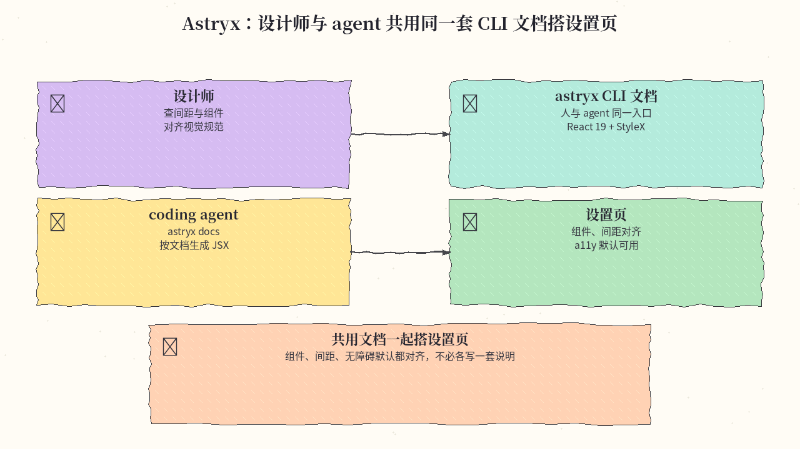
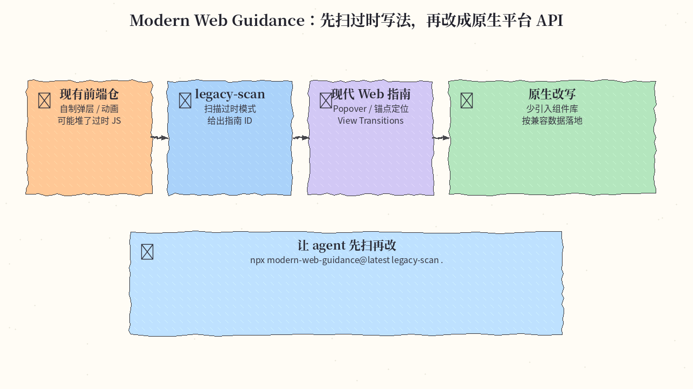
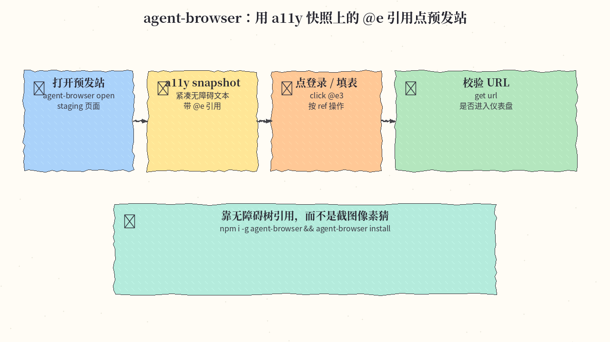
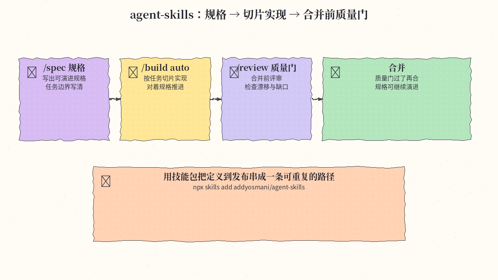
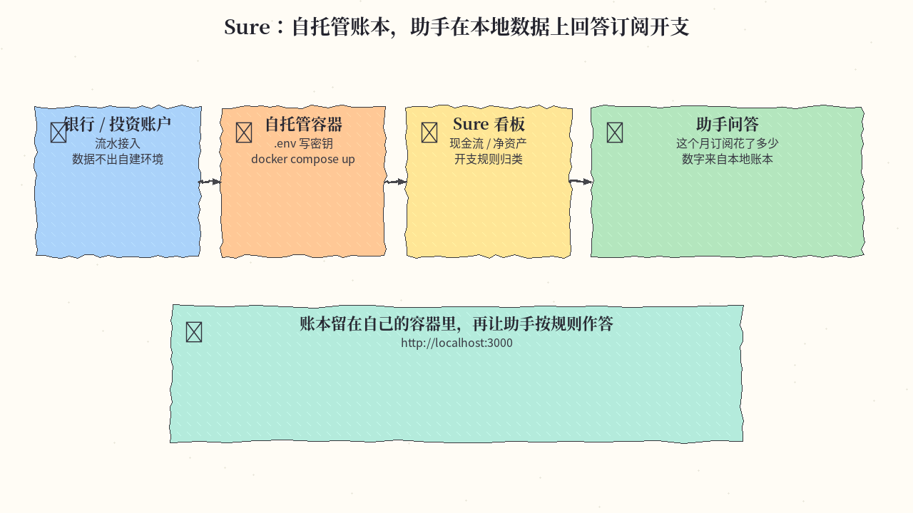
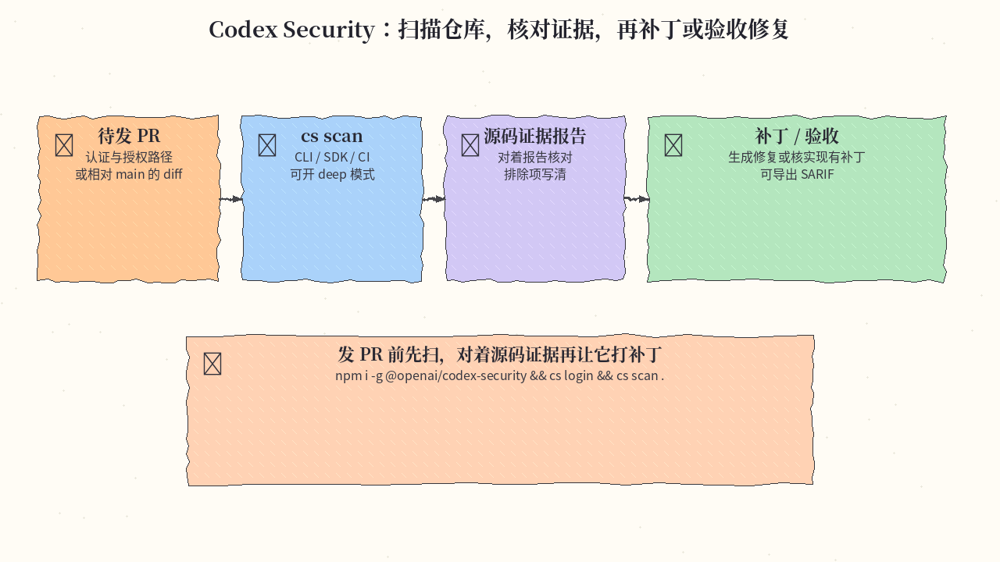
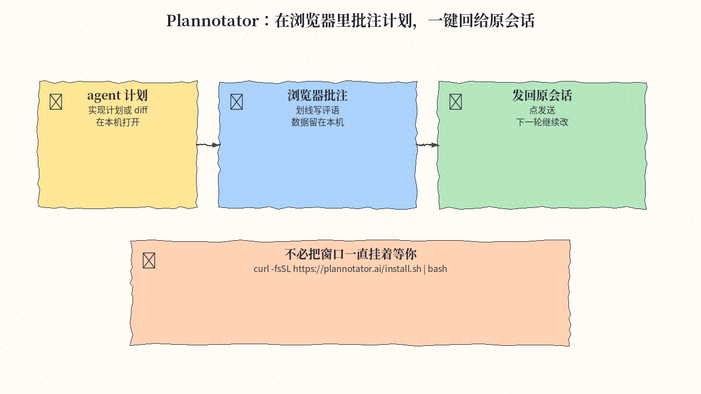
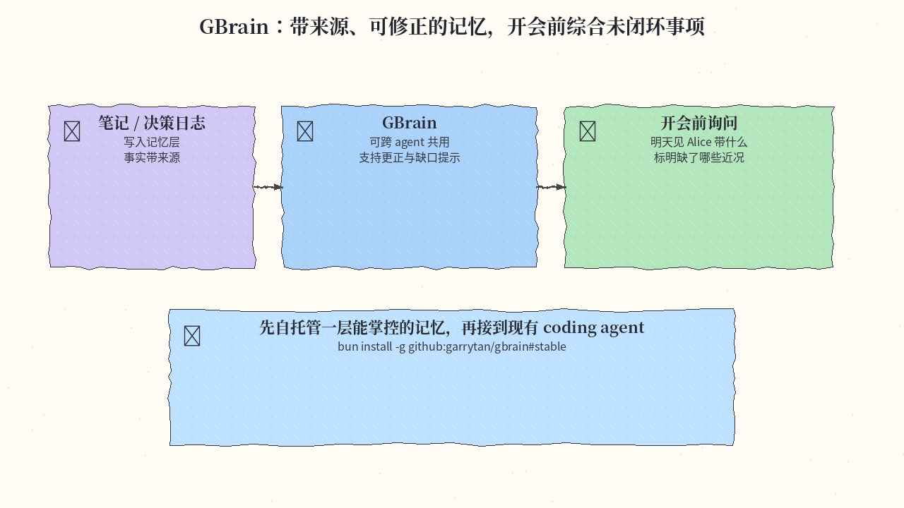
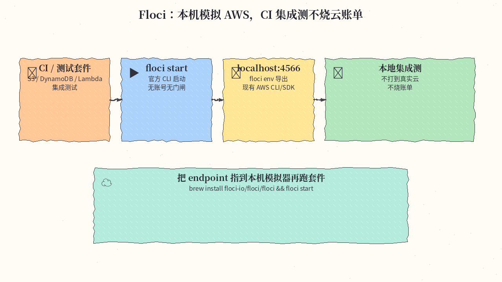
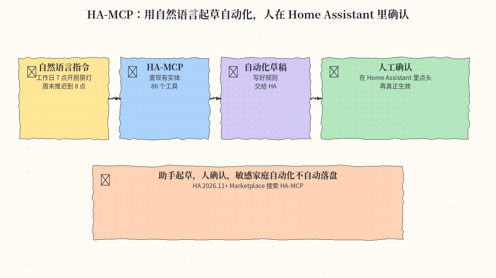

# 2026-11-16 GitHub 周报

上周（11/09–11/15）精选 10 个值得跟进的开源项目（偏 Agent 设计系统与技能 / 浏览器自动化与安全扫描 / 自托管应用）。

## 1. meta/astryx — Meta 开源、agent-ready 设计系统（beta）

**介绍**  
Astryx（MIT，★~28.9k）：Meta 开源设计系统（beta），React 19 + StyleX，150+ 无障碍组件，CLI 和文档按人和 agent 同一套方式组织。本周周榜第一，新增约 1.35 万星。站：[astryx.atmeta.com](https://astryx.atmeta.com)。

**用法**  
仓库：[github.com/meta/astryx](https://github.com/meta/astryx)。需要 React 19+。

```bash
npm i @astryxdesign/core @astryxdesign/theme-neutral @stylexjs/stylex
npm i -D @astryxdesign/cli
# 可选全局 CLI，方便任意目录 / coding agent 调用文档：
npm i -g @astryxdesign/cli
astryx docs global/project-global-or-both
```

**应用场景**  
设计师与 agent 共用同一套 CLI 文档，一起搭设置页：组件、间距、a11y 默认都对齐。



**推荐学习程度**：进阶

---

## 2. GoogleChrome/modern-web-guidance — 把现代 Web 写法直接喂进 agent

**介绍**  
Modern Web Guidance（Apache-2.0，★~17.9k）：Chrome、Edge、Firefox 与 MDN 团队及社区共同维护的 coding agent 技能，把近几年的平台能力（View Transitions、容器查询、Popover、锚点定位等）按 token 效率裁进上下文。周四日报时安装仓还约 5.1k 星，本周涨幅很大；源码与评测在 [modern-web-guidance-src](https://github.com/GoogleChrome/modern-web-guidance-src)。主页：[goo.gle/modern-web-guidance](https://goo.gle/modern-web-guidance)。CLI 会收集匿名用量（安装次数、调用方 agent 名、指南 ID、检索词；不收集原始 prompt）。

**用法**  
仓库：[github.com/GoogleChrome/modern-web-guidance](https://github.com/GoogleChrome/modern-web-guidance)。

```bash
npx modern-web-guidance@latest install
```

也可先不安装，直接检索、按 ID 取指南，或扫描仓库里的过时写法：

```bash
npx modern-web-guidance@latest search "animate a dialog modal backdrop"
npx modern-web-guidance@latest retrieve "animate-to-from-top-layer"
npx modern-web-guidance@latest legacy-scan .
```

**应用场景**  
让 agent 先对现有前端跑一遍 `legacy-scan`，再按指南把自制弹层改成原生 Popover 与锚点定位，而不是再引入一套组件库。



**推荐学习程度**：入门

---

## 3. vercel-labs/agent-browser — a11y 快照驱动的浏览器自动化 CLI

**介绍**  
agent-browser（Apache-2.0，★~51.6k）：给 AI agent 用的浏览器自动化 CLI（Rust 原生）。`snapshot` 返回带 `@e` 引用的紧凑无障碍文本，再按 ref 点击/填表，最后用 `get url` 等做校验。与上周周报的 agent-desktop 同门；本周周榜常驻，新增约 4.2k 星。文档：[agent-browser.dev](https://agent-browser.dev)。

**用法**  
仓库：[github.com/vercel-labs/agent-browser](https://github.com/vercel-labs/agent-browser)。

```bash
npm i -g agent-browser && agent-browser install
# 或: brew install agent-browser && agent-browser install
npx skills add vercel-labs/agent-browser
agent-browser mcp   # 可选 MCP
agent-browser open https://staging.example.com
agent-browser snapshot -i
agent-browser click @e3
agent-browser get url
```

**应用场景**  
Agent 打开预发站：snapshot 给出 `@e` refs，点登录、填表，再核 URL 是否进仪表盘。



**推荐学习程度**：入门

---

## 4. addyosmani/agent-skills — 生产级工程技能包（周末发布 0.6.16）

**介绍**  
agent-skills（MIT，★~118k）：Addy Osmani 维护的生产级工程技能，覆盖定义→计划→实现→验证→评审→发布，共 25 个 skill 与 9 条斜杠命令。周末（11/14）发布 0.6.16，规格可演进、文档漂移检测等有更新；本周周榜新增约 3.9k 星。站：[skills.addy.ie](https://skills.addy.ie)。

**用法**  
仓库：[github.com/addyosmani/agent-skills](https://github.com/addyosmani/agent-skills)。

```bash
npx skills add addyosmani/agent-skills            # 安装全部 25 个 skill
npx skills add addyosmani/agent-skills --list     # 先浏览再装
```

Claude Code 也可用插件市场：

```text
/plugin marketplace add addyosmani/agent-skills
/plugin install agent-skills@addy-agent-skills
```

**应用场景**  
用 `/spec` 先写出可演进规格，再 `/build auto` 按任务切片实现，合并前用 `/review` 跑质量门。



**推荐学习程度**：进阶

---

## 5. we-promise/sure — Maybe Finance 的社区续作，自托管个人财务

**介绍**  
Sure（AGPL-3.0，★~15.7k）：已停更 Maybe Finance 的社区维护分支（与 Maybe 商标无关）。功能仍是完整的个人财务应用：现金流、净资产、开支规则，可从浏览器、macOS 桌面、移动端、API 以及 LLM agent 使用。本周周榜新增约 4.6k 星。站：[sure.am](https://sure.am)，文档：[docs.sure.am](https://docs.sure.am)。

**用法**  
仓库：[github.com/we-promise/sure](https://github.com/we-promise/sure)。自托管指南：[docs/hosting/docker.md](https://github.com/we-promise/sure/blob/main/docs/hosting/docker.md)。现行示例已无内置 `SECRET_KEY_BASE`，启动前必须自己写入。

```bash
mkdir -p ~/docker-apps/sure && cd ~/docker-apps/sure
curl --fail --location --silent --show-error --output compose.yml \
  https://raw.githubusercontent.com/we-promise/sure/main/compose.example.yml
curl --fail --location --silent --show-error --output .env \
  https://raw.githubusercontent.com/we-promise/sure/main/.env.example
openssl rand -hex 64   # 把结果写入 .env 的 SECRET_KEY_BASE，并设置 POSTGRES_PASSWORD
docker compose up
# 默认 http://localhost:3000
```

本机开发则是 `bin/setup && bin/dev`。也可经 Render / PikaPods 等一键部署。

**应用场景**  
把银行流水和投资账户接到自己的容器里，在看板问「这个月订阅花了多少」——助手按规则归类后给出数字，账本数据留在自托管环境。



**推荐学习程度**：入门

---

## 6. openai/codex-security — OpenAI 官方安全扫描 CLI / SDK

**介绍**  
Codex Security（Apache-2.0，★~13.6k）：用来在代码里发现、核对并修复漏洞。可在 Codex 会话里走安全工作流，也可用 `@openai/codex-security` CLI 和 TypeScript SDK 自动化。支持扫整仓、指定路径或 Git diff；Deep 模式会重复 Standard 扫描并去重。也可起草 `SECURITY.md`、导出 SARIF / JSON / CSV。本周持续有提交。文档：[developers.openai.com/codex/security](https://developers.openai.com/codex/security)。

**用法**  
仓库：[github.com/openai/codex-security](https://github.com/openai/codex-security)。需要 Node.js 22.13+（22.x）或 24.x / 26.x，以及 Python 3.10+。

```bash
npm install --global @openai/codex-security
cs login
cs scan .
cs scan . --path src --path tests
cs scan . --diff origin/main
cs scan . --mode deep
```

`cs` 与 `codex-security` 是同一条命令；若短名冲突，用全名或 `npx @openai/codex-security`。CI 里给扫描进程设置 `OPENAI_API_KEY` 或 `CODEX_API_KEY`。

**应用场景**  
发 PR 前先扫认证与授权相关路径，对着报告里的源码证据核对，再让它生成补丁或验收已有修复。



**推荐学习程度**：进阶

---

## 7. backnotprop/plannotator — 在浏览器里批注计划与 diff，一键回给 agent

**介绍**  
Plannotator（Apache-2.0，★~11.9k）：本地、浏览器里的评审台。当 Claude Code、Codex、Copilot CLI、Gemini CLI、OpenCode 等提出计划或改完代码，工作会在浏览器打开，你划线、批注，再把反馈直接发回原会话。默认不采集用量分析，计划与批注留在本机。本周仍在周榜。站：[plannotator.ai](https://plannotator.ai)。

**用法**  
仓库：[github.com/backnotprop/plannotator](https://github.com/backnotprop/plannotator)。

```bash
# macOS / Linux / WSL
curl -fsSL https://plannotator.ai/install.sh | bash
# 只要二进制：bash -s -- --minimal
```

Windows 用 PowerShell：`irm https://plannotator.ai/install.ps1 | iex`。Claude Code 还需 `/plugin marketplace add backnotprop/plannotator`，然后 `/plugin install plannotator@plannotator` 并重启。

**应用场景**  
agent 写完实现计划后，在浏览器里圈出要改的段落并写评语，点发送后反馈进入原会话下一轮，不必把窗口一直挂着等你。



**推荐学习程度**：入门

---

## 8. garrytan/gbrain — 带来源、可修正、跨 agent 共享的记忆层

**介绍**  
GBrain（MIT，★~33.1k）：给已有 agent 加一层你能掌控的记忆：事实带来源，支持更正，并可在多个 agent 间共用。可先无密钥、关键词检索起步。仓库明确：**不要**从 npm 装名为 `gbrain` 的包（与本项目无关）。可自托管；[gbrain.io](https://gbrain.io) 为可选托管。需 Bun 1.4.4+。

**用法**  
仓库：[github.com/garrytan/gbrain](https://github.com/garrytan/gbrain)。

```bash
bun install -g github:garrytan/gbrain#stable
gbrain setup claude-code              # 或: gbrain setup codex
gbrain init --pglite --no-embedding   # 其他 harness / 先单独建脑
```

**应用场景**  
开会前问 agent「明天见 Alice 要带上哪些未闭环事项」：它综合记忆里的来源给出答案，并标明脑里缺了哪些近况。



**推荐学习程度**：进阶

---

## 9. floci-io/floci — 免费本机 AWS 模拟器

**介绍**  
Floci（MIT，★~31.8k）：免费开源的本机 AWS 模拟器，默认 `localhost:4566`，无账号、无 auth token、无付费门闸。仓库称可作 LocalStack 的 drop-in 替换。现推荐用官方 CLI 启动；也可用 Docker Compose，或 Releases 里的 standalone `floci-aws` 二进制。文档：[floci.io/floci](https://floci.io/floci/)。

**用法**  
仓库：[github.com/floci-io/floci](https://github.com/floci-io/floci)。官方 CLI：[floci-io/floci-cli](https://github.com/floci-io/floci-cli)。

```bash
brew install floci-io/floci/floci
# 或: curl -fsSL https://floci.io/install.sh | sh
floci start
eval $(floci env)
# 之后用现有 aws cli / SDK 指向 localhost:4566
```

也可用 Compose：把 `4566:4566` 映射后 `docker compose up`，再 `export AWS_ENDPOINT_URL=http://localhost:4566`。

**应用场景**  
CI 把 SDK/CLI 指到本机 Floci：本地跑 S3 / DynamoDB / Lambda 相关集成测，不烧云账单。



**推荐学习程度**：入门

---

## 10. homeassistant-ai/ha-mcp — 用 AI 助手配置与自动化 Home Assistant

**介绍**  
HA-MCP（MIT，★~7.9k）：把 Home Assistant 交给 Claude、ChatGPT 等助手：查询状态、调用服务、写自动化（README 徽章现为 86 个工具）。推荐用 **HA-MCP integration**；Home Assistant 2026.11+ 可走内置 Marketplace，在进程内跑完整服务。本周从约 6.0k 涨到约 7.9k。文档：[homeassistant-ai.github.io/ha-mcp](https://homeassistant-ai.github.io/ha-mcp/)。

**用法**  
仓库：[github.com/homeassistant-ai/ha-mcp](https://github.com/homeassistant-ai/ha-mcp)。

```text
# 推荐：HA 2026.11+ 打开 Settings → Marketplace，搜索 HA-MCP 并安装
# （2026.8–2026.10 走 HACS 搜索 HA-MCP → Download）
# 重启后添加 integration，按向导配置管理员令牌/专用账号与连接方式
# 再把 Configure 页里的 MCP URL 贴进 AI 客户端
# 客户端向导：https://homeassistant-ai.github.io/ha-mcp/setup/
```

官方目前只支持当前稳定版 Home Assistant；技术下限是 2026.8.0。

**应用场景**  
对助手说「工作日 7 点开厨房灯、周末推迟到 8 点」：它查现有实体并写好自动化，你在 HA 里确认。



**推荐学习程度**：入门

---
