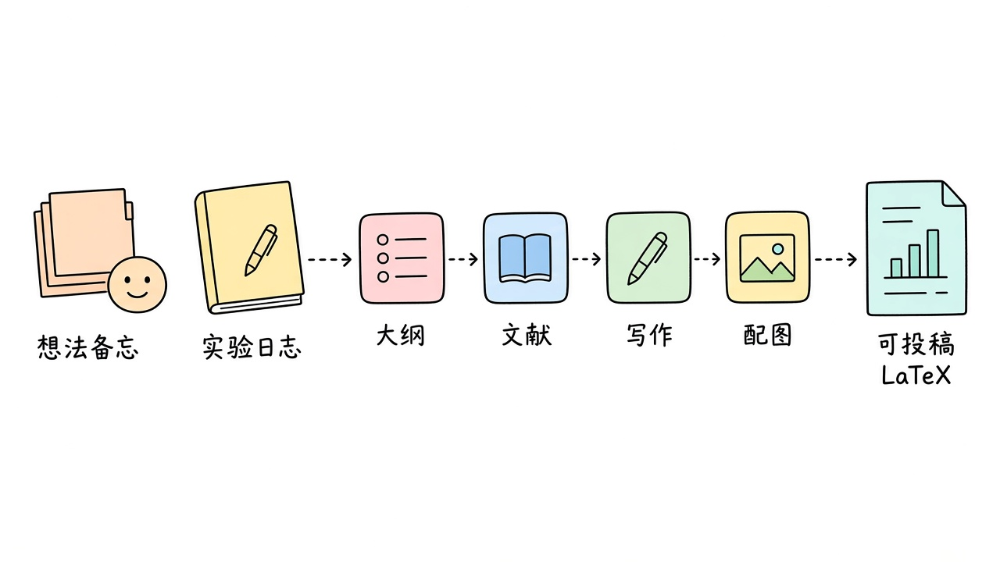

# 2026-11-17 GitHub 日报

今日两条：Google Research 把实验材料写成可投稿 LaTeX 的多智能体框架 PaperOrchestra，以及可拖时间轴、也能给 Agent 用的中国历史交互地图「江山时序」。

## 1. google-research/paper-orchestra — 把实验材料编排成可投稿论文

**介绍**  
PaperOrchestra 是 Google Cloud AI Research 开源的多智能体论文写作框架（Apache-2.0）：用 Outline、Literature Review、Section Writing、Content Refinement、Plotting 等角色，把想法和实验日志收成符合目标会议模板的 LaTeX，并做文献综合和配图。仓库 2026-05 创建，11-15 仍有提交；今天冲上 GitHub 日榜，约 1.6k★。站点：[yiwen-song.github.io/paper_orchestra](https://yiwen-song.github.io/paper_orchestra/)。评测用的数据集不在这个仓库里，README 写会另行发布。

**用法**  
仓库：[github.com/google-research/paper-orchestra](https://github.com/google-research/paper-orchestra)。

```bash
conda create -n paper_orchestra python=3.11
conda activate paper_orchestra
pip install -r requirements.txt
```

在仓库根目录建 `.env`，按要用的模型填 `GEMINI_API_KEY`，或 `VERTEX_AI_PROJECT` / `VERTEX_AI_LOCATION`，或 `OPENAI_API_KEY`；文献检索需要 `SEMANTIC_SCHOLAR_API_KEY`。

```bash
python paper_writing_cli.py \
  --raw_materials_dir /path_to_your_raw_materials/ \
  --latex_template_dir /path_to_your_latex_template/ \
  --output_dir /path_to_your_output_folder/ \
  --use_plotting true
```

默认 writer / reflection / plotting 模型是 `gemini-3.1-pro-preview`，可用 `--writer_model_name` 等改掉。材料目录默认找 `idea_sparse.md` 和 `experimental_log.md`。仓库提供 `templates/` 下的会议模板示例（如 cvpr2025）。也可用 `./paper_writing_cli.sh`，或在项目根目录 `streamlit run frontend/app.py` 打开本地界面。

**应用场景**  
把一篇工作的想法备忘和实验日志放进 raw_materials，指定 ICLR 或 CVPR 模板，让流水线先出大纲和文献，再写成可编译的 LaTeX；需要图时打开 plotting agent。



**推荐学习程度**：进阶

---

## 2. DeanChensj/jiangshan-map — 两千四百年中国历史交互地图，也能给 Agent 用

**介绍**  
江山时序是一份中国历史交互地图（GPL-3.0）：从战国分晋（前 403 年）到当代，覆盖 18 个时期、198 个疆域快照，点古代地名看沿革，也可沿诗歌或人物轨迹走。约 6.8k★，昨天还有提交，今天在 GitHub 日榜。在线演示：[deanchen.me/jiangshan-map](https://deanchen.me/jiangshan-map/)。郡 / 州 / 府这层来自 CHGIS，不在 GPL 范围内，默认不随仓库再分发，只供本地非商业教学使用。疆域是示意，README 写明不要当精确边界引用。

**用法**  
仓库：[github.com/DeanChensj/jiangshan-map](https://github.com/DeanChensj/jiangshan-map)。无需构建，静态文件即可本地打开：

```bash
git clone https://github.com/DeanChensj/jiangshan-map.git
cd jiangshan-map
python3 -m http.server 8000
```

浏览器打开 `http://localhost:8000`。Docker：`docker compose up -d --build` 后访问 `http://localhost:8008`。

给 Agent 用：仓库带零依赖的 MCP（`scripts/mcp_server.js`，工具为 `inspect_place`、`inspect_person`、`search_atlas`）和技能 `skills/jiangshan-atlas/`。也可以只给年份和地名出图：

```bash
python3 skills/jiangshan-atlas/scripts/jiangshan.py --year 819 --place 蓝关 --out /tmp/languan_819.png
```

分享链接同样是 `?year=` + `?place=`，例如韩愈蓝关、杜甫收复河南河北路线、苏轼贬谪轨迹。

**应用场景**  
读到「云横秦岭家何在」时，让助手按 819 年、蓝关定位，截一张当时的唐界地图，并打开该地沿革卡片。


**推荐学习程度**：入门
