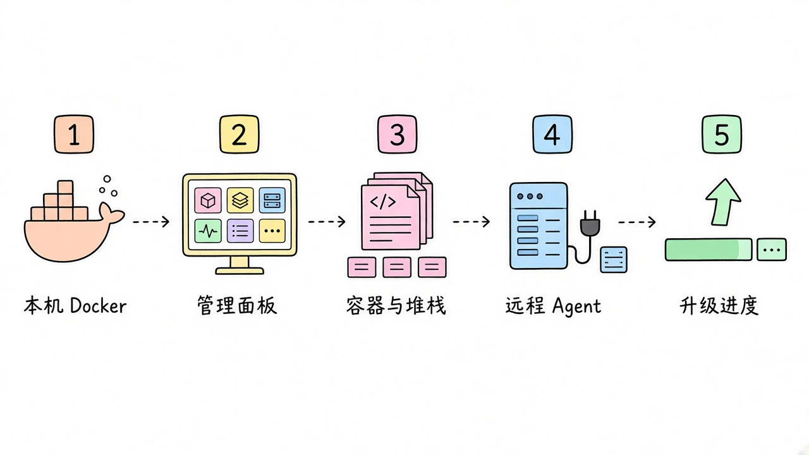

# 2026-11-18 GitHub 日报

今日两条：刚发布 v1.4.0 的渐进式 Rust 改写工具 rust-anything，以及刚上 v3 的 Docker 管理面板 Arcane。

## 1. erkamyaman/rust-anything — 一块一块改写成 Rust，每步对照原行为

**介绍**  
rust-anything（MIT）是一套给编码代理用的渐进式改写工具：先记录现有 TypeScript / Python / C / Go / Ruby / Java 应用（PHP、C# 为预览）在真实输入上的行为，再把热路径或整应用一段段改写成 Rust，每一步用回放对照，全部对上才放行。它不负责翻译代码，Rust 由你或 Claude Code / Codex / Cursor / Gemini CLI 来写；工具负责找热点、生成桥接、记录行为、对照和门禁。仓库 11-16 创建，今天发布 v1.4.0，约 1.4k★。README 写明：它只能抓住记录覆盖到的行为；把很小的函数逐次调到 Rust，通常比 JIT 更慢，它要找的是值得批量搬过去的循环。文中的加速数字（如 x18n 侧栏搜索 20 倍）来自仓库 `demo/` 基准，是作者在 4 核上测的，不是通用承诺。

**用法**  
仓库：[github.com/erkamyaman/rust-anything](https://github.com/erkamyaman/rust-anything)。

```sh
cargo install rust-anything   # 或从 Releases 下预编译包；JS 项目也可用 npm i -g rust-anything
rust-anything setup           # 给已检测到的 Claude Code / Codex / Cursor / Gemini CLI 登记 MCP 和技能
```

`setup` 改已有配置前会在旁边留 `.rust-anything.bak`，可重复执行，`--remove` 撤销。Claude Code 也可：`/plugin install rust-anything --marketplace erkamyaman/rust-anything`（CLI 仍需在 `PATH`）。然后可以直接说：「用 rust-anything 把这个 CLI 改写成 Rust，并证明行为一致。」或手动走 `profile` → `bridge` → `record` → 写 `port.rs` → `diff` / `bench` / `gate`。

**应用场景**  
搜索框在 5 万条键上发卡，先让工具标出热循环并记下原输出，再只把这一段搬到 Rust，回放全部对上后再看基准要不要合并。


**推荐学习程度**：进阶

---

## 2. getarcaneapp/arcane — 面向自己机器的 Docker 管理面板，刚到 v3

**介绍**  
Arcane（BSD-3-Clause）是一个自托管 Docker 管理界面：看容器和 Compose 堆栈、扫镜像更新、做备份和 GitOps，也可以加远程 agent 管别的主机。11-14 发布 v3.0.0：重做仪表盘和活动中心，升级过程可看实时日志，视图可自定义，备份和 GitOps 也扩大了；对旧协议和部分配置有破坏性变更。11-15 的 v3.0.1 修了 agent 模式启动和性能，并收紧证书与更新校验。仓库约 9.4k★，今天还在提交，冲上 GitHub 日榜。文档：[getarcane.app](https://getarcane.app)。官方镜像支持 amd64 / arm64 / armv7 / riscv64。

**用法**  
按[安装文档](https://getarcane.app/docs/get-started/installation)，需要本机已有 Docker Engine 和 Compose。先生成至少 32 字符的加密密钥：

```bash
docker run --rm ghcr.io/getarcaneapp/manager:latest /app/arcane generate secret
```

在 `compose.yaml` 里使用官方镜像 `ghcr.io/getarcaneapp/manager:latest`，映射 `3552:3552`、Docker socket 和数据卷，把密钥写入 `ARCANE_ENCRYPTION_KEY`，把 `ARCANE_APP_URL` 和 `ARCANE_PROJECTS_DIRECTORY` 改成你实际访问地址和 Compose 项目目录（主机路径要原样挂进容器）。然后 `docker compose up -d`，打开该地址。首次管理员是 `arcane`，密码写在容器内 `/app/data/initial-admin-password`，可用 `docker compose cp arcane:/app/data/initial-admin-password .` 拷出来，登录后立刻改掉。文档建议用 socket proxy 限制对 Docker socket 的访问，而不是长期裸挂 socket。Linux 也可用 `curl -fsSL https://getarcane.app/install.sh | sudo bash`（会安装 Docker）。

**应用场景**  
家里或小团队的 Compose 项目放在一个目录里，用面板看哪些镜像有更新、远程主机的 agent 是否在线，并在升级时盯着实时日志，而不是只靠 ssh 和 docker ps。



**推荐学习程度**：入门
