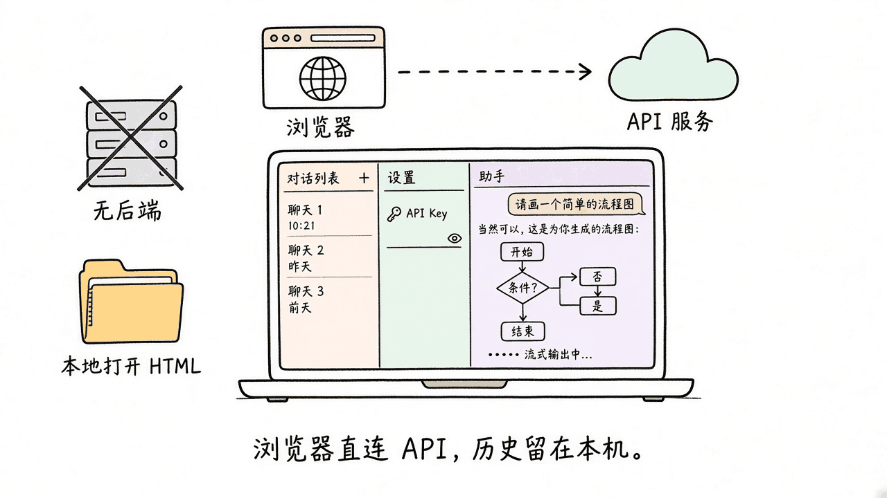

# 2026-11-19 GitHub 日报

今日两条：DeepSeek 官方的静态聊天页 chat-demo，以及 MIT Media Lab 方向的实时构思实验 Spaceship IDE。

## 1. deepseek-ai/chat-demo — 无后端的官方静态聊天页

**介绍**  
[chat-demo](https://github.com/deepseek-ai/chat-demo) 是 DeepSeek 11-12 开源的静态聊天演示（MIT）：浏览器直接连你配置的 API，不需要应用后端。支持多会话与自动标题、编辑/再生成、消息分支、流式回复、深度思考、智能搜索、读链接与引用，也可上传或粘贴附件、语音输入和朗读；Markdown、代码高亮、KaTeX 和 Mermaid 都有，中英与明暗色、移动布局齐。密钥和设置放在 localStorage，会话与原始附件在 IndexedDB，按浏览器配置和站点源隔离。默认走 `https://api.deepseek.com`，聊天用 `deepseek-flash`，协议是 Anthropic 兼容的 Messages / Files；搜索、读链接、标题等是扩展能力，目标服务得支持才行。仓库约 4.8k★，11-13 发了 v0.1.1，昨天还有提交。

**用法**  
在线试用：[deepseek-ai.github.io/chat-demo](https://deepseek-ai.github.io/chat-demo/)。也可从 [Releases](https://github.com/deepseek-ai/chat-demo/releases) 下载压缩包，解压后双击 `index.html` 本地打开（需浏览器允许 `file://` 的存储，且 API 允许该来源的跨域）。开发的话需要 Node.js 22.12+ 和 pnpm：

```sh
git clone https://github.com/deepseek-ai/chat-demo.git
cd chat-demo
pnpm install
pnpm dev
```

打开 http://localhost:8090，先在设置里填 API Key。`pnpm build` 输出到 `dist/`，可丢到静态服务器。默认 API 源在 `rspack.config.ts`，可用 `createConfig({ apiOrigin, devServer })` 改。设置里的历史导入会替换本地全部会话，导出是 ZIP，不含密钥。

**应用场景**  
给团队或自己搭一个不另开后端的 DeepSeek 聊天页：密钥留在浏览器，会话可导出备份；本地打开 HTML 就能用，再按需把 Mermaid / 公式渲染和搜索引用一起打开。



**推荐学习程度**：入门

---

## 2. chuanqisun/spaceship — 把构思当成实时操舵

**介绍**  
[Spaceship IDE](https://github.com/chuanqisun/spaceship) 是 MIT Media Lab 孙川崎的实验性演示（MIT）：设想当模型和决策系统快到接近 60 FPS 时，人可以怎样在生成过程中实时改方向。仓库把这还写成「猜想」，演示的是他认为那时值得有的几种交互，而不是宣布已经达到 60 FPS。四个方向分别是：用可视化看模型当前在注意什么（聚焦监视）、把注意力锁在特定短语上以偏置后文、把任务分解成可独立调节的方向再合成（未来向量操舵），以及生成足够便宜时用时间轴刷出替代未来并实时重写。作者写明实现大多交给 Claude Code，但交互和缓存失效（例如舵往回拨就要清空未来文本、取消进行中的请求）是自己判断的。11-16 创建，约 870★。配套主页：[chuanqisun.github.io/spaceship](https://chuanqisun.github.io/spaceship/)。

**用法**  
先打开演示页，可在模拟器里试用；若要接真实模型，按页面说明在浏览器里配置 Cerebras / Gemini 的 API Key（密钥只存 localStorage，仓库也提醒自行承担风险）。本地跑：

```sh
git clone https://github.com/chuanqisun/spaceship.git
cd spaceship
npm install
npm run dev
```

这是一个 Vite 项目，`npm run build` / `npm run preview` 可做静态预览。设计过程的色板和迭代稿在[演示站的 extra 页](https://chuanqisun.github.io/spaceship/extra/style-1.html)。

**应用场景**  
写一段还没定调的产品说明时，先锁定必须保留的短语，再拧舵看后文怎么变；对几种走向拿不准，就在时间轴上前后刷，比较实时重写出来的版本，而不是一次次从头再生成。


**推荐学习程度**：进阶
