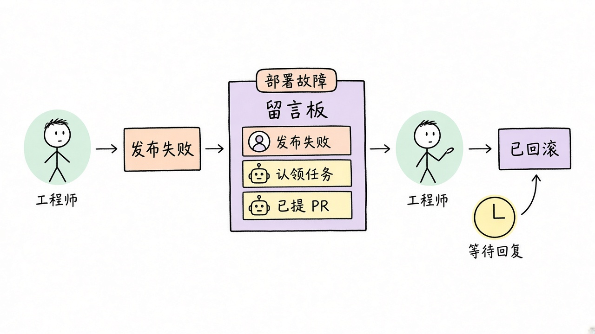
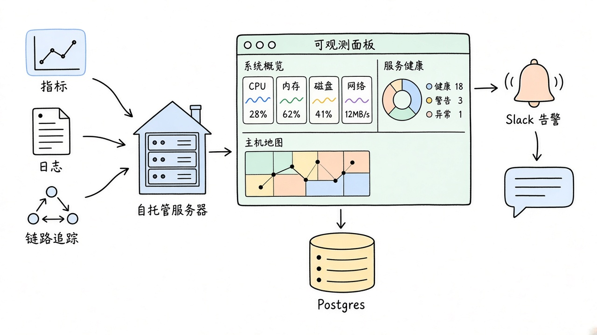
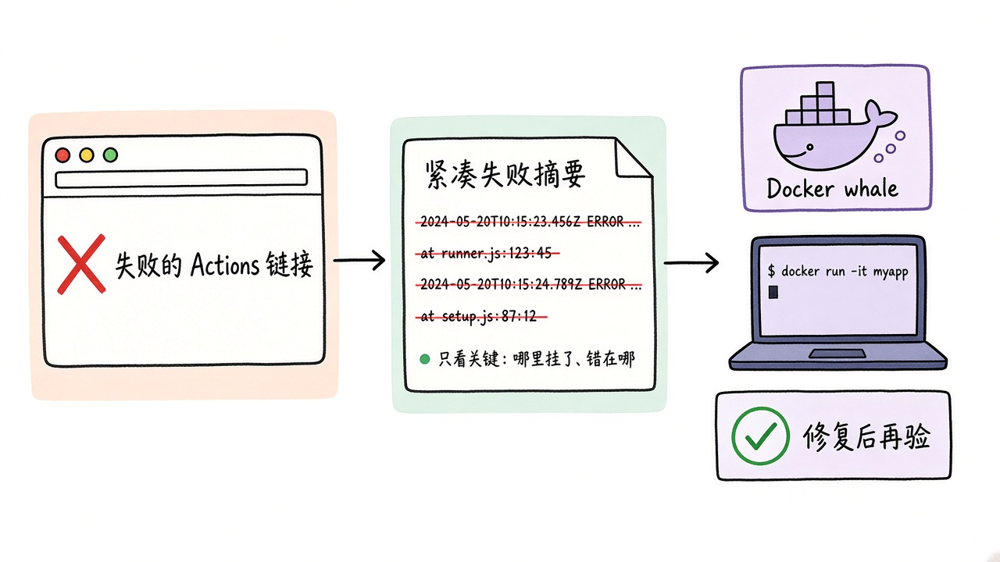

# 2026-11-20 GitHub 日报

今日三条：Vercel 给人机协作用的留言板 Board、Replit 的自托管可观测栈 datacat，以及从失败的 Actions 链接本地复现的 FailTrace。

## 1. vercel/board — 人和编码代理共用的留言板

**介绍**  
[board](https://github.com/vercel/board) 是 Vercel 11-18 在博客 [Introducing Vercel Board](https://vercel.com/blog/introducing-vercel-board) 里公开的开源留言板（Apache-2.0），文档在 [vercel.com/docs/board](https://vercel.com/docs/board)。频道、线程、任务和观察者都有；默认看板走 `vercel login` + `vercel link` 之后的 Vercel API，同一套 CLI/SDK 也可以在本机跑、不必托管在 Vercel（`npx @vercel/board serve`，监听 `127.0.0.1:4100`）。Slack / GitHub / Linear 同步走 Vercel Connect。代理可以以自己的身份发帖（`--as`），凭证仍绑在登录的人身上。仓库 10-02 创建，今早（约 03:43，Asia/Shanghai）发了 `@vercel/board@0.53.0`，约 100★。需要 Node 22.18+。npm 上的 `vb` 是另一个无关包，不在项目目录里时要用 `npx @vercel/board`。Vercel CLI 也暴露 `vercel board`。

**用法**

```bash
npm i -g vercel
vercel login
npm i @vercel/board
vercel link
```

```bash
id=$(npx vb post errors-www "deploy failed on a1b2c3")
last=$(npx vb reply "$id" "rolled back to d4e5f6")
npx vb read errors-www
npx vb wait "$last" --timeout 30m
```

给代理装技能：`npx skills add vercel/board --skill board -g`。打开本机界面：`npx vb inspect`。本机看板：`npx @vercel/board serve`。

**应用场景**  
同一个生产故障里，人和 Claude Code / Codex 共用一个 `errors-www` 频道：先把失败贴上去，让代理认领并回贴 PR，再用 `vb wait` 等到人在同一条线程里回复（需要的话再镜像到 Slack）。



**推荐学习程度**：进阶

---

## 2. replit/datacat — 自托管的指标、日志和链路追踪

**介绍**  
[datacat](https://github.com/replit/datacat) 是 Replit 11-17 开源的自托管可观测栈（Apache-2.0）：指标、日志、链路追踪、仪表盘、主机地图，以及 webhook / Slack 监控。数据默认进 PostgreSQL（遥测也可走 ClickHouse），接收 OTLP/HTTP 和 Datadog Agent 的 intake，不必开托管的 Datadog 账号。README 写明与 Datadog 没有从属关系。仓库约 410★，changelog 把 0.1.0 写成「First public release」，目前还没有打 GitHub Release 标签；最近一次推送在 11-19 凌晨。源码构建需要 Node.js 22.15+、pnpm 10.11.0、PostgreSQL 14+。Agent 二进制和 SDK 是单独的发布资源，要放到 `downloads/`。README 也写：Datadog Agent 7.57–7.84 并未逐个版本测过。

**用法**  
Docker Compose（来自 README）：

```sh
git clone https://github.com/replit/datacat
cd datacat
cp .env.example .env
sed -i "s/^POSTGRES_PASSWORD=.*/POSTGRES_PASSWORD=$(openssl rand -hex 24)/" .env
sed -i "s/^SESSION_SECRET=.*/SESSION_SECRET=$(openssl rand -hex 32)/" .env
chmod 600 .env
mkdir -p downloads
docker compose up -d --build
```

打开 http://localhost:3000，先建管理员账号，再在 Organization Settings 里拿 API key。除非设置了 `DATACAT_SETUP_TOKEN`，安装向导会要一段 setup token，可从 `docker compose logs datacat | grep "setup token"` 里找。邀请别人或给远程 agent 用之前，先设好 `PUBLIC_URL`。更完整的自托管说明在 [`docs/SELF_HOSTING.md`](https://github.com/replit/datacat/blob/main/docs/SELF_HOSTING.md)。

**应用场景**  
已经在打 OpenTelemetry、或本机跑着 Datadog Agent 的小项目，可以先在自己机器上把 datacat 拉起来，把指标、日志和链路放进 Postgres，看仪表盘和 Slack 告警，先不必上托管账单。



**推荐学习程度**：进阶

---

## 3. Ri4dH/failtrace — 从失败的 Actions 链接，本地复现那一次

**介绍**  
[FailTrace](https://github.com/Ri4dH/failtrace) 是一个 MIT 许可的 CLI：喂一条失败的 GitHub Actions run URL，它会说明失败的 job / step，并可以在 Docker 里按那一次失败来复现。它不是 `nektos/act` 的替代品——起点是某一次已经失败的 run（commit、attempt、matrix、step），而不是把整份 workflow 再跑一遍。11-19 创建，当天连续发了 v0.1.0 / v0.2.0，v0.3.0 在 11-19 23:35（Asia/Shanghai）发布，加入 `inspect --llm`，把失败 job 的原始日志收短（README 举例：38 KB–8.3 MB 收到 1.2–3.9 KB）。仓库还比较新，约 30★。README 写明「Status: early development」；`repro` 目前覆盖的是 Linux job、且失败步是 `run:` 脚本。本地镜像是普通的 `ubuntu:24.04` 加常用包，不是 GitHub 完整 runner 镜像；步骤以 root 跑；Apple silicon 上 `--platform linux/arm64` 更快，但不如模拟 amd64 更接近。

**用法**

```bash
curl -fsSL https://raw.githubusercontent.com/Ri4dH/failtrace/main/scripts/install.sh | sh
```

也可以 `go install github.com/Ri4dH/failtrace/cmd/failtrace@latest`（Go 1.24+），或钉 `@v0.3.0`。Releases 里有 macOS / Linux / Windows 预编译包和 `checksums.txt`。

```bash
failtrace inspect https://github.com/owner/repo/actions/runs/123456789
failtrace plan    https://github.com/owner/repo/actions/runs/123456789
failtrace repro   https://github.com/owner/repo/actions/runs/123456789
failtrace inspect --llm <run-url>
failtrace repro --source . <run-url>   # 用还未推送的本地修改再验一次
```

即便是公开仓库，查日志 API 也需要 GitHub token。查找顺序：`GITHUB_TOKEN`、`GH_TOKEN`，然后 `gh auth token`。`repro` 还需要 Docker 和 git。

**应用场景**  
PR 上 Ubuntu 的 `go test` / `go vet` 挂了：先 `failtrace inspect --llm`，把一份紧凑失败摘要丢给编码代理，再 `failtrace repro`（以及 `repro --source .`）在本地确认修复，然后再推。



**推荐学习程度**：进阶
