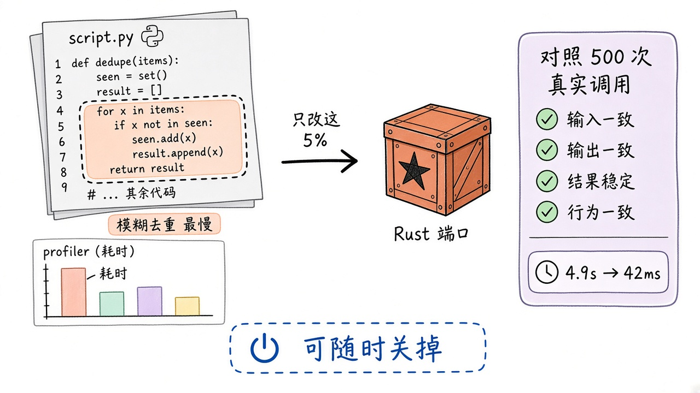

# 2026-11-23 GitHub 日报

今日三条：只把最慢的那 5% 改写成 Rust、并对照原行为再替换的 fast-anything；读失败 CI、给出修复供你审的 OpenSRE；以及把长视频剪成带字幕、封面和发布文案的 AutoClip。未重复今早周报已写过的 Univer、open-code-review、rust-anything、chrome-devtools-mcp、paper-orchestra、LoopForge、agentes-chat、arcane、vercel/board、spaceship，以及仍在热榜上的 superpowers、CLI-Anything、cursor/plugins、diagram-design 等。

## 1. EL4CTEO/fast-anything — 不要整仓改写，只把最慢的 5% 搬进 Rust

**介绍**  
[fast-anything](https://github.com/EL4CTEO/fast-anything) 是 11-21 新开源的 MIT 工具：先给 Python / Node / TypeScript / Ruby / Java / Kotlin / Go / PHP / C / C++ / C# / R 应用做性能剖析，找出「耗时 × 可移植性」靠前的函数，再让编码代理只把这些函数改写成 Rust，用最多 500 次真实调用（外加 NaN、空输入、放大输入等派生用例）对照原实现，通过后才替换进去，可随时 `disable` 或设 `FAST_ANYTHING_DISABLE=1` 回到原代码。它强调改最外层可搬的循环，而不是被调用几百万次的内层函数，以免跨语言调用把收益吃掉。仓库还提供 Claude Code 插件和 MCP。约 1960★，今早（Asia/Shanghai）仍在推送。需要本机 Rust 工具链（[rustup](https://rustup.rs)）。README 里的示例结果（i5-10500 / Windows 11，C/C++ 在 4 核 Linux runner）需按 `examples/` 自行复现，不能直接当成你这边的加速比。

**用法**  
仓库：[github.com/EL4CTEO/fast-anything](https://github.com/EL4CTEO/fast-anything)。

```sh
npm i -g @el4cteo/fast-anything      # 或：cargo install fast-anything
fast-anything go --agent claude -- python app.py
# 也可：-- node app.ts / bun app.ts / ruby app.rb / go run . 等
```

分步可用 `scan -- <cmd>`、`port [id]`、`verify`、`enable` / `disable`、`bench`、`report`。`--agent` 可取 `claude`、`codex`，或任何从 stdin 读提示的命令；不指定时，把生成的 `TASK.md` 交给你手头的代理即可。

**应用场景**  
本地有一段 Python / TypeScript 数据处理，profiler 显示时间几乎都耗在模糊去重或类似热循环上。用它只把这一段搬到 Rust，先看 500 次真实调用是否完全对齐，再决定是否启用，并给 PR 留一张对照卡片。



**推荐学习程度**：进阶

---

## 2. Tracer-Cloud/opensre — 读失败的 CI，给出修复供你审

**介绍**  
[OpenSRE](https://github.com/Tracer-Cloud/opensre) 是 Apache-2.0 的 CI/CD 可靠性代理（文档称 public alpha，接口和集成还可能变）：CI 只告诉你红了，它负责读失败的 run、追查原因，并推一个修复供你审查。口号是可在自己的基础设施上、用自己的模型跑；官方 Quickstart 则说明，登录后会启用 OpenSRE 托管模型，不必先准备 LLM key。仓库约 1.4 万★，今早仍在更新。安装文档：[opensre.com/docs/getting-started/quickstart](https://www.opensre.com/docs/getting-started/quickstart)。预编译 Linux 二进制需要 glibc 2.35+（Ubuntu 22.04 或同级）。

**用法**  
仓库 README 的安装命令：

```bash
curl -fsSL https://install.opensre.com | bash -s -- -gh
opensre
```

Windows（PowerShell）：

```powershell
& ([scriptblock]::Create((irm https://install.opensre.com/install.ps1))) -gh
```

首次启动会引导登录并（如需要）连接 GitHub。之后可在交互壳里用自然语言提问，或一次性执行：

```bash
opensre ask "why did checkout latency increase today?"
```

**应用场景**  
PR 上 GitHub Actions 又红了，与其盲目重跑，先让 OpenSRE 读这一次失败日志、区分偶发和真错，再提交一份修复 PR，由人审查后合并。


**推荐学习程度**：进阶

---

## 3. zhouxiaoka/autoclip — 一个链接，本机剪出带字幕的短视频

**介绍**  
[AutoClip](https://github.com/zhouxiaoka/autoclip) 是 MIT 许可的开源 AI 剪辑工具：贴一个播客、访谈或课程链接，生成适配抖音、小红书、TikTok、Reels、YouTube Shorts、B 站与 YouTube 的短视频，并带字幕、封面和发布文案。软件本身免费；分析模型可走云端按量计费，也可接本机 Ollama / LM Studio。字幕可用本地 Whisper（首次约 220 MB），或改用阿里云百炼转写（README 举例约 0.1 元/小时音频，以实际账单为准；音频会上传到云端）。提供桌面版、Docker、CLI 与 MCP。约 1.3 万★，周末仍在 GitHub 日榜；最新正式版 [v1.5.9](https://github.com/zhouxiaoka/autoclip/releases/tag/v1.5.9)。介绍站：[zhouxiaoka.github.io/autoclip_intro](https://zhouxiaoka.github.io/autoclip_intro/)。

**用法**  
桌面版从 [Releases](https://github.com/zhouxiaoka/autoclip/releases/latest) 下载：macOS Apple Silicon 用 `.dmg`，Windows 10/11 x64 用 `-setup.exe`（安装包自带 Python 和 FFmpeg）。Intel Mac 和 Linux 走 Docker 或 CLI。Docker：

```bash
git clone https://github.com/zhouxiaoka/autoclip.git
cd autoclip
cp env.example .env
mkdir -p data logs uploads
docker compose up -d --build
```

打开 http://localhost:3000。CLI / MCP 需要 Python 3.10+（建议 3.11）和 FFmpeg。完整安装见 [安装指南](https://github.com/zhouxiaoka/autoclip/blob/main/docs/USER_INSTALLATION_GUIDE.md)。

**应用场景**  
手头有一集很长的访谈或课程，想先在本机剪出几条竖版短视频，检查字幕和取景后再下载发布包，而不是全程把成片交给闭源剪辑站。


**推荐学习程度**：入门
