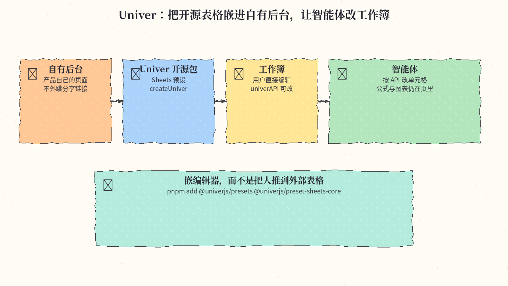
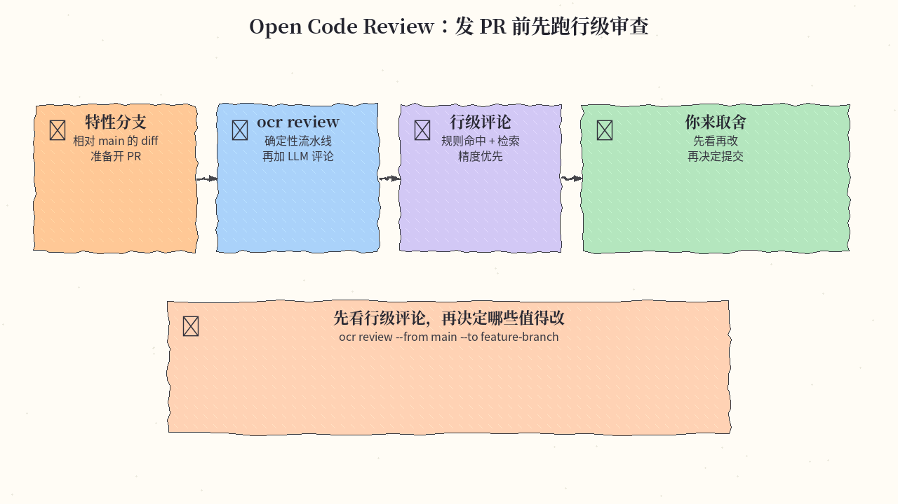
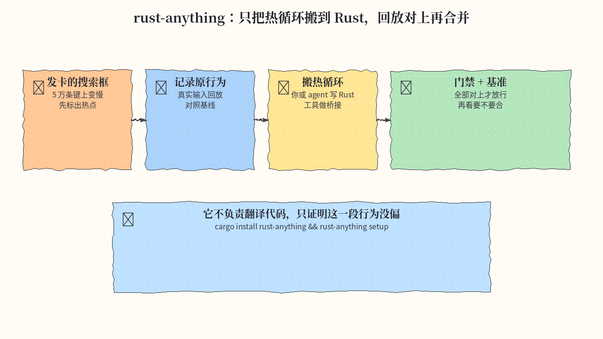
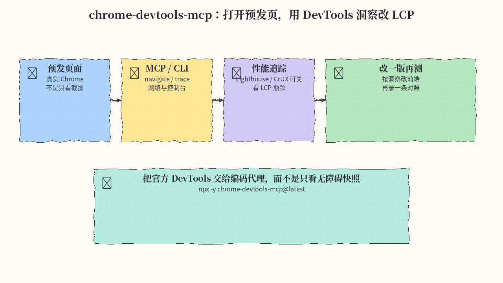
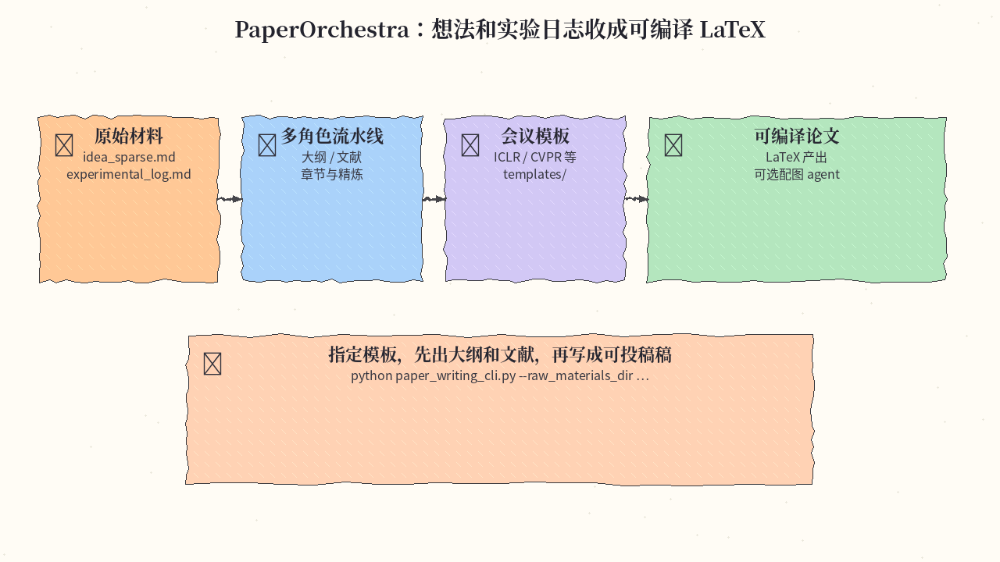
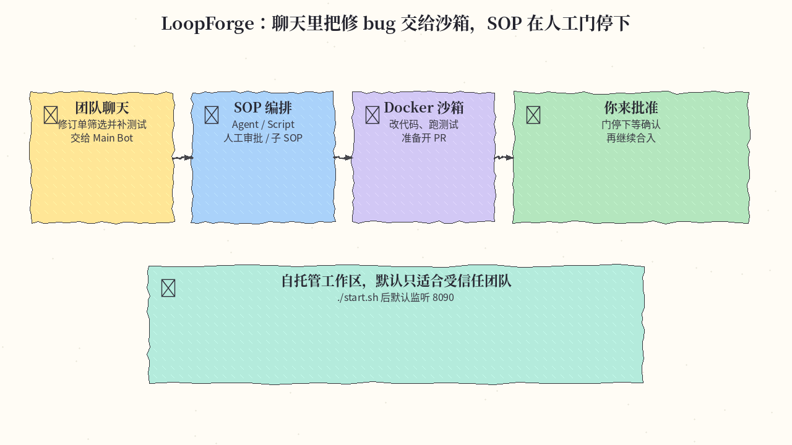
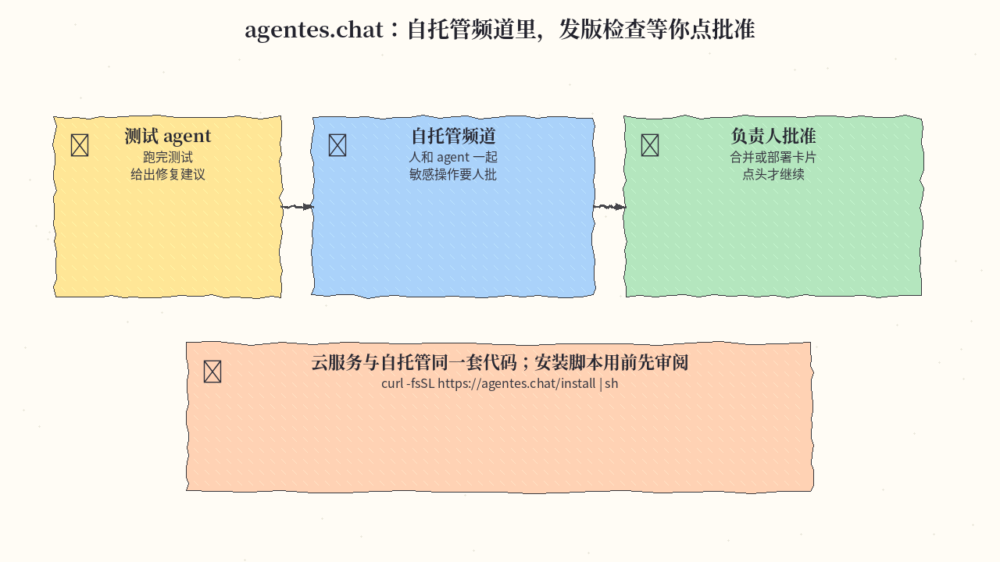
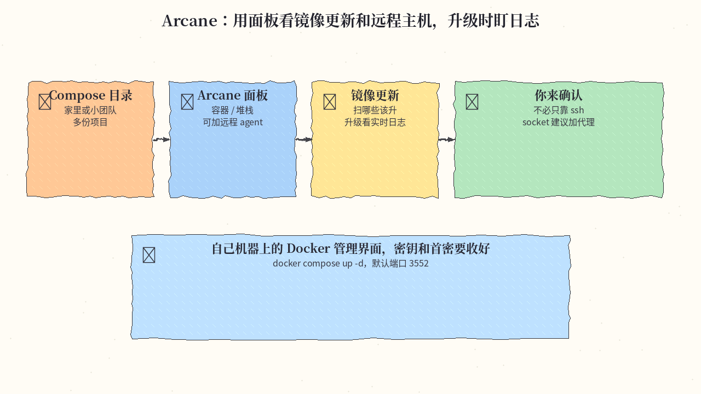
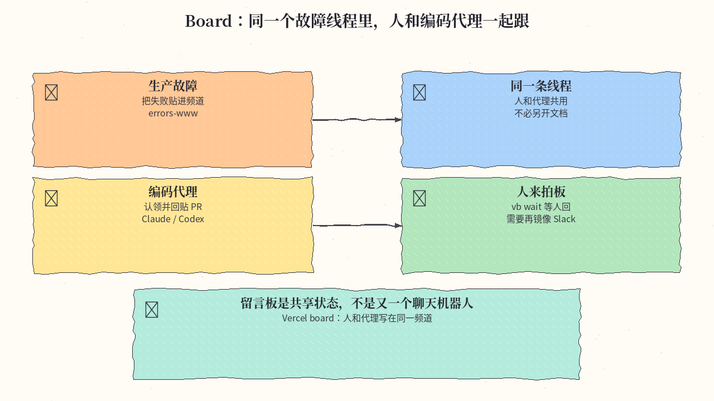
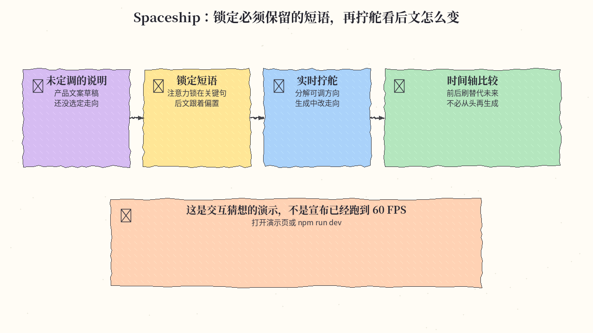

# 2026-11-23 GitHub 周报

上周（11/16–11/22）精选 10 个值得跟进的开源项目（偏 AI 办公与代码审查 / 编码代理工作流与渐进式改写 / 自托管协作与本机工具）。未重复上周周报已写过、本周仍在周榜上的项目（如 plannotator、astryx、modern-web-guidance）。

## 1. dream-num/univer — AI 办公 SDK，本周发布 1.5.0

**介绍**  
Univer 是 TypeScript 写的办公 SDK（Apache-2.0）：把表格、文档等编辑能力嵌进自己的产品或智能体。开源核心覆盖 Sheets / Docs 等；站点把开源包和 Pro 分开。11-14 发布 [v1.5.0](https://github.com/dream-num/univer/releases/tag/v1.5.0)：独立图表工作表、堆叠折线图与误差线、公式计算降内存、Office 兼容性改进，同时有 Worker 入口等破坏性变更。约 3.1 万★，本周新增约 7.2k，是这周星数涨幅最大的仓库之一。站：[univer.ai](https://univer.ai)，文档：[docs.univer.ai](https://docs.univer.ai/)。

**用法**  
仓库：[github.com/dream-num/univer](https://github.com/dream-num/univer)。README 的开源表格编辑器示例只用开源包，不需要商业许可或 Server SDK：

```bash
pnpm add @univerjs/presets @univerjs/preset-sheets-core
```

```ts
import { UniverSheetsCorePreset } from '@univerjs/preset-sheets-core'
import UniverPresetSheetsCoreEnUS from '@univerjs/preset-sheets-core/locales/en-US'
import { createUniver, LocaleType, mergeLocales } from '@univerjs/presets'
import '@univerjs/preset-sheets-core/lib/index.css'

const { univerAPI } = createUniver({
  locale: LocaleType.EN_US,
  locales: {
    [LocaleType.EN_US]: mergeLocales(UniverPresetSheetsCoreEnUS),
  },
  presets: [
    UniverSheetsCorePreset({
      container: 'app',
    }),
  ],
})

univerAPI.createWorkbook({})
```

页面上放一个全高容器即可：`<div id="app" style="height: 100vh"></div>`。从 1.4.0 升级需按发行说明迁移自定义 Worker 入口，并成套升级相关组件后再写入新图表数据。部分 1.5.0 能力与 Office / PDF 导入导出走 Pro；发行说明还写：更新适配器后，每月 10 次无水印成功导出用尽，受支持的导出可带许可证水印继续。

**应用场景**  
在自有后台里嵌一个开源表格编辑器，让智能体通过 `univerAPI` 改工作簿，而不是把用户推到外部分享的电子表格。



**推荐学习程度**：进阶

---

## 2. alibaba/open-code-review — 阿里开源的混合架构代码审查 CLI

**介绍**  
Open Code Review（`ocr` CLI，Go，Apache-2.0）把确定性流水线和 LLM Agent 拼在一起做行级审查：前者负责选文件、打包、规则匹配与定位，后者做动态检索与评论。也可 `ocr scan` 审整文件。兼容 Claude Code、Codex、Cursor、Kimi Code 等。README 称源自阿里内部审查助手。本周初发布过 [v1.13.10](https://github.com/alibaba/open-code-review/releases/tag/v1.13.10)：仅给 `--from` 时 `--to` 默认 HEAD、Markdown 摘要、workspace 模式支持 `--resume` 等。约 5.5 万★，本周新增约 4.0k。文档：[open-codereview.ai/docs](https://open-codereview.ai/docs)。

**用法**  
仓库：[github.com/alibaba/open-code-review](https://github.com/alibaba/open-code-review)。需要 Git >= 2.41：

```bash
npm install -g @alibaba-group/open-code-review
ocr config provider          # 选内置供应商或加自定义
ocr config model             # 为当前供应商选模型
cd your-project
ocr review
ocr review --from main --to feature-branch
ocr review --commit abc123
ocr scan
ocr scan --path internal/agent
ocr review --format json --output result.json
ocr delegate preview
```

`ocr review` / skill 默认走 OCR 自己的供应商配置，不是 Claude Code 的订阅登录。Delegation 模式则用宿主智能体的模型与鉴权，不必在 OCR 里另配密钥。自行调用模型会产生 API 费用。README 自述基准是精度优先、召回低于通用智能体，属有意取舍。

**应用场景**  
发 PR 前在特性分支上跑 `ocr review --from main --to feature-branch`，先看行级评论，再决定哪些值得改。



**推荐学习程度**：进阶

---

## 3. erkamyaman/rust-anything — 一块一块改写成 Rust，每步对照原行为

**介绍**  
rust-anything（MIT）是一套给编码代理用的渐进式改写工具：先记录现有 TypeScript / Python / C / Go / Ruby / Java 应用（PHP、C# 为预览）在真实输入上的行为，再把热路径或整应用一段段改写成 Rust，每一步用回放对照，全部对上才放行。它不负责翻译代码，Rust 由你或 Claude Code / Codex / Cursor / Gemini CLI 来写；工具负责找热点、生成桥接、记录行为、对照和门禁。仓库 11-16 创建，本周发布 v1.4.0；周三日报时约 1.4k★，本周已到约 8.0k★。README 写明：它只能抓住记录覆盖到的行为；把很小的函数逐次调到 Rust，通常比 JIT 更慢，它要找的是值得批量搬过去的循环。文中的加速数字（如 x18n 侧栏搜索 20 倍）来自仓库 `demo/` 基准，是作者在 4 核上测的，不是通用承诺。

**用法**  
仓库：[github.com/erkamyaman/rust-anything](https://github.com/erkamyaman/rust-anything)。

```sh
cargo install rust-anything   # 或从 Releases 下预编译包；JS 项目也可用 npm i -g rust-anything
rust-anything setup           # 给已检测到的 Claude Code / Codex / Cursor / Gemini CLI 登记 MCP 和技能
```

`setup` 改已有配置前会在旁边留 `.rust-anything.bak`，可重复执行，`--remove` 撤销。Claude Code 也可：`/plugin install rust-anything --marketplace erkamyaman/rust-anything`（CLI 仍需在 `PATH`）。然后可以直接说：「用 rust-anything 把这个 CLI 改写成 Rust，并证明行为一致。」或手动走 `profile` → `bridge` → `record` → 写 `port.rs` → `diff` / `bench` / `gate`。

**应用场景**  
搜索框在 5 万条键上发卡，先让工具标出热循环并记下原输出，再只把这一段搬到 Rust，回放全部对上后再看基准要不要合并。



**推荐学习程度**：进阶

---

## 4. ChromeDevTools/chrome-devtools-mcp — 官方把 Chrome DevTools 交给编码代理

**介绍**  
`chrome-devtools-mcp` 是 Chrome 官方的 MCP 服务器 + `chrome-devtools` CLI + 一组 skills（TypeScript，Apache-2.0）：让编码代理控制并检查真实 Chrome，做自动化、调试和性能分析。和只返回无障碍快照的浏览器 CLI 不是同一条线，这边强调 DevTools 追踪、网络/控制台、性能与 Lighthouse。约 5.9 万★，本周新增约 2.8k。本周初仍有正式版推送。文档：[developer.chrome.com/docs/devtools/agents](https://developer.chrome.com/docs/devtools/agents)。官方仅正式支持 Google Chrome 与 Chrome for Testing，需要 Node.js LTS 和当前稳定版或更新的 Chrome。

**用法**  
仓库：[github.com/ChromeDevTools/chrome-devtools-mcp](https://github.com/ChromeDevTools/chrome-devtools-mcp)。MCP 客户端配置：

```json
{
  "mcpServers": {
    "chrome-devtools": {
      "command": "npx",
      "args": ["-y", "chrome-devtools-mcp@latest"]
    }
  }
}
```

也可以装全局 CLI：

```sh
npm i chrome-devtools-mcp@latest -g
chrome-devtools navigate_page 1 --url "https://developers.chrome.com"
chrome-devtools take_screenshot 1 --filePath screenshot.png
chrome-devtools stop
```

Claude Code 插件：`/plugin marketplace add ChromeDevTools/chrome-devtools-mcp`，然后 `/plugin install chrome-devtools-mcp@chrome-devtools-plugins`。

用量统计默认开启（工具调用成功率、延迟、环境信息），可用 `--no-usage-statistics`，或设 `CHROME_DEVTOOLS_MCP_NO_USAGE_STATISTICS` / `CI` 关闭。性能工具可能把 trace URL 发给 Google CrUX，可用 `--no-performance-crux` 关掉。浏览器实例里的内容会暴露给 MCP 客户端，不要在里面放不想分享的敏感数据。默认还会向 npm 做更新检查（`CHROME_DEVTOOLS_MCP_NO_UPDATE_CHECKS` 可关）。

**应用场景**  
让代理打开预发页、录一条性能追踪，并根据 DevTools 洞察改 LCP，而不是只看截图。



**推荐学习程度**：入门

---

## 5. google-research/paper-orchestra — 把实验材料编排成可投稿论文

**介绍**  
PaperOrchestra 是 Google Cloud AI Research 开源的多智能体论文写作框架（Apache-2.0）：用 Outline、Literature Review、Section Writing、Content Refinement、Plotting 等角色，把想法和实验日志收成符合目标会议模板的 LaTeX，并做文献综合和配图。仓库 2026-05 创建；周二日报时约 1.6k★，本周已到约 6.0k★。站点：[yiwen-song.github.io/paper_orchestra](https://yiwen-song.github.io/paper_orchestra/)。评测用的数据集不在这个仓库里，README 写会另行发布。

**用法**  
仓库：[github.com/google-research/paper-orchestra](https://github.com/google-research/paper-orchestra)。

```bash
conda create -n paper_orchestra python=3.11
conda activate paper_orchestra
pip install -r requirements.txt
```

在仓库根目录建 `.env`，按要用的模型填 `GEMINI_API_KEY`，或 `VERTEX_AI_PROJECT` / `VERTEX_AI_LOCATION`，或 `OPENAI_API_KEY`；文献检索需要 `SEMANTIC_SCHOLAR_API_KEY`。

```bash
python paper_writing_cli.py \
  --raw_materials_dir /path_to_your_raw_materials/ \
  --latex_template_dir /path_to_your_latex_template/ \
  --output_dir /path_to_your_output_folder/ \
  --use_plotting true
```

默认 writer / reflection / plotting 模型是 `gemini-3.1-pro-preview`，可用 `--writer_model_name` 等改掉。材料目录默认找 `idea_sparse.md` 和 `experimental_log.md`。仓库提供 `templates/` 下的会议模板示例（如 cvpr2025）。也可用 `./paper_writing_cli.sh`，或在项目根目录 `streamlit run frontend/app.py` 打开本地界面。

**应用场景**  
把一篇工作的想法备忘和实验日志放进 raw_materials，指定 ICLR 或 CVPR 模板，让流水线先出大纲和文献，再写成可编译的 LaTeX；需要图时打开 plotting agent。



**推荐学习程度**：进阶

---

## 6. Tencent/LoopForge — 自托管编码代理交付工作流

**介绍**  
LoopForge 是腾讯开源的自托管工作区：用 SOP（Agent / Script / 人工审批 / 子 SOP）编排 CodeBuddy、Codex、Claude Code 等，在 Docker 沙箱里改代码、开 PR。不想跑平台时，也可用 LoopForge Local 把内置交付流程装进现有编码助手。README 还写了 OpenCode、Cursor CLI、Antigravity、Kimi Code、Pi、DeepSeek Harness、ZCode。根目录 LICENSE 正文为 MIT（第三方组件保留原许可证；GitHub SPDX 显示 NOASSERTION）。周一日报时约 1.6k★，本周已到约 5.7k★。本周初仍有预发布与 main 提交。站点：[loopforge.cn](https://loopforge.cn)。

**用法**  
仓库：[github.com/Tencent/LoopForge](https://github.com/Tencent/LoopForge)。日常安装按 README 走 main（不要默认 checkout RC 标签）。需要 Git、Docker、Compose、Python 3、curl：

```bash
git clone https://github.com/Tencent/LoopForge.git
cd LoopForge
./start.sh
```

安装器会拉取 `compose.yaml` 里钉死的 GHCR 镜像、拉起 MySQL 与平台服务。默认监听 `0.0.0.0:8090`，安装器打印的地址上创建的第一个账号是管理员。ghcr.io 慢时可 `MIRROR=ghcr.nju.edu.cn ./start.sh`（这会信任该镜像主机）。

只想在现有助手里跑内置工作流（需 Node.js 20+、Python 3.8+），在目标项目里：

```bash
npx -y loopforge-cli@latest install claude
```

然后在 Claude Code 里执行 `/start-devflow "<your request>"`。部署与 Local 说明见仓库 [docs/deployment.md](https://github.com/Tencent/LoopForge/blob/main/docs/deployment.md)、[docs/local/usage.md](https://github.com/Tencent/LoopForge/blob/main/docs/local/usage.md)。

默认 Compose 通过宿主机 Docker socket 起沙箱，README 写明只适合受信任团队，不是多租户隔离。新安装监听所有网卡，登录用户可跨实例读项目；登录页默认可注册，可在 `.env` 设 `AGENTFLOW_ALLOW_SIGNUP=false` 关掉。真正干活需要所选执行器的 API key；改已有仓库并开 PR 还要连接 GitHub。

**应用场景**  
团队在聊天里把「修订单筛选并补测试」交给 Main Bot，沙箱里分角色改代码并开 PR，SOP 在人工门停下等你批准再继续。



**推荐学习程度**：进阶

---

## 7. agentes-chat/agentes-chat — 人和智能体一起用的自托管团队聊天

**介绍**  
agentes.chat 是可自托管的团队聊天（TypeScript）：频道里人和 AI agent 一起干活，敏感操作要人批。Agent 可配角色、预算、MCP、自己的计算机和浏览器，以及 Claude Code / Codex。Web / 桌面 / 手机；云服务与自托管跑同一套代码。主许可是 AGPL-3.0-only（`packages/setup` 为 MIT）；闭源改动或自有品牌转售需看商业许可，名称与标志为商标，贡献需签 CLA。仓库 11-09 新建，周一日报时约 1.5k★，本周约 2.0k★。本周初发布过服务器 [v0.1.2](https://github.com/agentes-chat/agentes-chat/releases/tag/v0.1.2)，以及桌面端 0.8.x 等更新。站点：[agentes.chat](https://agentes.chat)。

**用法**  
仓库：[github.com/agentes-chat/agentes-chat](https://github.com/agentes-chat/agentes-chat)。自托管推荐 Linux，官方 Quick start：

```sh
curl -fsSL https://agentes.chat/install | sh
```

这是管道安装脚本，使用前应自行审阅。安装器在询问后可安装缺失的 Docker，并默认把实例放到 Tailscale 网上（约 10 分钟，带私钥 HTTPS）。细节见 [SELF_HOSTING.md](https://github.com/agentes-chat/agentes-chat/blob/main/SELF_HOSTING.md)。每个组织在应用内自行添加模型密钥。

桌面/手机、Agent browser、Codex、邮箱等多项仍标 Beta；README 写 Mac 构建未公证、Windows 安装包未签名。不要把它写成既有 OpenMausBot 的马甲——它只支持导入。

**应用场景**  
在自托管频道里把发版检查交给测试 agent，它跑完测试并给出修复，合并或部署以聊天卡片形式等负责人点批准。



**推荐学习程度**：进阶

---

## 8. getarcaneapp/arcane — 面向自己机器的 Docker 管理面板，本周到 v3

**介绍**  
Arcane（BSD-3-Clause）是一个自托管 Docker 管理界面：看容器和 Compose 堆栈、扫镜像更新、做备份和 GitOps，也可以加远程 agent 管别的主机。11-14 发布 v3.0.0：重做仪表盘和活动中心，升级过程可看实时日志，视图可自定义，备份和 GitOps 也扩大了；对旧协议和部分配置有破坏性变更。随后的 v3.0.1 修了 agent 模式启动和性能，并收紧证书与更新校验。约 1.0 万★。文档：[getarcane.app](https://getarcane.app)。官方镜像支持 amd64 / arm64 / armv7 / riscv64。

**用法**  
按[安装文档](https://getarcane.app/docs/get-started/installation)，需要本机已有 Docker Engine 和 Compose。先生成至少 32 字符的加密密钥：

```bash
docker run --rm ghcr.io/getarcaneapp/manager:latest /app/arcane generate secret
```

在 `compose.yaml` 里使用官方镜像 `ghcr.io/getarcaneapp/manager:latest`，映射 `3552:3552`、Docker socket 和数据卷，把密钥写入 `ARCANE_ENCRYPTION_KEY`，把 `ARCANE_APP_URL` 和 `ARCANE_PROJECTS_DIRECTORY` 改成你实际访问地址和 Compose 项目目录（主机路径要原样挂进容器）。然后 `docker compose up -d`，打开该地址。首次管理员是 `arcane`，密码写在容器内 `/app/data/initial-admin-password`，可用 `docker compose cp arcane:/app/data/initial-admin-password .` 拷出来，登录后立刻改掉。文档建议用 socket proxy 限制对 Docker socket 的访问，而不是长期裸挂 socket。Linux 也可用 `curl -fsSL https://getarcane.app/install.sh | sudo bash`（会安装 Docker）。

**应用场景**  
家里或小团队的 Compose 项目放在一个目录里，用面板看哪些镜像有更新、远程主机的 agent 是否在线，并在升级时盯着实时日志，而不是只靠 ssh 和 docker ps。



**推荐学习程度**：入门

---

## 9. vercel/board — 人和编码代理共用的留言板

**介绍**  
[board](https://github.com/vercel/board) 是 Vercel 11-18 在博客 [Introducing Vercel Board](https://vercel.com/blog/introducing-vercel-board) 里公开的开源留言板（Apache-2.0），文档在 [vercel.com/docs/board](https://vercel.com/docs/board)。频道、线程、任务和观察者都有；默认看板走 `vercel login` + `vercel link` 之后的 Vercel API，同一套 CLI/SDK 也可以在本机跑、不必托管在 Vercel（`npx @vercel/board serve`，监听 `127.0.0.1:4100`）。Slack / GitHub / Linear 同步走 Vercel Connect。代理可以以自己的身份发帖（`--as`），凭证仍绑在登录的人身上。仓库 10-02 创建，本周发布过 `@vercel/board@0.53.0`，约 190★。需要 Node 22.18+。npm 上的 `vb` 是另一个无关包，不在项目目录里时要用 `npx @vercel/board`。Vercel CLI 也暴露 `vercel board`。

**用法**

```bash
npm i -g vercel
vercel login
npm i @vercel/board
vercel link
```

```bash
id=$(npx vb post errors-www "deploy failed on a1b2c3")
last=$(npx vb reply "$id" "rolled back to d4e5f6")
npx vb read errors-www
npx vb wait "$last" --timeout 30m
```

给代理装技能：`npx skills add vercel/board --skill board -g`。打开本机界面：`npx vb inspect`。本机看板：`npx @vercel/board serve`。

**应用场景**  
同一个生产故障里，人和 Claude Code / Codex 共用一个 `errors-www` 频道：先把失败贴上去，让代理认领并回贴 PR，再用 `vb wait` 等到人在同一条线程里回复（需要的话再镜像到 Slack）。



**推荐学习程度**：进阶

---

## 10. chuanqisun/spaceship — 把构思当成实时操舵

**介绍**  
[Spaceship IDE](https://github.com/chuanqisun/spaceship) 是 MIT Media Lab 孙川崎的实验性演示（MIT）：设想当模型和决策系统快到接近 60 FPS 时，人可以怎样在生成过程中实时改方向。仓库把这还写成「猜想」，演示的是他认为那时值得有的几种交互，而不是宣布已经达到 60 FPS。四个方向分别是：用可视化看模型当前在注意什么（聚焦监视）、把注意力锁在特定短语上以偏置后文、把任务分解成可独立调节的方向再合成（未来向量操舵），以及生成足够便宜时用时间轴刷出替代未来并实时重写。作者写明实现大多交给 Claude Code，但交互和缓存失效（例如舵往回拨就要清空未来文本、取消进行中的请求）是自己判断的。11-16 创建，约 1.0k★。配套主页：[chuanqisun.github.io/spaceship](https://chuanqisun.github.io/spaceship/)。

**用法**  
先打开演示页，可在模拟器里试用；若要接真实模型，按页面说明在浏览器里配置 Cerebras / Gemini 的 API Key（密钥只存 localStorage，仓库也提醒自行承担风险）。本地跑：

```sh
git clone https://github.com/chuanqisun/spaceship.git
cd spaceship
npm install
npm run dev
```

这是一个 Vite 项目，`npm run build` / `npm run preview` 可做静态预览。设计过程的色板和迭代稿在[演示站的 extra 页](https://chuanqisun.github.io/spaceship/extra/style-1.html)。

**应用场景**  
写一段还没定调的产品说明时，先锁定必须保留的短语，再拧舵看后文怎么变；对几种走向拿不准，就在时间轴上前后刷，比较实时重写出来的版本，而不是一次次从头再生成。



**推荐学习程度**：进阶
