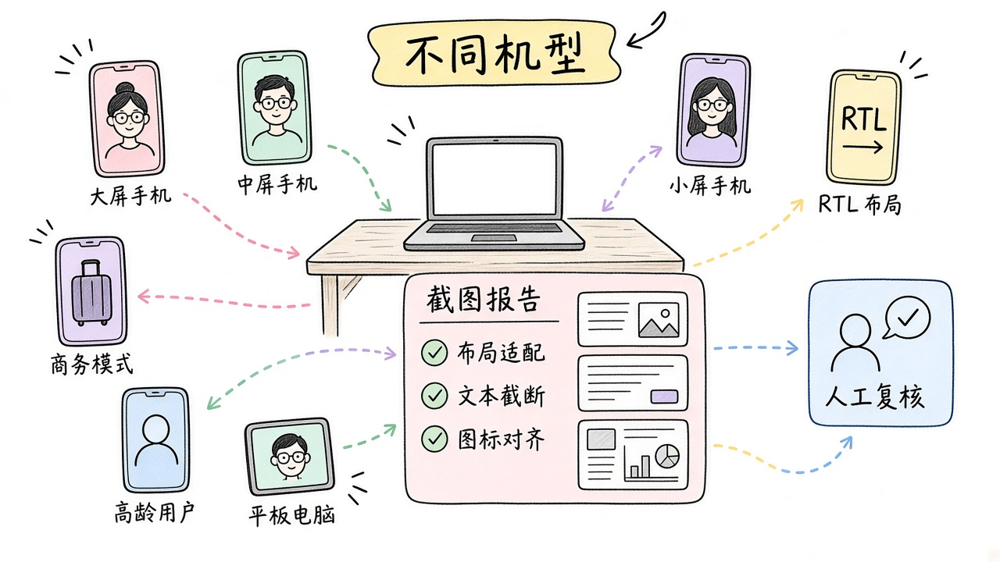
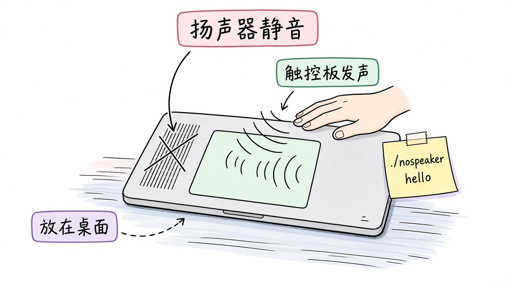
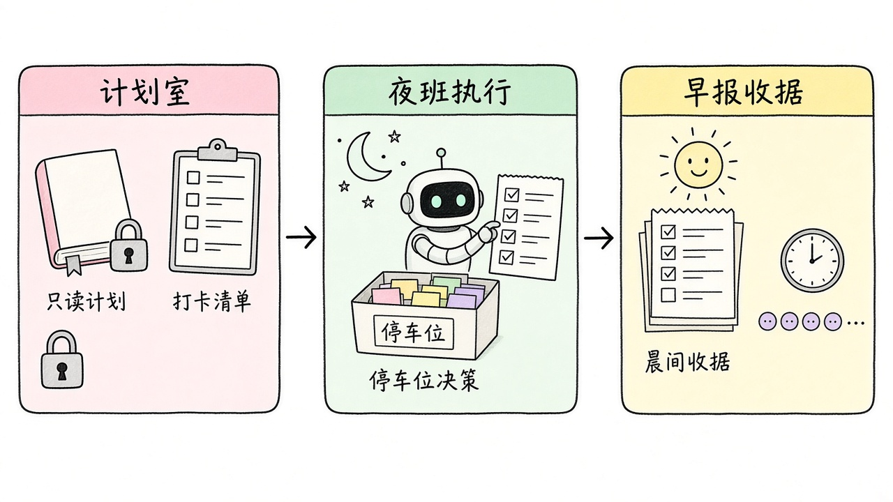

# 2026-11-24 GitHub 日报

今日三条：在 GitHub 免费 runner 上用不同机型并行试你的 App 的 mobile-agent-testers；让静音 Mac 的触控板说话的 nospeaker；以及给长时间编码代理留下可审查班次记录的 Nightshift。未重复昨日与周报已写过的 fast-anything、OpenSRE、AutoClip、Univer、rust-anything、open-code-review 等，以及仍在热榜上的 superpowers、CLI-Anything、cursor/plugins、diagram-design、last30days-skill、stitch-skills、app-store-compliance。

## 1. pierridotite/mobile-agent-testers — 不同机型并行试你的 App，带截图出报告

**介绍**  
[mobile-agent-testers](https://github.com/pierridotite/mobile-agent-testers) 是 11-16 开源的 MIT 工具：不必先写 Maestro / Appium 脚本，每个测试员是一个 Claude Code 代理，在 GitHub Actions 上独占一台 iOS Simulator 或 Android 模拟器，按人设当新用户使用（或按你给的 brief 跑通一个功能、复现工单、出改进报告、对比两个版本），再交出带编号截图的缺陷报告。支持 Flutter、React Native、Expo、原生 Kotlin / Swift、KMP、Capacitor 与 .NET MAUI。公开仓库可用 GitHub 免费 runner；模型费用走你的 Claude 订阅或 API key。README 引用仓库内示例跑次：每台约 0.15–0.55 美元，LocalSend 20 台约 69 分钟、4.62 美元（作者自己的数字，不是这里实测）。约 1480★，今早仍有提交。完整输入项与支持框架见 [docs/configuration.md](https://github.com/pierridotite/mobile-agent-testers/blob/main/docs/configuration.md)。

**用法**  
仓库：[github.com/pierridotite/mobile-agent-testers](https://github.com/pierridotite/mobile-agent-testers)。

```bash
gh repo create my-testers --public --template pierridotite/mobile-agent-testers --clone
cd my-testers && ./setup.sh           # 密钥对、secrets 与 Claude token（Windows: .\setup.ps1）
gh workflow run agent-testers.yml     # 演示：2 台 Android + 2 台 iOS，约 20 分钟
bash scripts/collect.sh <run id>      # 解密报告并归并重复项：runs/<id>/SUMMARY.md
```

测自己的应用：

```bash
gh workflow run agent-testers.yml -f source_repo=you/app -f app_id=com.you.app \
  -f android_personas=anna,malik -f ios_personas=clara,jonas
```

也可以在 Claude Code 里：`/plugin marketplace add pierridotite/mobile-agent-testers`，再 `/plugin install mobile-agent-testers@mobile-agent-testers`。

**应用场景**  
发版前想先知道大字号、小屏、从右到左布局会不会挡住关键按钮，与其只跑自己写好的脚本，不如先在公开仓库的免费 runner 上并行丢几个人设去试用，再人工看带截图的汇总。



**推荐学习程度**：进阶

---

## 2. os6/nospeaker — 把 Mac 静音，触控板仍会说话

**介绍**  
[nospeaker](https://github.com/os6/nospeaker) 是 11-22 开源的 MIT 小工具：MacBook 触控板里没有喇叭，只有一颗力触马达；它把这颗马达驱动到每秒数千次，让玻璃振动出听得见的声音，用来朗读、唱歌或当乐器。需要 Force Touch 触控板（2015 年起的 MacBook，或 Magic Trackpad 2 及更新），Apple Silicon 需 macOS 12+，Intel 需 macOS 13+。作者写明在 MacBook Pro（Mac17,10）M5 Max / macOS 27.2.1 上测过；Intel Mac、外接 Magic Trackpad 和更老系统尚未测试。它调用的 `MultitouchSupport` 是私有框架，公开触觉 API 只有三种固定触感。约 1460★。发行包用 Developer ID 签名并经 Apple 公证。

**用法**  
仓库：[github.com/os6/nospeaker](https://github.com/os6/nospeaker)。更稳妥的是从 [Releases](https://github.com/os6/nospeaker/releases/latest) 下载已签名的 `nospeaker.zip`，解压后在终端运行 `./nospeaker`。README 也提供一行安装，它指向仓库里的 [play.sh](https://github.com/os6/nospeaker/blob/main/play.sh)，建议先读再执行：

```sh
curl -fsSL a90.com/nospeaker | sh
```

从源码构建需要 Xcode 或 Command Line Tools：

```sh
git clone https://github.com/os6/nospeaker
cd nospeaker
./build.sh
./nospeaker
```

常用参数：`./nospeaker "hello there"`，`./nospeaker --voice Daniel "hello"`，`./nospeaker --sweep`。建议先静音、把电脑放在桌面上（腿上会更轻），按提示再把手放到玻璃上。Space 跳过一段，q 或 Ctrl-C 结束。

**应用场景**  
音箱不可用、或需要把系统音量打到零时，仍想听一句提示或试一段语音：把 Mac 放到桌上，让触控板把那句话「敲」出来。



**推荐学习程度**：入门

---

## 3. orwa-mahmoud/nightshift — 给编码代理排可审查的夜班

**介绍**  
[Nightshift](https://github.com/orwa-mahmoud/nightshift) 是 MIT 许可的 Claude Code / Codex / Cursor 插件：先在只读的「计划室」把方案、边界和完成定义写成打卡清单，再让代理按清单干活；拿不准的决策会写入「停车位」供你事后看，而不是卡死整晚。每条任务结束有收据（交付、否决项、跑过的检查、耗时和 token）。也支持 `/nightshift:hunt`：给一个目标和时限，按完整单元工作到下班。可装在 macOS、Linux、Windows 的 Git 仓库或普通文件夹里，不另起服务、不另要 API key。约 650★，11 月仍在更新。安装说明：[docs/install.md](https://github.com/orwa-mahmoud/nightshift/blob/main/docs/install.md)。

**用法**  
Claude Code：

```text
/plugin marketplace add orwa-mahmoud/nightshift
/plugin install nightshift@nightshift
```

Codex：

```sh
codex plugin marketplace add orwa-mahmoud/nightshift
codex plugin add nightshift@nightshift
```

然后在 CLI 用 `/hooks`，或在 Codex 应用里审查并信任 hooks。

Cursor：打开 Customize → Add → From GitHub Repository，粘贴 `https://github.com/orwa-mahmoud/nightshift`，导入后再安装 Nightshift。

第一次在项目里跑 `/nightshift:setup`。计划用 `/nightshift:plan`（计划室期间代码只读）；执行用 `/nightshift:start`；向目标狩猎用 `/nightshift:hunt`；过程中 `/nightshift:status`，暂停用 `/nightshift:stop`，`/nightshift:doctor` 只诊断不改动。

**应用场景**  
手头有一份已经对齐的改版清单，晚上不想盯着超长对话：先在计划室把完成定义写清，再开一班，第二天只看收据和停车位里的默认决策，而不是回翻整晚的聊天记录。



**推荐学习程度**：进阶
