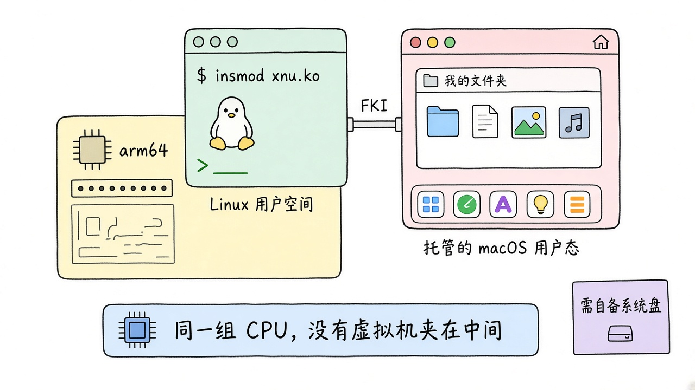

# 2026-11-25 GitHub 日报

今日三条：leanprover-community 在整理一份 2026 年 Riemann 猜想的 Lean 形式化；把 XNU 作为模块载入 arm64 Linux 的 xnulinux；以及开源的 agentic 视频工作室 OpenMotion。未重复昨日与周报已写过的 mobile-agent-testers、nospeaker、Nightshift、fast-anything、OpenSRE、AutoClip、Univer、rust-anything 等，以及仍在热榜上的 superpowers、CLI-Anything、cursor/plugins、diagram-design、last30days-skill、stitch-skills、app-store-compliance。

## 1. leanprover-community/riemann-hypothesis — 社区在整理一份 2026 年 Riemann 猜想的 Lean 形式化

**介绍**  
[riemann-hypothesis](https://github.com/leanprover-community/riemann-hypothesis) 是 Lean 社区 11-20 建的仓库：把一份 2026 年 Riemann 猜想（以及 Dirichlet L 函数上的广义 Riemann 猜想）的形式化证明，整理成更好构建、更好读的制品。仓库说明这份证明来自 11-20 公布的 [remark.pdf](https://alpo.ge/remark.pdf)（社区按作者姓氏称作 Alpöge）；`original` 分支保留当时取到的第一份公开 Lean 源码。只想看原文、不编译，也可以看 [riemann-hypothesis-original](https://github.com/homeowmorphism/riemann-hypothesis-original)。`src/Main.lean` 声称证明了 Mathlib 里的 `RiemannHypothesis`，以及把陈述写开的版本：ζ 除 −2、−4、−6、… 以外的零点都满足 Re s = 1/2，还有 Dirichlet L 函数在临界带上的相应命题。Comparator 会检查 `Main.lean` 证明的恰好是这些陈述、只用了 `propext`、`Quot.sound` 和 `Classical.choice` 这三条标准 Lean 公理，并且 Lean 内核与 nanoda 都接受这份证明。完整构建要数小时，仓库建议先用缓存阅读；若要自己核验，文档要求在装了 bubblewrap 的 Linux 上跑 `lake comparator`，且不要用会下载预编译提交的 `lake exe cache get` 来代替检查。约 1060★，今早仍有提交。注意：投稿本身发布时没有许可证，本仓库只是为了方便核对而做的镜像，提交归属原作者；`comparator/` 里从 [formal-conjectures](https://github.com/google-deepmind/formal-conjectures) 复制的声明是 Apache-2.0。这里记录的是社区正在整理和核验的形式化工作，不是对「猜想已被数学界接受」的裁定。

**用法**  
仓库：[github.com/leanprover-community/riemann-hypothesis](https://github.com/leanprover-community/riemann-hypothesis)。先读再构建。用缓存阅读：

```bash
lake exe cache get
lake build --no-build
```

要自己检查证明（Linux，需 [bubblewrap](https://github.com/containers/bubblewrap)）：

```bash
MATHLIB_CACHE_GET_URL=https://cache.mathlib.org/mathlib4 lake exe mathlib/cache get
lake comparator
```

更稳妥的分步导出与对照，见仓库 README 的 “Checking the proof yourself”。完整构建会实际运行提交中的代码，文档建议放在虚拟机或你自己的沙箱里做。

**应用场景**  
想搞清楚这份 2026 年证明在 Lean 里究竟陈述了什么、检查器用的是哪些公理，而不是先信一张新闻稿：先读 PDF 和 `Challenge.lean` 里的五个命题，再用官方 comparator 在沙箱里对一下 `Main.lean`。


**推荐学习程度**：进阶

---

## 2. AFK-surf/xnulinux — 把 XNU 做成 Linux 可加载模块，同一组 CPU 跑两套用户态

**介绍**  
[xnulinux](https://github.com/AFK-surf/xnulinux) 是 11-20 开源的研究项目：从 Apple 已公布的 XNU 源码构建 macOS 内核，把它作为可加载模块 `xnu.ko` 跑进未改过的 arm64 Linux 内核。托管的 XNU 直接驱动 CPU 和 MMU，macOS 进程和 Linux 进程跑在同一组 CPU 上，中间没有虚拟机；Linux 通过小型接口模块 `fki.ko` 借出内存、定时器、文件、网络和 GPU。作者写明：在发行版 Ubuntu 内核上 `insmod xnu.ko`，可以用你自己用官方安装器做的 macOS 27 系统盘启动到桌面（loginwindow、WindowServer、Dock、Finder、Safari、Chrome）。已在 NVIDIA DGX Spark 裸机（Ubuntu 24.04.5 aarch64，当前多为 CPU 渲染）和 Apple Silicon Mac 上的 arm64 Linux 虚拟机（krunkit / tart；有 virtio-gpu 时可走 GPU 桥）上测过。在后者上，macOS 27.2.1 自动登录到桌面约 31–48 秒；30 分钟压力测试（Safari、Notes 等 40 轮）无 panic。要求主机是带 PAC、4K 页、至少 16 GB 内存的 arm64 Linux（其中 8 GB 留给托管内核），并需要一台装了 Xcode 的 Mac 来制作系统盘和编译 GPU 部分。仓库不含、也不分发任何 Apple 二进制；系统盘和 trust cache 都来自你自己的安装。许可证按目录拆开：`fki.ko` 一侧 GPL-2.0，`xnu.ko` 和补丁一侧 APSL-2.0，Linux 会把它登记为非 GPL 模块并 taint 内核。项目声明与 Apple 无关。约 3410★，今早仍有提交。已知停靠项（cryptex 合并进系统卷、AMFI 打过补丁、SIP 放宽、4K 页导致访存比原生虚机慢等）见 [docs/production.md](https://github.com/AFK-surf/xnulinux/blob/main/docs/production.md)。

**用法**  
仓库：[github.com/AFK-surf/xnulinux](https://github.com/AFK-surf/xnulinux)。按 README 的顺序，不要跳步：

1. 在 arm64 Linux 主机上跑 `scripts/vm-xnu-build.sh`，用 macOS-DroidVM 工具链本地编译 XNU（`xnu-12377.121.6`）。
2. `scripts/vm-xnu-rebuild.sh` 打上 `xnu-patches/`，编译内核和 `kexts/`，并与你自己系统盘里的 Apple kext 链接。
3. 在 Mac 上用 `scripts/mk-macvm-disk.sh`，把官方安装器做的 macOS 虚机磁盘转成托管系统盘，拷进 Linux。
4. 在 Linux 主机上用 `scripts/xnulinux-boot.sh` 针对正在运行的内核编译 `fki.ko` / `xnu.ko` 并启动；控制台是 `scripts/xnu-console.sh`。裸机（例如 DGX Spark）要按内存布局设置 `mem=` / `carve_base=` / `carve_mb=`；目前 GPU 桥只支持 virtio-gpu，裸机需 `GPU=off`。
5. 可用 `scripts/install-service.sh` 做成 `xnulinux.service`。

**应用场景**  
你已经有一台 Apple Silicon Mac，也有自己的 macOS 27 安装，想在同一台机器的 Linux 里观察 Darwin 用户态和 Linux 如何共用 CPU，而不是再开一层完整虚机：按文档在 arm64 Linux 虚机里加载模块，用官方安装器做的系统盘启动到桌面，再自己看压力测试和已知停靠项。



**推荐学习程度**：进阶

---

## 3. nexu-io/openmotion — 开源的 agentic 视频工作室，用自己的品牌重做参考片

**介绍**  
[OpenMotion](https://github.com/nexu-io/openmotion) 是 Apache-2.0 的全栈 agentic 视频工作室，作者把它定位为 Claude Motion 和 CapCut 的开源替代：上传参考视频或贴一条社交视频链接，按你的品牌套件和文案重做分镜与转场，在 Studio 里改时间轴，再导出 MP4。它引入 Motion.md，用 Markdown 记录镜头顺序、时长和转场。素材侧可接 GPT Image 2.6、Seedance 2.5、Suno、Eleven v4 等（用你自己的密钥）。安装技能本身只是说明书；连上 Cloud MCP（OAuth 2.1）后，代理才能打开云端模板库。也支持在本地代理里做（Claude Code、Codex、WorkBuddy 等）。约 1.60 万★，本周仍在增长，今早仍有提交。中文说明见 [docs/README.zh-CN.md](https://github.com/nexu-io/openmotion/blob/main/docs/README.zh-CN.md)，连接步骤见 [docs/install.md](https://github.com/nexu-io/openmotion/blob/main/docs/install.md)。

**用法**  
仓库：[github.com/nexu-io/openmotion](https://github.com/nexu-io/openmotion)。用 [Skills CLI](https://github.com/vercel-labs/skills) 装主技能：

```sh
npx skills add nexu-io/openmotion --skill openmotion
```

然后让代理：「用 OpenMotion 连接 Cloud MCP，再帮我做一条视频。」只装技能还不会连上 MCP。也可以把下面这句话交给当前代理：

```text
Read https://github.com/nexu-io/openmotion/blob/main/docs/install.md and follow the instructions to connect OpenMotion in the current agent.
```

授权后会看到模板预览；选 Recreate template，再把 brief 发过去。本地源码 / npm 安装是可选的旧路径，说明在同一份 install 文档里。

**应用场景**  
手头有一条效果不错的参考短视频，想用自己的色板、字体和文案重做一版，再导出到 Shorts / Reels / 抖音：把参考片和品牌套件交给你正在用的编码代理，让它先拆成 Motion.md，你再在时间轴上改节奏。


**推荐学习程度**：入门
