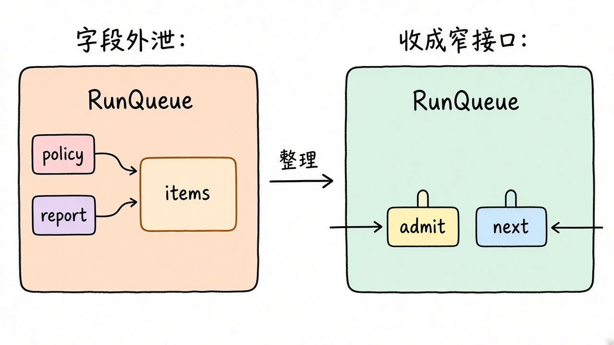

# 2026-11-26 GitHub 日报

今日三条：n8n 的本机个人代理 Nod；按你自己的测试一刀刀删死代码的 shrink-anything；以及按「深模块、窄接口」查结构的 deslop-please。未重复昨日与周报已写过的 riemann-hypothesis、xnulinux、OpenMotion、mobile-agent-testers、Nightshift、fast-anything、OpenSRE、AutoClip 等，以及仍在热榜上的 superpowers、CLI-Anything、cursor/plugins、diagram-design、last30days-skill、stitch-skills、app-store-compliance。主机游戏转译类仓库今天也不写入。

---

## 1. n8n-io/nod — 本机个人代理，代你跑网页，但先问再动手

**介绍**  
[Nod](https://github.com/n8n-io/nod) 是 n8n 开源的本机个人代理（Apache-2.0）：在你自己的电脑上跑，用你选的模型，去真实网站办发票催收、通话前简报、取消试用这类杂事，并且在代你发消息或改动网页之前先停下来等你点头。官方说明它能串 Gmail、Calendar、Slack、Notion 和浏览器；记忆来自你自己的消息，笔记可查看、修改或忘掉；密码、验证码和卡片走 Vault，不进模型。模型可选 OpenAI、Anthropic、Gemini、OpenRouter、Bedrock、Azure、自建服务，或用 ChatGPT Plus / Pro 登录。桌面应用支持 macOS 14+（Apple 芯片或 Intel），Windows 11 和 Linux x64 仍是预览。官网：[nod.n8n.io](https://nod.n8n.io/)。约 3590★，本周仍在周榜上，今早还有提交。README 里 226 件差事、678 次跑次的完成率和「0 次不安全动作」，是作者自己的测试数字，不是这里实测。

**用法**  
仓库：[github.com/n8n-io/nod](https://github.com/n8n-io/nod)。更稳妥的是从 [Releases](https://github.com/n8n-io/nod/releases/latest) 下载对应系统的安装包，或按 [桌面安装文档](https://nod.n8n.io/docs/get-started/install-desktop/) 操作。Apple 芯片 Mac 用 `nod-arm64.dmg`，Intel 用 `nod-x64.dmg`，Windows 用 `nod-Setup-x64.exe`。打开后选「Get started」在本机建助手，或「Connect to a server」连已有实例。本机路径需要先准备好模型服务或其密钥，也可先连本地的 Ollama。文档还提供一条安装脚本，建议先打开仓库里的 `deployment/n8n/install.sh` 读完再决定是否执行，不要用 sudo。

**应用场景**  
你把发票催收、开会前一页简报这类杂事交给本机上的 Nod：它打开真实网页去跑流程，但在代你发邮件或点「取消订阅」之前先停下来等你点头。


**推荐学习程度**：入门

---

## 2. EL4CTEO/shrink-anything — 删掉没人用的代码，每一刀都由你的测试决定

**介绍**  
[shrink-anything](https://github.com/EL4CTEO/shrink-anything) 是 11-23 开源的 MIT 工具（与先前列过的 fast-anything 同一作者）：找出没人调用的函数、没人导入的文件、没人用的依赖和资源，删掉后再跑 *你自己的* 检查命令。退出码为 0、且跑过的测试数量不少于剪之前，这一刀才留下；会破测试的单独放回，整次操作可 `undo`。也提供 `scan`（只列名单、不改文件）、把拿不准的重复或公开方法交给编码代理的 `task`，以及给 PR 用的报告。文档列出 Python、JavaScript、TypeScript、Rust、Go、Java、Kotlin、C#、C、C++、PHP、Ruby、Swift、Dart、Lua、Luau、Elixir、Shell；HTML / Vue / Svelte / YAML / SQL 等文本会被读到引用，避免只在模板里用到的名字被误删。库和应用程序的处理不同：它会按项目形态猜测，也可用 `--lib` / `--app` 覆盖。约 281★，11-25 还有提交。README 写演示应用可读 token 少了 46%，是作者自己的数字，不是这里实测。

**用法**  
仓库：[github.com/EL4CTEO/shrink-anything](https://github.com/EL4CTEO/shrink-anything)。

```sh
npm i -g @el4cteo/shrink-anything      # 或: cargo install shrink-anything
shrink-anything go --agent claude -- npm test     # 检查命令换成 pytest、cargo test、go test ./... 等也可以
```

也可以拆开：`scan` 只看名单；`cut -- <check>` 删除并跑检查；`undo` 按字节撤回上一刀（`--all` 撤回全部）；`verify` 对照第一次剪之前的测试数量再跑一遍。`--agent` 可设 `claude`、`codex`，或任何从 stdin 读提示词的命令。Claude Code 可用官方 marketplace 插件；二进制里还带 MCP server，8 个工具，可用 `claude mcp add shrink-anything -- shrink-anything mcp` 接上。技能说明在仓库 `skills/shrink-anything`。

**应用场景**  
仓库里堆着代理写完没人删的工具函数和没用到的依赖，你先 `scan` 看名单，再让它按 `npm test` 一刀刀剪；测试失败的那一刀会原样放回去，通过的才留在 diff 里。


**推荐学习程度**：入门

---

## 3. deterministic-machines/deslop-please — 先查模块是不是又浅又宽，再决定怎么收

**介绍**  
[deslop-please](https://github.com/deterministic-machines/deslop-please) 是 11-22 开源的 MIT 结构检查器，作者把它写成对 John Ousterhout《A Philosophy of Software Design》的实践：模块要深、接口要窄。它会报字段被模块外直接摸到（`field-leak`）、模块循环与缠绕（`module-cycle`、`tangle`）、以及接口过宽的浅模块（`shallow-module`）这类问题。README 要求把报错从第一原则修好，而不是做机械挪动来消掉；也可以 `--update-allow` / `--allow` 维护放行名单。约 1066★，今早还有提交。

**用法**  
仓库：[github.com/deterministic-machines/deslop-please](https://github.com/deterministic-machines/deslop-please)。

```bash
cargo install deslop-please
deslop-please
```

需要暂时放行时：

```bash
deslop-please --update-allow .deslop-please.allow
deslop-please --allow .deslop-please.allow
```

README 建议把一条说明写进 `AGENTS.md`：跑 `deslop-please` 查结构；被标出的问题要从第一原则修，不要只做机械挪动把报错藏起来。

**应用场景**  
一个队列模块的字段被四个调用点直接摸到，接口越来越宽。跑一遍 deslop-please，对着 `field-leak` 报告把读写收进两三个深模块函数，而不是先加一行 allow 把报错静音。



**推荐学习程度**：进阶
