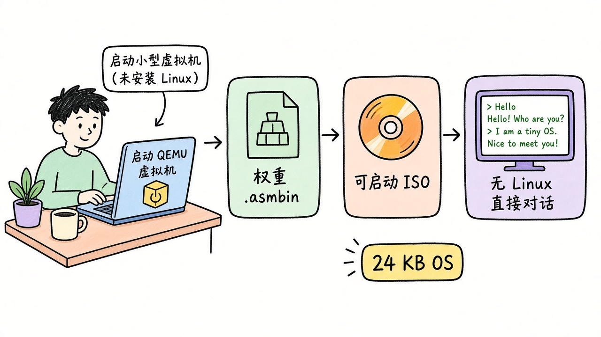
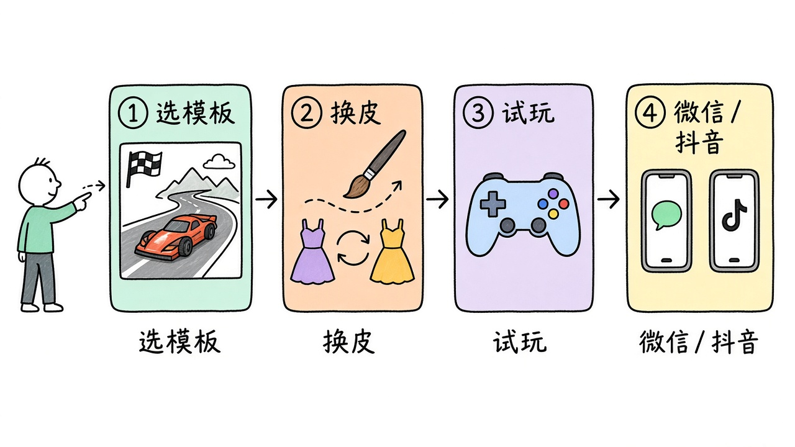
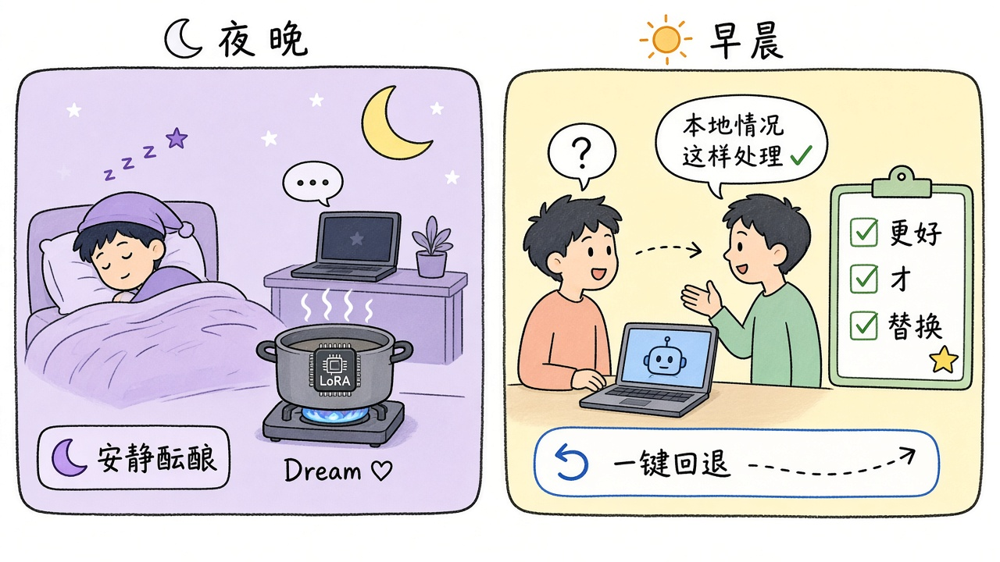

# 2026-11-27 GitHub 日报

今日三条：纯汇编的 Qwen3-0.6B 推理与裸机 OS（llm.asm）；nexu-io 的 Super Game Agent OpenGame；以及用空闲算力给本机模型做 LoRA 的 Songe。未重复昨日与周报已写过的 nod、shrink-anything、deslop-please、OpenMotion、xnulinux、riemann-hypothesis 等。主机游戏转译类仓库今天也不写入。仍在热榜上的 superpowers、CLI-Anything、cursor/plugins、diagram-design、last30days-skill、stitch-skills、app-store-compliance、OpenSRE、AutoClip、Claude-BugHunter、minimind 等不再重复。

---

## 1. alesha-pro/llm.asm — 纯汇编跑 Qwen3-0.6B，也可以做成不装 Linux 的启动盘

**介绍**  
[llm.asm](https://github.com/alesha-pro/llm.asm) 是 11-25 开源的 MIT 项目：三份完整工程都用 x86-64 NASM 写成，不链 C / Rust / libc。第一份是约 14 KB 的静态 Linux ELF，跑 `Qwen/Qwen3-0.6B` 的 Q8_0 推理，并带多轮 KV-cache 的 `--chat`；第二份是约 24 KB 的 Multiboot 裸机 OS，不装 Linux 或 Windows，用 VGA / PS/2 / 串口做同样的对话；第三份是约 32 KB 的 Mini-GPT 训练器，带解析反向传播、AdamW，以及 80×24 的 Braille TUI。作者在同一台 EPYC 机器上给出的 CPU decode 数字是：`FAST_Q8=1` 时 1 线程 20.7 tok/s、16 线程 121.9 tok/s，并写明比同设置的 `llama.cpp` Q8_0（`-ngl 0`）快 18%–36%；裸机 KVM 16 vCPU 写的是 134.9 tok/s——这些都是 README 里的数字，不是这里实测。需要 AVX2 + FMA + F16C。约 1565★。

**用法**  
仓库：[github.com/alesha-pro/llm.asm](https://github.com/alesha-pro/llm.asm)。先装 `nasm` 和 `binutils`，再按 [01-qwen3-inference/README.md](https://github.com/alesha-pro/llm.asm/blob/main/01-qwen3-inference/README.md) 把 Qwen3-0.6B 导出为 `.asmbin`：

```bash
git clone https://github.com/alesha-pro/llm.asm.git
cd llm.asm
sudo apt install nasm binutils
# 模型目录准备好之后：
python3 scripts/export_weights.py --model-dir models/qwen3-0.6b-bf16 --out models/qwen3-0.6b-q8_0.asmbin --scale-dtype fp16
make inference FAST_Q8=1
./build/asm-llm -m models/qwen3-0.6b-q8_0.asmbin -p "Explain how a CPU cache works in 3 concise sentences." -n 128 -t 16
./build/asm-llm -m models/qwen3-0.6b-q8_0.asmbin --chat -t 16
```

裸机 OS 与训练器：

```bash
make os FAST_Q8=1
make os-run MODEL=models/qwen3-0.6b-q8_0.asmbin SMP=16
# 或做可启动 ISO：make os-iso MODEL=models/qwen3-0.6b-q8_0.asmbin
mkdir -p data checkpoints
curl -fsSL https://raw.githubusercontent.com/karpathy/char-rnn/master/data/tinyshakespeare/input.txt -o data/tinyshakespeare.txt
make train
./build/asm-gpt-train --data data/tinyshakespeare.txt --steps 400 --seq 128 -t 16 --save checkpoints/shakespeare.ckpt
```

QEMU / Proxmox 部署细节见 [02-baremetal-os/README.md](https://github.com/alesha-pro/llm.asm/blob/main/02-baremetal-os/README.md)。

**应用场景**  
要在一台没有装 Linux 的虚拟机里直接跟 Qwen3-0.6B 对话：先把权导出成 `.asmbin`，做成可启动 ISO，在 QEMU/KVM 里开机就能聊，不必先装发行版。



**推荐学习程度**：进阶

---

## 2. nexu-io/opengame — 用本地编码代理，从模板改一款能发布的小游戏

**介绍**  
[OpenGame](https://github.com/nexu-io/opengame) 是 nexu-io 11-25 开源的 Apache-2.0 项目（与 11-25 写过的 [OpenMotion](https://github.com/nexu-io/openmotion) 同一组织，但是独立的游戏工作室，不混用）。它把本地编码代理接成一条「选模板 → 换皮 / 重做 → 试玩与检查 → 发布」的流水线：仓库带 25 个可玩的 HTML5 / Three.js 模板（3D、体素、像素和 9:16 竖屏），README 写明支持 22 种本地代理；发布路径包括网页链接、单文件 9:16 Playable Ad，以及微信小游戏、TikTok、抖音。美术、音乐、语音和 3D 也走开源栈，密钥和模型自己带。约 997★，今早还有提交。中文说明见 [README.zh-CN.md](https://github.com/nexu-io/opengame/blob/main/README.zh-CN.md)。

**用法**  
仓库：[github.com/nexu-io/opengame](https://github.com/nexu-io/opengame)。需要 Git、Git LFS、npm 和 Node.js 22.18+（CI 钉的是 26.11.1）。首次克隆建议浅克隆并跳过 LFS，模板资源会在第一次试玩时再下：

```sh
npx skills add https://github.com/nexu-io/opengame/tree/skills --skill opengame

git -c filter.lfs.process= -c filter.lfs.smudge= -c filter.lfs.required=false clone --depth 1 --single-branch --branch main https://github.com/nexu-io/opengame.git
cd opengame
git lfs install --local --skip-smudge
npm ci
npm run build:studio
npm start
```

把本地代理接到 Studio 的步骤，按仓库里的 [docs/opengame-setup.md](https://github.com/nexu-io/opengame/blob/main/docs/opengame-setup.md) 做；也可以让代理按该文档完成接入，再打开模板画廊选一款开改。

**应用场景**  
想先有一款能玩的竞速小游戏，再换成自己的角色和画风，试玩通过后导出 9:16 可玩广告，发到微信或抖音，而不是从空白工程开始搭引擎。



**推荐学习程度**：入门

---

## 3. sous-labs/songe — 你不在的时候训练，只有更好才换上，还能撤回

**介绍**  
[Songe](https://github.com/sous-labs/songe) 是 11-20 开源的 Apache-2.0 本机训练引擎：在你的编码代理和本机模型服务之间加一层 OpenAI 兼容代理，记下对话里的纠正、规则和重试，等代理空闲、内存和电量都够时再做「Dream」。Quick Dream 把你表达过的偏好写进模型说明；Deep Dream 用这些教训生成练习，再训练 LoRA，并且只在新版本于你原来有反应的那些节点上明显更好、且不破坏已经能做的事时才替换。可以一键回到上一版。默认无账号、无遥测；`songe cloud on` 才允许 Dream 询问你指定的云端模型，并带夜间预算。作者写明它不会替你跑工具。支持的模型服务包括 LM Studio、vLLM、Ollama、llama.cpp、mlx-lm；代理侧会给 opencode 和 pi 做初始化，其他 OpenAI 兼容工具也可以接。没有 GPU 的机器可以提供服务和记录，但不能训练。约 905★，11-26 还有提交。

**用法**  
仓库：[github.com/sous-labs/songe](https://github.com/sous-labs/songe)。需要 Python 3.11+，以及一套本机模型服务和代理：

```sh
uv tool install songe        # 或: pipx install songe
songe init
```

macOS 也可用 Homebrew：`brew tap sous-labs/tap`，较新的 Homebrew 会先要求 `brew trust sous-labs/tap`，再 `brew install songe && songe init`。`songe init` 会列出它要改的代理配置和登录启动项，并先问一次再动手。之后在代理里选 Songe 提供的模型（opencode 里是 `songe/songe/<name>`），照常工作即可。常用命令：`songe open` 打开仪表盘，`songe sleep` 立刻开一次 Deep Dream，`songe undo MODEL` 退回上一版，`songe pause` / `songe resume` 暂停或继续学习。卸载用 `songe uninstall`（加 `--purge` 会删掉数据和学到的版本）。

**应用场景**  
本机已经在用 LM Studio 和 opencode：白天照常改代码，夜里让 Songe 根据你纠正过的偏好做一次 Dream；第二天只在对照通过时换上新 LoRA，不满意就 `songe undo` 退回去。



**推荐学习程度**：入门
