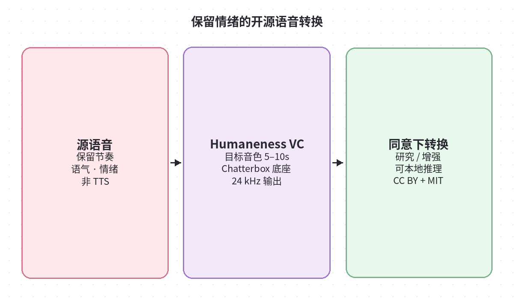
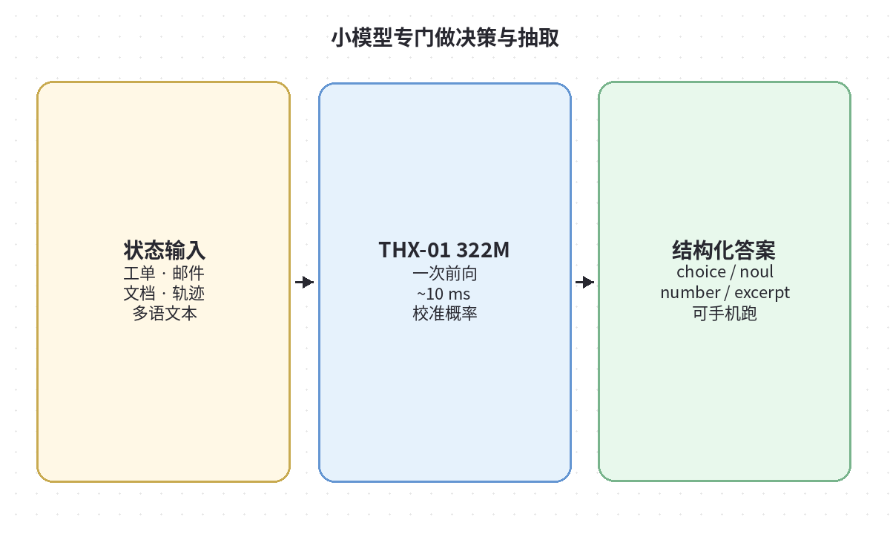
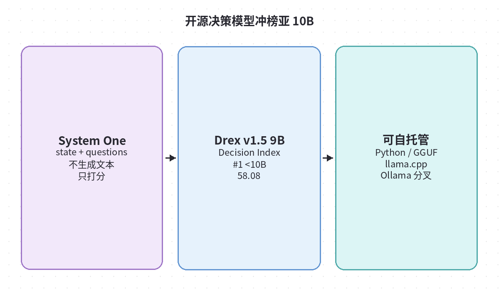
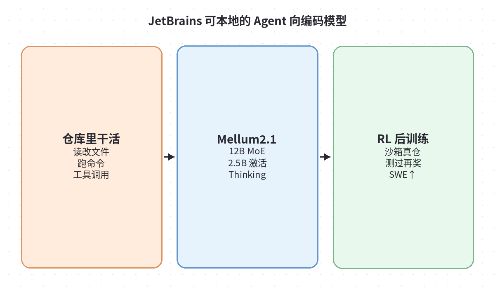

# 2026-10-12 Hugging Face 日报

今日精选 4 个可验证跟进的模型（语音转换 / 决策 / 编码 Agent）。与当日周报条目不重复。

## 1. laion/Humaneness-Voice-Converter — 保留情绪的开源语音转换

**介绍**  
LAION 于 10/11 上线的 Chatterbox 系语音转换完整权重：源录音 → 另一位**已同意**说话人的音色，尽量保留节奏、重音与情绪；音频到音频，不是 TTS。自带 `infer.py`、Ears Medium 条件分与 Demo Space；LAION 增量为 CC BY 4.0，上游 Chatterbox 仍为 MIT。

**用法**  
模型卡：[huggingface.co/laion/Humaneness-Voice-Converter](https://huggingface.co/laion/Humaneness-Voice-Converter)。`hf download …` 后按卡内命令装 CUDA Torch + chatterbox，再跑 `infer.py --source … --target …`（目标建议 5–10 秒干净单说话人）。可加 `--candidates` 做 Best-of-N。

**应用场景**  
有授权的配音/数据增强实验、需要「换音色但别抹掉表演」的研究对照；**禁止**用于冒充与欺诈。

**推荐学习程度**：进阶

---

## 2. doofz/THX-01 — 322M 校准决策 + 文档抽取小模型

**介绍**  
HAL-X AI 开源的非自回归决策模型（约 322M）：对状态（工单/邮件/文档/agent 轨迹）一次前向回答多个 typed 问题（choice / noul / score / number / excerpt + cite），约 10 ms/请求级延迟，强调校准概率与多语（含阿塞拜疆语侧重）。Apache-2.0；有 `pip install thx01` 与免费托管 API。

**用法**  
模型：[huggingface.co/doofz/THX-01](https://huggingface.co/doofz/THX-01) · 博文：[huggingface.co/blog/doofz/…](https://huggingface.co/blog/doofz/thx-01-we-open-sourced-a-322m-decision-model-that) · Demo：[spaces/doofz/THX-01-demo](https://huggingface.co/spaces/doofz/THX-01-demo)。`import thx01; agent = thx01.load("doofz/THX-01")` 后 `agent.decide(state, questions)`。

**应用场景**  
路由/工单分诊、发票数字与摘录抽取、要把高置信自动处理、低置信升级大模型的生产流水线。

**推荐学习程度**：进阶

---

## 3. nace-ai/drex-v1.5 — Decision Index 亚 10B 开源决策模型

**介绍**  
Nace.AI 的 System One 决策模型（约 9B）：读 state + typed questions，一次前向给各选项概率，**不生成文本**。公开板 Decision Index 0.3.1 上亚 10B 成绩 58.08（领先档）。自带 Python serve、`llama.cpp`/`Ollama` 分叉与 agent skill；RAIL-M 许可，Kev 代码 Apache-2.0。

**用法**  
模型：[huggingface.co/nace-ai/drex-v1.5](https://huggingface.co/nace-ai/drex-v1.5)。`hf download` 后 `python inference.py` / `serve.py` 调 `POST /v1/systemone`；或按卡内说明转 GGUF。Coding agent 可用 Drex skill（Claude plugin / 各 harness 链 `skills/drex`）。

**应用场景**  
要自托管「打分器」而不是再套一层 LLM 分类、或与 TypeSafe/Jev 系客户端兼容的路由与长文档决策。

**推荐学习程度**：深度

---

## 4. JetBrains/Mellum2.1-12B-A2.5B-Thinking — 仓库级 Agent 向 Thinking 模型

**介绍**  
JetBrains Mellum2.1 Thinking：12B MoE（约 2.5B 激活）、131K 上下文，面向复杂仓库任务与工具调用。本版把 RL 做成主训练段，并在真实仓库+shell 环境里用测试通过发奖；自报 SWE-bench Verified 等相对 Mellum2 大幅跃升。Apache-2.0；可用 vLLM（含 tool calling）服务。

**用法**  
模型：[huggingface.co/JetBrains/Mellum2.1-12B-A2.5B-Thinking](https://huggingface.co/JetBrains/Mellum2.1-12B-A2.5B-Thinking)。`vllm serve JetBrains/Mellum2.1-12B-A2.5B-Thinking --reasoning-parser qwen3`（工具调用再加 hermes parser）。GGUF/MTP 卡内标注即将提供。

**应用场景**  
要本地/私有化跑「会改仓库、会跑命令」的 coding agent 骨干，或评测开源 agentic 编码模型时的对照基线。

**推荐学习程度**：深度
