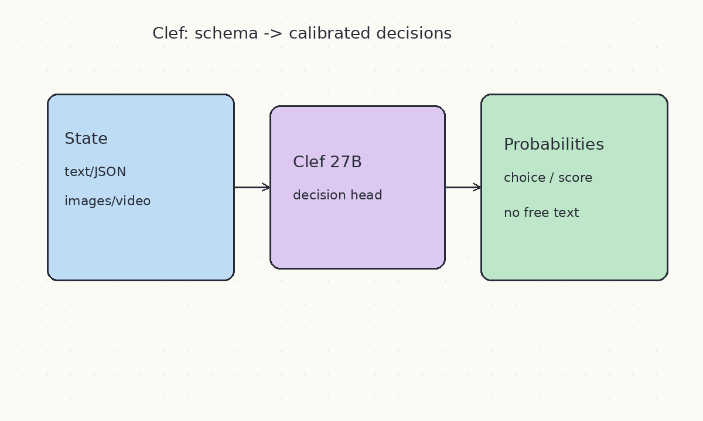
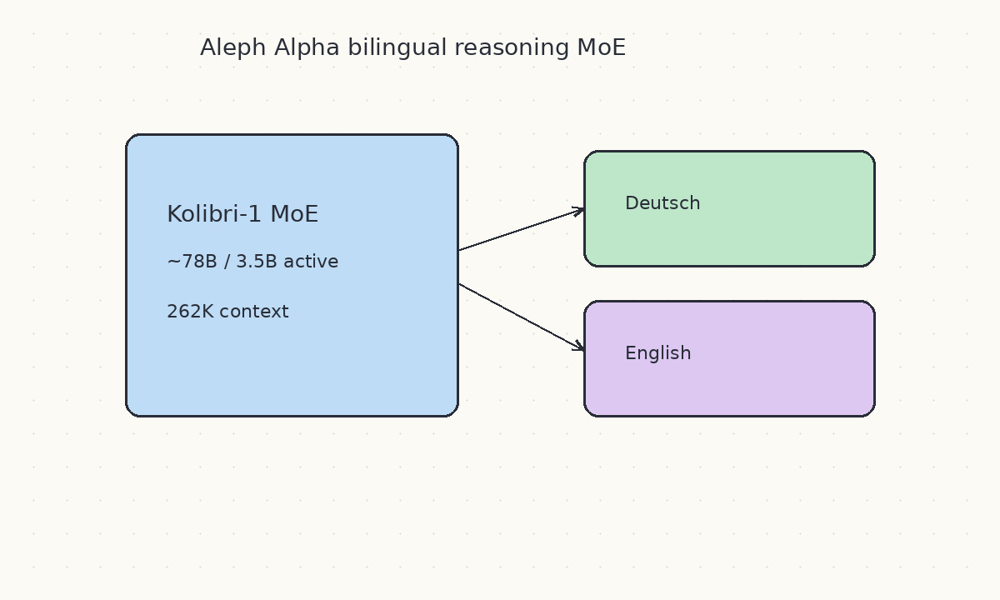
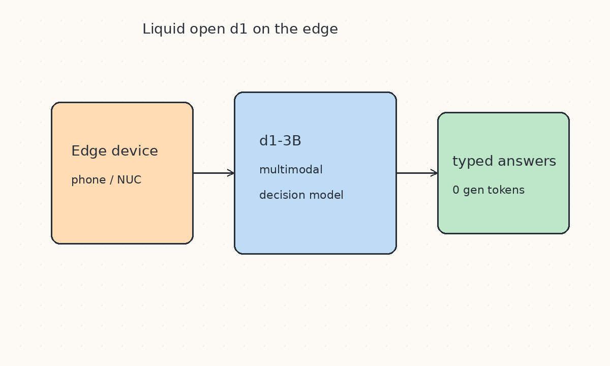
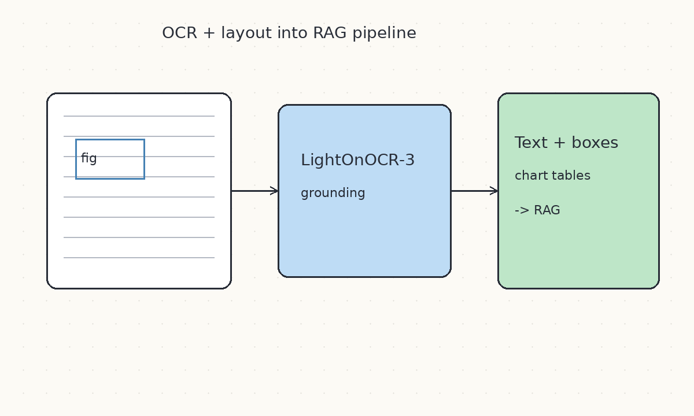
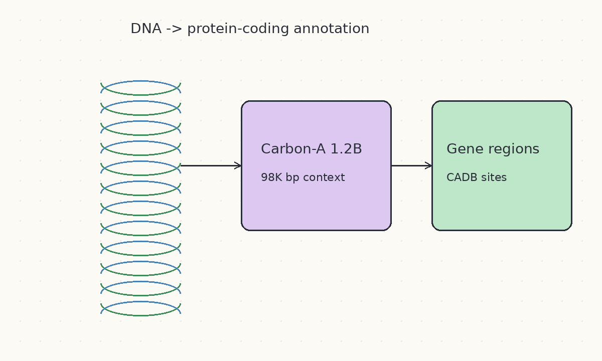
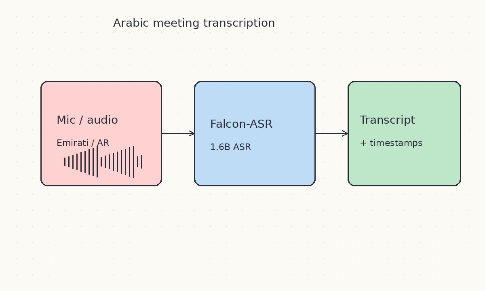
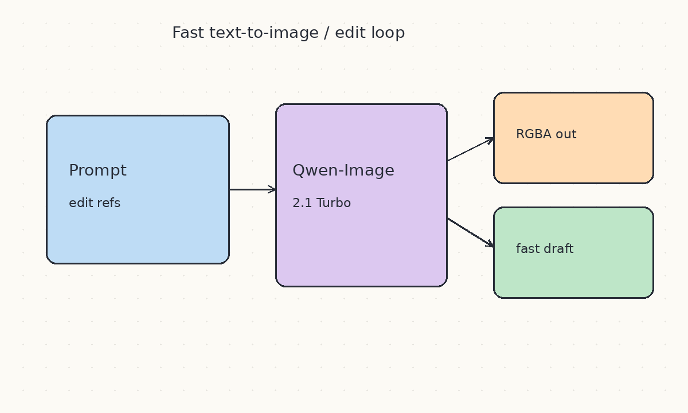
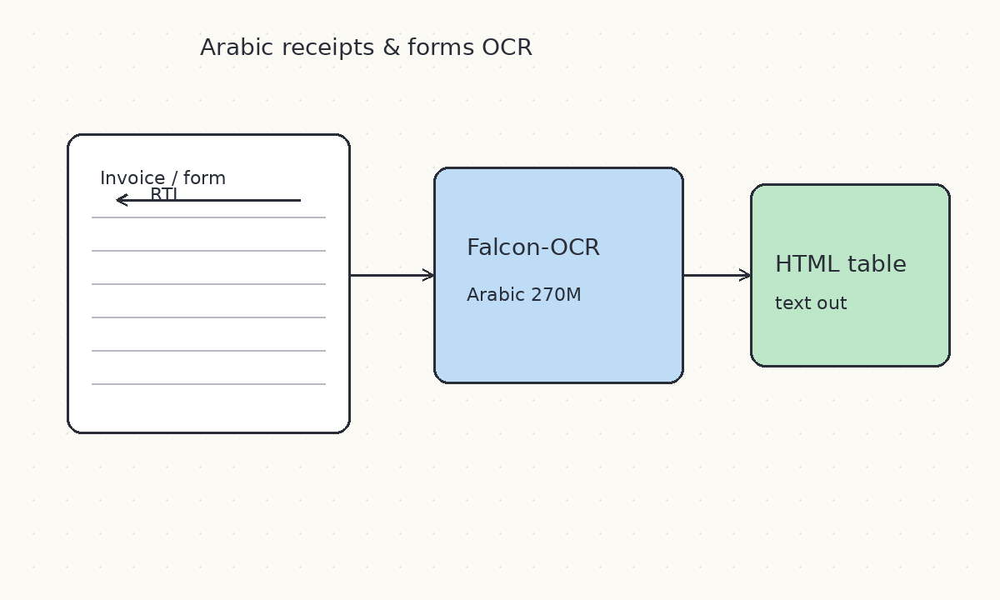
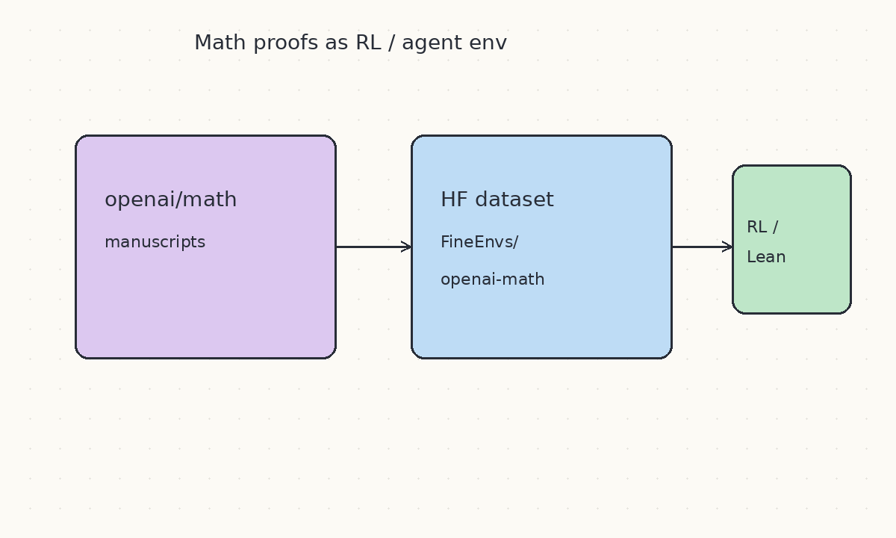
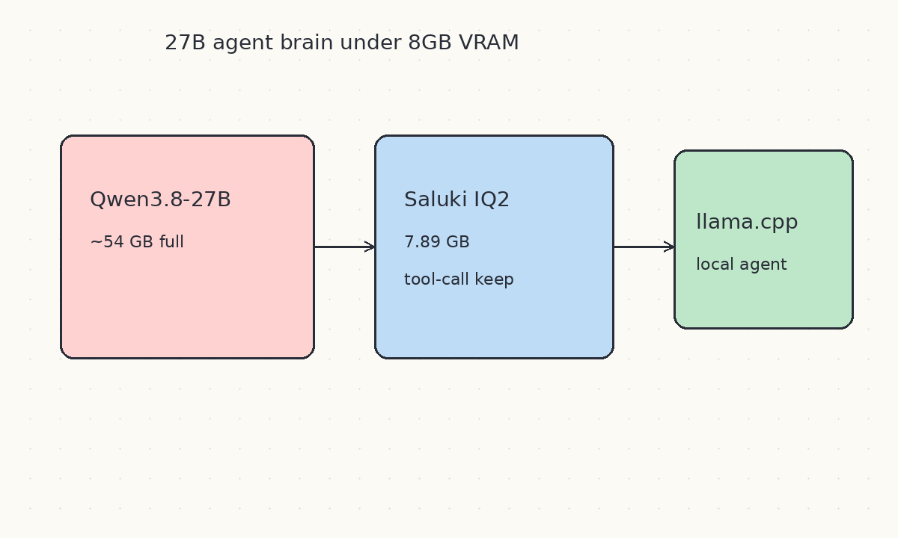

# 2026-10-12 Hugging Face 周报

上周（10/5–10/11）精选 10 个值得立刻试的模型 / 数据集 / 发布（宁缺毋滥，覆盖决策模型、OCR、生物、语音与本地量化）。

## 1. Cloudflare/clef — 输出概率而非文本的 27B 决策模型

**介绍**  
Cloudflare 的多模态决策模型：输入状态（文本/JSON/图像/视频）+ 类型化问题 schema，一次前向给出每个选项的概率，不生成自由文本。基于 Qwen3.8-27B 后训练，Apache-2.0。10/5 当周 HF trending 快照上冲到第 1，同族还有更快的 [clef-flash](https://huggingface.co/Cloudflare/clef-flash)（9B）。

**用法**  
模型：[Cloudflare/clef](https://huggingface.co/Cloudflare/clef) · Flash：[Cloudflare/clef-flash](https://huggingface.co/Cloudflare/clef-flash)  
`snapshot_download` 后用仓库内 `joint_schema_model.load_release_model`；也可用 SGLang `sglang serve --model-path Cloudflare/clef`，走 `/v1/systemone`（Jev 兼容）。

**应用场景**  
客服分诊、发票/工单路由、需要校准置信度的 agent 决策头、替代「让 LLM 吐 JSON 再解析」。



**推荐学习程度**：进阶

---

## 2. Aleph-Alpha/Kolibri-1 — 德英双语 MoE 推理模型

**介绍**  
Aleph Alpha（德国）约 10/2–10/3 放出：约 78B 总参、约 3.46B 每 token 激活，原生 262K 上下文（宣称可验至约 1M），带推理模式与工具调用，Apache-2.0。10/5 当周 trending 快照进入 Top 5，是欧洲开源权重里少见的「一周冲榜」信号。

**用法**  
模型：[Aleph-Alpha/Kolibri-1](https://huggingface.co/Aleph-Alpha/Kolibri-1)  
按模型卡用 aleph-alpha-inference / vLLM 部署；优先用德英长上下文与工具调用场景做对照评测。

**应用场景**  
德英双语客服/法务草稿、长文档推理、欧洲合规场景下的自托管 MoE。



**推荐学习程度**：进阶

---

## 3. LiquidAI/d1-3B — 边缘侧开放决策模型

**介绍**  
Liquid AI 约 10/5–10/7 开源的约 3.1B 多模态决策模型：吃文本/JSON/图像，一次前向给出类型化答案、不生成输出 token，32K 上下文，面向边缘部署。与 Cloudflare Clef 同属「决策模型」浪潮，但体量适合端侧。

**用法**  
模型：[LiquidAI/d1-3B](https://huggingface.co/LiquidAI/d1-3B) · 博文：[Open d1](https://huggingface.co/blog/LiquidAI/open-d1)  
`AutoModel.from_pretrained("LiquidAI/d1-3B", trust_remote_code=True)`；细节见模型卡与 [liquid.ai 博客](https://www.liquid.ai/blog/d1-open)。

**应用场景**  
手机/工控机上的分诊与质检、低延迟路由、离线多模态「是/否/多选」决策。



**推荐学习程度**：进阶

---

## 4. LightOnOCR-3 — 轻量 OCR + 版面 Grounding 一体

**介绍**  
LightOn 于 10/8 发布的 OCR 家族（0.8B / 1B / 4B，Apache 2.0）：空 prompt 做转写；`grounding` 模式额外输出带标签的框、图注与图表数据表。小参数量在 olmOCR / ParseBench 上接近甚至超过更大模型。

**用法**  
模型：[0.8B](https://huggingface.co/lightonai/LightOnOCR-3-0.8B) · [1B](https://huggingface.co/lightonai/LightOnOCR-3-1B) · [4B](https://huggingface.co/lightonai/LightOnOCR-3-4B)  
Demo：[LightOnOCR-3-Demo](https://huggingface.co/spaces/lightonai/LightOnOCR-3-Demo) · 博文：[LightOnOCR-3](https://huggingface.co/blog/lightonai/lightonocr-3)  
本地用 transformers/vLLM 加载后，先空 prompt 再发 `grounding`。

**应用场景**  
RAG 前文档解析、扫描件/多栏 PDF、需要框选区域或抽图表数值。



**推荐学习程度**：进阶

---

## 5. Carbon-A-1.2B — 跨物种 DNA 基因区预测 + CADB

**介绍**  
HuggingFaceBio 10/8 发布：1.2B 参数、约 98K bp 上下文，直接从 DNA 预测蛋白编码区（双链、核苷酸分辨率），并在 GenBank 规模跑出 Carbon Annotation Database（约 566M 候选位点）。

**用法**  
模型：[HuggingFaceBio/Carbon-A-1.2B](https://huggingface.co/HuggingFaceBio/Carbon-A-1.2B)  
Space：[CADB Explorer](https://huggingface.co/spaces/HuggingFaceBio/genbank-annotation-explorer)  
博文：[Carbon-A](https://huggingface.co/blog/HuggingFaceBio/carbon-annotator-genbank-genome-annotation)  
先在 Space 翻已有注释；自有组装再按模型卡推理并用置信度过滤。

**应用场景**  
非模式生物基因组注释、补 RefSeq 缺口、CADB 下游蛋白挖掘。



**推荐学习程度**：深度

---

## 6. Falcon-ASR — 阿语（含阿联酋方言）优先的多语 ASR

**介绍**  
TII 10/7 介绍的 1.6B 语音识别：强调阿拉伯语（尤其 Emirati），同权重也支持英/法/西/葡，带词级时间戳；公开评测上阿语平均 WER 优于当时榜单快照头部结果。当前最稳妥上手方式是官方 Demo Space。

**用法**  
Space：[tiiuae/falcon-asr-demo](https://huggingface.co/spaces/tiiuae/falcon-asr-demo)  
博文：[Introducing Falcon ASR](https://huggingface.co/blog/tiiuae/falcon-asr)  
上传或录制音频即可转写；对比方言口语与电话场景。API / 原生应用仍在规划。

**应用场景**  
阿语/海湾方言会议纪要、多语客服质检、需要词级对齐的字幕与检索。



**推荐学习程度**：入门

---

## 7. Qwen/Qwen-Image-2.1-Turbo — 更快的官方文生图 / 编辑线

**介绍**  
Qwen 于 10/9 前后上线的 Image 2.1 Turbo：官方文生图与图像编辑线的加速变体，承接 2.1 的透明通道与多参考编辑能力，适合迭代草稿。当周 Hub 上与社区 GGUF 包一起占据 trending 注意力。

**用法**  
模型：[Qwen/Qwen-Image-2.1-Turbo](https://huggingface.co/Qwen/Qwen-Image-2.1-Turbo) · 官方主线亦可对照 [Qwen/Qwen-Image-2.1](https://huggingface.co/Qwen/Qwen-Image-2.1)  
按模型卡用 Diffusers / 官方推理脚本；注意 Qwen Research License。

**应用场景**  
产品视觉快速出图、多参考编辑、需要 RGBA 透明素材的 UI/营销图。



**推荐学习程度**：入门

---

## 8. Falcon-OCR-Arabic — 270M 参数阿语文档 OCR

**介绍**  
TII 10/6 发布：在 Falcon OCR 早期融合架构上做阿语 SFT + RL，270M 参数，在自建阿语文档基准上文本准确率约 81.9%（仅次于 Gemini 3.5 Flash），Table TEDS 领先对比组。强项是官方文档、表格、收据发票；报纸/漫画等密集版面仍有差距。

**用法**  
博文：[Falcon OCR Arabic](https://huggingface.co/blog/tiiuae/falcon-ocr-arabic) · 基座：[tiiuae/Falcon-OCR](https://huggingface.co/tiiuae/Falcon-OCR)  
优先用博文中的 playground 试自家单据；阿语适配权重是否完整开源请以模型卡/社区更新为准（截至博文评论区仍有「权重何时放出」讨论）。

**应用场景**  
阿语收据/发票/行政表单数字化、RTL 表格抽取、边缘侧阿语 OCR。



**推荐学习程度**：进阶

---

## 9. FineEnvs/openai-math — openai/math 对应的 HF 环境/数据集包装

**介绍**  
10/8 上线：把 OpenAI 公开的数学手稿/证明相关材料包装成可被 Harbor 等框架消费的数据集/环境条目，标签覆盖 theorem-proving、Lean4、code-agent、RL。适合与 GitHub `openai/math` 对照，做 agent 或 RL 流水线接入。

**用法**  
数据集：[FineEnvs/openai-math](https://huggingface.co/datasets/FineEnvs/openai-math)  
上游手稿库：[openai/math](https://github.com/openai/math)  
用 `datasets` / Harbor 加载后按任务切片；形式化子集对齐上游 `lean/`。

**应用场景**  
定理证明 agent 训练/评测、Lean 相关 RL、复现「模型数学」实验协议。



**推荐学习程度**：深度

---

## 10. ConwayResearch/Underdog-Saluki-27B-1.0 — 7.89GB 仍保工具调用的 Qwen3.8-27B

**介绍**  
10/8 发布的 IQ2 量化包：把 Qwen3.8-27B 压到约 7.89GB，宣称在自建 Underdog Bench 上工具调用分甚至高于全量，并行工具调用与平均保留率表现亮眼。面向「笔记本也能跑 27B agent」的本地玩家。

**用法**  
模型：[ConwayResearch/Underdog-Saluki-27B-1.0](https://huggingface.co/ConwayResearch/Underdog-Saluki-27B-1.0)  
```bash
huggingface-cli download ConwayResearch/Underdog-Saluki-27B-1.0 Underdog-Saluki-27B-1.0-IQ2-mix.gguf --local-dir .
llama-server -m Underdog-Saluki-27B-1.0-IQ2-mix.gguf --jinja -ngl 99 -fa on -c 32768
```
可选下载 `mmproj-*.gguf` 开视觉。

**应用场景**  
本地 coding/agent 网关、低显存机器上的工具调用实验、离线演示。



**推荐学习程度**：进阶
