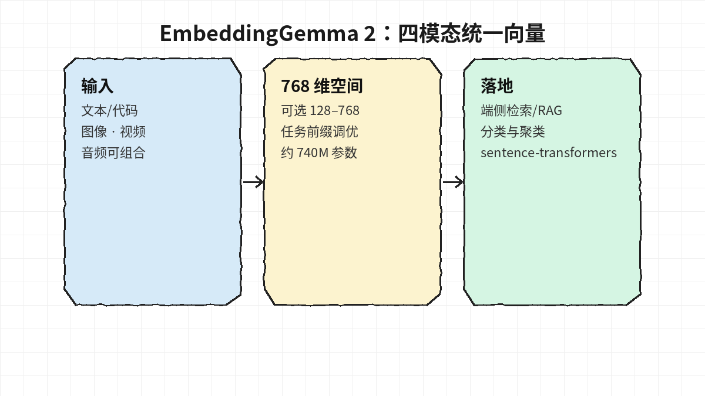
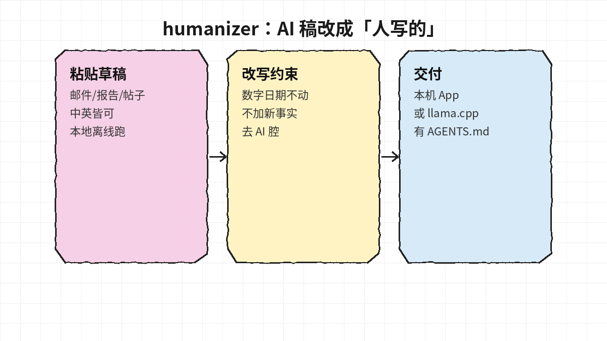
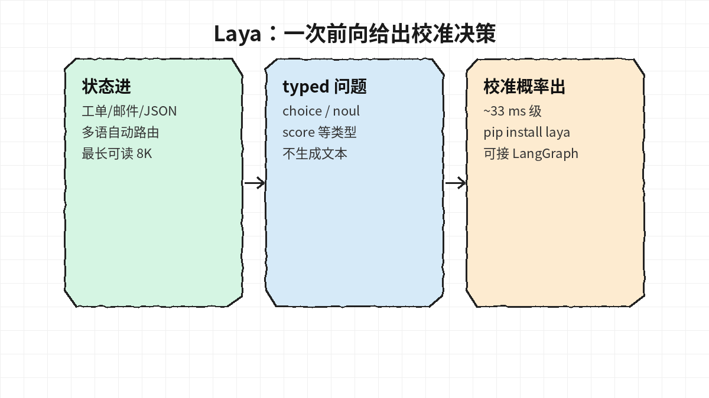
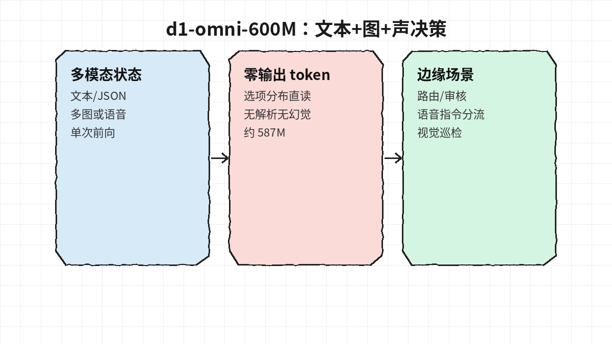

# 2026-10-13 Hugging Face 日报

今日精选 4 个可验证跟进的模型（多模态嵌入 / 去 AI 腔改写 / 决策小模型）。与黑名单及往日日报不重复。

## 1. google/embeddinggemma-2 — 文本/图/视/音统一进 768 维

**介绍**  
Google DeepMind 开源多模态嵌入：约 740M（270M 文本骨干 + 可选 170M 视觉 / 300M 音频编码器），文本（含代码）、图像、视频、音频及组合映射到同一 768 维空间；支持 MRL 截到 128/256/512；8K 上下文；100+ 语。Apache-2.0；近期 HF 趋势前列。

**用法**  
模型卡：[huggingface.co/google/embeddinggemma-2](https://huggingface.co/google/embeddinggemma-2)。`pip install -U sentence-transformers transformers` 后：

```python
from sentence_transformers import SentenceTransformer
model = SentenceTransformer("google/embeddinggemma-2")
q = model.encode("What causes the northern lights?", prompt_name="SearchQuery")
d = model.encode("…", prompt_name="Document")
print(model.similarity(q, d))
```

检索/问答等请用卡内任务前缀；不用的模态可用 `config_kwargs` 关掉以省内存。

**应用场景**  
端侧或多模态 RAG、跨图文音检索、分类/聚类要统一向量空间时。



**推荐学习程度**：进阶

---

## 2. jialinyyzz/humanizer — 本地把 AI 草稿改写成「人写的」

**介绍**  
基于 Gemma 4 12B 的改写模型（中英）：邮件、报告、论坛帖等，训练目标是**数字/日期/人名/引用不动、不加新事实**，去掉 AI 腔。附 Mac/Windows 本机 App、多档 GGUF（含量化感知训练的小文件），卡内报 Originality.ai 严苛设定下约 95% 判为人写。Apache-2.0。

**用法**  
模型：[huggingface.co/jialinyyzz/humanizer](https://huggingface.co/jialinyyzz/humanizer) · GGUF：[jialinyyzz/humanizer-GGUF](https://huggingface.co/jialinyyzz/humanizer-GGUF) · 代码：[github.com/sgaofen/humanizer-local-model](https://github.com/sgaofen/humanizer-local-model)。下 App 粘贴即用；或按 `USAGE.md` / `AGENTS.md` 用 llama.cpp 起服务，把路径交给 coding agent。

**应用场景**  
工作邮件/对内文档要降 AI 味又怕改坏事实；适合本机离线改写流水线。



**推荐学习程度**：入门

---

## 3. convaiinnovations/laya — 多语 System-1 校准决策（不生成文本）

**介绍**  
非自回归决策模型：状态（文本/邮件/工单/JSON）+ typed 问题 → 一次前向给出校准概率（choice / noul / score 等），约 33 ms 量级；脚本检测后可走 100+ 语种 checkpoint，长文可 `max_len=8192`。`pip install laya`；可选 serve / MCP / LangChain。Apache-2.0。

**用法**  
模型：[huggingface.co/convaiinnovations/laya](https://huggingface.co/convaiinnovations/laya)。

```python
from laya import Router
router = Router()
result = router.predict(state, questions)  # questions 为 typed schema
print(result["answers"]["department"]["choice"])
```

也可用 `laya.load("convaiinnovations/laya")` 直载；文档见 [nandhakishorm.github.io/laya](https://nandhakishorm.github.io/laya/)。

**应用场景**  
工单分诊、意图路由、要校准置信度再决定是否升级大模型的流水线（与已推的 THX/Drex 同族思路、另一套权重与 SDK）。



**推荐学习程度**：进阶

---

## 4. LiquidAI/d1-omni-600M — 文本 + 图像 + 语音的边缘决策模型

**介绍**  
Liquid 开源 d1 族实验款（约 587M）：状态可含文本/JSON、多图或最长约 30 s 语音，对命名问题一次前向读选项分布，**零生成 token**。与黑名单中的 d1-3B 不同，本卡侧重 vision+audio；LFM1.0 许可。博文：[liquid.ai open-d1](https://www.liquid.ai/blog/open-d1) / [HF blog](https://huggingface.co/blog/LiquidAI/open-d1)。

**用法**  
模型：[huggingface.co/LiquidAI/d1-omni-600M](https://huggingface.co/LiquidAI/d1-omni-600M)。`pip install "transformers>=5.15" torch torchvision pillow soundfile`，`AutoModel.from_pretrained(..., trust_remote_code=True)` 后调用 `model.system_one(state, questions, images=…, audio=…)`（卡内有文本/图/声完整示例）。

**应用场景**  
端侧/边缘要「看图或听短语音就做分流/审核/巡检」，又不想再套一层生成式 LLM 解析答案时。



**推荐学习程度**：深度
