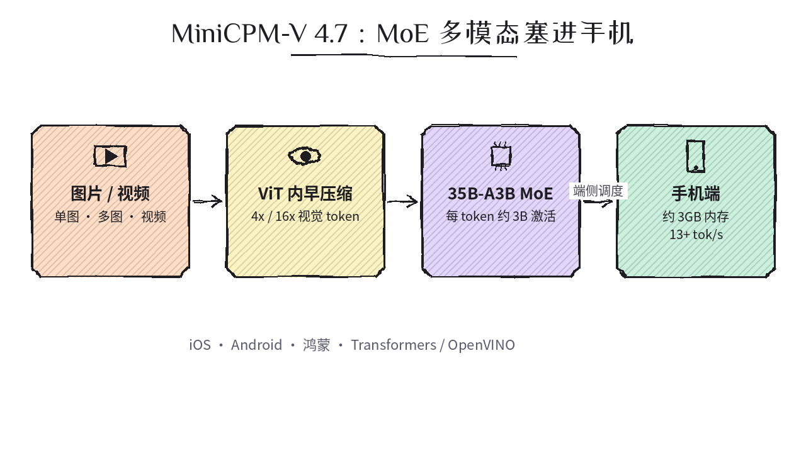
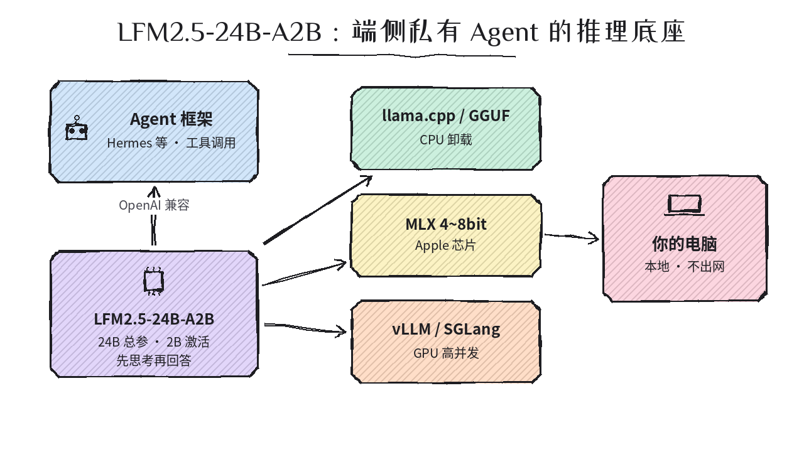
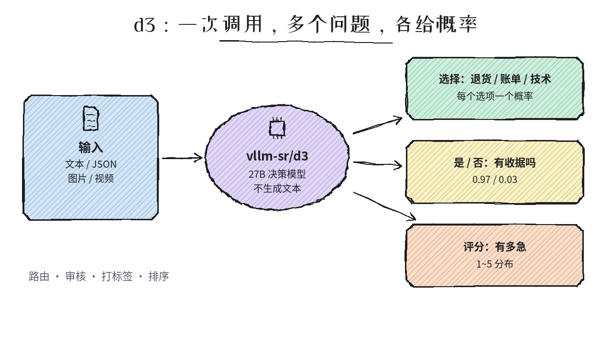
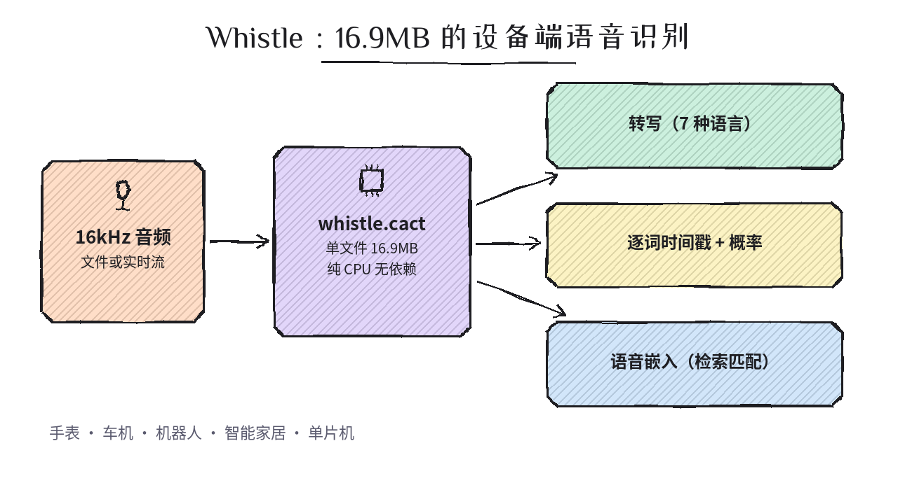

# 2026-10-14 Hugging Face 日报

今日精选 4 个可验证跟进的模型（端侧多模态 MoE / 端侧 Agent 推理 / 多模态决策 / 超小语音识别）。与黑名单及往日日报不重复。

## 1. openbmb/MiniCPM-V-4.7-35B-A3B — 系列首个 MoE，多模态大模型塞进手机

**介绍**  
面壁 OpenBMB 10/07 发布的 MiniCPM-V 4.7：35B 总参、约 3B 激活的 MoE，单图/多图/视频理解；在 ViT 内部做早期视觉 token 压缩（支持 4x/16x 混合），配合 Lookahead Expert Scheduling 与分层量化，官方称 iPhone 17 Pro Max 上约 3GB 内存可跑 13+ tok/s。支持 iOS / Android / 鸿蒙，Rockchip、Intel、AMD、Arm 等 day-0。Apache-2.0；同系列另有 [MiniCPM-V-4.7-1B](https://huggingface.co/openbmb/MiniCPM-V-4.7-1B)。

**用法**  
模型卡：[huggingface.co/openbmb/MiniCPM-V-4.7-35B-A3B](https://huggingface.co/openbmb/MiniCPM-V-4.7-35B-A3B)。`pip install "transformers[torch]>=5.18.0" torchvision torchcodec`（CUDA 12.x 遇 torchcodec 报错可换 `av`），然后 `AutoProcessor.from_pretrained` + `AutoModelForImageTextToText.from_pretrained("openbmb/MiniCPM-V-4.7-35B-A3B", torch_dtype="auto", device_map="auto")`。端侧 App 源码见 [MiniCPM-V-Apps](https://github.com/OpenBMB/MiniCPM-V-Apps)，微调/量化见 [Cookbook](https://github.com/OpenSQZ/MiniCPM-V-CookBook)。

**应用场景**  
离线拍照问答、文档/票据 OCR、手机端视频理解；想在端侧做多模态又不想退回到小而弱的 dense 模型。

**推荐学习程度**：进阶

---

## 2. LiquidAI/LFM2.5-24B-A2B — 24B 总参、2B 激活的端侧 Agent 推理模型

**介绍**  
Liquid AI 10/12 发布，LFM2.5 家族最大也是最后一款：24B 总参 / 约 2.45B 激活，纯文本、先思考后回答，主打工具调用与 agent 任务（官方 LiveClaw 48.09 vs Qwen3.6-35B-A3B 38.19）；llama.cpp Q4_K_M 下 Apple M5 Max 约 184 tok/s。同步放出 Base、GGUF、MLX（4~8bit）、ONNX、FP8 版本。多语言含中文。许可为 LFM Open License v1.0（`lfm1.0`，商用前请看条款）。

**用法**  
模型卡：[huggingface.co/LiquidAI/LFM2.5-24B-A2B](https://huggingface.co/LiquidAI/LFM2.5-24B-A2B)。Transformers ≥ 5.0：`AutoModelForCausalLM.from_pretrained("LiquidAI/LFM2.5-24B-A2B", device_map="auto", dtype="bfloat16")`。本地跑：用 [LFM2.5-24B-A2B-GGUF](https://huggingface.co/LiquidAI/LFM2.5-24B-A2B-GGUF) 配 llama.cpp / LM Studio，或 Mac 上用 MLX 版本；起 OpenAI 兼容服务后接 Hermes 等 agent 框架（见官方 [Agent Harnesses 指南](https://docs.liquid.ai/examples/agent-harnesses)）。

**应用场景**  
想在笔记本上跑「私有、不出网」的个人 agent / 编码助手，需要可靠工具调用又受限于显存与速度。

**推荐学习程度**：进阶

---

## 3. vllm-sr/d3 — vLLM Semantic Router 的多模态决策模型：只给概率，不生成文本

**介绍**  
10/10 发布的 Decision 3.0 基座（26B，基于 Qwen3.8-27B，Apache-2.0）：输入文本/JSON，可附多张图和多段视频，一次调用回答多个问题——**选择题、是/否、打分**——每个选项都返回概率而非生成文字。官方称在 Jev Decision Index 0.3.2 文本榜 66.3 居首；文本请求中位延迟约 54ms（MI325X）。与此前推过的 clef / d1 / laya 同属「决策模型」赛道，这是目前分数最高且能看图看视频的一款。

**用法**  
模型卡：[huggingface.co/vllm-sr/d3](https://huggingface.co/vllm-sr/d3)。`pip install "transformers==5.17.0" torch torchvision pillow opencv-python-headless safetensors accelerate`，`AutoModel.from_pretrained("vllm-sr/d3", trust_remote_code=True)` 后调用 `model.system_one(state=..., questions={...})`（type 取 choice / noul / score）。服务化：`curl -fsSL https://vllm-sr.ai/install.sh | bash -s -- --channel dev --no-launch` → `vllm-sr serve -e vllm-sr/d3`。

**应用场景**  
客服工单路由、内容审核、打标签与排序、Agent 路由里的「该走哪条」判断，要可校准的置信度而不是一段解释。

**推荐学习程度**：深度

---

## 4. Cactus-Compute/whistle — 16.9MB 单文件的设备端语音识别

**介绍**  
Cactus Compute 的 ASR 模型（9/30 上架，近日冲上趋势）：整个模型一个 16.9MB 的 `.cact` 文件，纯 CPU、无依赖、无需 GPU；转写英/德/法/西/意/荷/波 7 种语言（可自动识别、静音返回空而非编造），支持实时流式、逐词时间戳与概率、语音嵌入，以及关键词偏置（让人名、地名、产品词更准）。与 Needle 共用同一推理引擎。Apache-2.0。暂不支持中文。

**用法**  
模型卡：[huggingface.co/Cactus-Compute/whistle](https://huggingface.co/Cactus-Compute/whistle)；引擎与各平台二进制在 [Cactus-Compute/needle3](https://huggingface.co/Cactus-Compute/needle3)。先 `pip install cactus-needle`（needle3 卡片给出的 Python 包），再按 whistle 卡片：`needle download macos-arm64 && needle download whistle`，然后 `./macos-arm64/needle --model whistle.cact --audio clip.wav --audio-word-timestamps`；实时流加 `--audio-stream`。C API 见 `needle.h`。

**应用场景**  
手表、车机、机器人、智能家居、单片机等离线语音输入；需要逐词时间戳做字幕/剪辑定位的轻量应用。

**推荐学习程度**：进阶
