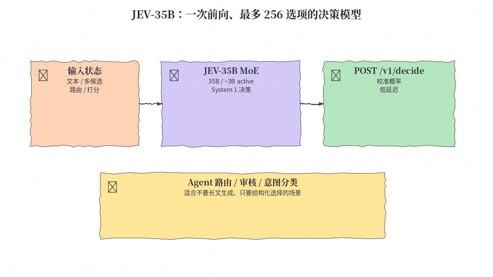
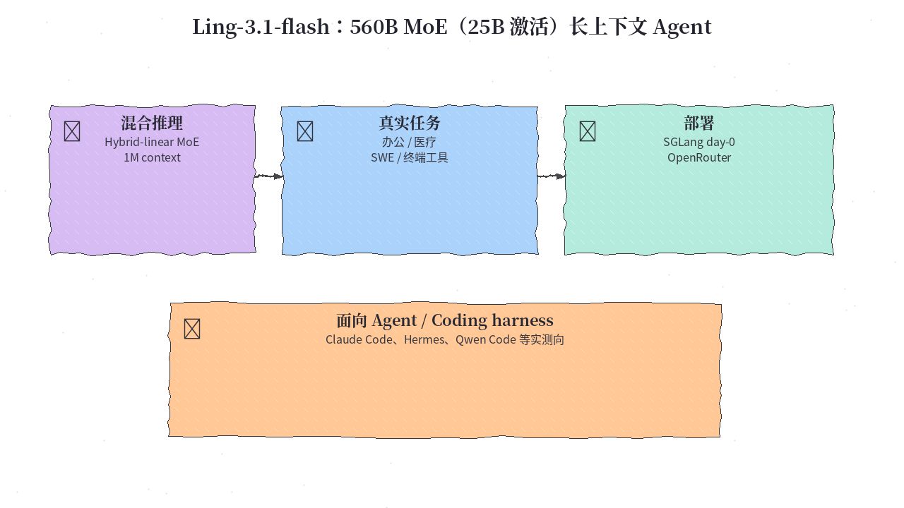
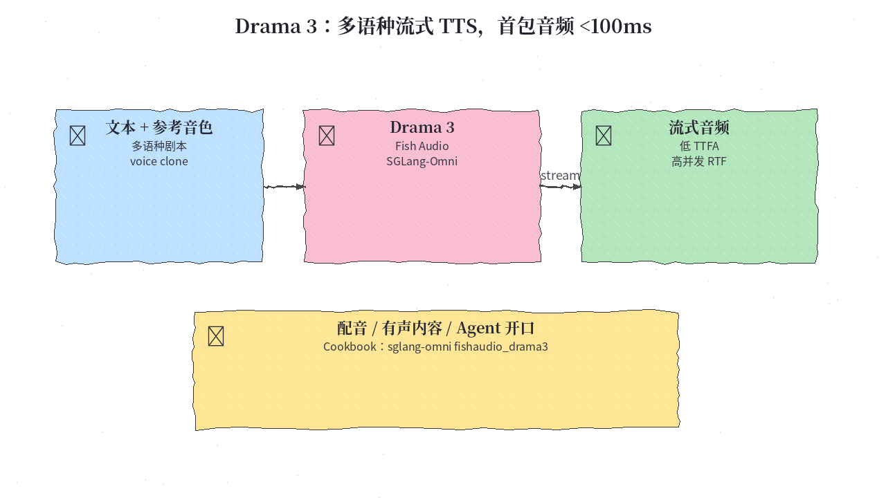
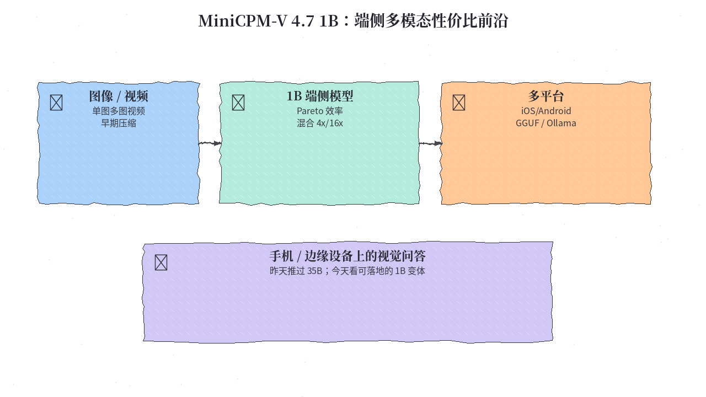
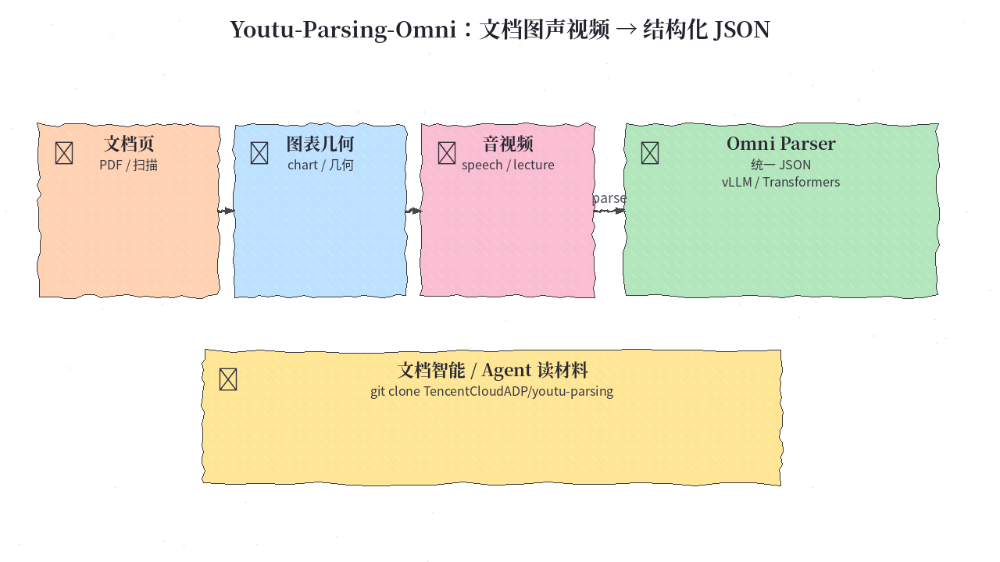

# 2026-10-15 Hugging Face 日报

今日精选 5 个近期可动手试的模型（决策 MoE / 长上下文 Agent 基座 / 流式 TTS / 端侧 1B 多模态 / 文档音视频统一解析）。避开已在日报与 10/12 周报写过的条目。

## 1. autotrust/JEV-35B — 一次前向、最多 256 选项的 System 1 决策模型

**介绍**  
10/11 上线（Apache-2.0，热度高）：基于 Qwen3.5-35B-A3B 的决策模型（约 3B 激活），面向路由、审核、意图、打分等「选一个答案」场景，而不是写长文。宣称 Decision Index 与公开视觉重建分数相对 JEV-27B-VL 有提升；提供 `POST /v1/decide` 与同系列 NVFP4（更省显存）。不要当聊天模型用。

**用法**  
模型卡：[huggingface.co/autotrust/JEV-35B](https://huggingface.co/autotrust/JEV-35B)；量化：[autotrust/JEV-35B-NVFP4](https://huggingface.co/autotrust/JEV-35B-NVFP4)。按模型卡用仓库自带 `serve.sh` / 决策 API；推理时保持决策头与校准温度设定（见卡内说明），勿当普通 `generate` 聊天接口滥用。

**应用场景**  
Agent 流水线里需要低延迟、结构化多选一（工具路由、内容审核、候选排序），不想为每个决策烧完整生成。



**推荐学习程度**：进阶

---

## 2. inclusionAI/Ling-3.1-flash — 560B MoE（25B 激活）、1M 上下文的混合推理 Agent 基座

**介绍**  
10/13 发布（MIT）：Ling-3.0-flash 升级版，Hybrid-linear MoE，总参 560B、每 token 激活约 25B，上下文到 **1M**。偏真实任务与 agentic 能力（办公、医疗、SWE、终端工具等），评测提到 Terminal-Bench、FrontierSWE、GDPVal 等。配套强调 SGLang day-0（含 MTP 投机解码），也可经 OpenRouter / ModelScope 试用。体量大，适合有多卡或云端额度的团队。

**用法**  
模型卡：[huggingface.co/inclusionAI/Ling-3.1-flash](https://huggingface.co/inclusionAI/Ling-3.1-flash)。推荐：  
```bash
docker pull lmsysorg/sglang:dev-ling-3.1-flash
docker run --gpus all --network host --ipc=host --rm \
  lmsysorg/sglang:dev-ling-3.1-flash \
  python3 -m sglang.launch_server \
    --model-path inclusionAI/Ling-3.1-flash \
    --tp 8 --ep 8 --speculative-algorithm NEXTN \
    --host 0.0.0.0 --port 30000
```
（卡内示例为 8×H200；更少卡需改 `--tp/--ep`。）在线入口见卡内 OpenRouter / ModelScope 链接。

**应用场景**  
要跑长程 coding / 办公 agent、需要超长上下文与工具调用，且有对应推理集群。



**推荐学习程度**：深度

---

## 3. fishaudio/drama-3 — 多语种流式 TTS：首包音频可到百毫秒级

**介绍**  
10/1 前后放出的 Fish Audio **Drama 3**（多语种 text-to-speech）：面向剧本/旁白类长文本与音色克隆，强调流式与高并发（卡内 H200 数字：单流 TTFA 可 <100ms，较高并发下 RTF 仍可 <1）。官方推荐经 **SGLang-Omni** 部署；有独立 Cookbook。适合做配音流水线或让 agent「开口」，而不是又一个通用 LLM。

**用法**  
模型卡：[huggingface.co/fishaudio/drama-3](https://huggingface.co/fishaudio/drama-3)；部署教程：[Drama 3 Cookbook](https://sgl-project.github.io/sglang-omni/cookbook/fishaudio_drama3.html)。按 Cookbook 安装 SGLang-Omni 的 fishaudio 扩展后拉起服务，再走流式 API（卡内给出并发与采样建议：`temperature`/`top_p`/`top_k` 等）。

**应用场景**  
产品内嵌语音播报、多语种有声内容、agent 口头汇报——需要低首包延迟与可克隆音色。



**推荐学习程度**：进阶

---

## 4. openbmb/MiniCPM-V-4.7-1B — 昨天推过 35B，今天看可上手机的 1B 多模态

**介绍**  
MiniCPM-V 4.7 系列的 **1B** 变体（Apache-2.0）：单图/多图/视频理解，强调性能–效率 Pareto；相对前代与同量级小模型在 Instruct 分数与推理效率上更激进。支持混合 4×/16× 视觉 token 压缩，以及 iOS / Android / HarmonyOS 与多家芯片的端侧部署路径；推理可用 SGLang、vLLM、llama.cpp、Ollama 等。与 10/14 日报的 35B-A3B 互补：那边冲能力，这边冲可落地。

**用法**  
模型卡：[huggingface.co/openbmb/MiniCPM-V-4.7-1B](https://huggingface.co/openbmb/MiniCPM-V-4.7-1B)；Demo：[spaces/openbmb/MiniCPM-V-4.7-Demo](https://huggingface.co/spaces/openbmb/MiniCPM-V-4.7-Demo)。权重与 Transformers / 端侧说明见 [OpenBMB MiniCPM-o 文档](https://github.com/OpenBMB/MiniCPM-o/blob/main/docs/minicpm_v4dot7_en.md)。量化可选 GGUF / AWQ / GPTQ / FP8 等变体（卡内列出）。

**应用场景**  
要在笔记本或手机上做视觉问答、截图理解、轻量视频摘要，显存/功耗不允许上 35B。



**推荐学习程度**：入门

---

## 5. tencent/Youtu-Parsing-Omni — 一份模型：文档、图表、几何、音频、视频 → 结构化 JSON

**介绍**  
10/9 放出（自定义 license，见卡内 LICENSE）：腾讯云 ADP 的 Omni 解析模型，把文档页、自然图、图表/流程图/几何题、语音与视频统一解成结构化 JSON。提供 vLLM 插件服务与 Transformers 推理两条路径（**注意两者钉死的 transformers 版本不同**，需分环境）。适合做「材料进、结构出」的文档智能，而不是闲聊。

**用法**  
模型卡：[huggingface.co/tencent/Youtu-Parsing-Omni](https://huggingface.co/tencent/Youtu-Parsing-Omni)；代码：[TencentCloudADP/youtu-parsing](https://github.com/TencentCloudADP/youtu-parsing)。  
```bash
# 按仓库脚本准备环境（serving 与 transformers 推理请分环境）
bash scripts/setup_env.sh                 # vLLM + plugin
# 或：bash scripts/setup_env.sh --transformers
python examples/infer_transformers.py --model $MODEL --task document --media /path/to/page.png
```
任务开关含 `document` / `graphics_chart` / `audio` / `natural_video` 等（见模型卡 Quick Start）。

**应用场景**  
发票/论文/课件入库、会议录音结构化、把图表与板书喂给下游 agent 前先统一成 JSON。



**推荐学习程度**：进阶
