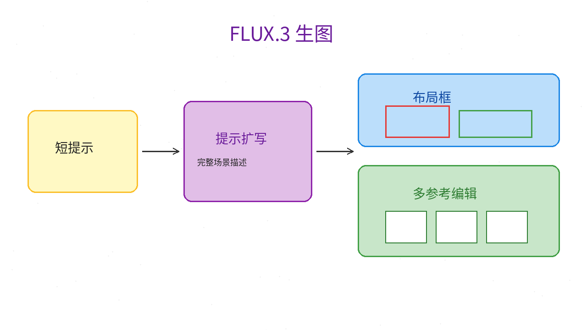
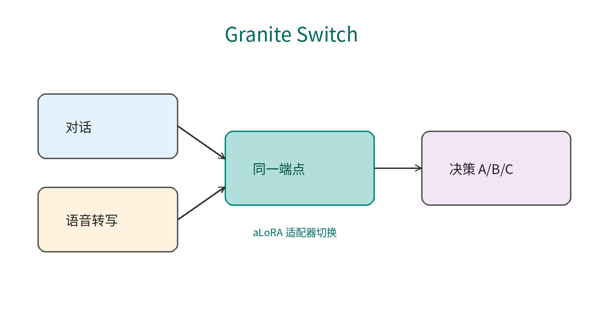
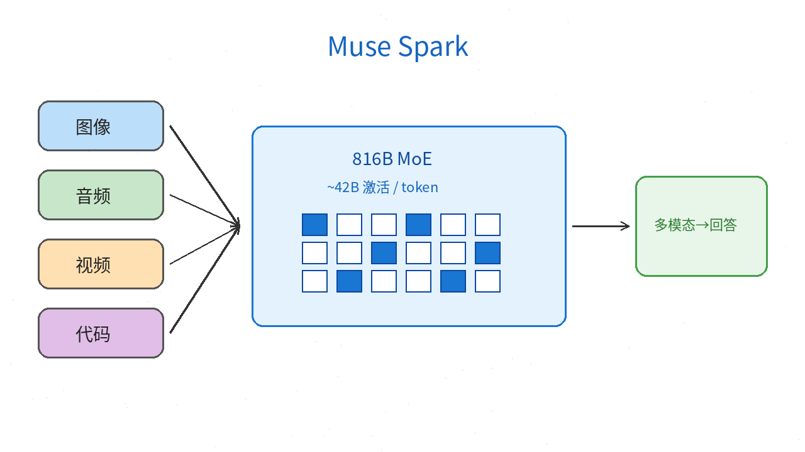
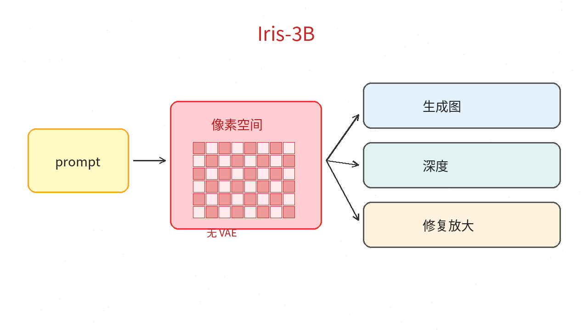

# 2026-10-16 Hugging Face 日报

今日精选 4 个近期可跟进的模型（开源生图 Klein / 一模多能 Switch / 多模态前沿 MoE / 像素空间 Iris）。避开已在日报与周报写过的条目。

## 1. black-forest-labs/flux-3-image-klein — 一文生图 + 多参考编辑 + 提示里写布局框

**介绍**  
约 10/13 放出（FLUX Kommunity License）：5.6B 级图像 transformer（文本编码器另计），同一套权重做 text-to-image、单/多参考编辑；提示里可用 0–1000 网格 bounding box 摆元素。蒸馏版默认约 16 步、无 CFG；另有 base 便于微调。官方强调：**务必先跑提示扩写**（自带 `flux-3-image-klein-pup` 或任意 LLM），短提示直接喂会很糊。Diffusers 有 Modular pipeline；也有参考 CLI。

**用法**  
模型卡：[huggingface.co/black-forest-labs/flux-3-image-klein](https://huggingface.co/black-forest-labs/flux-3-image-klein)；博客：[Welcome FLUX.3 Image Klein in Diffusers](https://huggingface.co/blog/flux-3)；代码：[black-forest-labs/flux-3-image-klein](https://github.com/black-forest-labs/flux-3-image-klein)。  
```bash
pip install git+https://github.com/huggingface/diffusers.git
# Diffusers：先用 pup / 自备 LLM 扩成完整场景描述，再：
```
```python
import torch
from diffusers import ModularPipeline
pipe = ModularPipeline.from_pretrained("black-forest-labs/flux-3-image-klein")
pipe.load_components(dtype=torch.bfloat16)
pipe.to("cuda")
image = pipe(prompt="<完整场景描述>", generator=torch.Generator().manual_seed(0), output="images")[0]
```
参考 CLI 会默认拉 `flux-3-image-klein-pup`；量化有 FP8 / NVFP4 变体。

**应用场景**  
产品图、多参考换装/换景，或要在画面里定点摆物件——需要开源权重自托管。



**推荐学习程度**：进阶

---

## 2. ibm-granite/granite-switch-4.1-8b — 一个端点：对话 + 决策 + Guardian + 语音转写

**介绍**  
10/14 发布（Apache-2.0）：在 Granite 4.1-8B（128K）上用 aLoRA 挂 `decision` 与 `guardian-core`，并嵌入 Granite Speech 5.0 TurboCTC 做英文 ASR；控制 token / `adapter_name` 切换能力，聊天模板自动插入。决策适配器面向「状态 + 选项 → 一次前向的选项分布」；Guardian 出 yes/no JSON。同系列有 30B。可用 Transformers / vLLM；应用侧推荐 Mellea 包一层。

**用法**  
模型卡：[huggingface.co/ibm-granite/granite-switch-4.1-8b](https://huggingface.co/ibm-granite/granite-switch-4.1-8b)；博客：[Granite Switch 4.1](https://huggingface.co/blog/ibm-granite/granite-switch-4-1)；代码：[generative-computing/granite-switch](https://github.com/generative-computing/granite-switch)。  
```bash
git clone https://github.com/generative-computing/granite-switch.git
cd granite-switch && pip install -e ".[vllm]"
python -m vllm.entrypoints.openai.api_server \
  --model ibm-granite/granite-switch-4.1-8b --port 8000
```
请求里用 `extra_body={"chat_template_kwargs": {"adapter_name": "decision"}}`（或 `guardian-core`）；决策读选项 label 的 logprobs / softmax。

**应用场景**  
客服 / Agent 网关想共用一个部署：闲聊、路由决策、安全审核、语音进线转写，不想拆四套服务。



**推荐学习程度**：进阶

---

## 3. meta-models/Muse-Spark-Open-816B-A42B — 开源权重多模态 MoE（约 816B / ~42B 激活）

**介绍**  
模型卡早前上线，HF 博客 10/15 集中介绍：文本 + 图像 + 音频 + 视频进、文本出；宣称面向 agentic coding（读仓、改代码、调工具），上下文可达约 1M。体量极大，适合有集群或云额度的团队；有 NVFP4、GGUF、MLX 等社区量化分支。**仓库为受限访问，需在 HF 上申请/登录后才能下权重。**

**用法**  
模型卡：[huggingface.co/meta-models/Muse-Spark-Open-816B-A42B](https://huggingface.co/meta-models/Muse-Spark-Open-816B-A42B)；介绍：[Welcome Muse Spark Open](https://huggingface.co/blog/meta-muse-spark-open)。按博客用 Transformers / vLLM / SGLang 等路径加载（需已获授权）；消费级机器可先看 `mlx-community` / `unsloth` 等量化卡做本地试读。

**应用场景**  
要一套开源权重同时吃截图、口述与代码上下文做长程 coding / 多模态 Agent，且有对应推理资源与 HF 权限。



**推荐学习程度**：深度

---

## 4. speridlabs/iris-3b — 像素空间直出（无 VAE）：生图，还能深度 / 修复放大

**介绍**  
约 10/5 放出（Apache-2.0，论文 arXiv:2610.09450）：约 3B，flow-matching，**网络直接画像素**，不做 latent。默认可出约 1MP；同骨干微调后做单目深度、修复与超分。另有 4 步蒸馏 Turbo（约 0.7s/张 @H100 量级，见卡内数字）。有 Spaces Demo。

**用法**  
模型卡：[huggingface.co/speridlabs/iris-3b](https://huggingface.co/speridlabs/iris-3b)；代码：[github.com/speridlabs/iris-3b](https://github.com/speridlabs/iris-3b)；Demo：[spaces/speridlabs/iris-3b](https://huggingface.co/spaces/speridlabs/iris-3b)。  
```bash
git clone https://github.com/speridlabs/iris-3b.git && cd iris-3b
pip install -e .   # Python 3.11+, PyTorch 2.7.1+
hf download speridlabs/iris-3b --local-dir iris-3b --exclude "depth/*" "upscaler/*" "turbo/*"
python scripts/sample.py --checkpoint iris-3b \
  --prompt "a red fox sleeping in fresh snow, golden hour"
```
Turbo：`hf download ... --include "turbo/*"` 后对 `iris-3b/turbo` 采样。需 NVIDIA CUDA。

**应用场景**  
研究/产品要避开 VAE 损失的细节，或同一先验上接深度与超分；有算力时也可用 Turbo 做快速出图。



**推荐学习程度**：进阶
