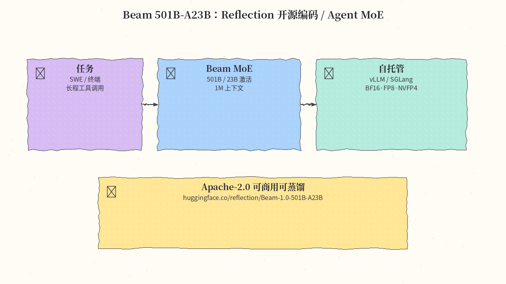
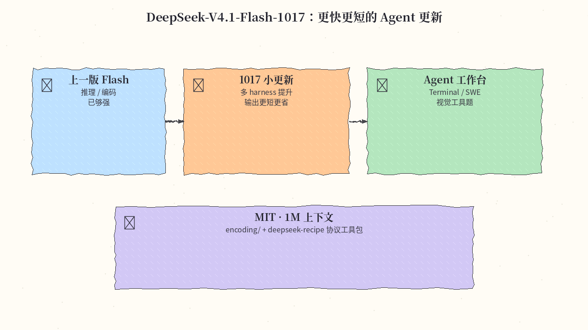
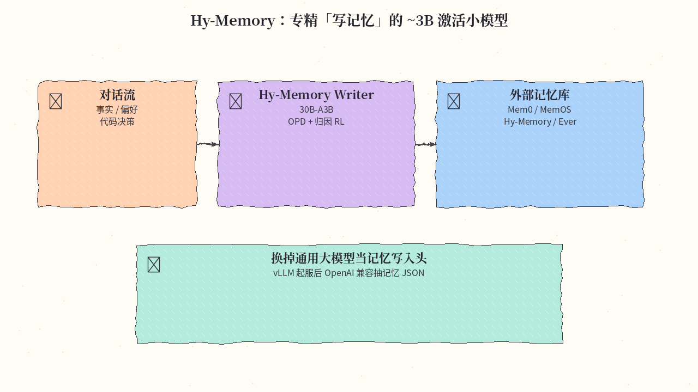
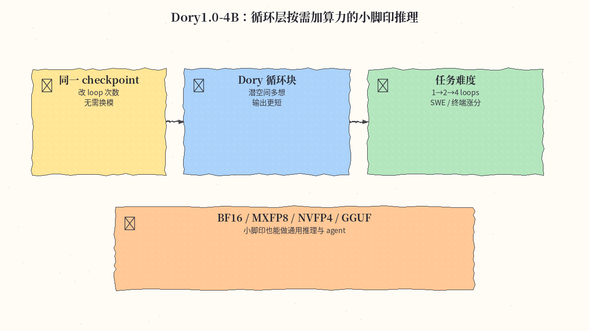
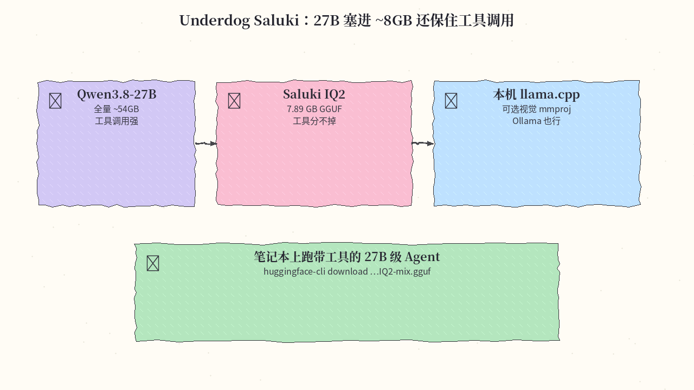

# 2026-10-19 Hugging Face 日报

今日精选 5 个近几天值得立刻试的模型（开源前沿 MoE / Flash 小更新 / 记忆写入头 / 循环小脚印 / 8GB 级工具调用 GGUF）。与往日日报、周报不重复。

## 1. reflection/Beam-1.0-501B-A23B — Reflection 首发开源：501B MoE / 23B 激活

**介绍**  
Reflection 实验室首个开放权重模型（Apache-2.0，卡上 likes~148，约 3 天前更新）：稀疏 MoE 共约 501B、每 token 约 23B 激活，**1M 上下文**，主打编码与 agentic 工具调用；提供 BF16 / FP8 / NVFP4。卡内报告 SWE-bench Verified ~81.6%、Terminal Bench v2.1 ~80.1%（BF16，卡内设定）。配套 transformers / vLLM / SGLang day-0，并有 Rust harness。

**用法**  
模型卡：[huggingface.co/reflection/Beam-1.0-501B-A23B](https://huggingface.co/reflection/Beam-1.0-501B-A23B)；介绍博文：[Welcome Beam](https://huggingface.co/blog/reflection-beam)。按卡内 / Reflection 文档用 vLLM 或 SGLang 拉权重；注意硬件门槛（大 MoE）。

**应用场景**  
要在自有机房跑前沿级 coding / 长程 Agent，且希望可商用、可后训练的开放权重。



**推荐学习程度**：深度

---

## 2. deepseek-ai/DeepSeek-V4.1-Flash-1017 — Flash 小更新：更快、更短、多 harness 抬头

**介绍**  
DeepSeek-V4.1-Flash 的 10/17 小版本（MIT，近月下载 1 万+）：推理 / 编码 / agentic / 视觉题全面抬升，同时缩短输出与任务耗时。卡内对比：Terminal-Bench 4.0 42.3（前版 31.2）、DeepSWE v1.1 77.0（前版 74.2）。自带 `encoding/` 参考实现与 deepseek-recipe（Rust+Python）做协议编码；推荐采样 temp=1.0、top_p=1.0、上下文 1M。

**用法**  
模型卡：[huggingface.co/deepseek-ai/DeepSeek-V4.1-Flash-1017](https://huggingface.co/deepseek-ai/DeepSeek-V4.1-Flash-1017)。按仓库 `inference/` 做权重转换与本地推理；生产侧用 deepseek-recipe 处理 Messages / Chat Completions。

**应用场景**  
已在用 V4.1-Flash 的 Agent / 终端 harness，想用小版本换更短轨迹与更高通过率。



**推荐学习程度**：进阶

---

## 3. tencent/Hy-Memory-30B-A3B — 专精「写长期记忆」的 ~3B 激活模型

**介绍**  
腾讯混元的记忆写入小模型（约 30B / 3B 激活，约 3 天前更新）：在 Mem0、MemOS、Hy-Memory 等外部记忆框架里**只替换 writer**，决定记什么、怎么表述、如何更新库；两阶段训练（Memory OPD + Attributed Memory RL），对未见过的 EverMemOS 也能迁移。固定 20% 子样本上四 harness 宏平均约 55.49，高于同设定下 Claude Opus 5 / DeepSeek V4.1 Flash 作 writer 的分数（见模型卡表 1）。

**用法**  
模型卡：[huggingface.co/tencent/Hy-Memory-30B-A3B](https://huggingface.co/tencent/Hy-Memory-30B-A3B)；框架代码：[Tencent-Hunyuan/Hy-Memory](https://github.com/Tencent-Hunyuan/Hy-Memory)。  
```bash
# vLLM（卡内测过 v0.31.0）起服后：
# --served-model-name hy-memory
# 再用 OpenAI 兼容客户端抽 memories JSON（见卡内 Quickstart）
```

**应用场景**  
自建 Mem0 类记忆管线时，不想用昂贵通用大模型当「写记忆头」，又要写入质量够稳。



**推荐学习程度**：深度

---

## 4. nvidia/NVIDIA-Nemotron-Labs-Dory1.0-4B-BF16 — 循环层按需加算力的 4B

**介绍**  
NVIDIA 10/16 发布的 looped（潜空间循环）小模型（OpenMDW-1.1，约 4B）：同一 checkpoint 改 `n_recurrent_loops`（1/2/4）即可在算力与精度间滑动，无需换模；强调 token 效率与 last-loop KV 缓存。卡内一致 harness：SWE-bench Verified 在 1/2/4 loops 约 50.3 / 59.5 / 61.8。另有 MXFP8 / NVFP4 / GGUF。

**用法**  
模型卡：[huggingface.co/nvidia/NVIDIA-Nemotron-Labs-Dory1.0-4B-BF16](https://huggingface.co/nvidia/NVIDIA-Nemotron-Labs-Dory1.0-4B-BF16)。vLLM 需带 Dory PR（卡内链到 #60149）；示例：  
```bash
vllm serve --model nvidia/NVIDIA-Nemotron-Labs-Dory1.0-4B-BF16 \
  --hf-overrides '{"n_recurrent_loops": 2, "recurrent_kv_cache_mode": "per_loop"}' \
  --max-model-len 262144
```
本机也可按卡内说明用量化 GGUF + llama.cpp。

**应用场景**  
边缘或单卡上要通用推理 / 轻量 agent，并希望按任务临时加「多想几圈」而不换权重。



**推荐学习程度**：进阶

---

## 5. ConwayResearch/Underdog-Saluki-27B-1.0 — ~8GB GGUF，工具调用几乎不掉

**介绍**  
基于 Qwen3.8-27B 的极端压缩 GGUF（Apache-2.0，近月下载 41 万+）：主文件约 **7.89 GB**，Underdog Bench（120 BFCL 任务）通过 88，对比全量 54GB 的 84；并行工具调用 42 vs 35。可选 mmproj 视觉附加。目标就是笔记本 + 原版 llama.cpp / Ollama 跑「带工具的 27B 级」体验。

**用法**  
模型卡：[huggingface.co/ConwayResearch/Underdog-Saluki-27B-1.0](https://huggingface.co/ConwayResearch/Underdog-Saluki-27B-1.0)；说明：[underdog.ai/saluki](https://underdog.ai/saluki)。  
```bash
huggingface-cli download ConwayResearch/Underdog-Saluki-27B-1.0 \
  Underdog-Saluki-27B-1.0-IQ2-mix.gguf --local-dir .
llama-server -m Underdog-Saluki-27B-1.0-IQ2-mix.gguf --jinja -ngl 99 -fa on -c 32768
```

**应用场景**  
本机要跑工具调用 / 轻量 agent，显存或磁盘摆不下全精度 27B，又不愿工具格式先崩。



**推荐学习程度**：入门

---
