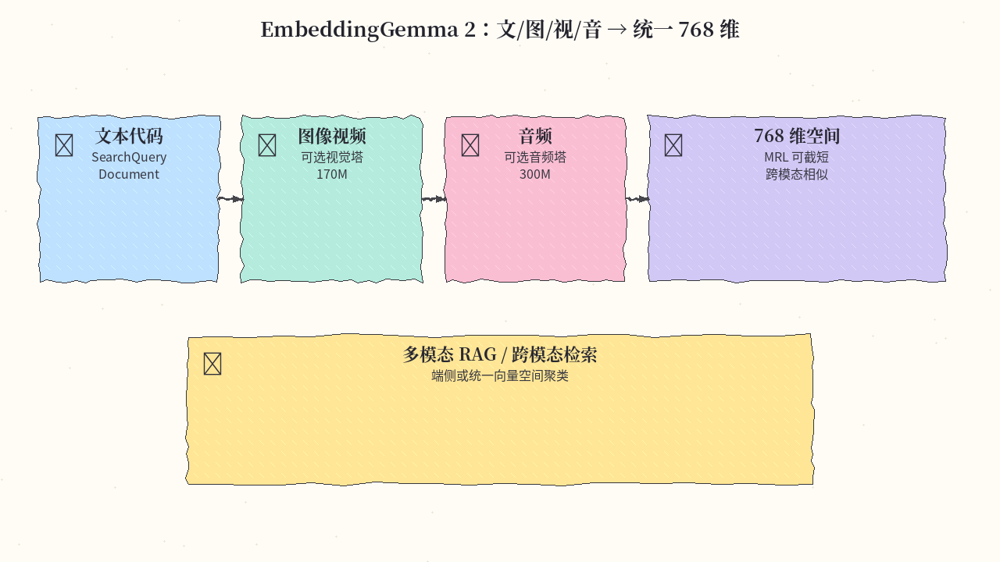
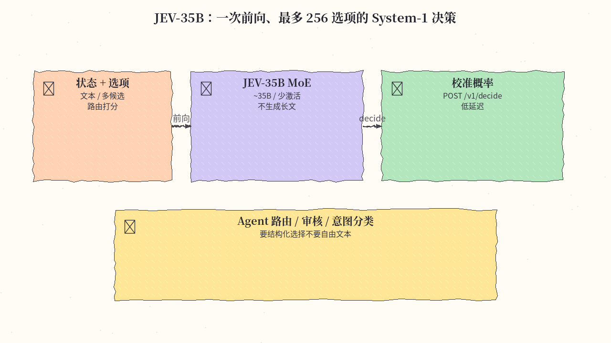
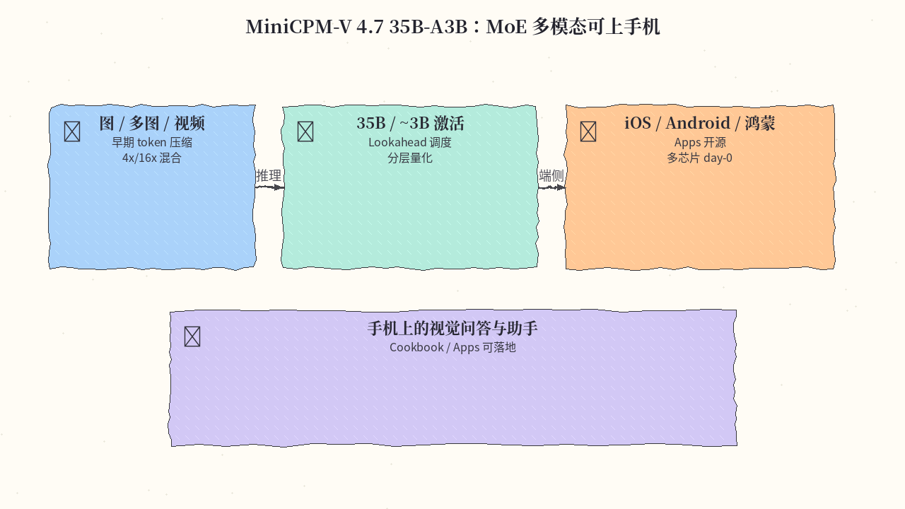
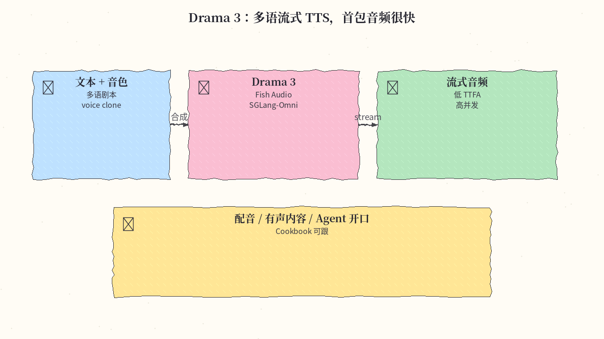
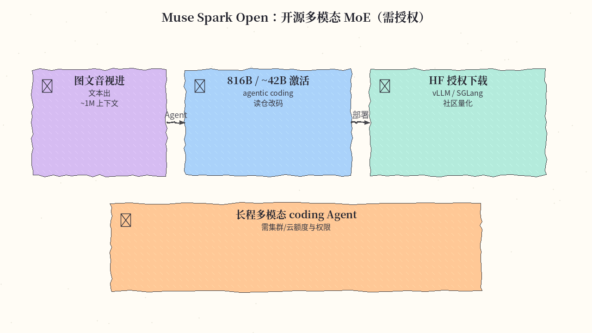
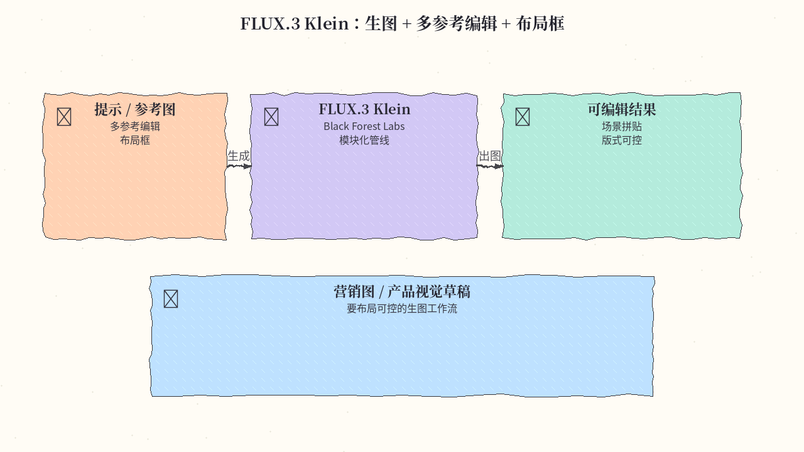
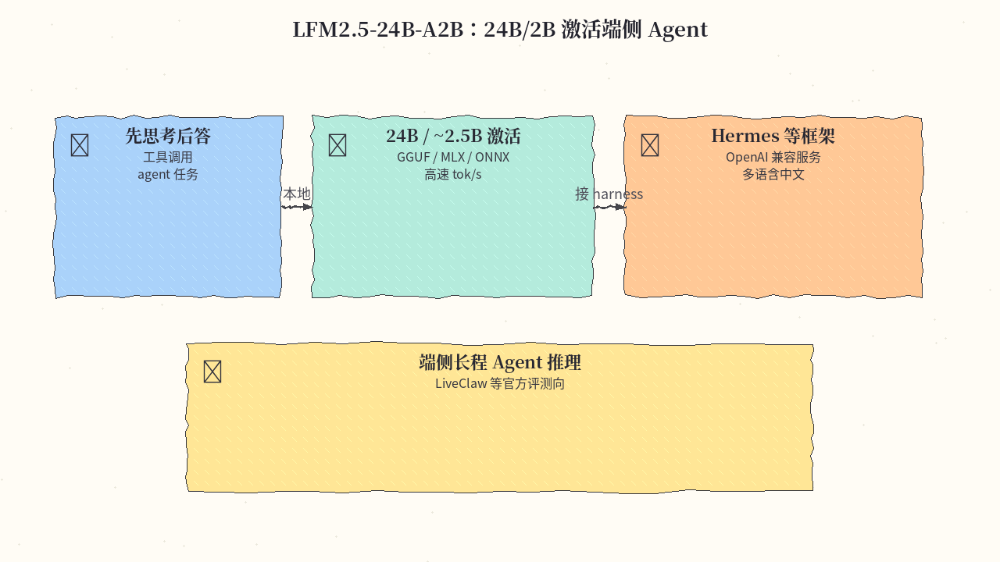
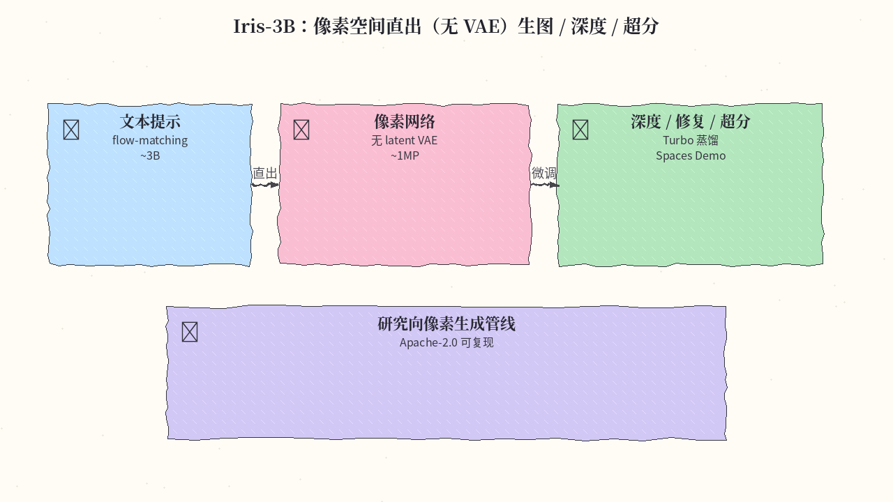
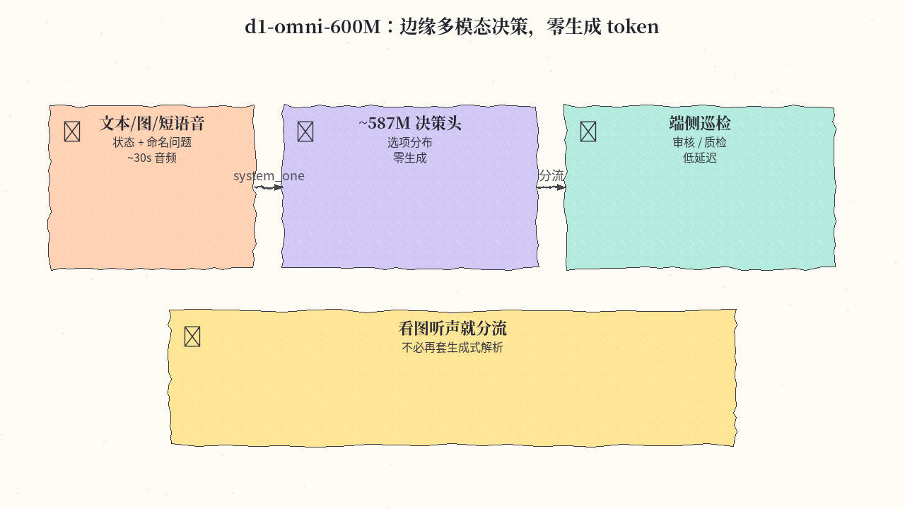
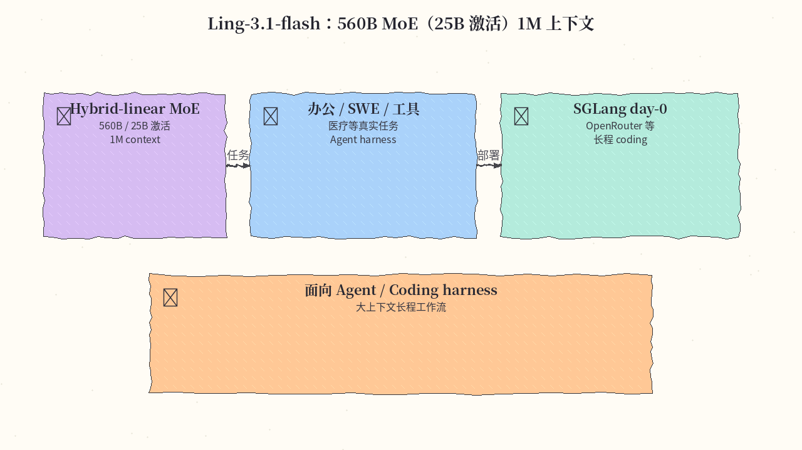

# 2026-10-19 Hugging Face 周报

上周（10/12–10/18）精选 10 个值得立刻试的模型 / 发布（宁缺毋滥：统一嵌入、决策、端侧多模态、TTS、开源 MoE 与像素生图）。

## 1. google/embeddinggemma-2 — 多模态统一 embedding 768 维

**介绍**  
Google DeepMind 开源多模态嵌入（likes~2663）：约 740M（270M 文本骨干 + 可选视觉/音频编码器），文本（含代码）、图像、视频、音频及组合映射到同一 768 维空间；支持 MRL 截到 128/256/512；8K 上下文；100+ 语。Apache-2.0。

**用法**  
模型卡：[huggingface.co/google/embeddinggemma-2](https://huggingface.co/google/embeddinggemma-2)。`pip install -U sentence-transformers transformers` 后用 `SentenceTransformer("google/embeddinggemma-2")`，检索请用卡内 `SearchQuery` / `Document` 等任务前缀；不用的模态可用 `config_kwargs` 关掉以省内存。

**应用场景**  
端侧或多模态 RAG、跨图文音检索、分类/聚类要统一向量空间时。

**推荐学习程度**：进阶

---

## 2. autotrust/JEV-35B — System-1 决策、最多 256 选项一次前向

**介绍**  
非聊天生成向的决策 MoE（likes~2662）：输入状态与类型化选项，一次前向给出校准概率，最多约 256 选项，不吐自由文本。适合当作 agent 路由/审核头。另有 NVFP4 等量化卡。

**用法**  
模型卡：[huggingface.co/autotrust/JEV-35B](https://huggingface.co/autotrust/JEV-35B)。按卡内 `serve.sh` / 决策 API 部署；保持决策头与校准温度设定，勿当普通 `generate` 聊天接口滥用。

**应用场景**  
Agent 路由、意图分类、审核分流——要结构化选择与置信度，不要长文生成。

**推荐学习程度**：深度

---

## 3. openbmb/MiniCPM-V-4.7-35B-A3B — MoE 多模态可上手机

**介绍**  
面壁 MiniCPM-V 4.7（likes~1009）：35B 总参、约 3B 激活的 MoE，单图/多图/视频理解；ViT 内早期视觉 token 压缩（4x/16x 混合），配合 Lookahead Expert Scheduling 与分层量化，官方称高端手机可跑。支持 iOS / Android / 鸿蒙及多芯片 day-0。Apache-2.0。

**用法**  
模型卡：[huggingface.co/openbmb/MiniCPM-V-4.7-35B-A3B](https://huggingface.co/openbmb/MiniCPM-V-4.7-35B-A3B)。`transformers` 加载 `AutoProcessor` + `AutoModelForImageTextToText`；端侧 App：[MiniCPM-V-Apps](https://github.com/OpenBMB/MiniCPM-V-Apps)；微调/量化见 Cookbook。

**应用场景**  
手机/边缘设备上的视觉问答与多模态助手，要 MoE 效率而不是纯稠密大模型。

**推荐学习程度**：进阶

---

## 4. fishaudio/drama-3 — 多语流式 TTS

**介绍**  
Fish Audio 的 Drama 3（likes~697）：多语种流式语音合成，强调低首包延迟与高并发；可参考音色 / clone。适合配音、有声内容与「Agent 开口」。

**用法**  
模型卡：[huggingface.co/fishaudio/drama-3](https://huggingface.co/fishaudio/drama-3)；Cookbook：[sglang-omni fishaudio_drama3](https://sgl-project.github.io/sglang-omni/cookbook/fishaudio_drama3.html)。按卡与 Cookbook 用 SGLang-Omni / 官方推理路径拉起流式服务。

**应用场景**  
多语配音流水线、产品有声说明、需要 Agent 边说边生成的交互。

**推荐学习程度**：进阶

---

## 5. meta-models/Muse-Spark-Open-816B-A42B — 开源多模态 MoE（需授权）

**介绍**  
开源权重多模态 MoE（likes~548）：约 816B / ~42B 激活；文本 + 图像 + 音频 + 视频进、文本出；宣称面向 agentic coding，上下文可达约 1M。**仓库为受限访问，需在 HF 申请/登录后才能下权重。**

**用法**  
模型卡：[huggingface.co/meta-models/Muse-Spark-Open-816B-A42B](https://huggingface.co/meta-models/Muse-Spark-Open-816B-A42B)；介绍：[Welcome Muse Spark Open](https://huggingface.co/blog/meta-muse-spark-open)。获授权后按博客用 Transformers / vLLM / SGLang 等加载；消费级机器可先看社区量化分支试读。

**应用场景**  
要一套开源权重同时吃截图、口述与代码上下文做长程 coding / 多模态 Agent，且有对应推理资源与 HF 权限。

**推荐学习程度**：深度

---

## 6. black-forest-labs/flux-3-image-klein — 生图 + 多参考编辑 + 布局框

**介绍**  
Black Forest Labs FLUX.3 家族中的 Klein 路线（likes~489）：生图之外强调多参考编辑与布局框控制，适合要「版式可控」的视觉草稿工作流。详见官方 FLUX.3 博文。

**用法**  
模型卡：[huggingface.co/black-forest-labs/flux-3-image-klein](https://huggingface.co/black-forest-labs/flux-3-image-klein)；博文：[FLUX.3](https://huggingface.co/blog/flux-3)。按卡与博客用 Diffusers / 官方管线加载；结合参考图与布局框做编辑生成。

**应用场景**  
营销图、产品视觉草稿、需要多参考与框选布局的可控生图。

**推荐学习程度**：进阶

---

## 7. LiquidAI/LFM2.5-24B-A2B — 24B/2B 激活端侧 Agent

**介绍**  
LFM2.5 家族大款（likes~471）：24B 总参 / 约 2.45B 激活，纯文本、先思考后回答，主打工具调用与 agent 任务；有 GGUF / MLX / ONNX / FP8 等变体。多语言含中文。许可为 LFM Open License v1.0（商用前请看条款）。

**用法**  
模型卡：[huggingface.co/LiquidAI/LFM2.5-24B-A2B](https://huggingface.co/LiquidAI/LFM2.5-24B-A2B)。Transformers ≥ 5.0：`AutoModelForCausalLM.from_pretrained(...)`；本地用 GGUF 配 llama.cpp / LM Studio，或 Mac 上用 MLX；起 OpenAI 兼容服务后接 Hermes 等 harness。

**应用场景**  
端侧/本机长程 Agent 推理，要 MoE 效率与工具调用，而不是云端超大稠密模型。

**推荐学习程度**：进阶

---

## 8. speridlabs/iris-3b — 像素空间直出无 VAE

**介绍**  
约 3B flow-matching 模型（likes~312，Apache-2.0）：**网络直接画像素**，不做 latent VAE；默认可出约 1MP；同骨干可微调做单目深度、修复与超分；另有蒸馏 Turbo。有 Spaces Demo。

**用法**  
模型卡：[huggingface.co/speridlabs/iris-3b](https://huggingface.co/speridlabs/iris-3b)；代码：[github.com/speridlabs/iris-3b](https://github.com/speridlabs/iris-3b)。`git clone` → `pip install -e .` → `hf download` 权重后 `python scripts/sample.py --checkpoint … --prompt "…"`。

**应用场景**  
研究/实验像素空间生成管线，或同骨干做深度/修复/超分对照。

**推荐学习程度**：深度

---

## 9. LiquidAI/d1-omni-600M — 边缘多模态决策零生成

**介绍**  
Liquid d1 族实验款（likes~137，约 587M）：状态可含文本/JSON、多图或最长约 30 s 语音，对命名问题一次前向读选项分布，**零生成 token**。LFM1.0 许可。

**用法**  
模型卡：[huggingface.co/LiquidAI/d1-omni-600M](https://huggingface.co/LiquidAI/d1-omni-600M)。`pip install "transformers>=5.15" torch torchvision pillow soundfile`，`AutoModel.from_pretrained(..., trust_remote_code=True)` 后调用 `model.system_one(state, questions, images=…, audio=…)`。

**应用场景**  
端侧/边缘要「看图或听短语音就做分流/审核/巡检」，又不想再套一层生成式 LLM 解析答案。

**推荐学习程度**：进阶

---

## 10. inclusionAI/Ling-3.1-flash — 560B MoE 25B 激活 1M 上下文

**介绍**  
Ling-3.1-flash（likes~121）：约 560B 总参 / 25B 激活的 Hybrid-linear MoE，宣称约 1M 上下文，面向 Agent / coding harness 与真实任务（办公、SWE、工具调用等）。适合有对应推理资源的团队。

**用法**  
模型卡：[huggingface.co/inclusionAI/Ling-3.1-flash](https://huggingface.co/inclusionAI/Ling-3.1-flash)。按卡用 SGLang 等 day-0 路径或平台托管端点加载；先用小上下文冒烟，再拉长上下文与工具调用对照。

**应用场景**  
需要超长上下文的 Agent / Coding harness，且能承担 MoE 大模型推理成本。

**推荐学习程度**：深度
